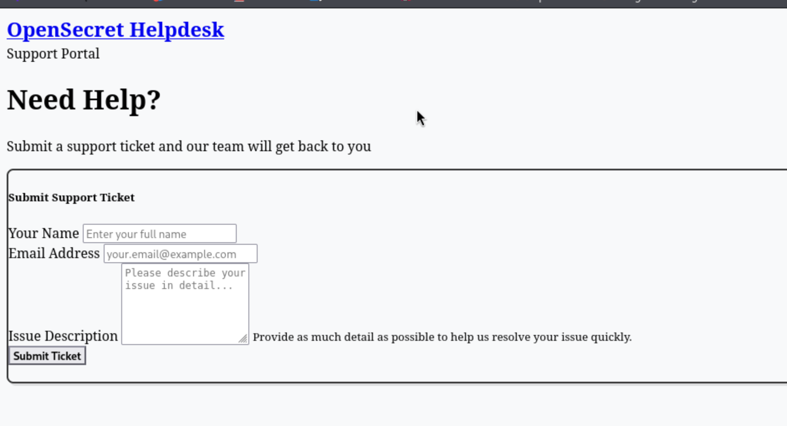
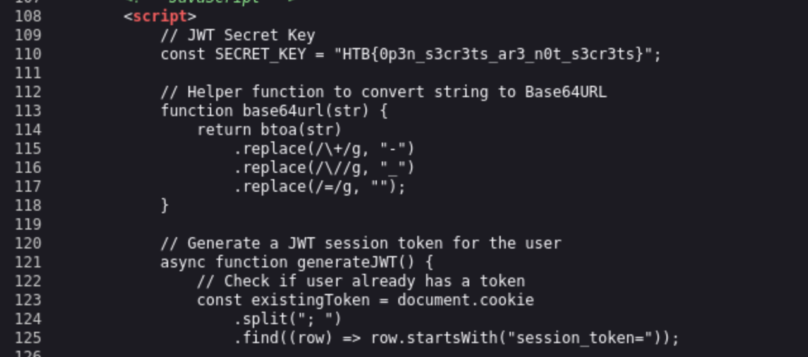
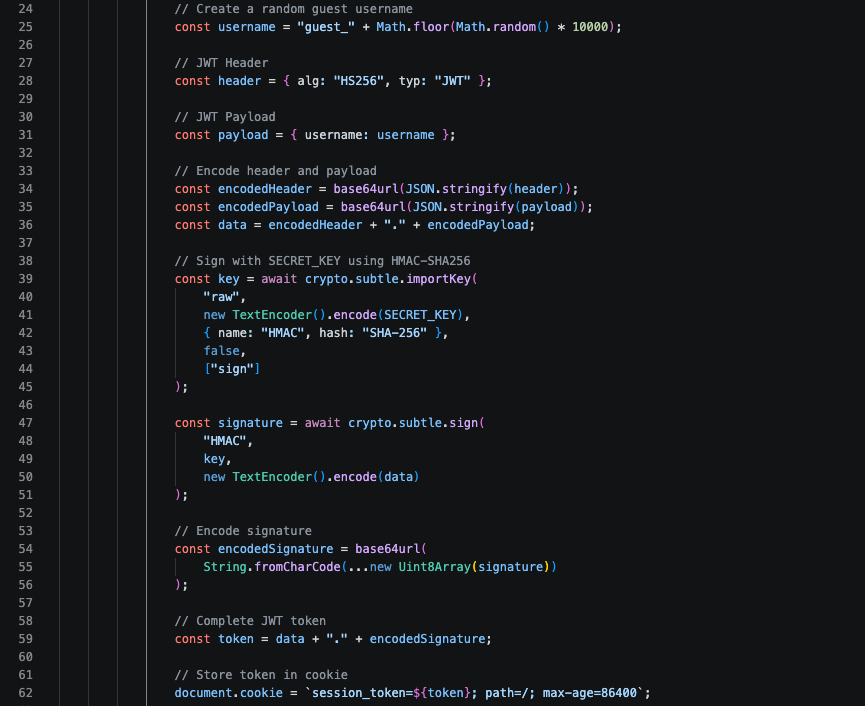
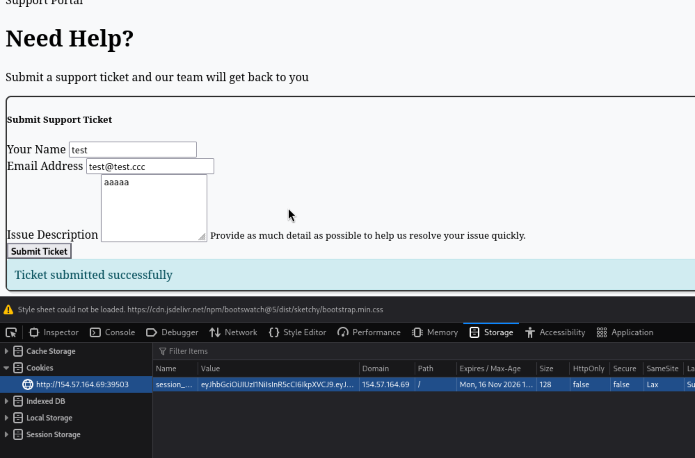
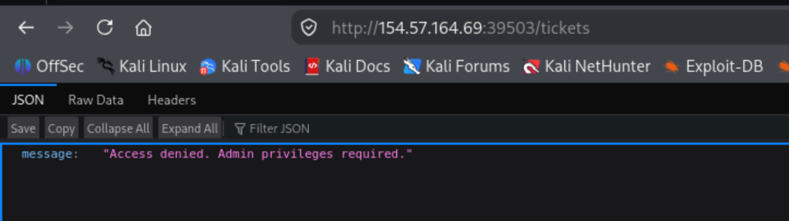

## Challenge Scenario
Một cổng thông tin hỗ trợ đơn giản, nơi người dùng có thể gửi các support ticket. Ứng dụng sử dụng JWT token để quản lý phiên làm việc nhưng cách triển khai dường như có vấn đề. Liệu chúng ta có thể tìm ra lỗ hổng bảo mật đó không?
## Writeup
Chúng ta được giao cho một trang web support ticket

Dựa theo gợi ý thì chúng ta sẽ xem thử jwt có điều gì đáng ngờ

JWT có vẻ được xử lý bằng js nên copy sang một chỗ khác dễ đọc hơn. Đập vào mắt sẽ thấy luôn SECRET_KEY nhưng nó dùng để làm gì?


Dựa theo đoạn code thì SECRET_KEY này sẽ được dùng để kí các jwt token của username guest_xxxx.

Chúng ta sử dụng python để tạo một token hợp lệ và kiểm tra
```python
import jwt

token_guest = jwt.encode({"username": "guest_1234"}, "HTB{0p3n_s3cr3ts_ar3_n0t_s3cr3ts}", algorithm="HS256")

print(token_guest)
```

### Tìm url của admin
Đoán thử đường dẫn sẽ là /admin hay /tickets gì đó thì vô tình tìm được

Nhưng khi forge token bằng username Admin thì lại không được. Sau một hồi "quằng" để cố gắng forge admin thì tôi đã đi tìm sự trợ giúp, nhận ra chúng ta đã có flag ngay từ khi ctrl + u !!!
