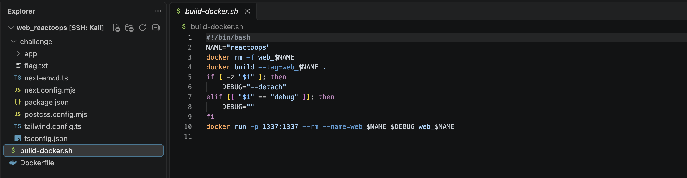
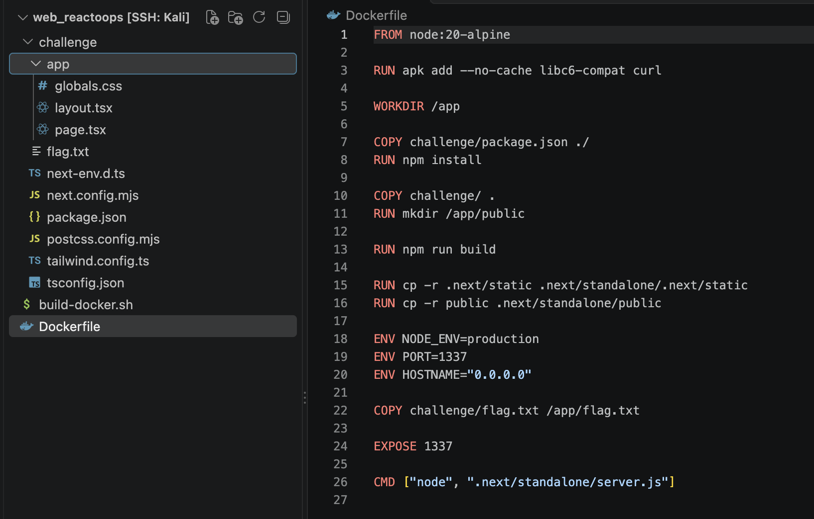
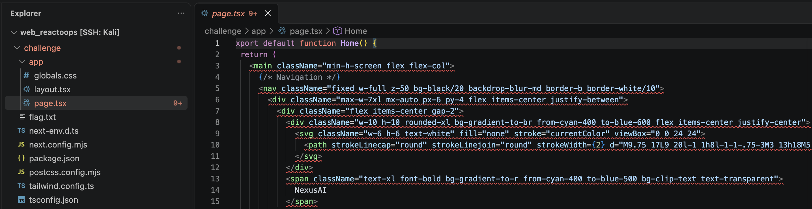
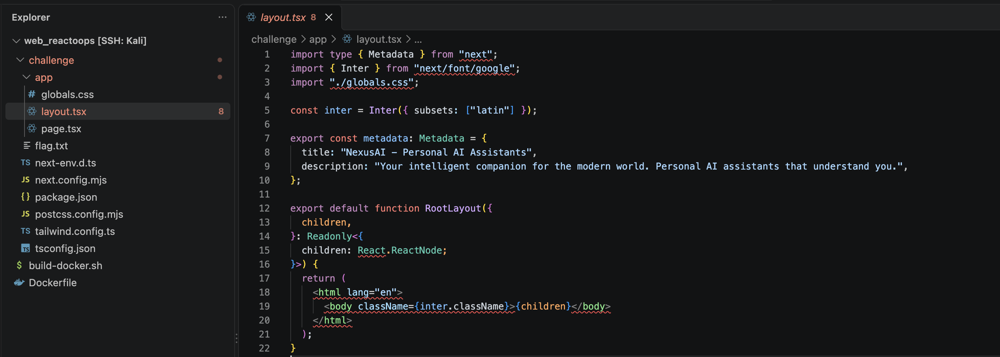
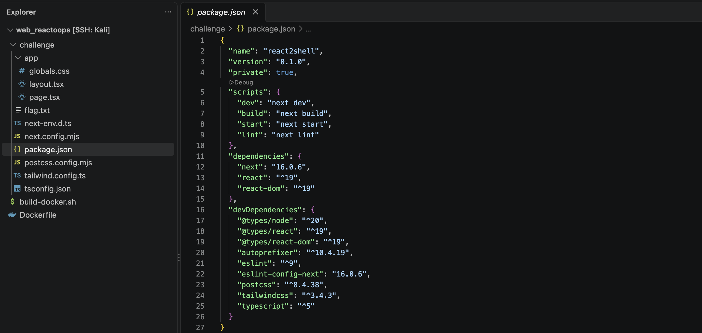
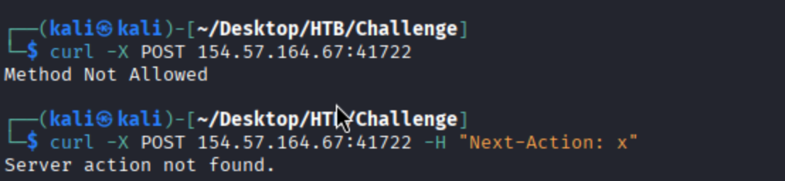
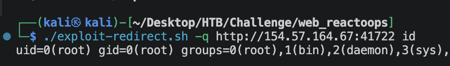

## Challenge Scenario
Giao diện trợ lý tinh tế của NexusAI hứa hẹn khả năng học hỏi thích ứng cùng trải nghiệm tương tác mượt mà. Tuy nhiên, ẩn sau lớp giao diện phản hồi đó là những lỗi nhỏ tinh vi, cho thấy dữ liệu đầu vào từ người dùng có thể đang định hình hệ thống theo những cách không ngờ tới. Hãy khám phá nền tảng này, lần theo các dấu vết trong lớp phản hồi, và vạch trần khiếm khuyết đang ẩn giấu phía sau giao diện người dùng.
## Writeup
Lúc này chúng ta lại được cung cấp một source code. Tìm hiểu qua các file
### build-docker.sh

### Dockerfile

`flag.txt` được đặt ở `/app/flag.txt` — **không nằm trong `public/`**, nghĩa là không có route tĩnh nào tự động serve nó ra ngoài. Muốn đọc được file này, phải có 1 đoạn code nào đó trong app **chủ động đọc file theo đường dẫn**, và đường dẫn đó có khả năng bị user thao túng (path traversal / LFI kiểu Node.js — ví dụ `fs.readFileSync(path.join(basePath, userInput))`)
### app/page.tsx

Đây chỉ là file tĩnh không thấy logic xử lý gì có vẻ không đúng file chúng ta cần tìm
### app/layout.tsx

Cũng không có logic xử lý gì...
### package.json

Hình như tìm thấy được một gợi ý `react2shell` . Sau khi tìm hiểu thì lỗi này bắt nguồn từ chính framework đó cũng giải thích là vì sao chúng ta không tìm thấy được logic xử lý nào bên trong source code. 
## Kiến thức nền tảng
### Next.js Server Actions là gì?
Next.js (App Router) cho phép viết hàm chạy **trên server** nhưng gọi được **từ client** như gọi hàm JS bình thường gọi là **Server Action**. Ví dụ code thường thấy:
```tsx
async function submitForm(formData: FormData) {
  "use server";   // đánh dấu đây là Server Action
  await db.save(formData);
}
```
Khi client gọi hàm này (ví dụ submit 1 form), browser **không** gọi JS function trực tiếp mà nó gửi 1 **HTTP POST request** tới chính URL của trang, kèm theo header đặc biệt **`Next-Action: <id-của-action>`**. Server nhận request này, thấy header đó, biết đây không phải request trang thường mà là **lời gọi Server Action**, nên xử lý khác đi bằng cách deserialize body thành tham số, gọi đúng hàm, trả kết quả.

→  Cơ chế xử lý `Next-Action` nằm ở tầng framework, server vẫn sẽ cố deserialize bất kỳ request nào có header này, bất kể trang có thật sự định nghĩa Server Action hay không.
### Kiểm tra giả thuyết
```bash
curl -X POST 154.57.164.67:41722
curl -X POST 154.57.164.67:41722 -H "Next-Action: x"
```


Điều này có nghĩa là server đã xử lý Next-Action nhưng do không tìm thấy định nghĩa `x` nào nên trả phản hồi not found. Sau tìm hiểu cách khai thác thì tôi tìm được script PoC tại https://github.com/freeqaz/react2shell/blob/master/exploit-redirect.sh
```bash
chmod +x exploit-redirect.sh
./exploit-redirect.sh -q http://154.57.164.67:41722 "cat /app/flag.txt"
```

và chúng ta sẽ tìm được flag tại /app/flag.txt như file Dockerfile đã đề cập
