## Sherlock Scenario
You have been presented with the opportunity to work as a junior DFIR consultant for a big consultancy. However, they have provided a technical assessment for you to complete. The consultancy Forela-Security would like to gauge your knowledge of Windows Event Log Analysis. Please analyse and report back on the questions they have asked.
## Task 1
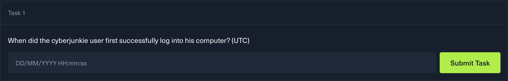

Chúng ta sẽ được cung cấp một file nén
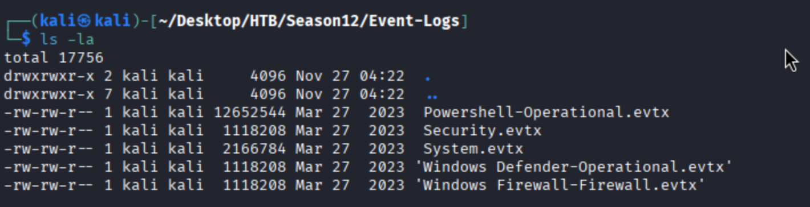

Trong đó, 5 file event log:
- **Security.evtx** — login/logoff, account changes, audit events
- **System.evtx** — service install, system changes
- **Powershell-Operational.evtx** — PowerShell commands executed
- **Windows Defender-Operational.evtx** — malware detection, exclusions
- **Windows Firewall-Firewall.evtx** — firewall rule changes

Chúng ta sẽ chuyển đổi thành xml để dễ đọc
```bash
pip install python-evtx
python3 -c "
import Evtx.Evtx as evtx
import Evtx.Views as e_views
import sys, glob

for f in glob.glob('*.evtx'):
    out = f.replace('.evtx', '.xml')
    with evtx.Evtx(f) as log, open(out, 'w') as o:
        o.write(e_views.XML_HEADER)
        for record in log.records():
            o.write(record.xml())
    print(f'{f} -> {out}')
"
```
Giờ chúng ta sẽ grep các file để tìm kết quả Event ID **4624** (successful logon) cho user `cyberjunkie`
```bash
grep -A 20 "EventID.*4624" Security.xml | grep -B 10 -A 10 -i "cyberjunkie" | head -50
```
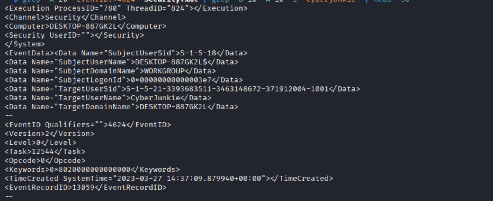

 Phải đổi format một chút 2023-03-27 14:37:09.879940 -> 27/03/2023 14:37:09
## Task 2
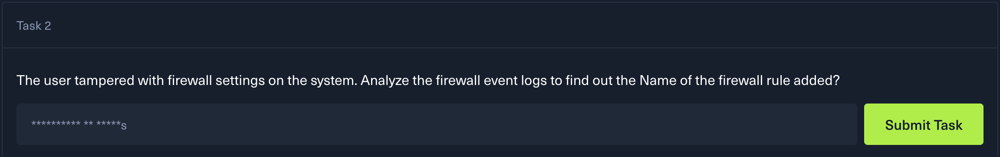

Chúng ta sẽ tìm trong Windows Firewall log — Event ID **2004** (rule added):
```bash
grep -B 2 -A 30 "2004" "Windows Firewall-Firewall.xml" | grep -i "RuleName"
```
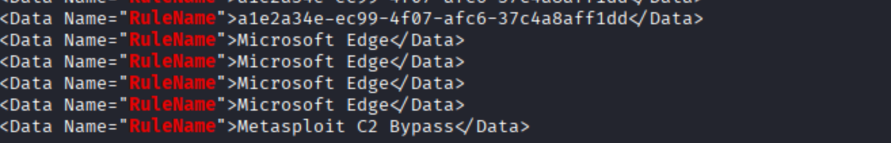

>Metasploit C2 Bypass
## Task 3
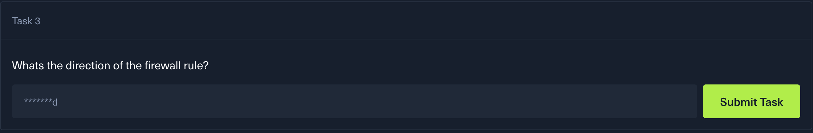

Xem thêm chi tiết rule này
```bash
grep -B 5 -A 30 "Metasploit C2 Bypass" "Windows Firewall-Firewall.xml"
```
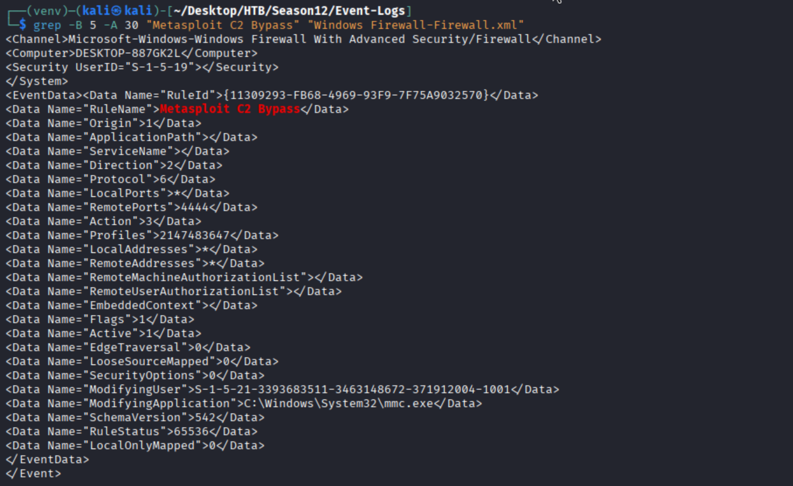

Tìm dòng `<Data Name="Direction">` — giá trị sẽ là `1` (Inbound) hoặc `2` (Outbound).
> Outbound
## Task 4
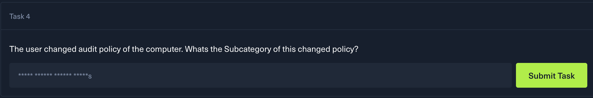

Tìm trong Security.evtx — Event ID **4719** (audit policy change):
```bash
grep -B 5 -A 30 "4719" Security.xml | grep -i "SubcategoryGuid\|Subcategory\|TimeCreated"
```
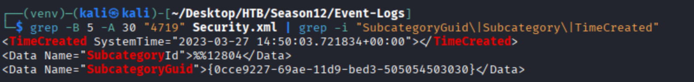
SubcategoryId `%%12804` và GUID `{0cce9227-69ae-11d9-bed3-505054503030}` = **Logon**
> Other Object Access Events
## Task 5
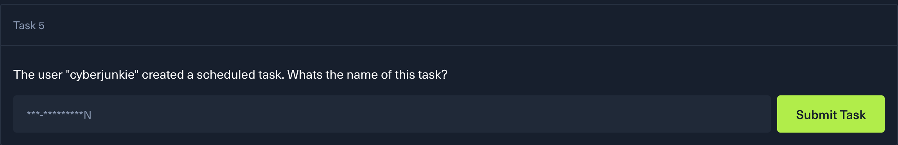

Tìm trong Security.evtx — Event ID **4698** (scheduled task created):
```bash
grep -B 5 -A 30 "4698" Security.xml 
```
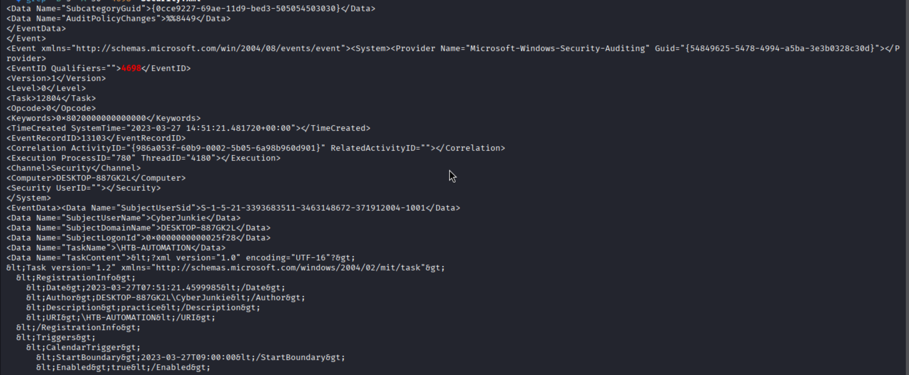

> HTB-AUTOMATION
## Task 6
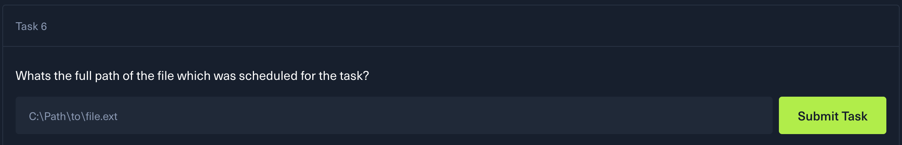

Tuy nhiên đoạn trên bị cắt mất 
```bash
grep -A 80 "4698" Security.xml | grep -i "Command\|Arguments\|Actions"
```
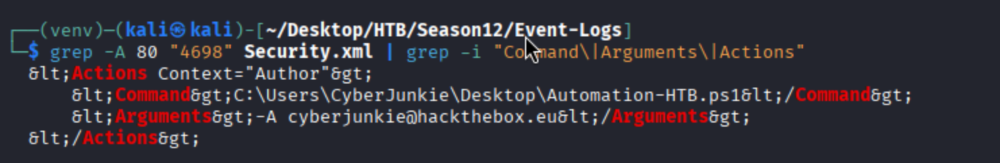

> C:\Users\CyberJunkie\Desktop\Automation-HTB.ps1
## Task 7
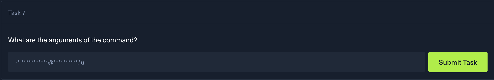

> -A cyberjunkie@hackthebox.eu
## Task 8
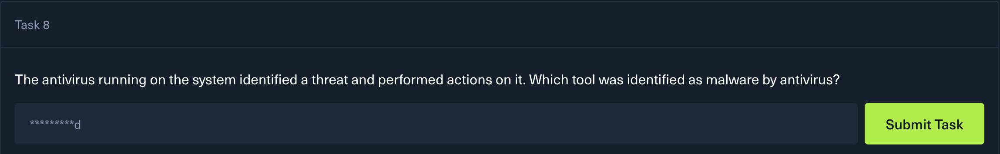

Tìm trong Windows Defender log:
```bash
grep -i "ThreatName\|threat\|malware" "Windows Defender-Operational.xml" | head -20
```
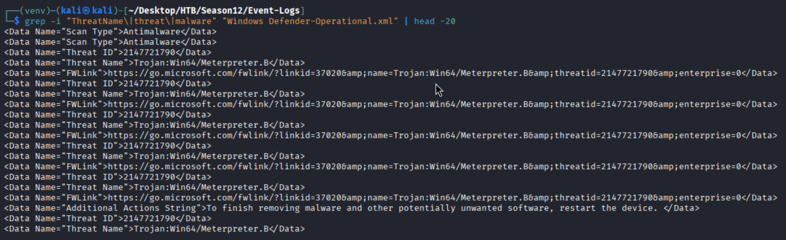
Nhưng đáp án lại không đúng, chắc chúng ta đã bỏ qua một chỗ nào đó, xem thêm chi tiết path/resource
```bash
grep -B 5 -A 50 "1116" "Windows Defender-Operational.xml" | grep -i "Path\|Resource\|Threat Name\|Category"
```
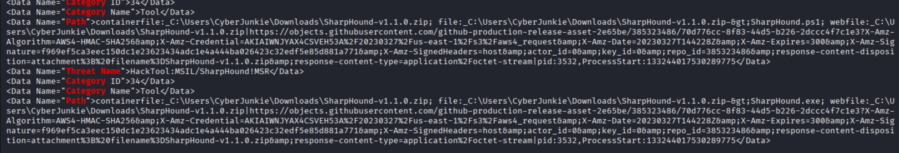

Phát hiện thêm một công cụ recon Domin
>SharpHound
## Task 9
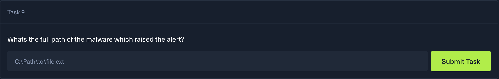

Từ kết quả câu trên chúng ta có
>C:\Users\CyberJunkie\Downloads\SharpHound-v1.1.0.zip
## Task 10
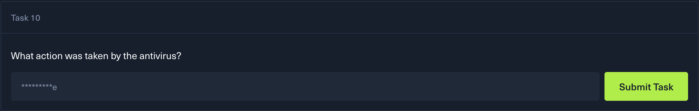

Tìm trong event 1117 (action taken):
```bash
grep -B 5 -A 30 "1117" "Windows Defender-Operational.xml" | grep -i "Action Name\|Action"
```
Thường sẽ là **Quarantine** — Defender mặc định quarantine malware detected.
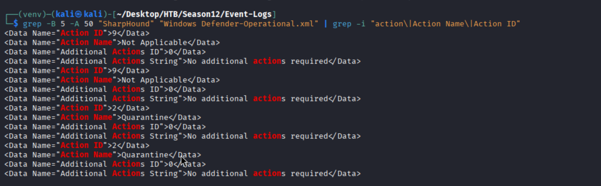

>Quarantine
## Task 11
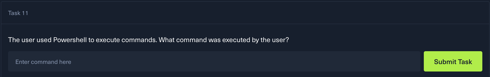

Tìm command nào có **ParameterBinding** kèm input từ user (file path, argument cụ thể)
```bash
grep "ParameterBinding" Powershell-Operational.xml | grep -v "default\|Mandatory" | sort -u
```
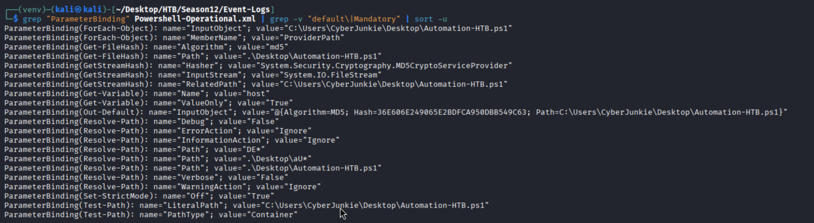

> Get-FileHash -Algorithm md5 .\Desktop\Automation-HTB.ps1
## Task 12
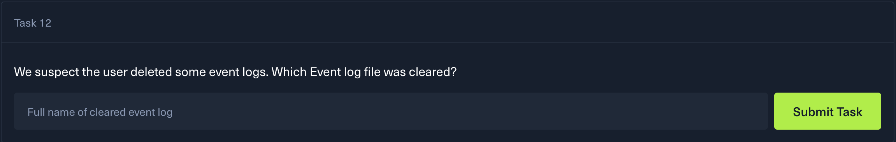

Tìm Event ID **104** (System log cleared) trong System.xml:
```bash
grep -B 2 -A 10 "LogFileCleared" System.xml | grep -i "SubjectUserName\|Channel"
```
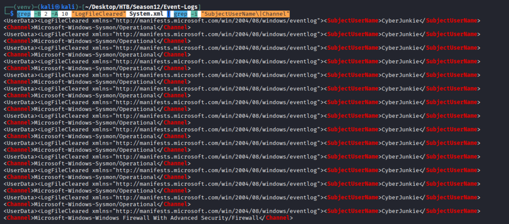

> Microsoft-Windows-Windows Firewall With Advanced Security/Firewall