## Sherlock Scenario
In this Sherlock, you will familiarize yourself with Sysmon logs and various useful EventIDs for identifying and analyzing malicious activities on a Windows system. Palo Alto's Unit42 recently conducted research on an UltraVNC campaign, wherein attackers utilized a backdoored version of UltraVNC to maintain access to systems. This lab is inspired by that campaign and guides participants through the initial access stage of the campaign.

To answer the questions in this lab, you will only need the Event Viewer, with VirusTotal as an optional supplement. Below are some important Sysmon Event IDs that can be utilized in your analysis:
- Event ID 1: Process Creation/Execution. Includes process path, parent process path, and command-line arguments.
- Event ID 2: File Creation Time Changed. Includes the file making the change, the file to which the change is being made, tampered timestamp, and original timestamp.
- Event ID 3: Network Connection. Includes the process making the connection, destination IP Address, and port.
- Event ID 5: Process Termination. Includes the name of the process that was killed or terminated itself.
- Event ID 11: File Created. Includes the process creating the file, the file being created, and its full path.
- Event ID 22: DNS Query. Includes the process querying the domain, the target domain name, and the IP Addresses they resolve to.
## Task 1
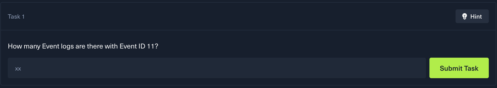

Ban đầu chúng ta cũng cần convert một chút
```bash
python3 -c "
import Evtx.Evtx as evtx
import Evtx.Views as e_views
with evtx.Evtx('Microsoft-Windows-Sysmon-Operational.evtx') as log, open('Sysmon.xml','w') as o:
    for record in log.records():
        o.write(record.xml())
print('Done')
"
```
Tiến hành đếm
```bash
grep -c ">11</EventID>" Sysmon.xml
```

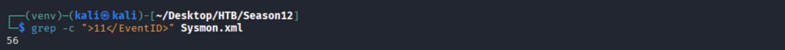

> 56
## Task 2
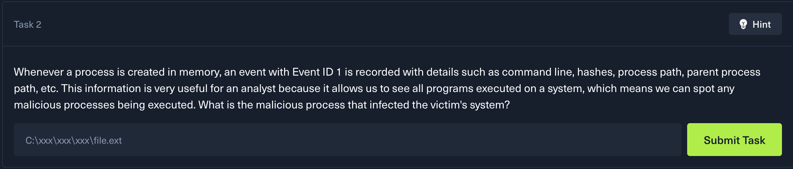

Chúng ta sẽ lọc EventID kèm theo các trường khác để filter
```bash
grep -A 20 '>1</EventID>' Sysmon.xml | grep -i "Image\|CommandLine\|ParentImage" | sort -u
```
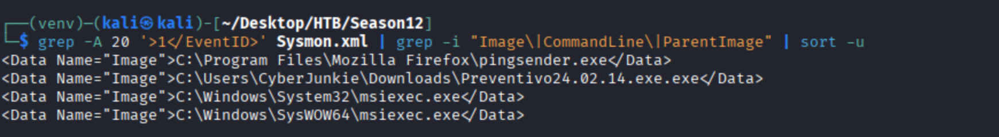

> C:\Users\CyberJunkie\Downloads\Preventivo24.02.14.exe.exe
## Task 3
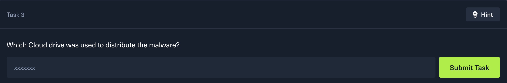

Tìm trong DNS queries và File Created để tìm xem sau khi query domain thì malware có được download về không:
```bash
echo "=== DNS Queries (ID 22) ==="
grep -B 5 -A 20 'EventID Qualifiers="">22<' Sysmon.xml | grep "TimeCreated\|QueryName"

echo "=== File Created (ID 11) ==="
grep -B 5 -A 20 'EventID Qualifiers="">11<' Sysmon.xml | grep "TimeCreated\|TargetFilename" | head -30
```
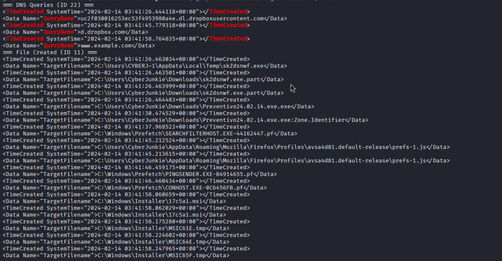

Chúng ta thấy malware được download ngay sau khi query domain dropbox
> dropbox
## Task 4
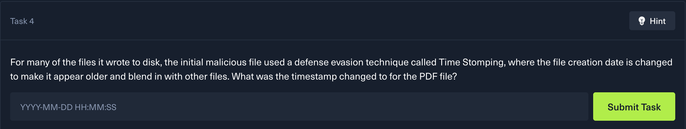

Tìm Event ID 2 (File Creation Time Changed) liên quan đến file PDF:
```bash
grep -B 5 -A 20 'EventID Qualifiers="">2<' Sysmon.xml | grep -i -B 5 -A 5 "\.pdf"
```

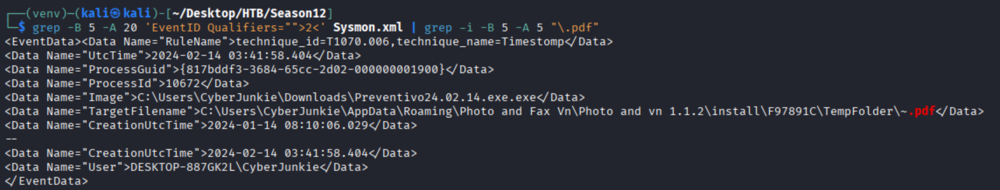

Tìm thấy
- **File**: `~.pdf`
- **Process thực hiện timestomp**: `Preventivo24.02.14.exe.exe` (malicious binary)
- **RuleName**: `T1070.006 - Timestomp` (MITRE ATT&CK)
- **Timestamp bị đổi thành**: **`2024-01-14 08:10:06.029`**
- **Timestamp thực tế**: `2024-02-14 03:41:58.404`
## Task 5
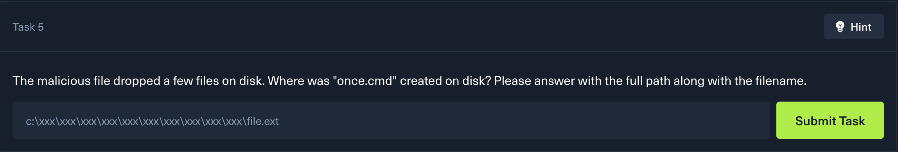

Chúng ta tìm thử
```bash
grep -B 2 -A 10 'once.cmd' Sysmon.xml
```
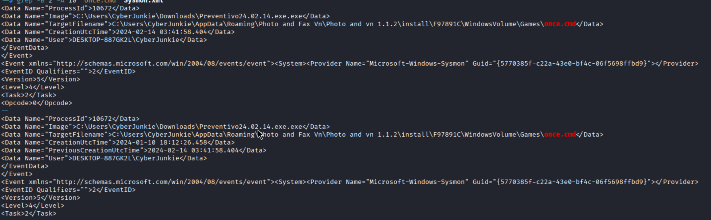

> C:\Users\CyberJunkie\AppData\Roaming\Photo and Fax Vn\Photo and vn 1.1.2\install\F97891C\WindowsVolume\Games\once.cmd
## Task 6
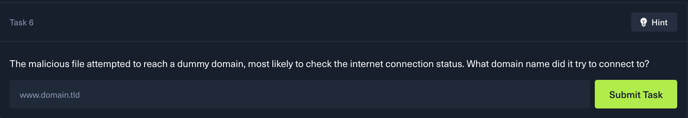

Tìm Event ID 22 (DNS Query) từ process `Preventivo24.02.14.exe.exe` 
```bash
grep -B 5 -A 10 'Preventivo24' Sysmon.xml | grep -i 'QueryName'
```

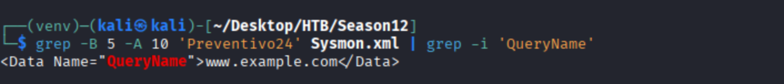

> www.example.com
## Task 7
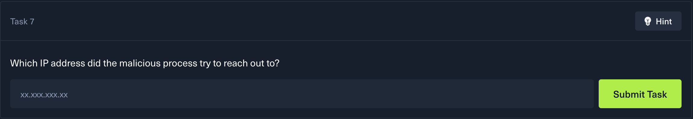

Cùng từ Event ID 22 (DNS Query) hoặc Event ID 3 (Network Connection) của `Preventivo24.02.14.exe.exe`. Chạy:
```bash
grep -B 5 -A 15 'Preventivo24' Sysmon.xml | grep -i 'DestinationIp\|QueryResult'
```
`QueryResult` trong Event ID 22 sẽ cho IP mà `www.example.com` resolve tới, hoặc `DestinationIp` trong Event ID 3 sẽ cho IP mà process kết nối đến.
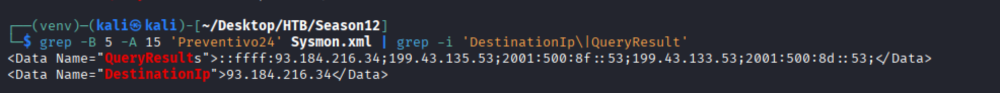

> 93.184.216.34
## Task 8
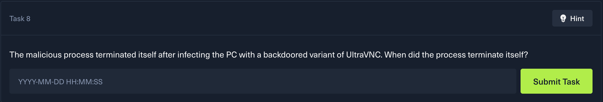

Chạy lệnh tìm Event ID 5 (Process Terminated) của `Preventivo24.02.14.exe.exe`:
```bash
grep -A 20 'EventID Qualifiers="">5<' Sysmon.xml | head -40
```

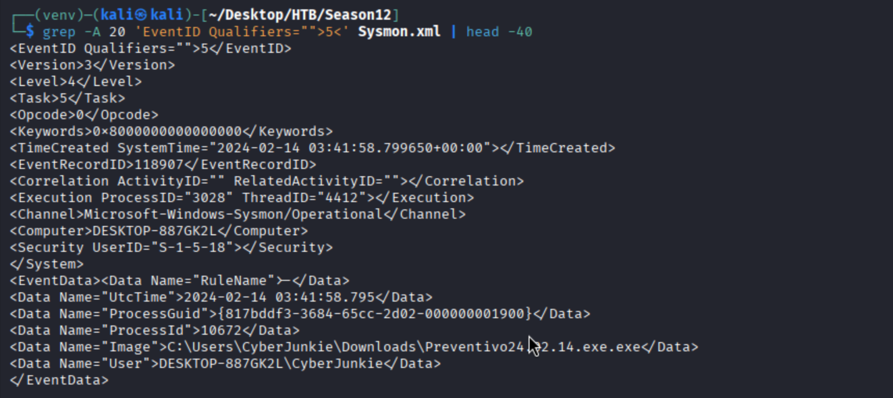

Chúng ta sẽ thấy
- **Process**: `Preventivo24.02.14.exe.exe`
- **UtcTime**: **2024-02-14 03:41:58.795**

> 2024-02-14 03:41:58
