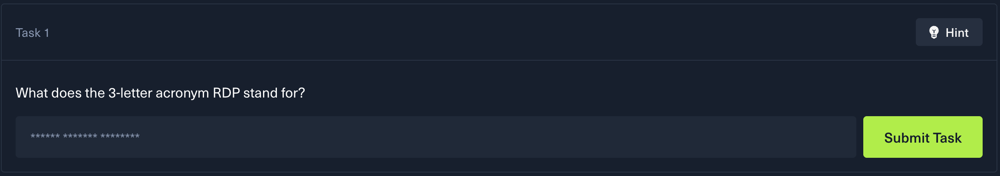
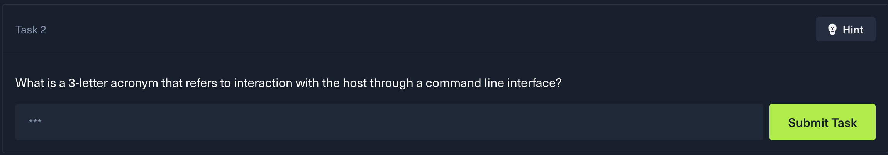
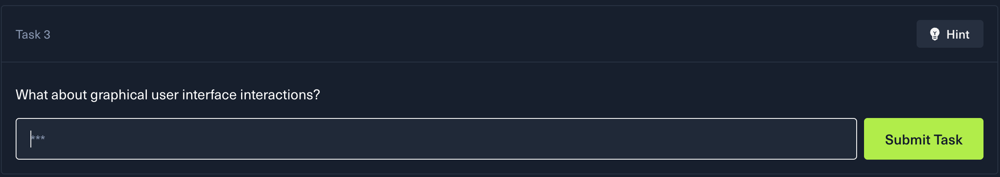
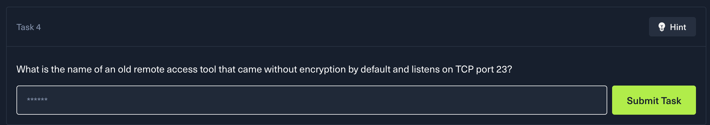
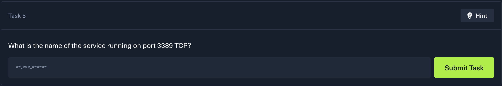
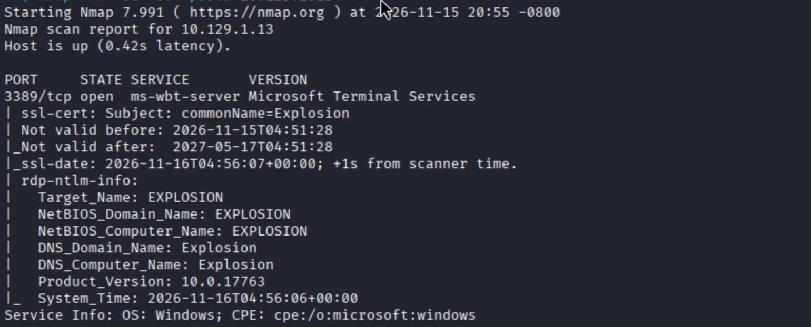
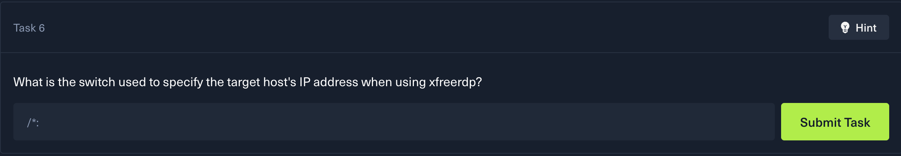
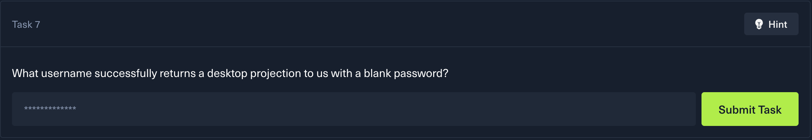
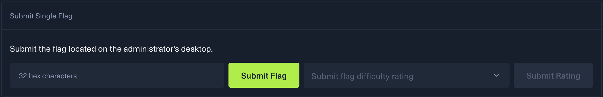
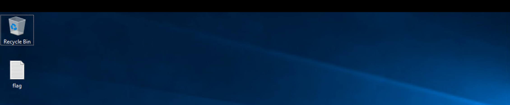

## Task 1

> Remote Desktop Protocol

## Task 2

> cli

## Task 3

>GUI

## Task 4

> telnet

## Task 5

Thực hiện quét dịch vụ
```bash
nmap -Pn -sC -sV -p3389 10.129.1.13
```

>ms-wbt-server

## Task 6

Không biết tham số thì --help
```bash
xfreerdp3 --help
```
> /v:

## Task 7

Thử ngay với administrator
```bash
xfreerdp3 /u:Administrator /p:"" /v:10.129.1.13 /f
```
## Flag

Sau khi RDP thành công sẽ tìm được flag ngay trên desktop

