## Task 1
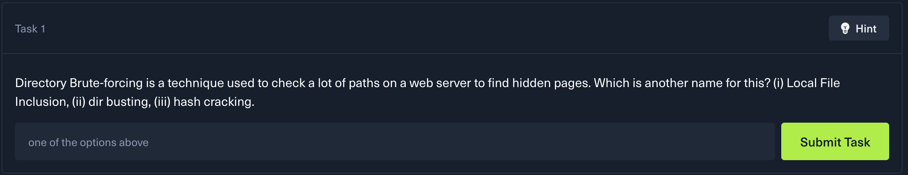
>dir busting

## Task 2
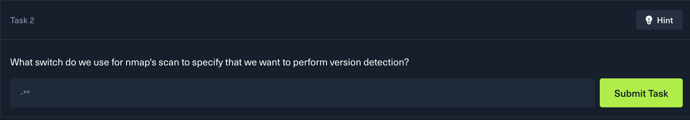
> -sV

## Task 3
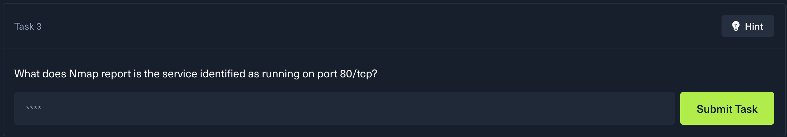

Với yêu cầu này cần thực hiện rà quét
```bash
nmap -Pn -sV -p80 10.129.62.8
```
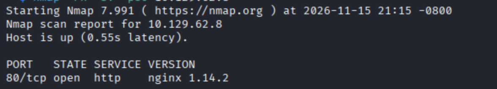
## Task 4
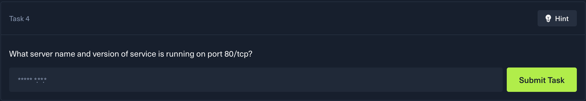
>nginx 1.14.2

## Task 5
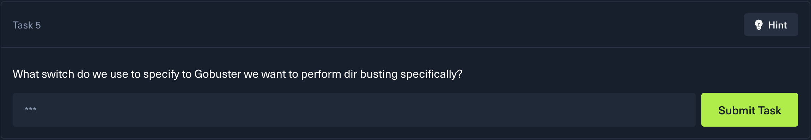
> dir

## Task 6
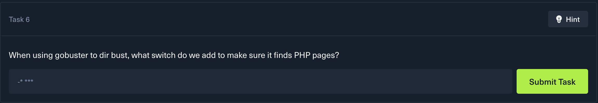
> -x php

## Task 7
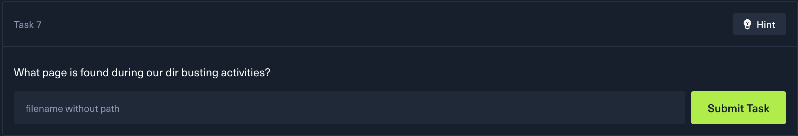

Thực hiện gobuster để quét
```bash
gobuster dir -u http://10.129.62.8 -w /usr/share/wordlists/dirbuster/directory-list-lowercase-2.3-medium.txt -x php
```
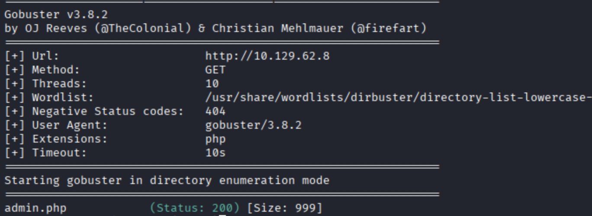
> admin.php

## Flag 8
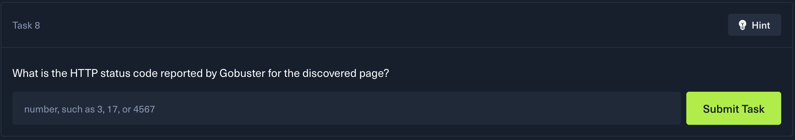
> 200
## Flag
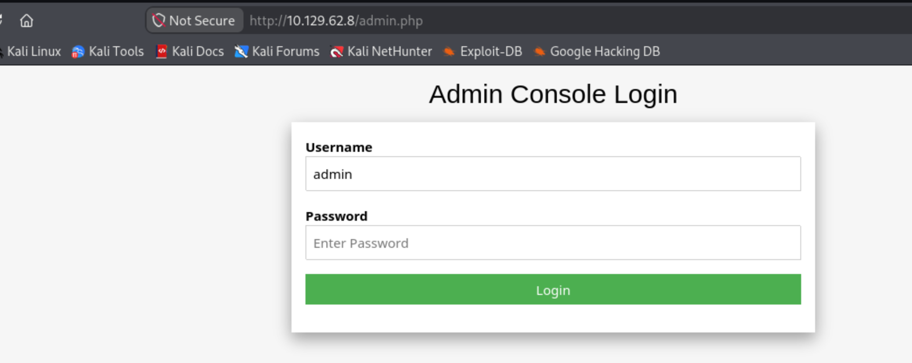
Thử vận may với account admin/admin thì lấy được flag luôn 