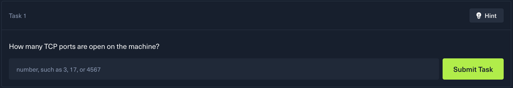
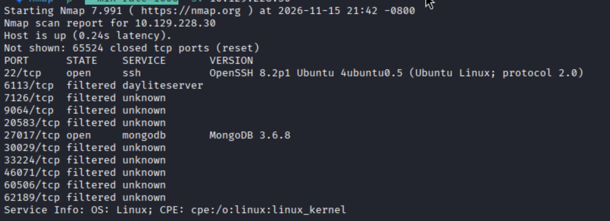
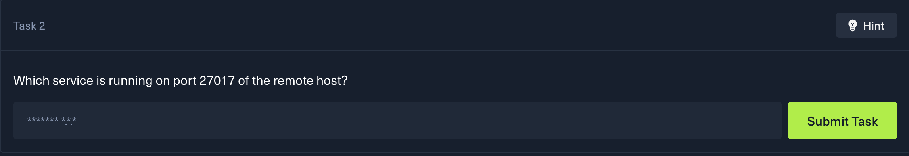
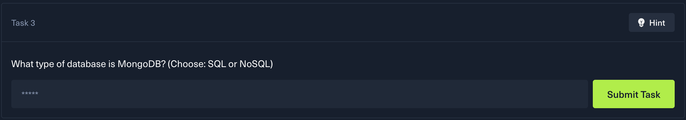
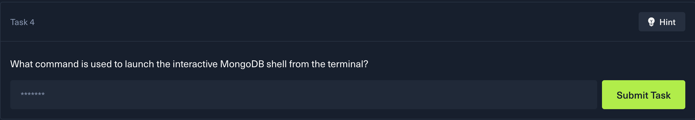
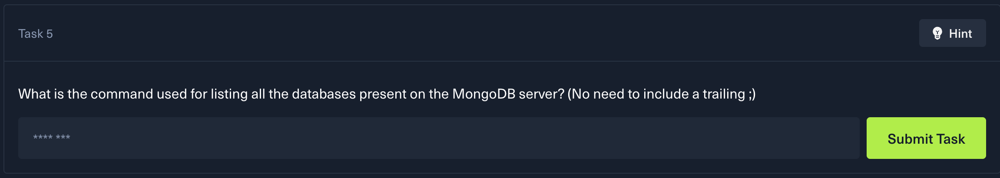
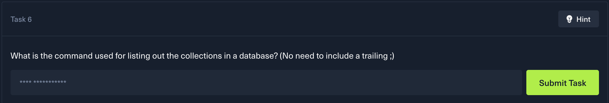
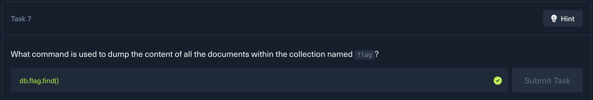

## Task 1


Thực hiện rà quét bằng Syn scan
```bash
nmap -Pn --min-rate=1000 -sV 10.129.228.30
```

> 2
## Task 2

> mongodb 3.6.8
## Task 3

> NoSQL
## Task 4

Để tương tác với mongoDB chúng ta cần cài công cụ từ mongoDB trên Debian
https://www.mongodb.com/docs/mongodb-shell/install/?operating-system=linux&linux-distribution=debian&debian-version=debian11

> mongosh

Tuy nhiên tương tác bị lệch version nên phải dùng sang python
```python
pip install 'pymongo==3.12.3' --break-system-packages 

python3 -c " from pymongo import MongoClient 
c = MongoClient('10.129.228.30', 27017, serverSelectionTimeoutMS=5000) print(c.server_info()) 
print(c.list_database_names()) "
```
## Task 5


>show dbs
## Task 6


> show collections

## Task 7

## Flag
Từ task 7 chúng ta sẽ có được flag

