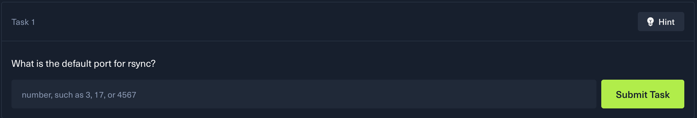
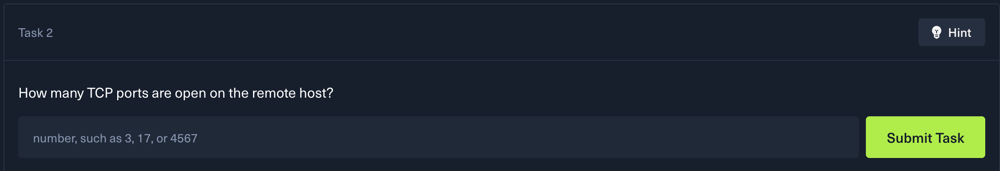
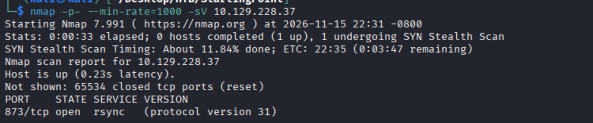
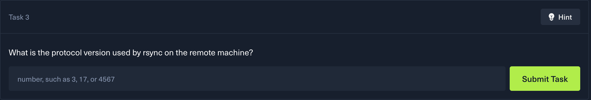
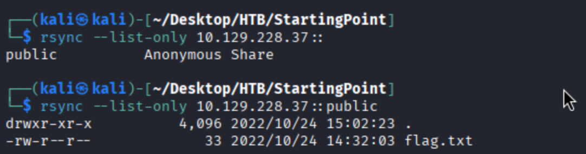

## Task 1

> 873
## Task 2

Thực hiện scan
```bash
nmap -p- --min-rate=1000 -sV 10.129.228.37
```

> 1
## Task 3

> 31
## Task 4

> rsync
## Task 5


> None
## Task 6


> --list-only
## Flag
Trong quá trình enum chúng ta thu được


Tiến hành đọc flag
```bash
rsync 10.129.228.37::public/flag.txt flag.txt
```