## Task 1
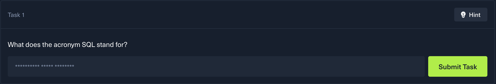
> Structured Query Language
## Task 2
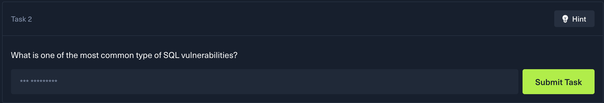
> SQL Injection
## Task 3
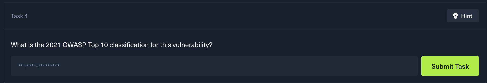
> A03:2021-Injection
## Task 4
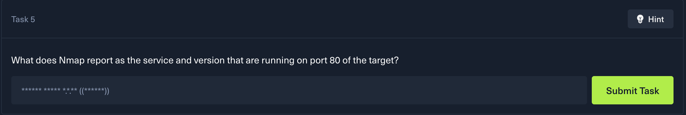
Thực hiện scan bằng nmap
```bash
nmap -p80 --min-rate=1000 -sV 10.129.62.36
```
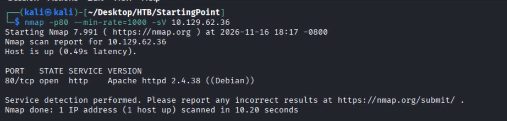
> Apache httpd 2.4.38 ((Debian))
## Task 5
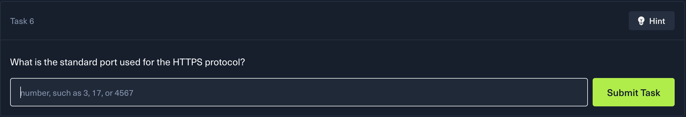
> 443
## Task 6
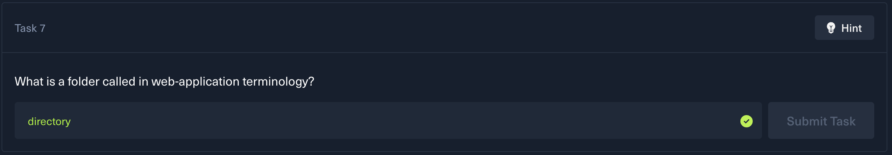
> directory
## Task 7
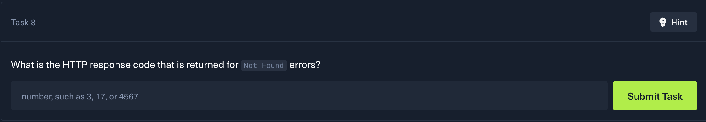
> 404
## Task 8
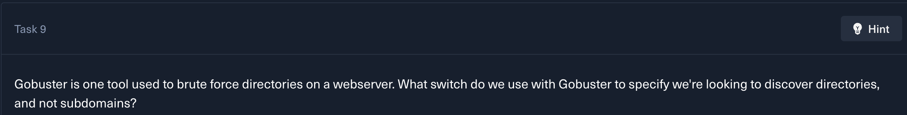
> dir
## Task 9
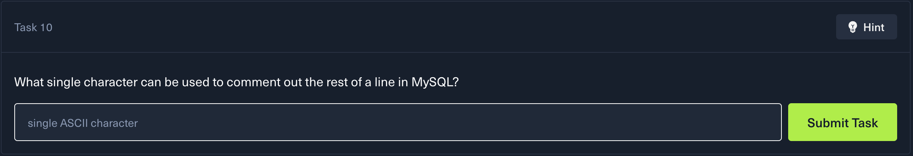
> #
## Task 10
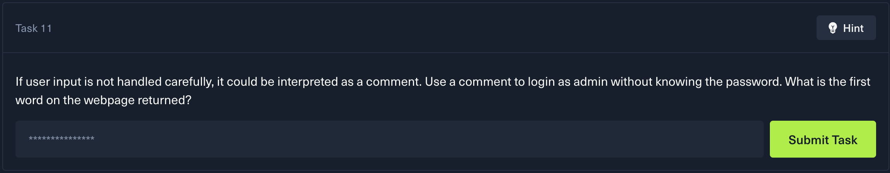

Ban đầu khi truy cập vào địa chỉ thì chúng ta có được một trang login
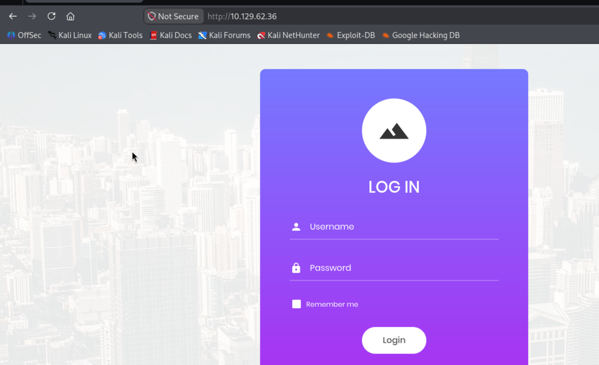
Theo như gợi ý thì chúng ta thử comment out password xem sao
```
admin'-- -
```
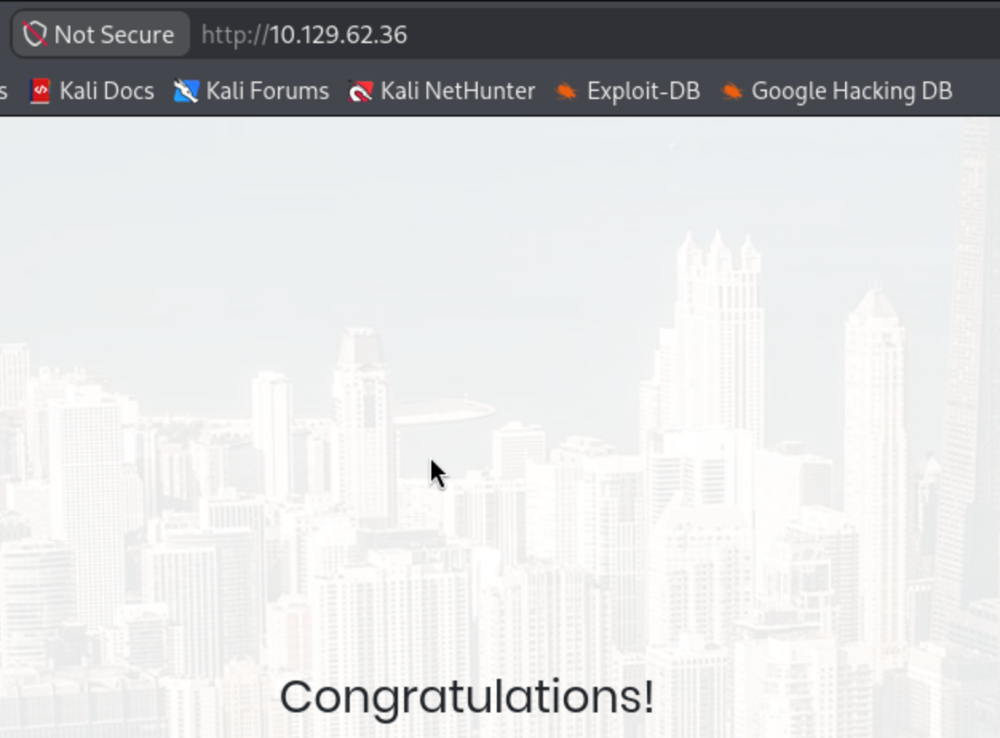
> Congratulations
## Flag
Tại trang sau khi login thành công thì có luôn flag

