## Task 1
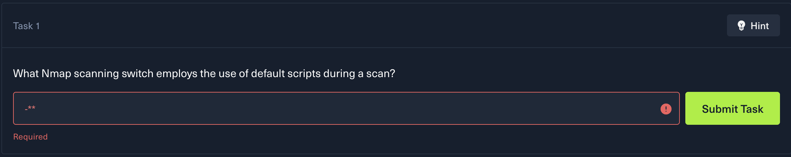

> -sC
## Task 2
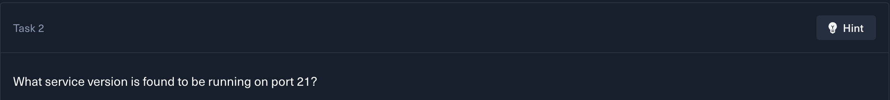

Thực hiện rà quét với nmap
```bash
sudo nmap --top-ports=100 -T4 -sV -sC -Pn 10.129.62.37
```
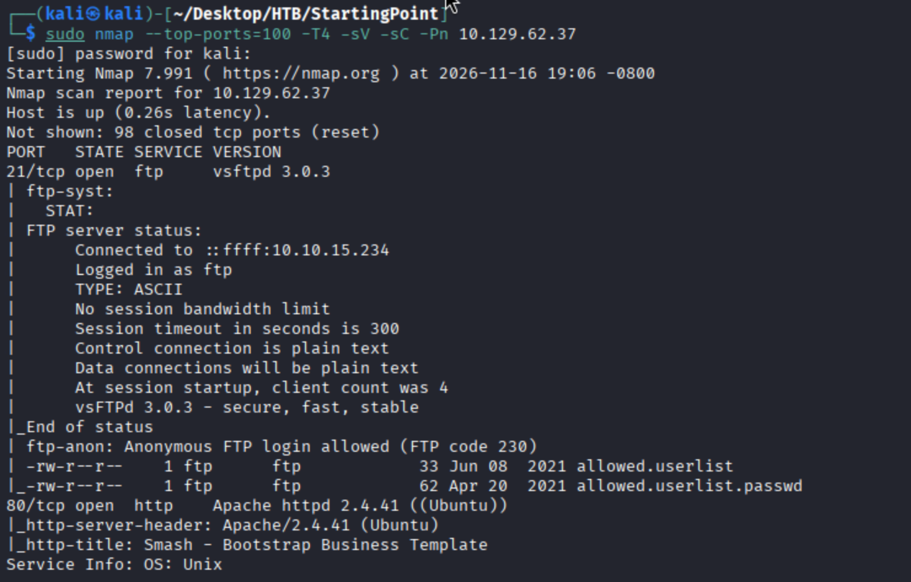

> vsftpd 3.0.3
## Task 3
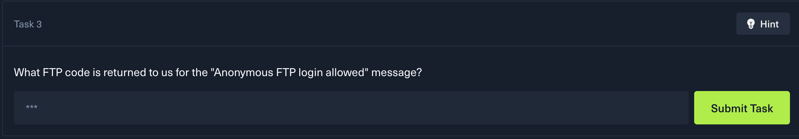

> 230
## Task 4

> anonymous
## Task 5
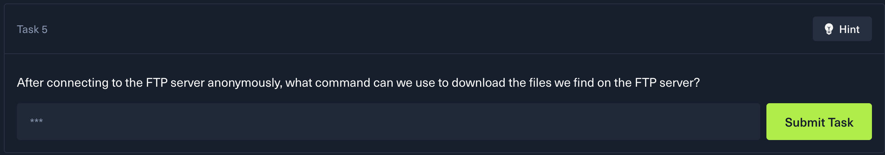
> get
## Task 6
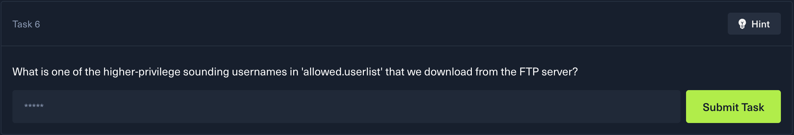
Sau khi login vào ftp thì chúng ta list các thư mục đang có
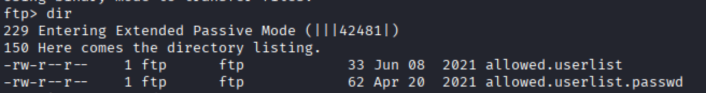

Thực hiện get toàn bộ file
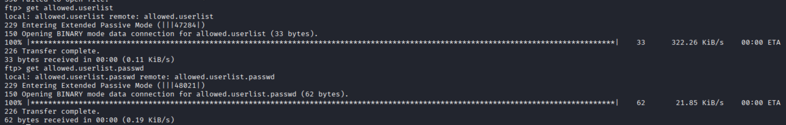

Đọc nội dung để tìm kết quả
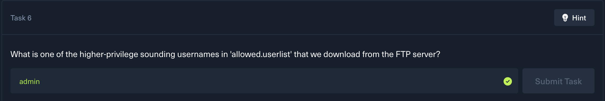

> admin
## Task 7
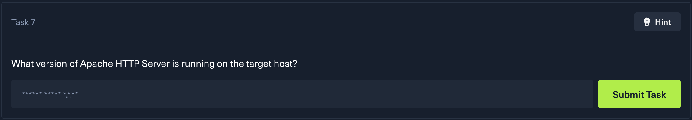

> Apache httpd 2.4.41
## Task 8
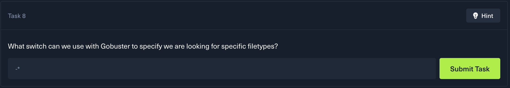

> -x
## Task 9


Chúng ta tiến hành tìm directory với gobuster
```bash
gobuster dir -u http://10.129.62.37 -w /usr/share/wordlists/dirbuster/directory-list-lowercase-2.3-medium.txt -x php
```

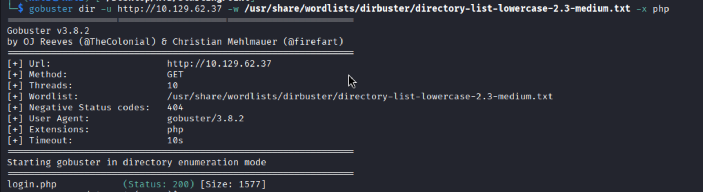

> login.php
## Flag
Chúng ta đã có được username nhưng còn 1 file mà chúng ta chưa thử mở ra
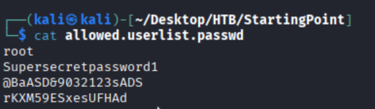

Có vẻ là file lưu trữ mật khẩu thử với credential
```
admin / rKXM59ESxesUFHAd
```
Đăng nhập thành công và chúng ta có được flag
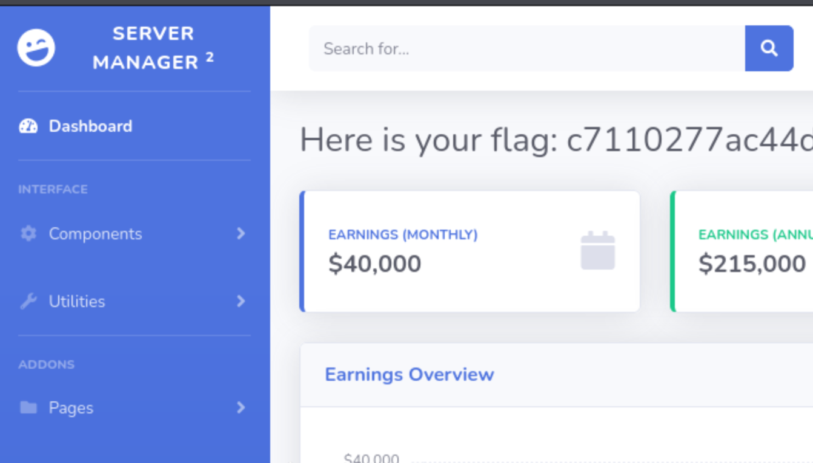
