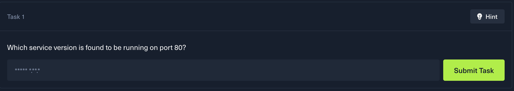
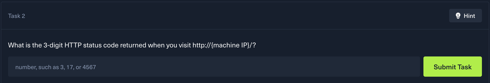
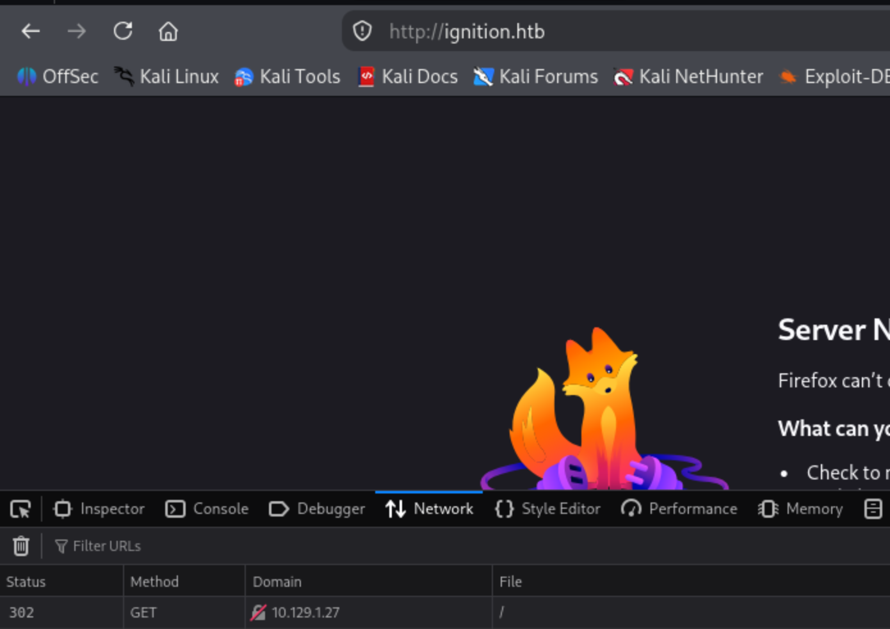
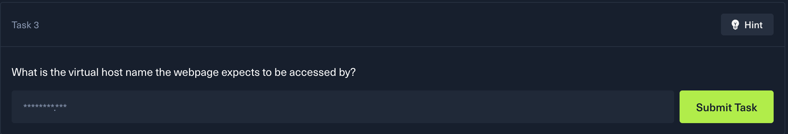
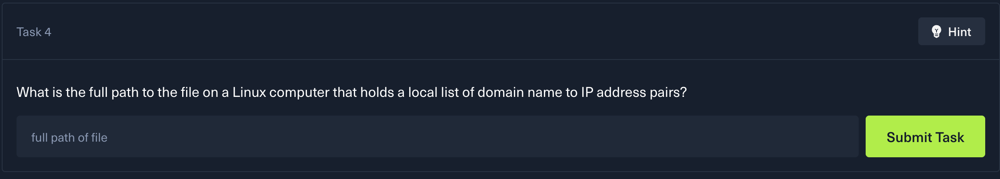
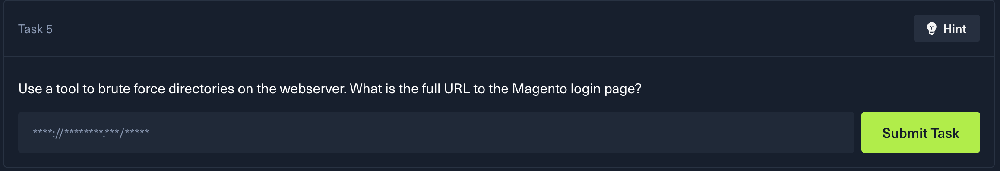
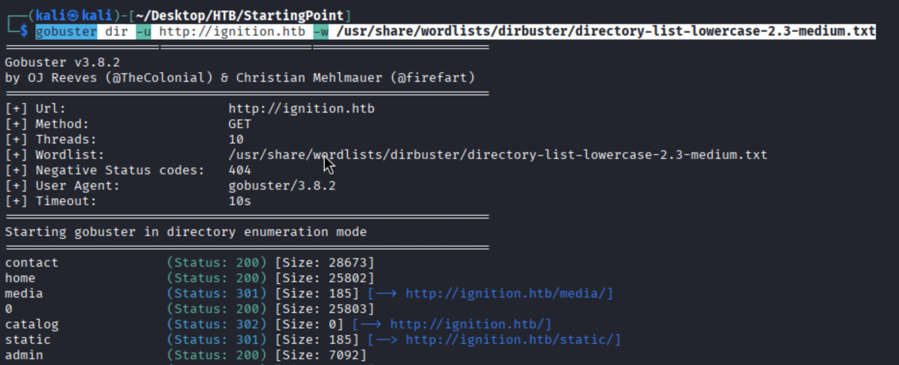
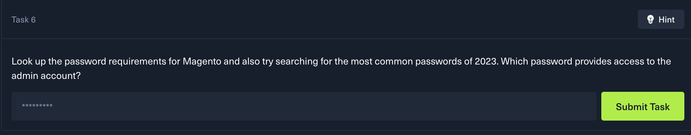
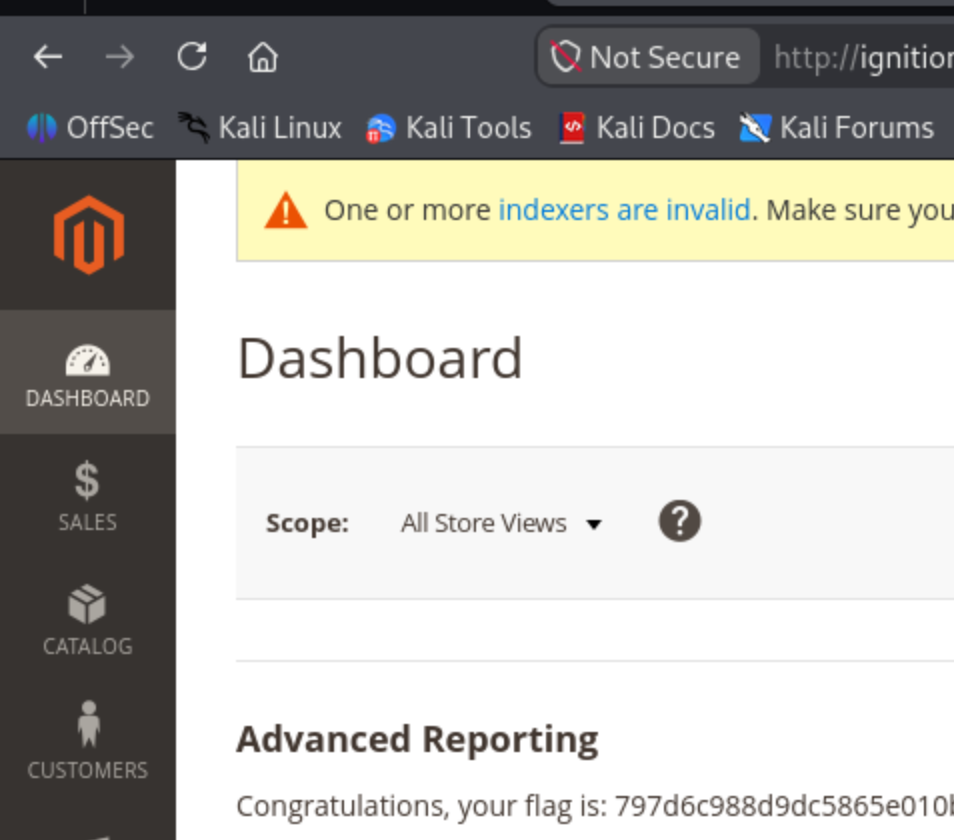

## Task 1


> nginx 1.14.2
## Task 2


Chúng ta khi truy cập bằng IP sẽ được chuyển sang domain


> 302
## Task 3


> ignition.htb
## Task 4


> /etc/hosts
## Task 5


Sử dụng câu lệnh
```bash
gobuster dir -u http://ignition.htb -w /usr/share/wordlists/dirbuster/directory-list-lowercase-2.3-medium.txt
```
Chúng ta tìm được 1 đường dẫn đáng ngờ


> http://ignition.htb/admin
## Task 6


Chúng ta tìm được trang này https://community.spiceworks.com/t/most-common-passwords-of-2023-the-top-10/963430

Thử các password thì có một cái thành công
```
admin / qwerty123
```
## Flag
Login thành công sẽ có flag

